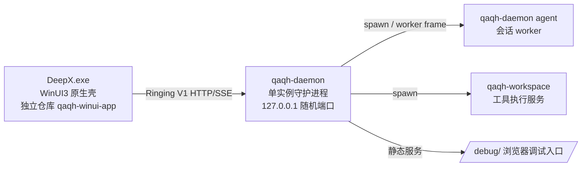

# QAQ-Harness

QAQ-Harness 是一款本地优先的 AI Agent 应用。**本仓库是跨平台 Rust 后端 monorepo**：daemon + agent loop + Ringing V1 协议 + 公共客户端 SDK + 工具执行。Windows 桌面层（WinUI3 原生壳、安装器、更新器）已拆分为独立仓库 **[qaqh-winui-app](../qaqh-winui-app)**。

当前版本：**1.0.0-rc.6**

> **QAQ-Harness 1.0 是 QAQ-Harness-Ring 版本。**它以统一的 Ringing V1 协议与架构作为桌面端、daemon 与 worker 的正式通信基础。

> 项目仍处于 beta 阶段。API、协议和持久化格式将在若干 rc 版本验证后，随 QAQ-Harness-Ring `1.0.0` 正式版进入稳定兼容周期。

## 核心能力

- 流式模型对话、token 用量与缓存命中统计
- Ringing V1 原生控制协议：会话快照、命令确认、批量事件与 SSE 增量同步
- Ringing V1 Timeline：按会话严格排序、可持久化回放的思考、聊天与工具时间线
- Markdown 增量渲染与分段封口，避免流式半截标记造成的吞字与显示错位
- 文件、Shell、Git、Plan、Todo 和网页访问等工具
- 会话持久化、工作区管理、Skills 和子 Agent
- 多前端支持：WinUI3 桌面壳位于独立仓库 [qaqh-winui-app](../qaqh-winui-app)，TUI 等其余前端直接消费本仓库的 `qaqh-client` SDK
- 独立 Rust daemon（单实例、127.0.0.1 随机端口、discovery 文件协商）
- daemon 内置 `/debug/` 静态服务：浏览器即可打开与桌面端相同的前端调试入口
- 前端、后端和完整组件的独立打包与更新
- 统一 updater，负责修改、升级、回滚和安全卸载
- 本地优先配置、日志与审计数据

QAQ-Harness 可连接 DeepSeek、OpenAI 及其他兼容模型服务。API Key 由用户自行配置，仅用于向所选模型服务鉴权。

## 架构



- **多前端直连**：WinUI3 壳（`qaqh-winui-app` 仓库的 `bridge.rs`）用 `qaqh-client`（Ringing V1 HTTP/SSE 客户端）直连 daemon；事件经三频道 SSE 解析为原生视图状态。WebView、`deepx-bridge.js` 与 SolidJS renderer 已整体移除。
- **daemon 单实例**：`daemon.lock` 持有 pid 判活 + `daemon.json` discovery（endpoint/token/pid）延迟到 HTTP 就绪后发布；客户端以 pid 存活为准避免直连死端口。
- **协议**：Ringing V1（`/ringing/v1/*`，HTTP 命令/查询 + SSE 事件流 + lease 续期）。旧 legacy WebSocket 控制协议已拆除。

## 项目结构

```text
QAQ-Harness/
├── crates/                # Rust 后端 workspace（18 crates）
│   ├── qaqh-daemon       #   守护进程：HTTP/SSE 服务、discovery、debug 静态服务
│   ├── qaqh-runtime      #   无 GUI 依赖的应用运行时（服务、workspace 监管、重建）
│   ├── qaqh-msglp        #   Agent 消息循环（worker 侧）
│   ├── qaqh-gate         #   模型访问与流式响应（含 gate-testui 调试页）
│   ├── qaqh-ringing      #   Ringing 线上协议（envelope/ack/batch/snapshot/worker frame）
│   ├── qaqh-domain       #   Ringing 领域层（DomainCommand/DomainEvent）
│   ├── qaqh-client       #   Ringing V1 公共客户端 SDK（WinUI/TUI/Tauri/Web 共用）
│   ├── qaqh-message      #   消息存储与状态机生命周期
│   ├── qaqh-session      #   会话管理（单例、列表/加载/保存/活动）
│   ├── qaqh-workspace    #   工具执行（库 + 独立二进制）
│   ├── qaqh-skills       #   Skills 发现与生命周期
│   ├── qaqh-subagent     #   子 Agent
│   ├── qaqh-config       #   配置：provider 注册表、prompts、config load/save
│   ├── qaqh-update       #   更新目录、规划、状态与来源引擎
│   ├── qaqh-proto        #   共享数据模型与 daemon discovery
│   ├── qaqh-types        #   共享类型定义
│   ├── qaqh-lsp          #   LSP client 运行时（语义查询复用现有 language server）
│   └── qaqh-gate-testui  #   Gate 交互式调试 Web UI
├── dsh-minimal-mode/      # 极简模式工具（bash_v2 + str_replace_editor）
├── skills/                # 项目级 Agent Skills
├── docs/                  # 文档（archive/ 历史归档 + nextdev/ 现行文档，含 legal/）
├── scripts/               # 版本同步等脚本
├── justfile               # 统一构建入口
├── version.txt            # 后端单一版本号源
└── Cargo.toml             # Rust workspace
```

Windows 桌面层（WinUI3 壳 / 安装器 / 更新器）见独立仓库 **`../qaqh-winui-app`**。

## 开发环境

- Rust stable（后端 core 跨平台：Windows / Linux / macOS）
- [just](https://github.com/casey/just)

本仓库的后端核心可在 Linux/macOS 上编译与测试。Windows 桌面壳与打包在 [qaqh-winui-app](../qaqh-winui-app) 仓库进行。

## 快速开始

```powershell
git clone https://github.com/QAQTam/QAQ-Harness.git
cd QAQ-Harness

# 编译后端 daemon 与 workspace
just build-daemon

# 启动 daemon（开发模式）
just dev
```

运行 WinUI3 壳（开发模式）在桌面层仓库进行：

```powershell
cd ../qaqh-winui-app
just build-winui
```

壳启动时自动拉起 daemon（`launch_daemon_if_missing`）。

## 构建与测试

| 命令 | 说明 |
|---|---|
| `just build-daemon` | 构建 Rust daemon + workspace（release） |
| `just check` | Rust workspace 静态检查 |
| `just test` | Rust 测试 |
| `just fmt` | Rust 格式检查 |
| `just clippy` | Rust Clippy |
| `just status` | 查看构建产物 |
| `just clean` | 清理生成文件 |

桌面壳 / 安装器 / 更新器的构建与打包命令在 [qaqh-winui-app](../qaqh-winui-app) 的 justfile 中。

## Beta.8 协议说明

Beta.8 起，桌面端（WinUI3 壳）通过 `qaqh-client` 以 Ringing V1 与 daemon 通信：

- 每个会话的事件使用严格递增 cursor；重连后可从 cursor 恢复，不依赖前端临时缓冲。
- 思考链、聊天正文和工具生命周期保留同一条时间线中的精确先后关系。
- Markdown 内容随 text delta 增量进入渲染器；区块封口只标记其完成状态，不再阻断流式展示。
- legacy WebSocket 控制协议已拆除（M3）；daemon 仅提供 `/control/v1/stop` 生命周期端点与 `/ringing/v1/*`、`/debug/*` 分流。
- daemon 以单实例运行：`daemon.lock` pid 判活、`daemon.json` discovery 延迟发布；客户端以 pid 存活为准，避免直连残留 discovery 的死端口。
- 壳首屏并发请求由壳侧连接互斥（`bridge.rs`）收敛为单次 daemon 拉起，避免冷启动多实例并存。

## 版本管理

`version.txt` 是 QAQ-Harness 发布版本的单一来源：

```powershell
just sync-version
```

该命令会同步 Rust workspace、根 `qaqh-backend.lock.json`（含 Release manifest URL）与根 `package.json`。桌面层仓库的 `version.txt` / `Cargo.toml` / `package.json` 由 `../qaqh-winui-app` 的 `just sync-version` 同步；两边版本必须保持一致（sidecar 打包时 `prepare-daemon.ps1` 会校验）。

协议文档使用独立版本号，位于 `docs/nextdev/legal/version.txt`。安装器会将用户同意状态、文档版本和文档哈希写入本地 `legal-consent.json`，供后续协议更新提示复用。

## 安装与更新

完整安装包由 winui 壳运行目录和 QAQ-Harness 原生安装器组装（无 Electron/NSIS 链路）。相关组件与打包脚本全部位于 [qaqh-winui-app](../qaqh-winui-app)：

```powershell
cd ../qaqh-winui-app
just winui-package   # 生成完整 Windows 安装包
```

`qaqh-updater.exe` 是唯一的维护入口（同仓库），统一负责前端、后端或完整组件更新、暂存/应用/回滚、Windows“修改”入口与安全卸载。独立 `uninstall.exe` 已移除。

## 开发工具

- **CodeGraph**：仓库已建立符号索引（`.codegraph/`）。安装 CLI 后可直接使用：

  ```powershell
  codegraph status    # 索引状态与统计
  codegraph query <symbol>   # 符号搜索
  codegraph explore <area>   # 探索区域：相关符号源码 + 调用路径
  codegraph files     # 项目文件结构
  ```

- **`/debug/` 调试页**：daemon 内置静态服务入口（端口见 `%USERPROFILE%\.deepx\daemon.json`）。SolidJS renderer 移除后该入口不再承载前端产物；保留用于服务任意静态调试目录。

## 数据与隐私

QAQ-Harness 默认将配置、会话、日志和工具审计保存在当前用户的本地数据目录（Windows：`%USERPROFILE%\.deepx`）。模型请求、搜索、网页访问和在线更新仅在用户触发相关功能时访问对应第三方服务。

发布前请阅读：

- [DeepX 用户协议](docs/nextdev/legal/USER_AGREEMENT.zh-CN.md)
- [DeepX 隐私政策](docs/nextdev/legal/PRIVACY_POLICY.zh-CN.md)

## License

QAQ-Harness 依据 [MIT License](LICENSE) 开源。第三方组件分别适用其各自许可证。
