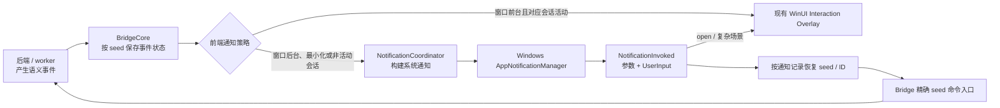

# DeepX WinUI Windows 交互式通知：可行性报告与实现方案

> 结论日期：2026-08-11  
> 适用范围：当前 `F:\DeepX` 项目、WinUI 3 前端（`apps/winui`）、Rust 事件与命令链路

## 1. 结论摘要

当前项目可以实现 Windows 系统通知，并通过通知中的按钮、文本框或下拉框完成一部分交互。推荐由**后端/worker 产生语义事件，WinUI 前端决定何时显示系统通知并负责处理通知激活**，而不是由后端直接调用 Windows 通知 API。

三类需求的结论如下：

| 需求 | 是否可实现 | 推荐交互 | 主要限制 |
| --- | --- | --- | --- |
| 工具授权弹窗 | 可以 | 低/中风险可在通知中批准或拒绝；高风险只允许“查看详情/拒绝”，批准回到应用内 | Windows 通知无法安全、完整地展示复杂风险信息；“信任文件夹”不应放入通知 |
| 消息回复弹窗 | 可以完整实现 | 通知文本框 +“发送”按钮 | 必须把回复路由到通知所属的会话，而不是当前活动会话 |
| AskUser 弹窗 | 条件可实现 | 简单单题用按钮、下拉框或文本框；复杂/批量问题打开应用内现有交互层 | 系统通知不是通用表单，无法可靠承载批量问题、富文本和混合输入 |

目标 API 选用 Windows App SDK 的 `Microsoft.Windows.AppNotifications.AppNotificationManager`。现有基于 `Windows.UI.Notifications`、手写 COM 回调和 PowerShell AUMID 的 worker 侧原型不应继续扩展。

目前存在一个必须先验证的部署前置条件：项目使用自包含 Windows App SDK，但当前 reactor setup 只解包 Framework MSIX，没有部署/注册 App Notifications 所依赖的 Singleton 包。正式开发前应完成一项 P0 干净机器实验；若继续自包含部署，安装器需要按微软规则部署对应架构的 Windows App Runtime Framework/Singleton 等受信任 MSIX，或者调整为带包/框架依赖部署。

## 2. “授权弹窗”的两种含义

这里必须区分两类授权：

1. **DeepX 工具调用授权**：例如是否允许读写文件、运行命令或访问网络。它是项目自己的业务交互，可以通过通知按钮处理，但需按风险分级。
2. **Windows 通知权限**：Windows App SDK 没有类似浏览器 `Notification.requestPermission()` 的运行时授权弹窗。应用只能读取通知设置状态，并在关闭时解释原因、引导用户打开 Windows“通知”设置。

因此，DeepX 应提供自己的通知说明对话框和设置页，但不能承诺弹出一个由 Windows 提供的“允许通知吗”权限请求框。

## 3. 当前项目审计结果

### 3.1 已有通知原型

当前 worker 侧存在原型实现：

- [`crates/deepx-msglp/src/services/notification.rs`](crates/deepx-msglp/src/services/notification.rs) 定义了普通通知和带输入的通知，XML 中已经包含 `reply` 文本框。
- [`crates/deepx-msglp/src/services/toast_com.rs`](crates/deepx-msglp/src/services/toast_com.rs) 手工注册 `INotificationActivationCallback`，尝试从通知回调中提取回复。
- 实际运行路径目前只发送普通 `Toast`，`ToastWithInput` 没有形成端到端业务链路。
- 通知受 `DEEPX_NATIVE_NOTIFICATIONS=1` 环境变量控制。
- 代码设置的是 DeepX 进程 AUMID，却以 PowerShell AUMID 发送通知，标识和激活回调不一致。
- 多 worker 场景可能重复注册、重复通知；回调也没有可靠地路由到原始会话。

这套代码可作为早期验证材料，但不适合作为新功能基础。建议新链路稳定后将其移除。

### 3.2 业务事件和响应命令已经具备

领域层已经有实现三类交互所需的语义事件和命令：

- 工具授权请求：`ToolPermissionRequested`，包含 `tool_call_id`、`turn_id`、工具名称、原因、路径、类别、级别、风险和后果。
- AskUser 请求：`ControlEvent::InteractionRequested`，包含 `interaction_id`、`turn_id`、单题/批量模式以及问题列表。
- 工具授权响应：`ToolCommand::ToolPermissionRespond { tool_call_id, approved, trust_folder }`。
- AskUser 响应/关闭：`ControlCommand::InteractionAskRespond` 和 `InteractionAskDismiss`。
- 普通回复：`ConversationCommand::ConversationSendMessage`。

这意味着无需重新设计后端协议。通知只是这些既有事件的第二种前端呈现方式。

### 3.3 WinUI 已有完整应用内交互层

[`apps/winui/src/interaction_overlay.rs`](apps/winui/src/interaction_overlay.rs) 已支持：

- 工具授权以及高风险说明；
- “信任文件夹”选项；
- AskUser 单题/批量、选项和自定义文本；
- 计划确认。

因此复杂场景不应在系统通知中重做一套表单，而应让通知负责提醒和快速操作，必要时唤回这一现有交互层。

[`apps/winui/src/bridge.rs`](apps/winui/src/bridge.rs) 的 `spawn_interaction_response` 已能将业务响应映射到对应命令，也已经从所有会话的事件批次中维护交互状态。但当前部分 UI 回调取的是 `active_seed()`；通知激活时必须使用事件原本携带的 `seed`。应用内 overlay 也建议一起改成使用 `InteractionState.seed`，避免用户切换会话后误答到另一个会话。

## 4. 技术选型

### 4.1 推荐：Windows App SDK App Notifications

使用命名空间：

```text
Microsoft.Windows.AppNotifications
Microsoft.Windows.AppNotifications.Builder
```

它是 WinUI 3 / Windows App SDK 应用的当前通知 API，支持通知激活、文本输入、按钮、下拉选择、Tag/Group 管理及历史通知移除。

不建议继续以旧的 `Windows.UI.Notifications` 为主线。微软仍为旧 API 提供兼容性，但面向新的 Windows App SDK 应用，App Notifications 才是应采用的接口。

### 4.2 Rust 绑定现状

当前 `apps/winui/Cargo.toml` 使用项目自定义的 windows-rs 0.100，已启用的是 Win32 功能；`Microsoft.Windows.*` 不属于系统 `Windows.*` 元数据，不能只靠增加一个 Cargo feature 得到 App Notifications 绑定。

当前 Windows App SDK 2.3.1 NuGet 缓存中已经存在：

```text
Microsoft.Windows.AppNotifications.winmd
Microsoft.Windows.AppNotifications.Builder.winmd
```

建议二选一：

1. 在项目内新增一个很薄的 `deepx-app-notifications` crate，从上述 WinMD 生成绑定，并与当前 `windows-core` 版本保持一致；
2. 将绑定能力补入 `deepx-winui-reactor`，由 reactor 提供可复用包装。

第一种更容易在本仓库内推进和测试；验证成熟后再上移 reactor。

### 4.3 自包含部署的 P0 阻塞项

当前 [`apps/winui/build.rs`](apps/winui/build.rs) 调用 `windows_reactor_setup::as_self_contained()`。外部 `deepx-winui-reactor` setup 固定 Windows App SDK Runtime 2.3.1，并只从 `Microsoft.WindowsAppRuntime.2.msix` 解包文件到应用目录。

App Notifications 在自包含部署中还依赖 Windows App Runtime Singleton 包。NuGet 中虽有 `Singleton.2.msix`、`Main.2.msix`、`DDLM.2.msix`，当前构建流程没有安装或注册它们。只把 DLL 放在 exe 旁边不能证明 App Notifications 能在未安装 Windows App Runtime 的机器上工作。

P0 实验必须覆盖一台没有预装目标 Windows App Runtime 的干净 Windows 10/11 VM：

1. 安装当前构建产物；
2. 调用 `AppNotificationManager::IsSupported()`；
3. 注册通知、发送通知并验证按钮/输入激活；
4. 验证冷启动和注销后再登录；
5. 确认卸载后 MSIX 注册和文件清理正确。

若 `IsSupported()` 为 false 或激活失败，安装器应按微软自包含部署指南安装对应架构、对应版本的受信任 Runtime MSIX（至少核对 Framework 与 Singleton，最终以官方 runtime installer 的适用包集合为准），或改用带包/框架依赖部署。运行时仍应保留 `IsSupported()` 检测和功能降级。

## 5. 总体架构



职责边界：

- 后端只产生 `ToolPermissionRequested`、`InteractionRequested`、任务完成等语义事件，不调用 Windows API。
- `NotificationCoordinator` 订阅所有 seed 的事件，决定是否通知、生成内容、去重和过期处理。
- 平台层只封装 App Notifications API 和生命周期。
- Bridge 提供“向指定 seed 发送命令”的公开入口；通知处理器严禁依赖 `active_seed()`。
- 现有 Interaction Overlay 是复杂交互的唯一完整表单。

## 6. 需要调用的 Windows API

### 6.1 初始化和生命周期

核心调用：

```text
AppNotificationManager::IsSupported()
AppNotificationManager::Default()
AppNotificationManager::NotificationInvoked(...)
AppNotificationManager::Register()
AppNotificationManager::Unregister()
```

未打包桌面应用也可由 `Register()` 完成通知激活所需的注册，不需要继续手写 AUMID/COM 注册。正确顺序是：

1. 先注册 `NotificationInvoked` 事件处理器；
2. 再调用 `Register()`；
3. 然后读取启动激活参数并决定是否创建/激活主窗口。

App SDK 对桌面应用会启动应用进程；通知中的“后台激活”标记不会让桌面应用获得真正的后台任务模型。应用可以在进程启动后静默执行批准、拒绝或回复，完成后退出；只有 `open` 动作才激活窗口。

当前 windows-reactor 的常规 `App::run` 会在 `OnLaunched` 中直接创建并激活窗口。为避免用户点“发送”却看到窗口闪现，需要：

- 给 reactor 增加“创建窗口前检查启动激活”的钩子；或
- WinUI 应用改用 reactor 的自定义启动入口，通知快速动作处理完后不调用 `host.activate()`，而 `open` 动作才创建/显示窗口。

### 6.2 构建和显示通知

优先使用 builder：

```text
AppNotificationBuilder::new()
AddArgument(key, value)
AddText(...)
AddTextBox(id, ...)
AddComboBox(comboBox)
AddButton(button)
SetTag(tag)
SetGroup(group)
BuildNotification()
AppNotificationManager::Show(notification)
```

如 Rust 绑定对 builder 覆盖不足，也可以生成 Toast XML 后用 `AppNotification(payload)` 构造通知。通知按钮最多 5 个（包含上下文菜单项），因此按钮不是复杂 AskUser 的通用答案。

通知完成、撤销或过期时使用 Tag/Group 管理历史记录：

```text
RemoveByTag(...)
RemoveByTagAndGroup(...)
RemoveByGroup(...)
RemoveAllAsync()
```

### 6.3 处理激活和输入

事件参数：

```text
AppNotificationActivatedEventArgs::Arguments()
AppNotificationActivatedEventArgs::UserInput()
```

`Arguments` 用于动作和关联标识；`UserInput` 是输入控件 ID 到字符串值的映射。例如回复通知读取 `UserInput["reply"]`，下拉式 AskUser 读取 `UserInput["answer"]`。

不要把文件路径、完整提示词或权限原因等敏感信息放入激活参数。通知参数只放不透明通知 ID 和动作；详细上下文保存在本地记录中。

### 6.4 通知设置状态和系统设置

读取：

```text
AppNotificationManager::Setting()
```

处理以下状态：

```text
Enabled
DisabledForApplication
DisabledForUser
DisabledByGroupPolicy
DisabledByManifest
Unsupported
```

被禁用时，在 DeepX 设置页显示明确状态，并通过 `Windows.System.Launcher::LaunchUriAsync` 打开 `ms-settings:notifications`。这只是引导用户修改系统设置，不是请求权限。

## 7. 三类交互的详细实现

### 7.1 工具授权通知

#### 可行性

按钮式批准/拒绝在技术上可行，但应增加风险策略，不能把所有权限请求都压缩成两个按钮。

#### 推荐策略

| 条件 | 系统通知内容 | 允许动作 |
| --- | --- | --- |
| 低风险、信息短且语义明确 | 工具、理由、简短影响 | `允许一次`、`拒绝`、`查看详情` |
| 中风险 | 显示风险和简短后果 | 可按最终安全策略决定是否提供 `允许一次`；始终提供 `拒绝/查看详情` |
| 高风险、写入/执行、长路径、多路径或信息被截断 | “需要授权”，只给必要摘要 | `查看详情`、`拒绝`，不得在通知中批准 |

无论风险级别，通知中都不提供 `trust_folder=true`。持久信任属于高影响决策，只能在应用内 overlay 展示完整范围后操作。

#### 事件到命令映射

输入事件：

```text
ToolPermissionRequested
```

快速批准/拒绝：

```text
ToolCommand::ToolPermissionRespond {
  tool_call_id,
  approved,
  trust_folder: false
}
```

必须发送到事件所属 `seed`。`open` 动作激活主窗口、选择对应会话，并显示现有权限 overlay。

#### 竞争和过期

- 请求被应用内处理后，立即按 Tag/Group 移除通知。
- 点击已过期通知时不得再次发命令，应静默移除并可显示“请求已失效”。
- 为每个通知动作生成稳定 `command_id`，避免 Windows 重复激活导致重复批准。

### 7.2 普通消息回复通知

#### 可行性

这是最适合系统通知的场景，可以完整实现。

#### 通知结构

```text
标题：DeepX · <会话名或任务摘要>
正文：最近一条需要回复的消息摘要
输入：TextBox(id="reply", placeholder="输入回复…")
按钮：发送（关联 input id="reply"）、打开
```

激活处理：

1. 从 `Arguments` 取得不透明通知 ID 和 `send/open` 动作；
2. 从 `UserInput["reply"]` 取得文本；
3. 从本地通知记录恢复准确 `seed`；
4. 校验非空、长度和通知是否过期；
5. 发送：

```text
ConversationCommand::ConversationSendMessage {
  text,
  images: [],
  attachments: None
}
```

6. 成功后移除通知；失败则保留/重建通知并让用户打开应用查看。

Bridge 需要新增显式 `send_message_to_seed(seed, text, command_id)` 或等价入口，不能复用默认发送到活动会话的 UI 方法。

### 7.3 AskUser 通知

#### 可行性分层

| AskUser 形态 | 通知内完成方式 | 结论 |
| --- | --- | --- |
| 单题，2–3 个短选项 | 每个选项一个按钮 | 推荐 |
| 单题，较多短选项 | `AppNotificationComboBox` +“提交” | 可实现 |
| 单题，允许自定义文本 | `TextBox` +“提交” | 可实现 |
| 批量问题 | “打开并回答” | 不在通知内完成 |
| Markdown、长说明、长选项、混合选择和文本 | “打开并回答” | 不在通知内完成 |

通知空间、按钮数量和输入布局有限，所以“技术上能塞进去”不等于具有可靠交互体验。复杂 AskUser 必须复用应用内完整表单。

#### 事件到命令映射

输入事件：

```text
ControlEvent::InteractionRequested {
  interaction_id,
  turn_id,
  mode,
  questions
}
```

通知内回答后构造与现有 overlay 相同的答案结构，通过：

```text
ControlCommand::InteractionAskRespond
```

用户关闭/明确跳过且业务允许时使用：

```text
ControlCommand::InteractionAskDismiss
```

仅仅划掉 Windows 通知不应自动等同于 dismiss；用户可能只是暂时隐藏提醒。只有明确的“跳过/取消”按钮才发送 dismiss。

复杂问题的 `open` 动作应定位到对应 `seed`、恢复 `interaction_id` 并展示已有 AskUser overlay。

## 8. 通知关联、持久化与安全

### 8.1 版本化激活参数

建议通知 arguments 仅包含：

```text
v=1&nid=<opaque-id>&action=<allow|deny|send|answer|dismiss|open>
```

本地待处理记录保存：

```text
nid
kind
seed
interaction_id / tool_call_id / turn_id
created_at
expires_at
resolved
payload_version
```

该记录必须写入 DeepX 本地数据目录，而不只是内存。否则应用未运行时由通知冷启动，无法知道回复属于哪个任务。

### 8.2 Tag 和 Group

建议：

- `tag = nid` 或业务请求 ID 的稳定哈希；
- `group = seed` 的不可逆短哈希；
- 同一请求更新通知时复用 Tag/Group；
- 会话归档、请求完成或超时时移除对应通知。

### 8.3 安全规则

- 通知正文默认隐藏完整本地路径、命令参数、密钥和长提示内容。
- 遵循 Windows 锁屏通知隐私；设置页应允许用户关闭敏感类型通知或只显示“需要操作”。
- 高风险批准必须回到应用内确认。
- 对输入设长度上限并做 Unicode/空白校验；命令发送失败不可伪装为成功。
- 以 `command_id` 和业务请求状态双重去重。
- 管理员/提升权限运行的应用不能可靠发送或接收 App Notifications；DeepX 应以普通用户权限运行，并在检测到提升时降级到应用内提示。

## 9. 前端通知策略

推荐默认行为：

- 主窗口在前台、对应 seed 正在查看：只显示应用内 UI，不重复发系统通知。
- 主窗口最小化、在后台或请求来自非活动 seed：发送系统通知。
- 任务完成但不需要回复：普通通知，点击打开对应任务。
- 权限和 AskUser：创建待处理通知记录并持续到业务事件解决或超时。

Windows 前台判断可使用现有 Win32 能力：`GetForegroundWindow` 后通过 `GetWindowThreadProcessId` 比较当前进程 ID；同时结合窗口最小化/可见状态和活动 seed。

建议设置项：

- 启用 Windows 通知；
- 任务完成通知；
- 需要回复通知；
- 工具授权通知；
- AskUser 通知；
- 通知声音；
- 锁屏时仅显示通用文本；
- 系统通知状态、打开 Windows 设置、发送测试通知。

## 10. 代码改造方案

### 10.1 新增模块

建议结构：

```text
apps/winui/src/notifications/
  mod.rs           # 生命周期和对外入口
  platform.rs      # AppNotificationManager/Builder Rust 封装
  coordinator.rs   # 前后台、风险和复杂度策略
  payload.rs       # 通知内容与激活参数
  store.rs         # 待处理记录、偏好和去重
```

另新增：

```text
crates/deepx-app-notifications/
```

该 crate 只负责从固定 Windows App SDK WinMD 生成/封装绑定，并提供小而稳定的 Rust API；不要让 WinRT 细节渗透到业务层。

### 10.2 修改点

| 文件/区域 | 改动 |
| --- | --- |
| `apps/winui/src/main.rs` | 在窗口创建前初始化通知、注册激活处理；区分静默动作和 `open` 动作；退出时注销事件 |
| `apps/winui/src/bridge.rs` | 让 coordinator 观察所有 seed 的事件；新增精确 seed 的普通回复和交互响应入口；统一命令去重 |
| `apps/winui/src/interaction_overlay.rs` | 用 `InteractionState.seed` 发送响应，不再在点击时读取 `active_seed()` |
| `apps/winui/src/settings_view.rs` | 增加通知偏好、状态、测试通知和打开系统设置 |
| `apps/winui/Cargo.toml` | 引入新的 App Notifications 绑定/封装 crate |
| WinUI reactor 启动层 | 支持在创建并激活主窗口前处理通知启动参数 |
| reactor setup / 安装器 | 正确部署 App Notifications 所需 Runtime MSIX；验证安装与卸载 |
| `crates/deepx-msglp` 通知原型 | 前端链路稳定后删除旧 toast/COM/AUMID 实现和环境变量开关 |

### 10.3 不改领域协议的前提

第一阶段无需新增权限和 AskUser 命令。普通回复也可复用现有 `ConversationSendMessage`。只有以下情况才需要扩展协议：

- 后端目前不能通过稳定 `command_id` 去重；
- 请求解决事件没有携带足够的业务 ID，导致前端不能准确移除通知；
- 需要后端明确下发“本请求允许通知内快速批准”的安全策略，而不是由前端推断。

第三点长期更稳妥：后端可以给授权事件增加 `allowed_response_surfaces` 或 `quick_approve_allowed`，前端只负责执行策略，不自行把新的工具类别判断为低风险。

## 11. 分阶段实施计划

### Phase 0：平台与部署验证（必须先做）

1. 从 Windows App SDK 2.3.1 WinMD 生成最小 Rust 绑定。
2. 完成 `IsSupported/Register/Show/NotificationInvoked/UserInput` 命令行或最小 WinUI spike。
3. 验证运行中、最小化、应用退出后的冷启动激活。
4. 在干净 VM 验证自包含安装器与 Singleton 依赖。
5. 确定 reactor 的无窗口快速激活方案。

退出标准：干净机器上可以从通知文本框发送字符串到本地日志/测试处理器，点击“打开”才显示窗口，安装卸载无残留或错误注册。

### Phase 1：普通消息回复

1. 建立 `NotificationCoordinator`、持久化记录和精确 seed 路由。
2. 实现回复文本框、发送/打开按钮。
3. 完成空输入、超时、失败、重复激活处理。
4. 加入设置开关和测试通知。

先做此阶段，因为风险最低，同时能验证输入、冷启动、路由和生命周期的完整技术链路。

### Phase 2：AskUser

1. 定义“通知可表达问题”的确定性判断函数。
2. 支持短选项按钮、ComboBox、自由文本三种单题模式。
3. 批量/复杂问题只提供打开应用。
4. 处理请求已解决时的通知移除。

### Phase 3：工具授权

1. 后端明确快速批准策略，或先只实现 `拒绝/查看详情`。
2. 低风险请求开放 `允许一次`，始终令 `trust_folder=false`。
3. 高风险和信息不完整场景强制应用内批准。
4. 完成审计日志、重复命令和过期请求测试。

### Phase 4：清理与产品化

1. 删除 worker 侧旧通知、COM、AUMID 和 PowerShell 借壳代码。
2. 增加遥测/本地诊断：通知是否支持、注册失败、设置禁用、激活解析失败。
3. 完成安装升级、降级和卸载矩阵。
4. 完善无障碍、本地化、锁屏隐私和高对比度体验。

## 12. 测试矩阵与验收标准

至少覆盖：

| 维度 | 场景 |
| --- | --- |
| 系统 | Windows 10 最低支持版本、Windows 11 当前版本 |
| 架构 | x64；如发布则增加 arm64 |
| Runtime | 已安装 Windows App Runtime、干净系统自包含安装 |
| 应用状态 | 前台、后台、最小化、退出、崩溃恢复、重启登录 |
| 通知设置 | Enabled、应用禁用、用户全局禁用、组策略禁用、不支持 |
| 会话 | 当前 seed、非活动 seed、多个并发 seed、会话已归档 |
| 交互 | 发送、空回复、超长回复、批准、拒绝、打开、通知划掉、重复点击 |
| 生命周期 | 请求已完成、请求超时、应用内和通知同时操作、升级后旧通知被点击 |
| 安全 | 高风险不出现快速批准、`trust_folder` 永不由通知设置、敏感内容不进入 arguments |
| 权限 | 普通用户运行、提升权限运行时正确降级 |

核心验收标准：

1. 通知回复 100% 进入通知所属 seed，不受用户当前选中会话影响。
2. 同一个通知动作最多产生一次有效业务命令。
3. 高风险授权不能从通知直接批准。
4. 复杂 AskUser 不丢字段，始终回到完整 overlay。
5. 被应用内处理或已过期的通知不能再次改变业务状态。
6. 通知被系统关闭或不支持时，应用内交互仍完全可用。
7. 冷启动快速动作不闪现主窗口；`open` 动作能准确打开对应任务。

## 13. 主要风险与决策点

| 风险/决策 | 建议 |
| --- | --- |
| 自包含部署缺少 Singleton | 作为 P0 阻塞项先在干净 VM 验证，不要只在开发机验证 |
| reactor 启动即激活窗口 | 增加启动钩子或自定义 run path，避免快速回复闪窗 |
| Rust 缺少 `Microsoft.Windows.*` 绑定 | 项目内先建薄绑定 crate，并严格对齐当前 windows-rs 版本 |
| 活动 seed 误路由 | 所有通知记录持久化 seed；Bridge 只走显式 seed API |
| 授权安全语义漂移 | 快速批准资格最好由后端显式下发，默认高风险不允许 |
| 通知不是完整表单 | 用确定性复杂度判断，复杂 AskUser 回到 overlay |
| 旧通知原型双发 | 迁移期间只允许一个 notification owner，最终删除 worker 原型 |

## 14. 最终建议

批准以下技术方向：

1. **前端拥有 Windows 通知能力，后端拥有业务事件和安全策略。**
2. **以 AppNotificationManager 为唯一目标 API，先解决自包含部署依赖。**
3. **先交付普通回复，再交付 AskUser，最后开放分级授权。**
4. **复杂交互继续使用现有 WinUI overlay；通知只负责提醒和安全的快速操作。**
5. **任何通知动作都必须携带并恢复原始 seed，支持冷启动、持久化、去重和过期校验。**

按此方案推进，不需要推翻现有领域事件设计，主要工作集中在 WinUI 生命周期、Windows App SDK Rust 绑定、安装部署和前端路由安全四个方面。

## 15. 官方参考

- [Windows 应用通知概览](https://learn.microsoft.com/en-us/windows/apps/develop/notifications/)
- [App notifications 概览](https://learn.microsoft.com/en-us/windows/apps/develop/notifications/app-notifications/)
- [App notification 内容：文本输入、按钮和选择控件](https://learn.microsoft.com/en-us/windows/apps/develop/notifications/app-notifications/app-notifications-content)
- [AppNotificationManager API](https://learn.microsoft.com/en-us/windows/windows-app-sdk/api/winrt/microsoft.windows.appnotifications.appnotificationmanager)
- [AppNotificationActivatedEventArgs.UserInput API](https://learn.microsoft.com/en-us/windows/windows-app-sdk/api/winrt/microsoft.windows.appnotifications.appnotificationactivatedeventargs.userinput)
- [AppNotificationBuilder API](https://learn.microsoft.com/en-us/windows/windows-app-sdk/api/winrt/microsoft.windows.appnotifications.builder.appnotificationbuilder)
- [AppNotificationSetting 枚举](https://learn.microsoft.com/en-us/windows/windows-app-sdk/api/winrt/microsoft.windows.appnotifications.appnotificationsetting)
- [Windows App SDK 自包含部署](https://learn.microsoft.com/en-us/windows/apps/package-and-deploy/self-contained-deploy/deploy-self-contained-apps)
- [启动 Windows 设置页面](https://learn.microsoft.com/en-us/windows/apps/develop/launch/launch-settings)
