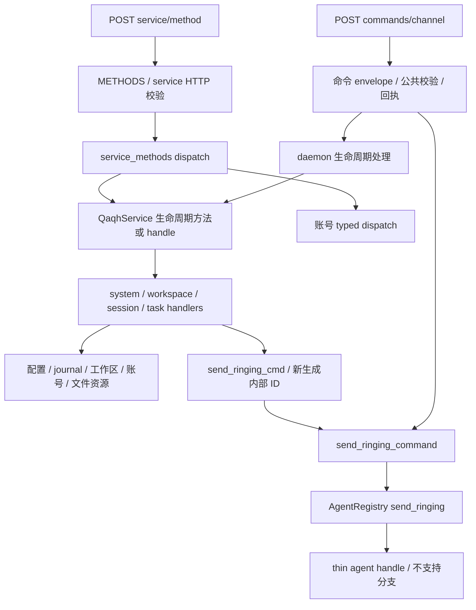
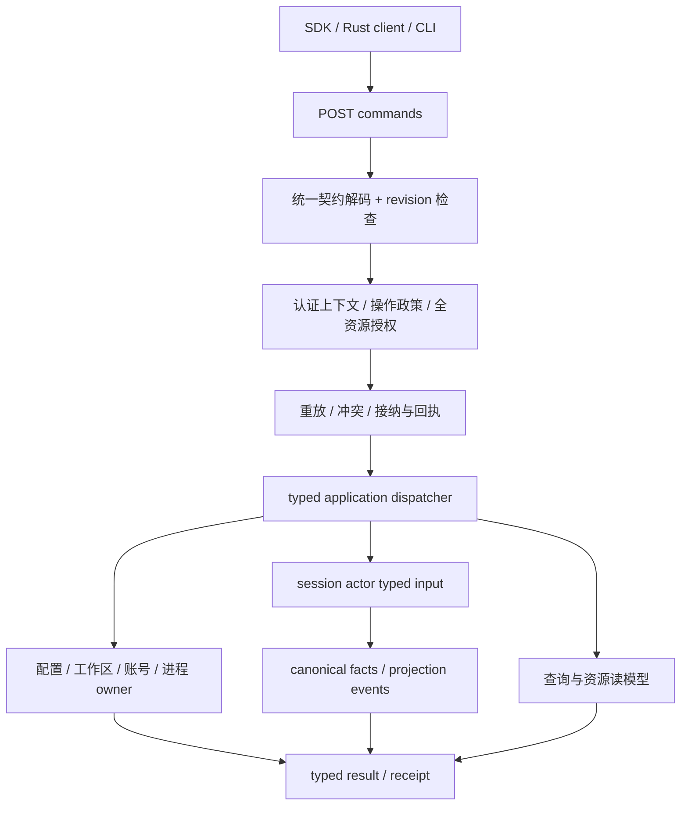

# Ringing v2 命令面大一统：现状盘点与一次性切换方案

日期：2026-10-31。状态：完成源码盘点及设计补充，给出目标设计；尚未实施协议或运行时改造。此次修订补齐产品能力边界、命令收敛、资源设置契约及批量实施纪律。

盘点基线：`8e640b8ad32da029c0ddc37991a0117f3073d845` 加当前工作区。工作区原有 Cargo、配置 DTO、README、版本等修改；本文以实际磁盘源码为准，未改动这些文件。本文没有运行编译、测试、daemon 或账号网络流程，因此“存在执行分支”不等于“端到端验证可用”。

## 1. 裁决与切换约束

当前 `commands` 与 `service` **部分重叠、部分互补，并不正交**。两者已在 Ringing v2 协议内，但操作词表、权限、目标定位、结果和执行通路尚未统一。

本次目标是**全部业务读写操作统一到 Ringing v2 命令面，一次性替换旧协议入口及其消费者**。此前“先迁写、再保留 service 查询”的渐进建议不再作为实施方案。

一次切换必须同时交付：

- 一个业务提交端点、一份封闭的类型化操作目录、一份权限及执行元数据。
- 全量读写能力的请求/结果 DTO、目标作用域、结果与回执语义。
- daemon、Rust client、daemon CLI、SDK、Electron、TUI、导出器、探针和文档的同步替换。
- 删除旧 service 路由、三频道命令提交路径及客户端字符串透传，不保留 shim、别名、灰度开关、旧协议 fallback 或双栈发布。
- 切换前现有会话、事实日志、配置和账号凭据仍能读取。删除旧网络契约不等于删除旧数据解码能力。

下文的工作包是同一交付的依赖拆解，**不是可以单独发布的阶段**。只允许完整新契约通过验收后整体切换。

### 1.1 实施纪律：快速落地，优先铺开，集中收口

**本次改动仍以快速落地为第一实施优先级。必须先按统一设计批量铺开契约、执行接线和消费者，再集中检查、修复与联验；禁止采用“写一个命令、检查一个命令、等该命令所有检查通过才继续下一个”的串行节奏。**

- U1 先一次性定下本次目录、合并映射及最小 DTO；随后按模块批量生成或替换类型、handler 接线、SDK/IPC/CLI 调用。一个操作尚未单独跑完测试，不阻塞其他已明确操作的铺开。
- 同类改动成批完成：例如一批会话设置、一批账号适配、一批消费者替换。不要每改一项就重复 cargo check/test、TS 检查、全量导出或跨端冒烟。
- 契约根、类型生成器或共享 dispatcher 等基础接缝，允许做一次必要的定向编译/导出检查以避免错误成倍扩散；这不是逐命令检查的例外通道。遇到阻塞后续铺开的共享错误立即修复，局部问题集中记录并在收口批次处理。
- 优先复用已有业务内核、owner、DTO 和投影。只做统一入口所需的适配与修复，不顺带重建账号框架、通用事务引擎、完整全局复制系统或新的工具执行框架。
- 第 6.3 节明确本次交付和后续扩展。后续项不提前注册、不用空 handler 占位，也不成为本次迁移的前置条件；不得以扩展能力尚未设计完为由停住主线。
- 批量铺开完成后，按受影响包与消费者集中运行第 12 节检查、修复并完成一次整体切换。快速落地不允许发布无执行分支的目录、虚假成功、越权通路或未经必要验证的最终版本。

本节优先于任何按单个 operation 反复“实现—测试—确认—再实现”的实施安排。工作包顺序仅表示依赖，不要求逐项独立封板、逐项请求确认或逐项发布。

## 2. 盘点结论与证据范围

| 项目 | 当前数量/形态 | 计数含义 |
| --- | --- | --- |
| 公开 service 方法 | 63 项：27 Read、36 Write | 来自 `METHODS`；包含已登记但无法解码的条目 |
| service typed descriptor | 39 项：普通 21、账号 18 | 是 DTO 描述覆盖，不是业务运行成功数；其余 24 项尚未进入这套完整描述 |
| Ringing 领域命令 | 27 个变体：Control 19、Conversation 6、Tool 2 | 枚举声明数，不是生产支持数 |
| daemon 就地处理的命令 | 7 个生命周期变体 | create/resume/attach/close/archive/unarchive/delete |
| thin agent 适配中显式处理的命令 | 6 个变体 | send/cancel/ask respond/permission respond/session shutdown/reload config |
| 其余 Ringing 变体 | 1 个入口明确拒绝、13 个落入适配不支持分支 | load more 在入口拒绝；13 个包含已退役的 driver 变体 |
| service 内部可解码、未公开的名字 | 5 项 | `session.new`、`session.resume`、`skills.activate`、`todo.cancel`、`plan.action` |
| service 表与解码器不一致 | 3 项 | `profile.update`、`provider.upsert`、`provider.delete` |

主要证据：

- [HTTP router](../crates/qaqh-daemon/src/axum_server/axum_impl/mod.rs#L118)、[service HTTP handler](../crates/qaqh-daemon/src/axum_server/axum_impl/service_api.rs#L8)。
- [service 方法目录](../crates/qaqh-runtime/src/ringing/service_methods.rs#L717)、[普通 typed descriptors](../crates/qaqh-runtime/src/ringing/service_methods.rs#L359)、[账号 descriptors 与执行](../crates/qaqh-runtime/src/ringing/service_methods/accounts.rs#L80)。
- [领域命令](../crates/qaqh-domain/src/command.rs#L46)、[公共命令执行入口](../crates/qaqh-daemon/src/axum_server/axum_impl/command.rs#L125)、[生命周期路由](../crates/qaqh-daemon/src/axum_server/axum_impl/command.rs#L572)。
- [service 解码器](../crates/qaqh-runtime/src/service/command.rs#L20)、[QaqhService 分发](../crates/qaqh-runtime/src/service.rs#L468)、[thin agent 命令适配](../crates/qaqh-runtime/src/registry/messaging.rs#L10)。

旧文档中的行号、能力数和“service 只承载非会话 RPC”等描述已有漂移。本文的 63/39/27 数量按当前源码重新计算，不从旧 SDK coverage 推断。

63 是旧 service 的盘点数，不是新目录的规模目标。原迁移去向再加保留命令、内部操作和管理路由，展开后已接近 90 个操作名；最终数量由本次合并和新增能力目录生成，不把“减少到某个整数”作为验收目标。重点减少重复设置入口、重复参数、前端编排与状态解释规则，不能把多个操作藏进自由字符串 `action` 后宣称复杂度已减少。

## 3. 两条入口的实际关系



交叉有三个层次：

1. **同一业务有两个公开入口。** 会话创建、工具模式、skills 操作和重载均发生重叠。
2. **一个入口编排另一个入口使用的底层能力。** `session.set_profile`、`session.set_effort`、`workspace.set` 先持久化，再发 `AgentReloadConfig`；配置保存还广播 reload。reload 是后续动作，不能替代上游变更。
3. **领域内核复用不等于协议重复。** `todo.set` 与模型工具共用 todo 执行内核，但外部用户操作和模型工具执行的权限、归因及回执不同；不能通过通用 `ToolInvoke` 偷渡全部管理 RPC。

## 4. 公开 service 方法全量去向

表中 `R/W`、`session`、`admin` 都是**当前方法表**的值；`D` 表示已有 typed descriptor，`—` 表示没有。`session=否` 不表示参数里没有会话键，也不表示没有副作用。目标操作名是本文建议的统一词表，不表示已实现。

### 4.1 daemon 与会话：11 项

| 当前方法 | R/W | session | admin | DTO | 统一后操作与必须保留的语义 |
| --- | --- | --- | --- | --- | --- |
| `daemon.version` | R | 否 | 否 | D | `daemon.version`，直接完成，返回版本字符串 |
| `session.list` | R | 否 | 否 | D | `session.list`，目录视图；设备返回其授权范围内的条目 |
| `session.meta` | R | 是 | 否 | D | `session.meta`，目标 Session；不存在时保持明确的空结果语义 |
| `session.activity` | R | 否 | 否 | D | `session.activity`，活动列表，与单会话工具记录区分 |
| `session.dashboard` | R | 是 | 否 | — | `session.dashboard`，补完整结果 DTO，保留 dashboard 视图 |
| `session.get_activity` | R | 是 | 否 | D | 改为 `session.tool_activity`，返回工具执行记录，避免与 activity 同名歧义 |
| `session.set_profile` | W | 是 | 否 | D | 合入 `session.settings.patch` 的 profile 选择；显式 inherit 表示跟随全局 |
| `session.set_effort` | W | 是 | 否 | D | 合入 `session.settings.patch` 的 effort 覆盖；与 profile/model 关联校验后定向应用 |
| `session.create` | W | 否 | 否 | D | 合并为唯一 `session.create`，覆盖两套创建参数，返回新 session ID，并建立调用者归属 |
| `session.rename` | W | 是 | 否 | D | `session.rename`，用户标题、持久化与 canonical 通知统一提交 |
| `session.set_tool_mode` | W | 是 | 否 | D | 合入 `session.settings.patch` 的 tools 类型化设置；统一校验、持久化与工具清单实际应用 |

来源：[session handler](../crates/qaqh-runtime/src/service/handlers/session.rs#L17)。

### 4.2 workspace 与文件：10 项

| 当前方法 | R/W | session | admin | DTO | 统一后操作与必须保留的语义 |
| --- | --- | --- | --- | --- | --- |
| `workspace.get` | R | 是 | 否 | D | 改为 `session.workspace`，读取会话运行 cwd；无绑定当前为空串 |
| `workspace.list` | R | 否 | 否 | D | `workspace.list`，注册表视图，保留 `missing_dir` |
| `workspace.set` | W | 是 | 否 | D | 改为 `session.set_workspace`，修改 cwd、自动归组并让运行环境实际生效 |
| `workspace.create` | W | 否 | 否 | D | `workspace.create`，注册目录；同路径重复注册返回既有工作区 |
| `workspace.rename` | W | 否 | 否 | D | `workspace.rename`，目标 Workspace，返回更新后的条目 |
| `workspace.delete` | W | 否 | 否 | D | `workspace.delete`，只删注册与归组，不删磁盘目录和会话 |
| `workspace.move_session` | W | 是 | 否 | D | 改为 `session.set_group`，目标 Session，参数指定目标 workspace；只改组织归属 |
| `workspace.detach` | W | 是 | 否 | D | 合并进 `session.set_group`，workspace ID 为空表示未分组 |
| `fs.list` | R | 否 | 否 | D | `fs.list`，Session/Global 目标由授权决定；保留路径限制与目录视图 |
| `fs.read` | R | 否 | 否 | D | `fs.read`，保留文件大小、截断标记与读取上限 |

`session.set_workspace` 与 `session.set_group` **不得合并**：前者修改执行 cwd，后者只修改 UI 注册表归属。当前 [workspace handler](../crates/qaqh-runtime/src/service/handlers/workspace.rs#L17) 与 [WorkspaceStore::move_session](../crates/qaqh-session/src/grouping.rs#L366) 已体现该区别。

设备文件读取必须显式绑定已授权 Session；本地 Admin 的文件选择器允许 Global 范围。现有 [路径白名单与 scope 收窄](../crates/qaqh-runtime/src/service/fs_git.rs#L66) 继续执行，目标统一不能放宽路径边界。

### 4.3 config、profile、provider：12 项

| 当前方法 | R/W | session | admin | DTO | 统一后操作与必须保留的语义 |
| --- | --- | --- | --- | --- | --- |
| `config.load` | R | 否 | 否 | — | `config.load`，使用现有 `ConfigDto`，不回传秘密值 |
| `config.save` | W | 否 | 否 | — | 改为 `config.patch`，复用并收紧现有 `ConfigPatch`，返回归一化配置与 revision，保留单写口和应用编排 |
| `config.set_permission_level` | W | 否 | 否 | — | 合入 `config.patch` 的权限字段，删除独立操作别名 |
| `profile.apply` | W | 否 | 否 | — | `profile.apply`，全局配置应用，与会话 profile 选择区分 |
| `profile.save_current` | W | 否 | 否 | — | `profile.save_current`，保留 secret 槽与配置标记的提交顺序 |
| `profile.delete` | W | 否 | 否 | — | `profile.delete`，默认项限制、配置与秘密清理结果明确 |
| `profile.create` | W | 否 | 否 | — | `profile.create`，统一 profile/provider 注册结果与秘密输入处理 |
| `profile.update` | W | 否 | 否 | — | **已登记但无解码变体**；统一后补齐 `profile.update` 的 typed handler |
| `profile.set_default` | W | 否 | 否 | — | 合入 `config.patch` 的默认 profile ID 字段；只接受规范 ID，集中执行既有引用校验 |
| `profile.list` | R | 否 | 否 | — | `profile.list`，现有 ProfilesStore 文档视图需完整 DTO |
| `provider.upsert` | W | 否 | 否 | — | **已登记但前缀都不被解码器接受**；统一后补齐 typed handler |
| `provider.delete` | W | 否 | 否 | — | **已登记但前缀都不被解码器接受**；统一后补齐 typed handler |

来源：[system handler](../crates/qaqh-runtime/src/service/handlers/system.rs#L10)、[SystemCommand](../crates/qaqh-runtime/src/service/command.rs#L83)、[前缀解码](../crates/qaqh-runtime/src/service/command.rs#L33)。

新契约将本组全局配置与凭据管理设为 Admin。当前 `admin=否` 是现状记录，不是新权限建议。实施时必须验证 profile/provider 的持久化单写口，不能延续“profiles 注册表已改、运行配置未同步”的半完成状态。

### 4.4 账号：18 项

本组当前均为 Global、Admin，18 项均已有 typed descriptor；统一后保留该权限下限和既有 credential-free DTO，两项模型目录按下表合并，不代表新目录仍有 18 个账号操作。`flow_id`/`attempt_id` 是登录流程身份，不能拿 command ID 替代。

| 当前方法 | R/W | 统一后操作与完成边界 |
| --- | --- | --- |
| `siwc.status` | R | `siwc.status`，账号聚合状态 |
| `siwc.profiles` | R | `siwc.profiles`，账号档案列表 |
| `siwc.models` | R | 合入 `model.catalog` 的 siwc 来源分支，保留可选 profile 选择与授权 |
| `siwc.sign_in.start` | W | `siwc.sign_in.start`，成功表示流程已建立，结果含 flow ID 与授权地址；不表示登录完成 |
| `siwc.sign_in.status` | R | `siwc.sign_in.status`，按 flow ID 查询登录状态 |
| `siwc.sign_in.cancel` | W | `siwc.sign_in.cancel`，取消指定登录流程 |
| `siwc.profile.select` | W | `siwc.profile.select`，账号切换与状态结果 |
| `siwc.sign_out` | W | `siwc.sign_out`，本地清理与远端 revoke 结果分别保留 |
| `dsaccount.status` | R | `dsaccount.status`，账号/流程/存储错误等聚合状态 |
| `dsaccount.balance` | R | `dsaccount.balance`，余额视图 |
| `dsaccount.bonuses` | R | `dsaccount.bonuses`，奖励列表 |
| `dsaccount.sign_in.start` | W | `dsaccount.sign_in.start`，成功表示流程已建立，返回 attempt ID 与授权地址 |
| `dsaccount.sign_in.status` | R | `dsaccount.sign_in.status`，流程状态 |
| `dsaccount.sign_in.cancel` | W | `dsaccount.sign_in.cancel`，指定 attempt 的取消 |
| `dsaccount.sign_out` | W | `dsaccount.sign_out`，退出结果 |
| `dsaccount.bonus.ack` | W | `dsaccount.bonus.ack`，按 order ID 确认奖励 |
| `dsaccount.models` | R | 合入 `model.catalog` 的 dsaccount 来源分支，保留原始已知能力信息 |
| `dsaccount.verify` | W | `dsaccount.verify`，可能清凭据，必须继续按写操作处理 |

来源：[账号 dispatch](../crates/qaqh-runtime/src/ringing/service_methods/accounts.rs#L237)。方法表中的 R/W 仅为当前分类；新目录应额外区分“查询本地视图”“访问上游”“可能修改凭据”，不能仅凭 R 就允许自动重试。

### 4.5 skills、todo、plan、diagnostics、subagent：12 项

| 当前方法 | R/W | session | admin | DTO | 统一后操作与必须保留的语义 |
| --- | --- | --- | --- | --- | --- |
| `skills.catalog` | R | 否 | 否 | D | `skills.catalog`，会话工作区视图或 Admin 显式指定 cwd |
| `skills.list_tools` | R | 否 | 否 | — | 改为 `tool.catalog`；Session 返回最终有效工具及可解释状态，Global 全目录仅 Admin |
| `skills.operation` | W | 否 | 否 | — | `skills.operation`，目标 Session；动作是封闭 union，合入 activate；revision 与 operation ID 保真 |
| `skills.reload` | W | 否 | 否 | — | `skills.reload`，实际参数需要 Session，必须重载并应用到目标 actor |
| `todo.status` | R | 是 | 否 | — | `todo.status`，聚合状态视图 |
| `todo.list` | R | 是 | 否 | — | `todo.list`，保留筛选等业务参数，与聚合视图区分 |
| `todo.set` | W | 是 | 否 | — | `todo.set`，同一资源写口提交变更与通知，返回真实业务结果 |
| `plan.read` | R | 是 | 否 | — | `plan.read`，读取 `PLAN.md` 条目视图，与挂起交互的 plan review 区分 |
| `diagnostics.memory.snapshot` | R | 否 | 是 | — | `diagnostics.memory.snapshot`，进程级 Admin 视图，保留增量游标 |
| `diagnostics.memory.start` | W | 否 | 是 | — | 合入 `diagnostics.memory.configure { enabled: true }` |
| `diagnostics.memory.stop` | W | 否 | 是 | — | 合入 `diagnostics.memory.configure { enabled: false }`；返回实际采集状态 |
| `subagent.spawn` | W | 否 | 否 | — | `subagent.spawn`，显式父 Session 与继承策略，返回 child Session/agent 身份，走已有父子生命周期编排 |

来源：[session handler](../crates/qaqh-runtime/src/service/handlers/session.rs#L137)、[task handler](../crates/qaqh-runtime/src/service/handlers/task.rs#L13)。现有独立 service spawn 仅分配并拉起 worker，不足以代表完整的父子归属、配额和终态收集；新操作必须使用完整编排，不能继续生成脱离父图的孤立 worker。

## 5. Ringing 27 个变体全量处置

“不支持”指当前 `AgentRegistry::send_ringing` 的 thin agent 适配没有对应分支，最终返回错误；该函数还可能关闭并重建实例后重试。不得把枚举存在、调用 send 返回或旧文档承诺当成业务实现证据。

### 5.1 Control：19 项

| 当前变体 | 当前执行状态 | 统一后处置 |
| --- | --- | --- |
| `SessionCreate` | daemon Create，内部调用 `session.new` 并 attach | 与 service 创建合成唯一 `session.create` |
| `SessionResume` | daemon Resume，attach 后内部 resume | `session.resume`，显式唤起；不得作为 attach 的别名 |
| `SessionAttach` | daemon Attach，只建立归属 | `session.attach`，View；不启动/恢复 actor |
| `SessionClose` | daemon Close | `session.close`，停止并关闭实例，保留历史 |
| `SessionArchive` | daemon Lifecycle | `session.archive`，关闭并归档 |
| `SessionUnarchive` | daemon Lifecycle | `session.unarchive`，恢复标签并按契约拉起 |
| `SessionDelete` | daemon Lifecycle | `session.delete`，明确关闭、磁盘删除及失败结果 |
| `SessionShutdown` | thin handle shutdown | 合入唯一 `session.close`：停止并卸载目标实例、保留持久历史；内部 Shutdown 信号保留，不新增公开 stop 同义词 |
| `AgentReloadConfig` | thin handle reload_provider | `session.reload_config`；配置变更后的内部通知复用同一应用逻辑 |
| `SetToolMode` | 不支持 | 合入 `session.settings.patch`，补 actor 实际应用；合并 service 持久化行为 |
| `InteractionAskRespond` | thin handle resolve_interaction | `interaction.ask.respond`，保留 canonical 目标与首答获胜 |
| `InteractionAskDismiss` | 不支持 | `interaction.ask.dismiss`，补齐关闭挂起交互语义 |
| `DriverClaim` | 已移除席位机制；当前不支持 | 删除公开操作、请求/响应类型与新 envelope 字段 |
| `DriverRelease` | 同上 | 同上；旧 DriverChanged 事实仍可重放 |
| `PlanReviewRespond` | 不支持 | `interaction.plan.respond`，补齐持久化决策与 actor 继续执行 |
| `SkillsActivate` | 不支持 | 合入 `skills.operation` 的 activate 变体，补齐实际激活，不保留独立公开别名 |
| `SkillsReload` | 不支持 | `skills.reload`，删除 service 包装重复路径 |
| `SkillsOperation` | 不支持 | `skills.operation`，revision 校验与操作结果关联 |
| `PublishResourceChanged` | 不支持 | 删除公开命令；资源写 handler 内提交事实/事件，不让外部伪造资源变更通知 |

### 5.2 Conversation：6 项；Tool：2 项

| 当前变体 | 当前执行状态 | 统一后处置 |
| --- | --- | --- |
| `ConversationSendMessage` | thin handle submit_user_input | `conversation.send`，保留 message ID、input purpose、attachments、合法归因及 inter-agent 语义 |
| `ConversationCancel` | thin handle cancel | `conversation.cancel`，保留可选 turn ID；定向取消必须在改变取消标记前验证目标 |
| `ConversationUndoTurn` | 不支持 | `conversation.undo_turn`，补齐业务实现与因果回执 |
| `ConversationCompact` | 不支持 | `conversation.compact`，补齐任务执行；ACK 与 compact 完成分开 |
| `ConversationLoadMore` | 公共入口明确拒绝 | 删除；现有 bootstrap 已提供完整持久历史，不复活 v1 分页 |
| `ConversationSetMode` | 不支持 | 合入 `session.settings.patch` 的 mode 字段，持久化与运行态一致生效 |
| `ToolInvoke` | 不支持 | `tool.invoke`，接入真实工具执行、权限与完成结果；只承载工具能力 |
| `ToolPermissionRespond` | thin handle respond_tool_permission | `interaction.permission.respond`，保留 tool call/interaction 关联及 trust_folder 策略 |

依据：[实际适配](../crates/qaqh-runtime/src/registry/messaging.rs#L47)、[load more 拒绝](../crates/qaqh-daemon/src/axum_server/axum_impl/command.rs#L195)。

全会话 driver 已从执行模型移除，bootstrap 仍返回 vacant 占位值。本次同步清掉该 wire 遗留，不再把“不破坏已导出契约”作为保留理由；[旧 driver 移除计划](plan-remove-driver-seat-2026-10-26.md) 的 wire 清理延迟条款由本次切换取代。

## 6. 内部方法及其他 HTTP 面的边界

### 6.1 五个内部名字

| 内部名字 | 当前事实 | 本次裁决 |
| --- | --- | --- |
| `session.new` | command create 所用内部方法，返回字符串 ID | 删除字符串分派，与 `session.create` 共享唯一 typed handler |
| `session.resume` | command resume 所用内部方法 | 改为 typed 生命周期调用，消除内部 method 别名 |
| `skills.activate` | 可解码但未在公开 METHODS 注册 | 合入 `skills.operation` 的 activate 变体，不新增独立操作 |
| `todo.cancel` | 可解码但未在公开 METHODS 注册 | 纳入 `todo.cancel`，显式目标条目，补 DTO 与统一资源写口 |
| `plan.action` | 可解码、修改 `PLAN.md`，但未公开注册 | 纳入 `plan.item_action`；操作的是文件条目，不等同于 `interaction.plan.respond` |

`plan.item_action` 的 approve/reject/ask/delete 必须成为封闭动作词表；当前自由字符串对未知动作可能原样回写，不应延续。[现有实现](../crates/qaqh-runtime/src/service/plan.rs#L52)。

### 6.2 HTTP 路由全量裁决

统一的范围是业务操作及管理操作。连接建立、投影复制和字节内容传输有自己的传输生命周期；以下保留项构成明确的传输/引导白名单，不再允许另加“辅助业务 RPC”。

| 当前 HTTP 路由 | 一次切换后的处置 |
| --- | --- |
| `POST /ringing/v2/commands/{channel}` | 删除，改为 `POST /ringing/v2/commands`；不保留三频道提交别名 |
| `GET /ringing/v2/commands/{command_id}` | 保留为统一回执对账，授权与 submit 共用上下文 |
| `POST /ringing/v2/service/{method}` | 删除，63 项全部按本文目录承接/合并，无内部 RPC 转发兜底 |
| `GET /health` | 保留，免鉴权存活探针，不能扩展成业务查询逃生口 |
| `GET /activity` | 删除，统一为 `daemon.activity`；原形状的 `has_active_work` 与活动数组保留 |
| `POST /control/v1/stop` | 删除，统一为 Admin `daemon.stop { require_idle: false }`，CLI 同批修改 |
| `POST /control/v1/stop-if-idle` | 删除，合入 Admin `daemon.stop { require_idle: true }`；后端原子判断，busy 结果类型化 |
| `POST /ringing/v2/clients/open` | 保留，连接与契约协商的引导入口 |
| `POST /ringing/v2/leases/renew` | 保留，仅管理连接 presence |
| 新增 `GET /ringing/v2/notifications` | 授权后的资源失效通知流，仅携带资源引用/revision；不承载业务读写，不要求持久重放，重连后重读已观察资源 |
| `GET /ringing/v2/sessions/{session_id}/bootstrap` | 保留，投影初始同步；不再作为创建结果的旁路发现机制 |
| `GET /ringing/v2/sessions/{session_id}/events` | 保留，事实投影复制、cursor/reset/断流机制 |
| `GET /ringing/v2/sessions/{session_id}/team` | 删除路由，合入 `team.snapshot`，复用现有快照 DTO |
| `GET /ringing/v2/sessions/{session_id}/approvals` | 删除路由，合入 `interaction.pending`，保留 Admin canonical / Device challenge 结果边界 |
| `POST /ringing/v2/sessions/{session_id}/approvals/respond` | 删除路由，合入 `interaction.challenge.respond`；challenge 解出 canonical 决策后调用同一内部 handler |
| `GET /ringing/v2/content/{content_id}` | 保留，受权限约束的字节下载 |
| `POST /ringing/v2/content` | 保留，字节上传与内容引用建立；业务命令继续传引用 |
| `POST /ringing/v2/pair` | 保留，一次性配对凭证兑换的引导入口，尚无 device principal 时不能要求先提交普通命令 |
| `POST /ringing/v2/pairing/tokens` | 删除路由，统一为 Admin `device.pairing_token.create` |
| `GET /ringing/v2/devices` | 删除路由，统一为 Admin `device.list` |
| `POST /ringing/v2/devices/{device_id}/revoke` | 删除路由，统一为 Admin `device.revoke`，保留身份、连接与归属的整体吊销 |
| `GET /ringing/v2/exec-sessions` | 删除路由，统一为 Admin `exec_session.list` |
| `POST /ringing/v2/exec-sessions/{id}/kill` | 删除路由，统一为 Admin `exec_session.kill`，目标 ExecSession，区分 killed/tombstone_cleaned/no_os_pid/not_found |

本节覆盖 [当前 router](../crates/qaqh-daemon/src/axum_server/axum_impl/mod.rs#L118)。`exec_session` 当前只检查 lease，尚无逐操作 scope；新契约按进程级 Admin 收紧。`daemon.stop` 的“提交完成”必须定义为关闭/封存条件满足且停止请求已落实，随后退出；不能承诺 daemon 已退出后还可轮询其 HTTP 回执。

### 6.3 产品能力补充与本次范围

迁移盘点须同时检查旧公开入口、已有内部业务能力、消费者中的独立编排，不能只把 63 项 service 方法逐个搬名。以下“本次”项与旧能力迁移一起批量铺开；“后续”项显式不属于本次交付，不提前承诺生产支持。

| 能力 | 本次交付 | 后续扩展及边界 |
| --- | --- | --- |
| 会话设置读写 | 新增 `session.settings.get`，与 `session.settings.patch` 配套，返回覆盖值、有效值、来源、设置 revision 和应用状态；model/profile/effort/mode/tools 使用同一解析规则 | 不把原始配置、秘密或全部内部 metadata 下发；不新增第二套配置存储 |
| 模型目录 | 新增 `model.catalog`，复用现有两家账号目录及已配置模型信息，统一最小 DTO；能力未知必须显式表示，允许既有 BYOK 手工模型输入 | 暂不新建任意端点探测、完整上游能力数据库或所有 provider 的实时发现；已有 `siwc.models`/`dsaccount.models` 合入该操作，不保留重复公开目录 |
| 有效工具目录 | `tool.catalog` 返回目标会话最终可用工具、schema、目录 revision，以及现有政策可解释的禁用状态；复用执行侧的有效目录解析 | 不再用 daemon 的名字快照冒充会话工具集；未知禁用原因不可编造 |
| 子代理控制 | 新增 `agent.list`、`agent.instruct`、`agent.interrupt`，复用已有发现、投递、打断和结果编排；保留 `subagent.spawn` | 本次不增加独立 wait 长轮询命令，终态通过 list/既有投影观察；逻辑 agent 不是 exec process |
| 团队任务 | 新增 `team.task.create/claim/update/close/list`，复用 TaskBoardHost 与 TeamStore；动作、依赖和终态使用封闭 DTO | 与会话 todo 分属不同资源，不通过 `tool.invoke` 或改写 todo 代替 |
| 团队讨论板 | 新增 `team.board.channel.create`、`team.board.thread.create`、`team.board.post`、`team.board.subscribe`、`team.board.list`，复用 BoardHost 与 BoardStore | 不新增完整聊天系统；业务订阅关系与 SSE 连接订阅区分 |
| 输入队列管理 | 本次保留输入接纳、排队及其可观察状态，明确 InputId 和输入接纳/turn 完成的区别 | `conversation.queue.get/remove/edit/reorder` 后续单独实现；需要可靠队列状态、撤回与启动竞争语义，不能只凭内存 VecDeque 注册新能力 |
| MCP/LSP 运行管理 | 本次配置继续走 `config.patch`，工具可用性通过 `tool.catalog` 表达 | 独立 server 状态、reconnect/restart 和资源浏览按产品需要后续补；不将模型工具 dispatcher 原样导出为管理 API |
| 全局变化通知 | 本次以 revision 和授权后的资源失效通知收口，覆盖 config/workspace/账号状态等多端镜像；客户端收到通知重新读取 | 复用现有投影/连接设施承载，必要的通知流属于复制白名单；不重建完整全局快照日志或通用订阅查询系统 |

补充证据：后端 [SubagentHost](../crates/qaqh-subagent/src/host.rs#L528)、[TaskBoardHost/BoardHost](../crates/qaqh-subagent/src/host.rs#L475)、[AgentCommand 与队列输入](../crates/qaqh-agent-runtime/src/session_agent/types.rs#L31)。这些是可复用内核的证据，不等于新的外部权限、用户归因或回执已经实现。

`agent.*`、`team.task.*`、`team.board.*` 本次沿用 Session 作为授权上下文；额外 agent/task/thread/channel ID 必须解析至同一授权 root tree。用户操作记录真实 principal，由 typed application adapter 调用业务 owner；不得把用户伪装成代理、接受客户端自报 author，或把内部 trait 原样暴露。`agent.instruct` 使用封闭投递策略并记录用户来源，不靠伪造 inter-agent metadata 绕过子代理所有权检查。

模型与设置的消费者也在本次修正范围：[SDK adminService](../../qaqh-sdk/src/core/index.ts#L187) 仍允许 `provider.models`、`profile.model_selection`、`session.set_model_selection` 等目录外名字；这些名字在当前后端公开目录/解码器中没有对应实现。本次删除该逃生口，不把旧字符串当已有能力承诺。[Electron 输入框选择](../../qaqh-electron/webui/src/composer/model-config.ts#L158) 当前修改全局 config：**新契约明确输入框模型/effort 选择作用于当前 Session；全局默认只在设置页显式修改。** provider 槽位等客户端记忆只能是展示偏好，不再充当运行配置事实源。

`model.catalog` 的 Global 全账号目录按 Admin 授权；Session 视图仅返回授权会话允许选择的目录与脱敏能力。条目包含来源、已知/未知能力、可选 effort 和已知限制，不由前端根据模型名猜测。与当前 provider 不匹配或未被证实的能力不得编造为支持。

### 6.4 合并裁决与最小改造边界

- `session.settings.patch` 合并 profile、model、effort、mode 和工具策略；标题仍走 `session.rename`。cwd 仍走 `session.set_workspace`，组织归属仍走 `session.set_group`，避免把跨 owner 的工作区注册/归组效果塞入设置 patch。
- `config.patch` 合并普通配置、权限字段和默认 profile 选择；保留 `profile.apply` 的后端配置应用编排。`profile.save_current` 本次保留其后端快照与秘密提交语义，不要求前端先读取再创建。
- profile 创建/更新本次保持独立，避免 upsert 掩盖 AlreadyExists/NotFound 和版本冲突。账号保留 provider 特有状态、登录、余额和奖励操作，复用公共 DTO/执行骨架；仅模型目录合入 `model.catalog`，不为名称统一重写整个账号域。
- `todo.status` 与 `todo.list` 本次保留各自聚合/筛选结果，复用读模型即可；不为了少一个名字新增可选字段组合、分页协议或通用 include 查询。
- `skills.operation` 合入 activate，reload 仍是重新发现并应用的独立动作；`daemon.stop` 合入 require_idle；内存采集 start/stop 合入 configure。
- 禁止新增自由字符串 `session.action`、`resource.action` 或把全部管理能力藏到 `tool.invoke`。operation 名减少但内部动作、权限和完成分支不变时，不能宣称业务复杂度已经减少。

### 6.5 会话生命周期裁决

| 操作 | 完成后的承诺 |
| --- | --- |
| `session.attach` | 建立调用者归属/观察关系，不启动或恢复 actor |
| `session.resume` | 显式拉起已有未归档会话；对已运行实例不重复启动 |
| `session.close` | 停止并卸载运行实例，保留持久历史；既有 ephemeral 清理政策仍执行并反映在结果中；同时承接旧 SessionShutdown |
| `session.archive` | 按关闭编排处理实例并提交归档状态，保留持久历史 |
| `session.unarchive` | 清除归档状态并按本操作契约显式拉起；与 attach 区分 |
| `session.delete` | 按关闭编排处理实例并删除目标持久数据，失败/部分完成可识别 |

`conversation.cancel` 只针对当前/指定 turn，不等于 close，不自动撤回尚未执行的输入。关闭/归档/删除对派生子代理和待处理输入的处理必须沿用并明确现有生命周期政策；不以本次收敛为由静默丢弃已接纳输入。内部 Shutdown 信号不再对应第二个公开 `session.stop` 操作。

## 7. 现状缺口：本次交付必须一起解决

| 编号 | 源码事实 | 对大一统的影响与处置 |
| --- | --- | --- |
| G01 | service 与 command 都有 create，但参数、返回和归属不同 | 唯一 create 接受 cwd/title/profile/effort/tool_mode/custom_tools，返回 typed SessionCreatedResult；创建后的调用身份归属明确 |
| G02 | `SessionCreate.close_current` 被序列化送入 `SessionNewArgs`，后者没有此字段 | 当前字段未落实“关闭当前会话”；新契约删除隐式 current 概念，调用方需要关闭时显式提交带目标的 close |
| G03 | `SetToolMode` 枚举存在，实际适配不支持；service 先写 meta 后发送它 | 不能只把入口换名；必须实现 actor 应用，区分已持久化/待应用/应用失败，不返回虚假的全部成功 |
| G04 | service skills 请求转发时新建 worker envelope；client 发的 expectedRevision 未进入该 envelope | 把目标 revision 与 operation ID 纳入统一请求、指纹和 handler；拒绝丢保护的转发 |
| G05 | service 请求不经公共 execute_command；内部生成新的 command ID | 用统一上下文一路传递 principal/command ID/目标/保护条件；内部派生动作记录父因果，不冒充另一条客户端请求 |
| G06 | service 只对 admin_only 检查 Admin，不按 Write 检查 Interact；全局请求只要求非空 header | 统一认证、有效连接绑定、scope 与资源授权；kind 必须驱动政策，不只用于错误码 |
| G07 | service 与 command 的 session ownership/admin 豁免策略不同；service 不验证 header lease 属于当前 device | 一个 ResourcePolicy 裁决；多目标操作检查所有读写资源；所有 replay/status/结果快路同样鉴权 |
| G08 | 公共 envelope 除 create 外都强制 session ID | 目标改为显式 tagged union；global/workspace/exec 管理不借用虚假 Session |
| G09 | command result 只有 AskResolved/PlanReviewResolved/PermissionResolved | 为全部操作生成关联结果类型；create、配置、文件、目录、账号流程等均有真实结果 |
| G10 | thin 适配只传部分命令字段，其他枚举分支不支持，失败后还会尝试重建实例 | 完整映射至 typed application input；未知/无能力在副作用前拒绝，不能把“不支持”当通信故障重启 actor |
| G11 | `todo.set` 先直写资源，再 best-effort 请求 PublishResourceChanged；该命令当前也不支持 | 资源写入与 canonical 可观测结果由同一业务 owner 协调；补偿状态可恢复，不吞掉通知失败伪装完全同步 |
| G12 | METHODS、普通 descriptor、账号 descriptor、解码枚举、client 白名单分别维护 | 以统一目录生成闭集、元数据、DTO 关联、执行覆盖、TS map；双向覆盖，拒绝死条目 |
| G13 | 3 项方法只登记无执行；5 项内部动作未公开 | 按第 4/6 节完整处置，不原样搬运坏目录，不把内部动作误计为旧 HTTP 能力 |
| G14 | `Client::attach()` 实际发 SessionResume | 同批改成真正 attach；resume 是独立显式 API，避免观察/重连隐式启动或恢复 actor |
| G15 | service Read 不全是严格无副作用：`session.list` 会自愈归组，部分 store load_or_create 会创建状态 | 自愈/初始化移入受控启动或维护路径；新读分类以业务可见副作用审计为准，不能照抄旧 R 标记 |
| G16 | 当前回执 300s/4096、best-effort 持久化，缺失仅表示结果未知 | 明确可靠接纳、保留边界和未知结果；不把统一路由宣传成 exactly-once |
| G17 | driver 的执行机制已移除，但类型、capability、bootstrap 占位仍在 | 本次删网络遗留；历史事实读取保留 |
| G18 | workspace store 的 save 只记日志，不向多个调用者传播持久化失败 | 统一写成功必须反映真实提交；修正 store 写口返回错误及内存/磁盘状态处理 |
| G19 | `plan.read` handler 把 `read_plan` 的 Result 直接交给序列化，而不是先传播错误并取出 PlanListOutput | 先取出业务值并传播错误，再绑定结果 DTO；当前 wire 形状需用真实 fixture 确认，不能仅从 PlanListOutput 类型名推断 |
| G20 | SDK 仍有目录外 adminService 名字与自由泛型结果 | 删除独立逃生口，将实际产品需求映射到唯一目录；不存在的名字不能直接计入已实现能力 |
| G21 | Electron 输入框模型/effort 写全局配置，部分目录与能力判断由前端拼装 | 输入框改会话 settings；设置页显式改全局默认；目录和有效能力由后端统一解析 |
| G22 | agent/team 内部能力未形成完整外部控制面 | 用 typed application adapter 复用现有 host/store，补统一权限、用户归因与结果，不直接导出内部 trait |
| G23 | 单个 Session revision 容易与设置无关的事实增长冲突 | settings/config/skills/team 采用各自 owner 的资源版本，比较与提交在同一 owner 串行边界完成 |
| G24 | 全局状态缺少统一的多端刷新约定 | 本次提供资源 revision 与失效通知；客户端重读，断线重连后刷新，不要求完整全局复制引擎 |

补充证据：[内部发送](../crates/qaqh-runtime/src/service.rs#L549)、[客户端 skills 参数](../crates/qaqh-client/src/endpoint.rs#L193)、[客户端 attach](../crates/qaqh-client/src/client.rs#L504)、[目录查询自愈](../crates/qaqh-runtime/src/service.rs#L617)、[workspace save](../crates/qaqh-session/src/grouping.rs#L202)、[现有回执政策](../crates/qaqh-ringing-runtime/src/pending_store.rs#L20)、[plan.read 结果流](../crates/qaqh-runtime/src/service/handlers/task.rs#L39)。

## 8. 目标契约

### 8.1 一个业务提交端点

统一为：

```text
POST /ringing/v2/commands
GET  /ringing/v2/commands/{command_id}
```

**协议风格裁决：业务操作采用强类型命令 RPC，HTTP 负责传输与命令生命周期查询；不以资源 CRUD 风格的 REST 作为统一业务模型，也不采用 JSON-RPC 2.0 的通用 `method + params` 信封。** 这些操作跨会话、配置、账号、进程等不同 owner，且各自有目标、权限、前置条件、执行器和完成边界；由封闭操作目录统一定义这些语义。同步查询可直接返回对应的完成结果，异步操作先返回接纳状态，再按 `command_id` 查询回执。投影、内容传输等本身具有资源表示或独立传输生命周期的端点仍按其资源语义保留。这样既明确业务面的 RPC 语义，也避免把 JSON-RPC 的通用方法分派误当成授权、幂等或异步结果契约。

旧 Control/Conversation/Tool 是领域分类和投影视图，不再决定 URL，也不再要求 envelope/channel/内层 command 三处重复填写同一个路由事实。内部仍可按领域拆类型、模块和执行器。

`RingingV2CommandEnvelope` 的目标形状如下，字段名为目标设计：

```json
{
  "schema": "qaqh.Ringing",
  "version": 2,
  "contract_revision": "unified-commands-1",
  "command_id": "<client-generated-id>",
  "target": { "kind": "session", "session_id": "<session-id>" },
  "command": {
    "type": "session.settings.patch",
    "patch": {
      "profile": { "kind": "use", "profile_id": "p-1" },
      "effort": { "kind": "inherit" },
      "mode": "plan",
      "tools": { "mode": "custom", "names": ["fs_read"] }
    }
  },
  "precondition": { "kind": "settings_revision", "revision": 12 }
}
```

身份与在线连接从 Bearer 和既有 client-session header 解析。新 envelope 不接受客户端自报 actor，删除重复的 client session/instance 字段和 driver_epoch；device principal 一律来自认证。Admin 实例标识继续由 open 协商，不能逐次由 payload 改写。

`command.type` 是封闭 tagged union，点分字符串只是序列化标签；服务端不得回退为 `method: String + params: Value` 的旧通用调用。目标只在 envelope 指定一次，业务 DTO 不再重复 session/workspace 定位键。

普通 envelope/DTO 拒绝未知字段和旧命名别名；真正需要动态 JSON 的位置由具体 DTO 明确声明，例如配置 patch 或工具的业务参数。删除 client action 自动附加的 action_id/fingerprint；请求 ID 与幂等摘要分别由统一 envelope 和服务端负责，不能作为普通业务参数混入。

`SessionSettingsPatch` 是独立公开 DTO，不直接导出内部 `SessionMetadataPatch`。后者包含 usage、parent、归档与内部注解等字段，不能通过通用 patch 获取其写权限。普通字段缺失表示保持；可继承设置使用明确的 use/inherit 变体，不继续用空串表达清除。tools 按 mode 定义封闭 union：custom 必须携带非空合法清单，其他变体不接收无关清单。

patch 在一个 owner 内一次完成关联校验和设置提交，禁止内部拆成数条独立客户端请求；这不承诺所有运行效果跨存储原子生效。秘密输入使用保持/替换/清除的明确语义，读 DTO 只给 secret 是否存在等脱敏状态，不让掩码字符串充当待保存密钥。

### 8.2 显式目标与多资源授权

| Target | 用途 | 规则 |
| --- | --- | --- |
| `Global` | daemon/config/profile/provider/accounts/目录级查询与创建 | 按逐操作政策限制；不是“无权限校验” |
| `Session { session_id }` | 对话、会话配置、skills、todo/plan、交互、团队、子代理 | 绑定稳定 principal 的 session 授权；attach/resume 有明确的归属建立策略 |
| `Workspace { workspace_id }` | 已存在工作区注册项的管理 | 全局管理默认 Admin；不得通过 session attach 自动获得全局工作区管理权 |
| `ExecSession { id }` | 进程实例终止 | 当前目标按 Admin 进程管理收口，保留真实进程身份及墓碑结果 |

Target 与 operation 必须在 Rust 构造类型及生成的 TS 请求 union 中关联，不能只导出两个互不相关的 union 形成任意笛卡尔积。例如 `config.patch + Session`、`session.settings.patch + Global` 应在类型层拒绝，服务端同时校验。多种合法 target 的操作分别定义其参数、结果与权限分支。

`session.set_group` 的 workspace ID、subagent 的父子关系、附件内容引用、交互目标等是额外资源引用，必须由目录给出授权解析器。检查 primary target 一次不能替代所有关联资源检查。

### 8.3 一份操作目录

每项操作至少关联以下信息，并由同一声明生成静态目录与类型绑定：

| 元数据 | 作用 |
| --- | --- |
| `operation / request_type / result_type` | 精确绑定请求和结果，不允许客户端自报泛型结果 |
| `effect` | Query 或 Mutation，由实际副作用审计决定 |
| `target_policy / resource_policy` | 允许的目标与额外资源授权 |
| `required_scope` | View / Interact / Admin，不能从全局默认 Interact 推断所有方法 |
| `executor` | 目录/资源 handler、session actor、账号管理器、进程管理器等内部去向 |
| `completion` | 请求内完成或异步接纳；同项操作可返回已经完成的终态 |
| `precondition_policy` | 是否需要目标版本、哪个 owner 校验、版本冲突错误 |
| `retry_policy / receipt_policy` | 能否重试、是否保留结果、保留期限与未知边界 |
| `request_visibility / result_visibility` | 密钥、登录流程地址、内容引用、设备/管理员不同视图的处理 |

目录不能在 runtime 中只剩名字、在 exporter 中再抄结果、在 client 中第三次补白名单。编译期关联请求/结果/执行器，测试从“目录到执行分支”和“执行分支到目录”双向核对。

目录的静态声明完整不等于当前资源可执行。open 可携带本次实际支持的目录摘要；资源读模型返回当前可执行性及禁止原因，覆盖权限、生命周期和已知能力限制。优先复用现有协商字段与政策结果，不为此新增每次操作前必须调用的 capability RPC。客户端提示不能替代 submit 时的最终授权。

### 8.4 统一结果，保留同步读取

新的提交结果为封闭 union：

- `rejected`：未接纳，包含稳定 code、明确问题及可选冲突信息。
- `accepted`：异步变更已由正确 owner 接纳，包含 command ID、回执保留信息；不表示业务成功。
- `completed`：本次操作已得出终态，包含 operation、typed result 或 typed error、可选观察到的资源 revision。

具体约束：

1. 查询走同一 submit，但通常直接 `completed`，不为了统一外形而进 actor 排队、写 session fact、注册 PendingCommandStore 或让客户端轮询结果。
2. 写操作可直接 completed；长操作 accepted 后由 status/可靠因果事实对账。`config.patch` 等不能被人为拆成先 ACK 再另查返回值。
3. result 必须与 operation 类型对应，`session.create` 直接或经回执拿到 `{session_id, ...}`。客户端禁止扫描 session.list、磁盘或猜测最新 SessionCreated 来找创建结果。
4. command 的完成边界写入目录：`conversation.send` 的输入接纳与 turn 完成是不同业务事件；`conversation.compact` 的完成指压缩任务实际终态；登录 start 的完成只表示流程建立。
5. 查询默认不提供可恢复回执；丢包重试按该操作 retry_policy 重新读取，允许观察到新 revision。status 查不到该查询不能被解释成“后端未执行”。
6. 结果过大时使用既有 content ref 和大小限制，禁止把任意文件/工具输出长期塞入回执缓存。
7. HTTP 状态码与 rejected/failed 的映射集中定义；业务错误不再由 Read/Write 拼成 query_failed/action_failed 两套解释。

原 `RingingV2CommandAck` 和三种交互专用 result 的形状在本次一并替换。SDK 与探针不再沿用旧 ACK 类型猜测新返回。

### 8.5 回执、重试与崩溃边界

统一入口只提供有明确边界的幂等接纳和对账，不承诺任意外部副作用 exactly-once。

- 回执键采用稳定 principal/instance 与 command ID；target、operation、完整规范化业务参数和实际 precondition 纳入指纹。重复 ID 改任何业务目标/参数/保护条件均拒绝。连接 ID 不进入业务指纹，重连不改变请求身份。
- **先认证与资源授权，再读重复结果、interaction 已决结果或 status。** 当前某些快路发生在公共 execute 之前，不能直接复制为新入口。
- 异步 accepted 之前必须确认 owner 接纳；需要跨重启恢复的接纳记录不能只依赖 best-effort PendingCommandStore。将其改为统一 ReceiptStore 的有界查询缓存，由 owner 的已提交接纳/结果记录提供证据；Global 写也有 daemon 级记录，不能强塞进某个会话 journal。
- 目录明确终态从哪里产生、何时提交、如何与 command ID 关联。没有业务终态证据不能把“发送进 mailbox”标成 succeeded。
- 明确 TTL、容量淘汰、重启、actor 卸载和不可恢复外部调用的未知结果。缓存缺失不触发 SDK 自动重执行 mutation；不能用重新生成 command ID 解决超时。
- 写入发生后崩溃而回执未完成，可能需要返回 outcome_unknown 或按资源事实恢复。只有证据充分时才能返回失败并允许重试；不允许回滚回执就假装已回滚副作用。
- 登录凭据、配置明文密钥不进入日志或回执文件；指纹使用规范化请求的摘要，结果保留只允许脱敏 DTO/受控引用。

接纳记录是统一实现必须解决的问题，不要求本次重建一个跨所有业务存储的分布式事务引擎。

### 8.6 授权基线

| 操作组 | 新契约最低政策 |
| --- | --- |
| 版本、授权范围内目录/会话查询、attach | View，目录结果按资源授权过滤 |
| 会话消息、取消、配置覆盖、交互、skills、todo/plan、子代理编排 | Interact + 对应 Session 与额外资源授权 |
| 全局 config/profile/provider、账号、diagnostics、daemon 停止、设备管理、进程管理 | Admin |
| workspace 注册/改名/删除等全局组织管理 | Admin；会话归组另走 session 操作并检查目标 workspace 可用范围 |
| 设备文件浏览、skills catalog | View + 已授权 Session 的路径范围；任意 cwd/全局文件选择仅 Admin |

Admin 仍须有效认证与协议校验；其资源豁免集中写入政策。scope 不是全会话 driver。交互应答不得被重新引入的席位门槛阻塞。

Device 继续使用 opaque challenge：`interaction.pending` 返回受控详情；`interaction.challenge.respond` 绑定 principal/session/kind/TTL、单次消费并进入同一决策 handler。canonical 交互应答只对其允许的调用身份开放，不能因为存在通用 submit 而绕过 challenge。远端 `trust_folder` 的降级策略保留。

### 8.7 内部执行结构



统一的是业务契约与治理。查询不必唤醒会话 actor，全局操作不必经过会话邮箱，业务模块也不合成一个巨型 match 文件。

现有 `QaqhService` 承担装配、资源访问、配置通知和生命周期等多项职责。保留其中有价值的依赖注入与业务实现，改造成 typed application handlers/ports；删除 `handle(method, Value)` 及旧 decoder。**不能删 HTTP service 后把同一个字符串 RPC 藏到新 command 内。**

session actor 内部输入仍由应用层适配；core 不认识 HTTP、Bearer、wire enum、设备 challenge 或服务方法字符串。内部维护通知（reload/resource changed）使用明确端口，不能重新开放为任意客户端伪造事实的操作。

### 8.8 资源版本、设置应用与前端对账

- `session.settings.get` 返回覆盖设置、脱敏后的有效设置、字段来源及 settings revision；有效值和 `tool.catalog` 必须复用执行侧解析，不能各算一份。全局配置变化可能改变继承值，因此同时返回所依赖的 config revision/有效配置版本。
- settings/config/skills/任务等写保护使用对应资源版本，不使用每条新事实都会递增的 session 日志水位。版本由已有 owner 的提交版本、已有 revision 或规范化资源内容标识导出，优先复用；不为每项新建计数服务。比较版本与提交必须处于同一串行边界，不能先在 HTTP 检查再无保护地入队。
- 设置 patch 结果包含提交后的设置与 revision、运行态已应用版本、应用状态及必要错误。状态至少区分 applied/pending/failed/on_next_resume；未运行 actor 不因修改设置被隐式唤起。
- 明确应用边界：下一轮/下一个 provider 请求和已派发工具的策略快照分开解释。修改设置自动编排应用，常规 UI 不额外发送 reload 来“补成功”。session.reload_config 只承载显式重读外部配置等需求。
- “设置已持久化、运行态应用失败”必须保留真实提交状态，不能返回笼统失败诱导重复写入，也不能声称整个操作已经回滚。pending 后续变化通过回执或投影可对账。
- 写结果可携带资源版本及现有投影 cursor。前端据此结束乐观状态，避免较旧快照覆盖刚提交的值；不要求为所有资源制造一个全局事务 cursor。
- Global config/workspace/账号状态等提供脱敏的资源失效通知和 revision。失效只要求授权消费者重读；通知不携带秘密，掉线期间不承诺逐条重放，重连必须刷新已观察资源。通知设施属于连接/复制协议白名单，不得借机增加业务 RPC。

### 8.9 SDK、IPC 与业务参数

从同一目录生成 operation/target/request/precondition/result/error 的关联类型；SDK 提供资源门面，业务调用例如：

```typescript
client.sessions(sessionId).settings.patch(patch, { expectedRevision: 12 });
```

这是目标调用形态，不是当前 SDK 已有 API。SDK 自动填 envelope、协议 revision、稳定请求 ID 和连接上下文；消费者只处理业务参数与明确的保护条件。底层 typed submit 仍可使用，但不能开放自报结果泛型、任意 method 或 `as never` 绕过目录。

Electron main/preload/renderer 的业务 IPC 参数和返回由同一目录关联生成，保留其宿主能力限制；不再在 IPC 自动补“当前 session”或重新抄 service 白名单。前端展示用 camelCase 与 wire 命名若不同，只允许一个显式适配层，不允许手写 DTO 漂移。原生文件选择器、窗口、剪贴板和应用更新继续属于壳层能力，不为“统一”搬进 daemon。

## 9. 契约归属与一次性破坏性版本切换

### 9.1 类型归属

- 扩充现有 `qaqh-ringing-contract` 为应用契约所有者，承接统一 envelope/target/precondition/submit result、操作目录及每项请求/结果 DTO。已有通用值类型、`ConfigDto`/`ConfigPatch` 等直接复用；不另建第二个 service-contract 中间层。
- `qaqh-ringing` 保留低层传输、内容引用和复制协议；不反向依赖 runtime/application contract。原应用命令 envelope 等从低层导出的位置本次一并调整，不形成 contract ↔ ringing 循环。
- account 的公开 DTO 从账号实现层收口到应用契约；管理器使用其内部模型并在应用 handler 映射。client/contract 不为获得账号 DTO 而依赖账号管理器、凭据存储或 runtime。
- runtime/daemon 依赖应用契约来执行；exporter 依赖契约生成 TS、metadata、fixtures 和覆盖报告。保留已有投影类型依赖，本次不顺带重构全部事实/存储 crate。
- `qaqh-domain` 中仍有意义的内部业务输入可保留，但旧三频道 wire 命令不再是另一份公开目录；领域类型与公开应用操作必须有明确映射和唯一 handler。

### 9.2 revision 策略

路径继续使用 `/ringing/v2`，此次是其受控破坏性契约切换。新增强制 `contract_revision = "unified-commands-1"`，open 请求/响应、业务 envelope、生成产物及客户端均使用同一常量。

- 新 daemon 拒绝缺失/不匹配 revision 的旧 open 请求，返回 `incompatible_contract`，不静默降级。
- 新 client 在协商未确认 revision 前不发送业务请求；旧服务端没有该字段时明确报不兼容。
- 精确产物 `contract_hash` 继续服务于导出内容校验，不把每次无关 source revision 变化都当协议不兼容；兼容判定由 contract revision 负责。
- 更新旧 enum/字段和接口根的同时更新 manifest、coverage、fixtures、TS 消费者样本及各壳层导入，不保留 `service-map.ts` 兼容导出。
- 停止旧 daemon，整体安装新 daemon 与新消费者，再重连；禁止新旧进程同时接收同一份写任务。回滚仅整体回滚一致版本，不进行混合版本回滚。

这是一项明确的新设计选择；当前 open/envelope 并没有该 revision 保护。历史 session facts、配置及凭据不是旧网络 client，不能因 revision 切换被清空。

## 10. 一次交付的改动范围与删除清单

### 10.1 后端

| 位置 | 同批改动 |
| --- | --- |
| `qaqh-ringing-contract` | 新统一目录、目标与前置条件、请求/结果、错误、submit/status、TS 导出根 |
| `qaqh-ringing` / `qaqh-domain` | 清旧三频道公开命令契约、driver 遗留、load more、公开 resource-changed 通知；保留有效内部输入及旧事实读取 |
| daemon `axum_impl/mod.rs` | 路由按第 6.2 节替换，保留引导/复制/content 白名单 |
| daemon `command.rs` / `v2.rs` / `authz.rs` / `challenge.rs` | 一个 typed submit pipeline；身份绑定、资源授权、重放、challenge、结果快路顺序一致 |
| daemon `service_api.rs` | 删除旧 handler 与模块注册 |
| runtime `ringing/service_methods.rs`、`accounts.rs` | DTO/descriptor/账号 handler 搬入新归属后删除旧 method lookup 与 dispatch；不保留 METHODS 第二目录 |
| runtime `service/command.rs` | 删除旧 `method + params` 解码入口与重复动作枚举 |
| runtime `service/handlers/*` / `service.rs` | 保留业务逻辑，改为 typed handler；移除 `handle`、内部新生成客户端请求 ID、best-effort 资源事实补发链 |
| registry `messaging.rs`、agent-runtime `session_agent/*` | 全部保留操作都有真实处理；输入元数据保真；不支持在副作用前拒绝；取消、设置应用、重载、skills/工具模式实际生效 |
| runtime `host_impl.rs`、team stores、effective config/tool catalog | 接入 agent/team 外部操作的 typed adapter，保留用户 principal/root 授权；复用执行侧解析提供 settings/tool/model 读模型 |
| session/workspace/config/accounts owners | 修正提交与错误传播；明确应用失败与部分提交状态，不以入口返回代替业务结果 |
| ringing-runtime `pending_store.rs` 与相关 hub | 统一 ReceiptStore/有界缓存、因果折叠、状态权限及重启恢复边界 |
| daemon `main.rs` | todo CLI、session 列表、停止 daemon 等改用新提交及结果，无 raw service/control 请求 |

### 10.2 消费者与契约产物

| 位置 | 同批改动 |
| --- | --- |
| Rust client `endpoint.rs` / `client.rs` / `v2.rs` / `service.rs` / `service_types.rs` | 删除独立 QueryRequest/ActionRequest/service 白名单及 service_v2/service_call 传输；统一 typed invoke/submit；attach 真正只 attach |
| Rust client examples | command/connect/workspace audit/remote fs 全部接新请求与结果 |
| contract exporter | `ServiceMap/serviceMetadata/service-map.ts` 改为统一 `CommandMap/commandMetadata/command-map.ts`；全量 operation 覆盖，不能留下待补 DTO |
| `scripts/check-sdk-contract.py` | 严格 TS 正反例改验证统一 map、目标、权限元数据和结果关联 |
| daemon/runtime/client 测试与探针 | 改 raw URL、命令构造、回执语义；新增删除旧路由与拒绝旧 revision 的反例 |
| SDK | 高层会话/config/accounts API 全部由统一 map 推导；删除 service 通用入口 |
| Electron | bridge allowlist 与 IPC 映射接新目录；删除 service(method, params) 与 `as never` 透传逃生口 |
| TUI | 替换 QueryRequest/ActionRequest/service_call、回执等待、账号与设置调用、attach/resume 语义 |
| 文档 | SDK spec、coverage、runtime split、driver 计划及示例同步更正，以新契约为准 |

相邻仓的只读调用点抽样已确认：

- `../qaqh-sdk/src/core/index.ts` 的 createSession、setSessionProfile、config.save、profile.create/list、setSessionEffort 仍调用 service。
- `../qaqh-electron/src/main/ringing-client.ts` 仍通过 `sdk.service(method as never, params as never)` 转发。
- `../qaqh-tui-app/src/app/mod.rs`、`account_ops.rs`、`settings_ops.rs`、`session_ops.rs` 仍消费 Rust client 的 query/action/service_call。

这些是跨仓发布依赖证据，不是对相邻仓全部能力的审计。本次仅提交本报告，未修改相邻仓。正式实施必须将这些消费者纳入同一切换验收，不能以“后端编译通过”宣布大一统完成。

## 11. 同一交付的工作包

| 工作包 | 输入与产出 | 完成判据 |
| --- | --- | --- |
| U1 契约定型 | 一次定下第 4/5/6 节能力矩阵、唯一目录、合并/删除映射、最小 DTO、资源版本与完成边界；明确后续项 | 旧入口、内部能力、消费者独立编排均有处置；本次全部操作可批量生成类型与接线 |
| U2 typed 执行批量铺开 | 按模块批量接 handlers、actor 输入、配置/资源/账号 owner、agent/team adapter、settings/tool/model 读模型与结果关联 | 所有本次操作都有执行接线；局部问题统一记录，不逐命令等待测试封板 |
| U3 入口与治理批量铺开 | 新 router、统一授权和回执、challenge、revision 协商、轻量失效通知 | 一条业务管线；复用现有设施完成必要治理，不引入通用框架重建 |
| U4 全消费者批量替换 | Rust client/CLI/SDK/Electron/TUI、导出器、fixtures、探针；消除原始 service/adminService 与隐式 current | 所有本次消费点已替换；与 U2/U3 在契约确定后交错推进，不逐项联调后再改下一项 |
| U5 集中删除、检查与联验 | 删除旧路径与符号，集中编译/类型检查、受影响包测试、跨进程/多端联验及问题修复 | 第 12 节必要验收通过；没有空登记、虚假成功或越权通路，整体发布新版本 |

U1 → U2/U3/U4 批量铺开 → U5 集中收口表示实现依赖；所有代码可在同一个工作分支完成。U2/U3/U4 按已冻结契约交错推进，不要求某个命令后端、客户端、测试全部验完才能处理下一个。期间不发布可供生产消费的半成品，不设置“第一阶段旧 service 继续兜底”。执行顺序严格遵循第 1.1 节，以快速落地优先。

## 12. 验收条件

### 12.1 目录、类型与删除

- [ ] 63 项旧 service、27 个旧命令变体、5 个内部名字及第 6.2 节全部路由均有可机械核对的处置记录，重复项可以合并，废弃项显式删除。
- [ ] 全部保留操作的请求、结果、目标、scope、资源策略、执行器、前置条件、回执及重试政策从同一目录导出。
- [ ] 第 6.3 节本次能力全部进入目录，后续扩展不提前登记；能力矩阵覆盖消费者目录外调用，最终数量从生成产物统计。
- [ ] Session settings、config patch、skills activate、模型目录、daemon stop 和内存 configure 按合并裁决只有一个公开写口/目录；不保留被合并的别名。
- [ ] Target/operation/precondition/result 精确关联，非法组合在 Rust/TS 类型检查与服务端校验中被拒绝；公开 patch 不包含内部 metadata 特权字段。
- [ ] `profile.update`、`provider.upsert/delete` 不再是空登记；所有承诺保留的 conversation/skills/tool/interaction 操作有生产执行分支。
- [ ] 旧 service 路由和三频道 POST 返回未注册；旧 revision 被协商拒绝；不存在 fallback 或 compatibility alias。
- [ ] Rust/TS 不再公开旧 service 通用透传；导出产物不含 ServiceMap、serviceMetadata 或 driver 席位字段；旧 DriverChanged fact 可读。

### 12.2 业务行为

- [ ] 一次 `session.create` 覆盖合并参数，返回确定 session ID，归属正确；不依赖目录差分发现结果。非法参数不留下孤儿会话。
- [ ] attach 不启动 actor，resume 显式启动；重连不会隐式重复 resume。
- [ ] 工具模式、mode、profile、effort、cwd 等变更的持久值和运行态一致；应用失败返回可识别状态，重启不丢已提交选择。
- [ ] session.settings.get/patch 的覆盖值、有效值、来源、资源版本和应用状态可对账；设置修改自动编排应用，未运行 actor 不被隐式启动。
- [ ] 输入框模型/effort 选择只修改当前 Session；全局默认由设置页显式修改。tool.catalog 与 model.catalog 复用实际执行解析，未知能力不伪造，BYOK 手工模型输入仍可使用。
- [ ] agent list/instruct/interrupt、team task 与 board 操作复用现有 owner，用户归因真实，返回实际结果；读代理列表不拉起实例。
- [ ] config/workspace/账号等失效通知按授权过滤，消费者收到后重读，重连刷新资源；无需持久回放即可恢复当前视图。
- [ ] workspace 分组与运行 cwd 独立；detach 后查询不会又因旧的读取自愈立即重新归组。
- [ ] skills 的 operation ID/revision 在重试、冲突、actor 适配中保真；同一 revision 竞争有明确胜负。
- [ ] todo/plan 更新的业务结果、磁盘资源和 canonical 通知可对账；计划文件条目操作与 plan review 交互互不混用。
- [ ] send 的 input purpose/message ID/附件/合法代理归因保真；定向 cancel 不影响错误目标；undo/compact/mode/tool.invoke 均有真实效果与终态。
- [ ] 账号 start 返回稳定 flow/attempt ID；查询状态、取消、切换、退出完整；command 完成不被误解为 OAuth 登录完成。
- [ ] 文件读取、内存 configure/snapshot、进程 list/kill、设备配对管理、daemon.stop 的两种 require_idle 策略都有新入口等价用例；busy 检查由后端原子执行。

### 12.3 权限、并发与故障

- [ ] View 不能 mutation；Interact 不能全局改配置/账号/进程/设备；Admin 按统一政策通过。旧 service 全局 header-only 行为不保留。
- [ ] 无效/别人的 client-session、越权 primary/额外资源、跨 session 附件/交互、越界文件路径均在副作用前拒绝。
- [ ] agent/task/board 额外资源受同一 root tree 授权约束；用户不能伪造代理来源，Session 模型/工具视图不能泄露全局账号或秘密。
- [ ] settings/config/skills/team 冲突由各自 owner 校验，无关 session 事实增长不阻塞设置修改；版本比较与提交之间没有失保护窗口。
- [ ] replay/status/已决交互的结果快路不泄露另一身份的结果；设备 challenge 单次、过期、跨会话、跨身份复用均拒绝。
- [ ] 并发重复提交只接纳一次；改参数/目标/precondition 的同 ID 冲突；换连接保留稳定主体的对账能力；设备吊销对连接和业务操作立即生效。
- [ ] ACK 丢失、HTTP 超时、进程重启、owner 卸载、TTL/容量淘汰、资源写后结果未记录等情况明确返回成功证据或 outcome_unknown，不自动重放副作用。
- [ ] 查询直接返回，不写入 session fact/长期回执，不触发 actor 重建或业务归组自愈；重读可观察新 revision。
- [ ] 持久化失败不会只记日志并返回成功；已提交副作用不会因删除 pending 记录而被声称已回滚。

### 12.4 建议实施后的检查命令

下列是批量铺开后的集中验证入口，**本次文档盘点没有执行**。验收清单是最终行为覆盖要求，不是逐命令测试任务队列；优先用目录驱动的覆盖检查及能覆盖共同边界的集成场景，不为每个简单 DTO/转发写重复测试。测试名与新增用例按实现补齐；先跑受影响包，再按实际失败或依赖影响扩大检查。

```bash
cargo check -p qaqh-ringing-contract -p qaqh-ringing -p qaqh-runtime -p qaqh-agent-runtime -p qaqh-daemon -p qaqh-client -p qaqh-contract-export --all-targets
cargo test -p qaqh-ringing-contract -p qaqh-ringing -p qaqh-ringing-runtime -p qaqh-runtime -p qaqh-agent-runtime -p qaqh-client -p qaqh-contract-export --lib
cargo test -p qaqh-daemon
cargo test -p qaqh-runtime --tests
python scripts/check-sdk-contract.py --typescript
```

SDK/Electron/TUI 另外执行各仓声明的 typecheck/test/build 和真实联调；本文没有读取它们的构建脚本来承诺具体命令。发布记录必须写明各仓 revision、contract revision/hash、平台及通过/失败/未运行项。这些检查在批量铺开后集中执行，不在每个命令编辑后重复运行；共享接缝失败或新修改需要针对性复查时例外。

删除检查要限定生产源码和当前生成产物；历史文档、旧数据兼容测试及“旧接口必须拒绝”的测试可以保留旧字符串，不能简单把全仓字符串零命中作为完成标准。

## 13. 本次交付记录

已完成：读取当前工作区 router、service 方法表/typed descriptors/解码器/handlers、领域命令、daemon 路由与公共执行、thin agent 适配、客户端调用形态、回执政策与契约导出接线；脚本计算 63 项公开方法与 27 个命令变体；检查相邻三仓的代表性 service 消费点；形成全量迁移表、目标契约、一次切换删除清单与验收条件。

本次修订：补充 settings/tool/model、agent/team 控制面与消费者目录外调用；收敛重复设置、activate、模型目录、stop 和采集命令；明确用户归因、资源版本、设置应用与多端失效刷新；将新增运行时功能列为后续扩展。同步修改迁移去向、工作包和验收条件，明确**快速落地优先、先批量铺开再集中检查，禁止逐命令实现/检查封板**。

未执行：业务代码修改、编译、Rust/TS 测试、账号网络调用、daemon 启停、跨端发布。本文所有“统一后”条目都是实施规范，不是已交付能力声明。
