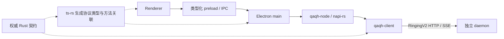

# QAQHarness v3.3：Electron 原生 Rust 客户端引入方案

日期：2026-11-05（Asia/Shanghai）  
状态：架构研判与实施方案，尚未实现或通过运行时验证  
范围：`qaqh-client`、napi-rs 绑定、Electron 主进程与 IPC、协议生成产物及 Linux/Windows 打包

## 1. 决策建议

建议以 `qaqh-client` 作为各 Rust 壳层共用的 RingingV2 客户端，新增薄的 napi-rs 绑定供 Electron 主进程调用，替换 Electron 对 `../qaqh-sdk` 中 TS 协议运行时的依赖。

总体难度为中等偏高。普通异步函数绑定难度较低，主要工作是补齐公共客户端的行为、统一契约来源、保证快照与事件有序交付，以及完成原生模块发布。

目标收益是让握手、续租、命令提交、回执查询和 SSE 恢复只维护一份 Rust 实现。新增 RingingV2 能力后，各平台消费同一客户端与契约，减少 TS SDK、Electron 包装层和 Rust 客户端之间的重复工作。

必须遵守以下边界：

1. RingingV2 协议及统一命令面保持最高权威；绑定层不得建立另一套业务命令或协议翻译表。
2. daemon 继续作为独立进程，通过现有 RingingV2 HTTP/SSE 提供服务。
3. 原生模块只在 Electron 主进程加载；renderer 通过类型化 preload/IPC 使用有限能力。
4. 保留 `ts-rs` 生成协议类型，napi-rs 负责原生调用绑定。
5. 切换完成后删除 Electron 的旧 TS 传输实现，不引入长期双实现、自动回退或兼容层。

引入 napi-rs 不会移除客户端到 daemon 的网络通信。此方案不承诺明显降低内存、减小安装包或提高吞吐；这些结果需要基于真实构建与负载测量。

## 2. 调研基线与限制

### 2.1 源码基线

| 项目 | 调研时 HEAD | 主要职责 |
| --- | --- | --- |
| `qaqh-backend` | `047bf47afe020e924995c1379532c88fec680b49` | RingingV2 权威契约、daemon、Rust 客户端、契约导出 |
| `qaqh-electron` | `fe6a6dd86f5acf46248137b89cd5570f478ec641` | Electron 宿主、preload、renderer、安装包 |
| `qaqh-sdk` | `c33bec7c2a91567a54828a784b708fc56c77df61` | 当前 TS 客户端及生成协议产物 |

backend 与 Electron 工作区存在未提交修改。本文依据本次会话中通过 CodeGraph 读取的工作区源码；HEAD 用于追溯，不表示纯净检出与调研时文件完全相同。本文仅新增 Markdown，不覆盖已有修改。

### 2.2 方法与验证状态

- 使用仓库已有 CodeGraph 索引检查 Rust 客户端、FFI、Electron 包装与构建脚本。
- 使用 `find-docs` / Context7 查询 napi-rs 当前文档，并核对官方文档。
- Context7 的异步任务与生命周期查询发生 `fetch failed`；该部分结论由 napi-rs 官方异步与并发指南补充核对。
- 未安装 napi-rs、创建绑定 crate、运行构建、启动 daemon 或执行全局测试。
- 尚未验证真实 Electron 原生加载、目标平台二进制兼容性、事件背压、关闭行为或性能。

文档落盘时资源约为：8 个逻辑 CPU、7.7 GiB 总内存、2.3 GiB 可用内存、Swap 已用 3.0 GiB、磁盘剩余 59 GiB。后续本机验证应先采用小范围构建和受控并发；原生绑定与 daemon 构建尽量共享 Cargo 产物，避免重复执行全工作区构建。

## 3. 现有架构与可复用基础

### 3.1 Electron 当前链路

```text
renderer
  → preload / IPC
  → Electron RingingClient 包装
  → @qaqh/sdk 的 TS 客户端
  → RingingV2 HTTP/SSE
  → daemon
```

Electron 主进程已经隔离 daemon 凭据，并承担原生能力与 renderer 访问约束。引入 napi-rs 可以保持这条宿主边界，主要替换主进程下面的协议运行时。

现有代码定位：

- [Electron 主进程客户端](../../../../qaqh-electron/src/main/ringing-client.ts)：`RingingClient`、`attach`、`serviceCall`、`command`。
- [IPC 处理](../../../../qaqh-electron/src/main/ipc-handlers.ts)：命令名单、服务名单、renderer 输入约束、原生操作。
- [preload](../../../../qaqh-electron/src/preload/index.ts)：调用入口与事件订阅。
- [renderer 传输接口](../../../../qaqh-electron/webui/src/lib/transport/backend.ts)：`ElectronServiceMap`、`TransportBackend`。

### 3.2 Rust 客户端已有能力

| 能力 | 当前基础 | 接入时的工作 |
| --- | --- | --- |
| 本地发现与连接 | discovery 读取、进程与端点探测、异步连接 | 与 Electron 的发现路径及启动职责统一 |
| 握手与续租 | open、后台续租、租约重新协商 | 对外暴露清晰的连接状态 |
| daemon 重启恢复 | 本地模式刷新端口/token、广播新租约上下文 | 验证 Electron 使用本地连接模式后的恢复链路 |
| 命令提交与状态查询 | 原生 RingingV2 信封、CAS 前提、ACK ID 校验、回执查询 | 补齐不确定结果及结构化失败信息 |
| 会话流 | 单流订阅、游标、epoch 变化、退避重连 | 统一 bootstrap 与增量事件交付、取消和背压 |
| 内容传输 | 上传、下载、摘要校验及范围读取入口 | 对齐 Electron 所需返回信息和取消行为 |
| 设备与配对 | 配对令牌、设备列表、吊销等 | 对齐公开方法及结果类型 |
| 生命周期 | `close()` 发送停止信号 | 增加可确认完成的异步关闭路径 |

证据：[client.rs](../../../crates/qaqh-client/src/client.rs)、[session.rs](../../../crates/qaqh-client/src/session.rs)、[v2.rs](../../../crates/qaqh-client/src/v2.rs)、[v2_stream.rs](../../../crates/qaqh-client/src/v2_stream.rs)。

### 3.3 已有平台绑定的参考价值

[qaqh-ffi](../../../crates/qaqh-ffi/src/lib.rs) 已使用 UniFFI 包装 `qaqh-client`，证明项目可以沿用“公共 Rust 客户端＋平台绑定”的分层。

Electron 的 napi-rs 绑定应与 UniFFI 绑定并列，直接依赖 `qaqh-client`。可以参考其句柄所有权与回调组织，但不应依赖 Android FFI crate，也不照搬逐方法 JSON 字符串接口或宿主投影转换。

## 4. 目标架构与代码归属



建议布局，名称为设计建议，当前目录尚未实现：

```text
qaqh-backend/
  crates/qaqh-client/           # 公共协议运行时
  crates/qaqh-node/             # 新增 cdylib：N-API 句柄、调用与事件交付
  bindings/node/                # JS loader、原生 API 声明、生成的协议产物

qaqh-electron/
  src/main/                    # 宿主原生能力、renderer 权限与窗口生命周期
  src/preload/                 # 类型化桥接
  resources/native/            # 当前平台的 .node 安装包产物
  resources/bin/               # 独立 daemon
```

职责划分：

| 层 | 应承担的职责 |
| --- | --- |
| 权威契约 | DTO、命令、事件词表、方法参数与结果关联、必要的方法元数据 |
| `qaqh-client` | HTTP/SSE、握手、续租、身份、命令回执、恢复与订阅生命周期 |
| `qaqh-node` | Rust/JS 值编组、原生句柄、Promise、事件交付、取消及环境资源释放 |
| Electron main | daemon 可执行文件与应用升级决策、原生窗口/对话框、renderer 能力约束 |
| preload | 暴露有限的类型化能力、订阅与取消句柄 |
| renderer | UI 状态与展示，不持有 daemon token，不维护网络恢复状态机 |

绑定层不得依赖完整 `qaqh-runtime` 或 daemon 来获取契约。服务 DTO/方法描述应从实现层下沉到轻量的权威契约层，再由服务端、客户端、导出器共用。

## 5. 替换前必须对齐的客户端行为

### 5.1 服务查询需要单一权威定义

TS SDK 的 `ServiceMap` 已由后端生成；Rust 侧还同时存在：

- [QueryRequest](../../../crates/qaqh-client/src/endpoint.rs) 的方法与参数映射。
- [service.rs](../../../crates/qaqh-client/src/service.rs) 中手工维护的账号方法白名单。
- [service_types.rs](../../../crates/qaqh-client/src/service_types.rs) 中单独定义的响应 DTO。
- 通用 `Value` 调用入口。

这不等于所有未列入枚举的方法都不能调用，但方法覆盖、参数与结果的静态关联尚未统一。仅包一层 napi-rs 无法消除这种重复。

实施要求：

1. 统一 Rust 服务契约来源，消费现有权威 DTO，避免再维护结构相似的响应类型。
2. 从同一方法声明生成 Rust 客户端关联、TS `ServiceMap` 和绑定所需元数据。
3. 清除 Electron 中已经被生成契约覆盖的补充声明和重复方法表。
4. renderer 允许的操作仍受宿主约束；协议方法表不自动等于 renderer 授权表。

### 5.2 命令结果未知必须保留原始 command_id

当前 TS SDK 有 `command_rejected` 与 `outcome_unknown` 的区分。Rust 的 `send_command_v2_typed` 会生成 `command_id`，但发送或读取响应时的错误可直接传播为通用客户端错误；现有 `ClientError` 没有将不确定结果与该 ID 关联。

实施要求：

- 对可能已受理的提交失败，返回可机器读取的不确定结果及原始 `command_id`。
- 保留 daemon 的结构化拒绝与原始 ACK 信息，避免壳层按错误文本猜测。
- 结果未知时只查询或按 RingingV2 规则使用原命令 ID，不以新 ID 重提。
- 明确区分“命令已受理”“命令回执终结”和“模型轮次结束”。

应修在公共 Rust 客户端，绑定层只透传；不能为 Electron 单独复制一套判定逻辑。

### 5.3 bootstrap 与事件必须有序交付

Electron 当前通过 TS SDK 的 `onBootstrap` 获得权威快照，再消费增量事件。Rust `V2Stream` 首次连接或 epoch 变化时会拉 bootstrap 来建立游标，但当前 `ClientHandlers` 没有对应的 bootstrap 交付出口。

公共客户端需要统一交付顺序：

```text
获得权威 bootstrap
  → 先向消费者交付该 bootstrap
  → 从其水位续订并交付后续增量
  → 收到 resync 或 epoch 变化时重新建立快照基线
```

快照水位、游标、epoch 和事件恢复由同一个 owner 管理。不得让 TS 另拉一份快照、Rust 独立推进另一条订阅。

不同会话的订阅必须有独立取消所有权；切换、重新订阅或关闭后，旧订阅的排队事件不得写入新会话投影。

### 5.4 有界事件交付与关闭

Rust 目前使用同步 `Fn` 回调交付事件。跨到 JS 后，不能直接假定消费者总能跟上，也不能把无限队列当成默认解决方案。

实施时需建立有界交付机制，并做到：

- 同一订阅的 bootstrap、事件和 reset 保持顺序。
- 队列满时采用明确的背压或中止并恢复流程，不忽略失败、不静默丢事实事件。
- 批量交付可以减少跨语言调用，但不得重排或改变协议事件。
- 取消或关闭能唤醒等待中的生产者，释放回调及订阅资源。
- 不将 JS 的 `Env`、对象句柄或借用值放进后台任务跨线程使用。

原生绑定可使用 `ThreadsafeFunction` 实现跨线程交付。具体有界订阅实现需与公共客户端现有同步回调接口一起设计，不在绑定层另写网络状态机。

Rust `close()` 当前只发停止信号，应增加能等待或终止所属任务的异步关闭能力。JS Promise 被丢弃不会自动取消 Rust future；操作取消和客户端关闭都必须有明确出口。napi-rs 的环境清理只能作为补充，不能代替正常关闭。

### 5.5 本地发现与进程启动只有一个 owner

Electron 目前有自己的 discovery 候选路径、校验及降级逻辑；Rust 客户端使用公共 discovery 路径，并在本地模式下支持 daemon 重启后的凭据刷新。两者不能继续独立决策。

建议 Electron 保留打包可执行文件选择、升级/重启等应用层决策；Rust 客户端统一当前 discovery 的解析、连接、续租和凭据刷新。初始化时明确进程拉起的唯一 owner，避免 Electron 与 Rust 同时启动 daemon。

本地发现与显式远端连接应是明确的连接来源。不得为了传入本地 endpoint/token，借用会关闭本地发现刷新的远端模式；远端连接也不得被本机 discovery 改道。

## 6. 类型生成与绑定 API

### 6.1 保留 ts-rs，避免协议类型镜像

建议分工：

| 机制 | 产物 |
| --- | --- |
| `ts-rs` / 现有契约导出器 | RingingV2 DTO、命令与事件联合类型、常量、`ServiceMap` |
| napi-rs | 原生函数/类的调用绑定与声明 |
| 同一契约驱动的生成门面 | 方法名与参数/结果的泛型关联、公开原生客户端类型 |

napi-rs 不是现有任意 Serde 类型的无配置绑定器。生成 `.d.ts` 不等于完成运行时值转换；不能依靠手工类型覆盖来掩盖 Rust/JS 形状不一致。

无需给全部协议 DTO 手写另一套 `#[napi(object)]` 镜像。可在绑定边界复用 Serde 转换，将 JS 对象解码到权威 Rust DTO，并以同一序列化规则交付响应。内部编组入口可以擦除类型，公开接口必须由契约生成准确的类型关联，避免把每个调用都变成 `any` 或 JSON 字符串。

### 6.2 值转换规则

- 保持 RingingV2 的字段名、枚举 tag、缺失字段与 `null` 语义。
- 对序号、revision、超时等整数沿用协议规定。napi-rs 的部分 64 位整数默认映射为 `bigint`，不能让现有 `number` 字段因绑定方式改变表示。
- 需要 JS Number 的字段应遵守契约安全整数范围，越界显式报错，不能截断或丢精度。
- 二进制内容使用明确的 Buffer/字节接口；不承诺所有 Electron 环境下都能零拷贝。
- 原生错误跨 IPC 时使用可序列化的结构化信息，保留 `code`、`command_id` 等必要字段，避免依赖原生 Error 的自定义属性自动穿透 IPC。

### 6.3 建议公开能力

以下是设计能力面，不是当前已生成的 API，也不是 napi-rs 自带方法：

| 能力 | 语义 |
| --- | --- |
| connect | 按明确连接来源创建客户端，完成 RingingV2 协商 |
| query | 由生成方法表关联参数与结果 |
| submit | 保留 target、command、CAS 前提、command_id 与原始 ACK |
| commandStatus | 查询原始命令回执 |
| watchSession | 交付有序快照/事件/状态，返回可取消的订阅所有权 |
| content / devices / pairing | 覆盖 Electron 实际消费的公共能力 |
| close | 停止并回收该客户端拥有的后台工作 |

原生能力入口不直接暴露给 renderer。preload 按实际产品能力提供类型化方法，宿主约束继续在主进程执行。

## 7. 构建、依赖与发布

### 7.1 产物归属与 SDK 退出

原生绑定、loader、协议生成产物应归属于 backend 的同一源码版本，减少维护独立 SDK 仓库的发布协调。

Electron 切换完成后：

- 移除 `@qaqh/sdk` 的客户端与 node discovery 运行时依赖。
- 将协议类型引用切到新的生成产物入口。
- 调整契约导出目录、manifest/hash 检查及 renderer 类型同步脚本。
- 移除构建链中为 Electron 单独检出、安装和构建 `qaqh-sdk` 的步骤。
- 检查其他消费者后再处理整个 `qaqh-sdk` 仓库的去留；Electron 退出依赖不等于已确认全仓无人使用。

### 7.2 Electron 原生模块打包

当前 esbuild 将主进程打成 CJS；安装包包含 `dist`、renderer 和独立 daemon，还没有 `.node` 产物路径。

推荐将当前目标平台的原生模块放入 `resources/native/`，与 `resources/bin/` 并列，并通过明确路径加载。构建链需要同步调整：

1. 编译当前平台 `qaqh-node`，生成匹配的 loader 与类型声明。
2. JS bundler 不把 `.node` 当作普通 JS 内联，也不依赖未随包分发的开发目录。
3. 显式把原生二进制加入安装包；若使用 ASAR unpack 布局，则连同解包目录一起发布。
4. `afterPack` 校验增加原生文件的存在、架构、来源/摘要，以及真实 Electron 加载验证。
5. 原生模块、协议产物和随包 daemon 的源码身份应可追溯，并继续严格校验 RingingV2 契约代际。

依据：[bundle.mjs](../../../../qaqh-electron/scripts/bundle.mjs)、[build-all.mjs](../../../../qaqh-electron/scripts/build-all.mjs)、[electron-builder.yml](../../../../qaqh-electron/electron-builder.yml)、[verify-package.cjs](../../../../qaqh-electron/scripts/verify-package.cjs)。

### 7.3 平台矩阵与资源

首期按现有发行范围验证 Linux x64 与 Windows x64，复用现有平台 runner。Node-API 的 ABI 稳定性可以减少因 Node 版本变化而重复编译的需求，但不覆盖不同 OS、CPU、libc 或最低系统版本；必须在实际随包 Electron 中加载验证。

公共客户端应只依赖必要的协议与传输能力。当前 `qaqh-types` 默认启用可选的 `tokenizers`，应检查并整理这条依赖链，避免原生客户端无意引入不需要的实现。不能仅在最外层设置 `default-features = false` 就认定完成裁剪，Cargo 的传递依赖和 feature 合并也需要确认。

正常异步调用应复用 napi-rs 提供的 Tokio 执行环境并使用 `connect_async`，避免调用同步连接入口再创建独立全局 runtime。后台任务归客户端句柄所有，JS 环境资源不得缓存为跨 isolate 全局对象。

独立浏览器客户端无法直接消费本机 `.node` 模块；若产品后续需要该形态，仍需浏览器网络客户端。此方案的直接收益覆盖 Electron 与其他 Rust 壳层。

## 8. 迁移阶段与难度

以下是熟悉仓库的工程师连续工作的初步人日估算，不是已验证排期。阶段间可以复用成果，不能把每一行估算理解为必须串行相加。

| 阶段 | 交付 | 难度 | 粗估 |
| --- | --- | --- | --- |
| M0：纵向贯通 | Linux 上原生模块连接 daemon、查询、提交命令、交付一条会话流 | 低到中 | 1–2 人日 |
| M1：公共客户端收口 | 权威服务契约、不确定结果、快照/增量、有界订阅及关闭 | 中到高 | 2–4 人日 |
| M2：Electron 切换 | 主进程消费原生客户端、生成类型化桥接、删除旧 TS 传输依赖 | 中 | 1–2 人日 |
| M3：平台发布 | Linux/Windows 安装包、来源检查、实际 Electron 加载与恢复验证 | 中 | 1–2 人日 |

完整替换初步估计约 5–10 人日。主要变量是公共客户端对齐范围、其他 Rust 壳层消费者需要同步调整的程度，以及跨平台原生打包问题。

M0 的实验入口应与正式运行路径分开；正式切换后删除旧实现，不以加载失败后回退 TS SDK 的方式上线。公共客户端的改动应直接提升共享能力，避免在 napi-rs 绑定里再建一份专用客户端。

## 9. 验收标准

只做与本次边界直接相关的验证，不为每个透传方法复制一套测试，不以反复全工作区测试作为日常修改循环。

| 验证项 | 通过标准 |
| --- | --- |
| 真实原生加载 | 打包后的 Electron 能加载目标平台 `.node`，不依赖兄弟仓库或开发机 node_modules |
| 命令纵向链路 | 创建/连接客户端、提交一次合法命令、保持 target 与 CAS，返回真实 ACK |
| 不确定结果 | 模拟可能受理后的断线，保留原始 command_id，可通过回执查询恢复，不制造第二条命令 |
| 有序会话投影 | 首次 bootstrap 先于对应增量；resync/epoch 变化正确建立新基线 |
| 慢消费与切换 | 队列有界；切会话、取消和重新订阅后，旧事件不污染新投影；不静默丢事实 |
| daemon 重启 | 本地端口/token 变化后能刷新凭据、重新协商并恢复所需订阅 |
| 关闭 | 应用退出和客户端关闭能回收续租、网络请求、订阅与 JS 回调，不因原生句柄阻止退出 |
| 类型与值一致 | 代表性的 tagged enum、缺失/null、序号/revision、安全整数边界与字节内容保持契约语义 |
| 跨平台发布 | Linux x64、Windows x64 安装包均通过真实 Electron 加载与最小连接验证 |
| 退出旧链路 | Electron 无旧 TS 协议运行时及其 fallback；构建链不再要求独立 SDK 检出 |

首个能做决策的里程碑应包含：打包 Electron 加载原生模块、完成命令提交、收到快照与增量、daemon 重启后恢复、退出时完成回收。仅证明 JS 能调用一个 Rust 函数，不足以判断本项目迁移成立。

## 10. 实施前仍需确认的事项

- 公共服务 DTO/描述表下沉的准确边界，以及其他客户端的同步修改范围。
- 有界订阅 API 的最终形态，特别是现有同步回调如何支持取消和背压。
- 各类命令失败是否完整保留 ACK、原始 command_id 和可区分的执行结果。
- 内容传输返回元信息、范围读取与取消是否覆盖 Electron 实际调用。
- 原生 API 生成声明与 `ServiceMap` 的拼接方式，及运行时值转换的一致性检查。
- 当前 Electron 版本、Linux 最低系统基线及 Windows 原生链接配置的实测结果。
- 原生模块的体积、启动成本和常驻内存。当前没有测量数据，不以估计值宣称收益。

## 11. 官方资料

查阅日期：2026-11-05。实现时应按选定并锁定的版本再次核对 API；以下页面用于支持本方案的机制判断。

- [napi-rs：Getting started](https://napi.rs/docs/introduction/getting-started)——原生模块、loader、TypeScript 声明及平台分发。
- [napi-rs：Async and concurrency](https://napi.rs/docs/more/async-concurrency)——Promise、取消、后台任务、队列及运行时生命周期。
- [napi-rs：ThreadsafeFunction](https://napi.rs/docs/concepts/threadsafe-function)——跨线程调用 JS、队列与回调所有权。
- [napi-rs：Type conversions](https://napi.rs/docs/concepts/type-conversions)——运行时转换要求、Serde 值与整数表示。
- [napi-rs：Support and compatibility](https://napi.rs/docs/more/support-compatibility)——Node-API ABI 与平台兼容性的边界。
- [Electron：ASAR Archives](https://www.electronjs.org/docs/latest/tutorial/asar-archives)——原生模块加载与解包发布。
