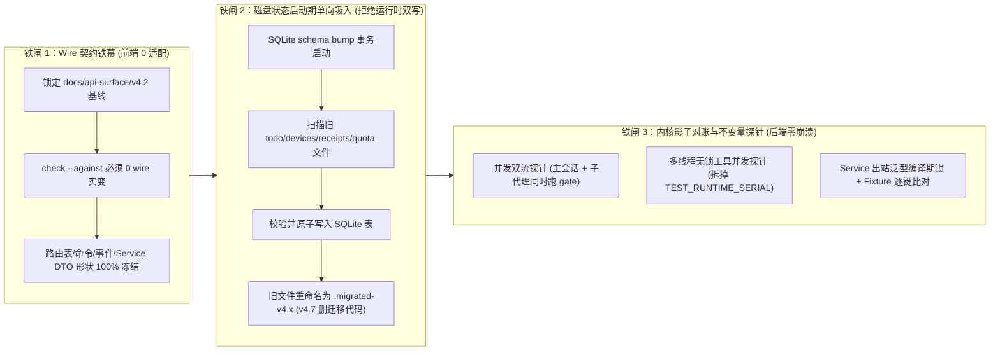
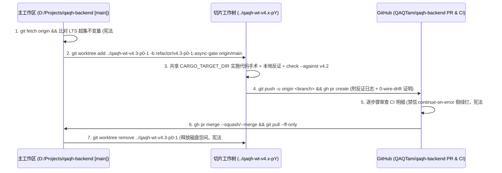

> **宿主机资源基线（项目宪法 #7）**：Intel Xeon E3-1230 V2（4C/8T）· 内存可用 **4.64 GB** / 7.95 GB · 磁盘 `C:` 剩余 105.54 GB / `D:` 剩余 **85.16 GB**。以下为补充了 **`../` 平级 Git Worktree 物理隔离规程**与 **GitHub PR 强制对外展示/审计流程**的完整整改令 Markdown。

---

# QAQ-Harness 后端架构与依赖乱象全面清剿令（`v4.7` 封板死线）

- **当前版本基线**：`v4.2.0`（[Cargo.toml](file:///d:/Projects/qaqh-backend/Cargo.toml#L62)）
- **最终完工死线**：**必须排除万难在 `v4.7.0` 发版前 100% 清零，严禁把任何一条历史包袱拖过 `v4.7`！**
- **适用最高准则**：《项目宪法》第 2、3、4、5、7、9、10、15、16、17、18、19、20、21、22 条
- **核心约束**：
  1. **前端（WinUI / Ratatui / Web / Android / OHOS）0 适配**；
  2. **后端必须建立在绝对正确的设计之上**，严禁靠防御性补丁或永久兼容转换层苟延残喘，且重构全程**功能零崩溃**；
  3. **全流程 Worktree 隔离 + GitHub PR 对外留痕**：所有切片一律在 `../` 下通过 `git worktree` 创建独立分支施工（严禁使用 `git checkout`，宪法 #22），并**首次全面启用 GitHub PR（`https://github.com/QAQTam/qaqh-backend`）机制**，确保虽在本机闭环开发，但每一个切片的设计、反证、契约对账与 CI 步骤明细对外完整公开可审计。

---

## 一、现状定性：不可容忍的架构腐化与工程懒政

经过对全仓 **43 个 workspace crates（超 13.8 万行 Rust 代码）** 的逐层剥离审计，当前后端在表面「RingingV2 契约化」之下，掩盖着大量**违背项目宪法、自欺欺人的拧巴设计**。在此逐条点名批判：

### 1. 荒谬绝伦的「异步 → 同步 → 异步」三明治与单进程 5 套 Tokio Runtime
这是全仓最丑陋的并发灾难：
- `qaqh-daemon` 本身就是多线程 Tokio Runtime，`SessionLoop::run_turn` 本身也是 `async` 任务；
- 结果调 LLM 时，[crates/qaqh-agent-runtime/src/provider_job.rs](file:///d:/Projects/qaqh-backend/crates/qaqh-agent-runtime/src/provider_job.rs#L172-L175) 居然用 `tokio::task::spawn_blocking` 把异步强行拍扁成同步阻塞线程，再去调同步签名的 `qaqh_gate::chat_stream`；
- 而 `qaqh-gate` 底层的 `mutil-ai` / `reqwest` **本来就是原生 `async` 的**！为了给同步函数圆场，[crates/qaqh-gate/src/transport.rs](file:///d:/Projects/qaqh-backend/crates/qaqh-gate/src/transport.rs#L25-L37) 竟然声明了一个进程级全局的 **`new_current_thread()` 单线程 Tokio Runtime (`FALLBACK_RT`)**，用 `FALLBACK_RT.block_on(...)` 跑流式 HTTP（见 [crates/qaqh-gate/src/chat_sdk.rs](file:///d:/Projects/qaqh-backend/crates/qaqh-gate/src/chat_sdk.rs#L793)）！
- **恶果**：`current_thread` Runtime 的 `block_on` 持有独占调度锁。当主会话与子代理（`spawn_subagent`）或多会话并发流式请求 LLM 时，后进入的线程在 `FALLBACK_RT.block_on` 门口**被彻底卡死串行化**！所谓「多代理并发协作（AgentTeam 2.0，`ADR-0033 [状态：已采纳并实施]`）」在网关 I/O 层被一把单线程大锁直接废掉！
- 同样的懒政还出现在 [crates/qaqh-mcp/src/bridge.rs](file:///d:/Projects/qaqh-backend/crates/qaqh-mcp/src/bridge.rs#L126-L225) 与 [crates/qaqh-lsp/src/bridge.rs](file:///d:/Projects/qaqh-backend/crates/qaqh-lsp/src/bridge.rs#L22-L31)：在各自私建的 Tokio Runtime 上 spawn 任务，然后用 `std::sync::mpsc::Receiver::recv_timeout(250ms)` 轮询取消位。**一个进程里塞进 5 个 Tokio Runtime，这是对 Rust 异步模型的彻底羞辱。**

### 2. 「伪模块化」拆分：43 个 Crate 靠 `thread_local!` 与 `OnceLock<fn()>` 反向钩子苟合
P2 阶段把 `qaqh-workspace` 拆成 `qaqh-file-tools`、`qaqh-process-tools`、`qaqh-permission`、`qaqh-tool-core`，表面上解了编译环，实际上干的是**掩耳盗铃的伪解耦**：
- **测试层依旧成环**：[crates/qaqh-file-tools/Cargo.toml](file:///d:/Projects/qaqh-backend/crates/qaqh-file-tools/Cargo.toml#L33-L35) 和 [crates/qaqh-process-tools/Cargo.toml](file:///d:/Projects/qaqh-backend/crates/qaqh-process-tools/Cargo.toml#L33-L35) 在 `[dev-dependencies]` 里反向依赖 `qaqh-workspace`；
- **运行期靠全局静态函数指针偷状态**：[crates/qaqh-file-tools/src/hooks.rs](file:///d:/Projects/qaqh-backend/crates/qaqh-file-tools/src/hooks.rs#L31-L41) 和 [crates/qaqh-workspace/src/registration.rs](file:///d:/Projects/qaqh-backend/crates/qaqh-workspace/src/registration.rs#L35-L45) 用 `OnceLock<fn() -> AmbientRuntime>` 把门面的 `thread_local!` 状态反向喂给子 crate；
- **执行一次工具要改 5 个 `thread_local!`/全局槽位**：[crates/qaqh-workspace/src/runtime.rs](file:///d:/Projects/qaqh-backend/crates/qaqh-workspace/src/runtime.rs#L104-L163) 的 `ToolExecutionScope::install()` 在明明已经有 `ToolCallContext` 的情况下，依然在线程局部存储里来回倒腾 `ACTOR_TOOL_MANAGER`、`EXECUTION_CONTEXT`、`RUNTIME_CTX`、`SUBAGENT_SANDBOX`；
- **进程级 `file_state::LEDGER` 跨会话污染**：[crates/qaqh-file-tools/src/file_state.rs](file:///d:/Projects/qaqh-backend/crates/qaqh-file-tools/src/file_state.rs#L93-L132) 的文件读写基线账本居然还是**全进程唯一单例**（里面甚至留着已死架构 `serve` 子进程的 `take_pending` / `apply_pending` 尸体），任何会话调一次 `init_tools`（[crates/qaqh-workspace/src/runtime.rs](file:///d:/Projects/qaqh-backend/crates/qaqh-workspace/src/runtime.rs#L235-L236)）就 `file_state::clear()` 把全进程所有会话的 `STALE_FILE` 校验基线全部洗白！
- **幽灵依赖无人清理**：拆完之后，[crates/qaqh-workspace/Cargo.toml](file:///d:/Projects/qaqh-backend/crates/qaqh-workspace/Cargo.toml#L15-L48) 里的 `globset`、`ignore`、`grep-regex`、`grep-searcher`、`similar`、`unicode-normalization`、`sbx-win` 在该 crate 内 **0 引用**，却一直挂在 `Cargo.toml` 里陪葬编译！

### 3. 口头「SQLite 单权威」，身体却在数据目录到处拉撒 JSON/JSONL 私房文件
[crates/qaqh-runtime/src/service.rs](file:///d:/Projects/qaqh-backend/crates/qaqh-runtime/src/service.rs#L86-L89) 注释写得义正词严：*「业务库：SQLite WAL 单权威」*。然而翻开代码，数据根下居然还有 **5 套脱离 SQLite 事务保护的野生文件账本**：
1. **`sessions/{seed}/todo.json`**（[crates/qaqh-workspace/src/todo/store.rs](file:///d:/Projects/qaqh-backend/crates/qaqh-workspace/src/todo/store.rs#L26-L31)）：会话早已落进 SQLite，Todo 却还在往 `sessions/{seed}/todo.json` 写文件，逼得 44 行的空壳 `SessionManager`（[crates/qaqh-session/src/manager.rs](file:///d:/Projects/qaqh-backend/crates/qaqh-session/src/manager.rs#L25-L49)）专门保留下来删目录。
2. **`quota/{root_session_id}/ledger.jsonl`**（[crates/qaqh-agent-runtime/src/quota_ledger.rs](file:///d:/Projects/qaqh-backend/crates/qaqh-agent-runtime/src/quota_ledger.rs#L135-L295)）：每次操作配额都要加 `.lock` 文件锁、把整个 JSONL 从头到尾重读解析一遍（`self.refresh()`）。
3. **`ringing-command-receipts.json`**（[crates/qaqh-ringing-runtime/src/pending_store.rs](file:///d:/Projects/qaqh-backend/crates/qaqh-ringing-runtime/src/pending_store.rs#L175-L260)）：每次命令回执更新，把最多 4096 条 `HashMap` 全量序列化写盘覆盖一次 JSON。
4. **`ringing-devices.json`**（[crates/qaqh-ringing-runtime/src/device_registry.rs](file:///d:/Projects/qaqh-backend/crates/qaqh-ringing-runtime/src/device_registry.rs#L86-L132)）：配对设备表不进 SQLite，单开 JSON 文件。
5. **`.qaqh/journal.jsonl` & `audit/v2.rs`**：工具侧维护两套 JSONL 审计日志，与 SQLite `tool_calls.code_delta` 形成三头记账。

### 4. 劣质手写轮子泛滥，甚至公然违宪写「伪随机数降级补丁」
明明 workspace 已经引入了工业级标准 crate，部分模块却偏要手搓劣质实现，甚至复制粘贴 3~5 份：
- **违宪防御性代码（宪法 #5 零容忍）**：[crates/qaqh-dsaccount/src/util.rs](file:///d:/Projects/qaqh-backend/crates/qaqh-dsaccount/src/util.rs#L13-L26) 与 [crates/qaqh-siwc/src/util.rs](file:///d:/Projects/qaqh-backend/crates/qaqh-siwc/src/util.rs#L11-L24) 在操作系统 CSPRNG (`SystemRandom::fill`) 失败时，不仅不报错终止，反而**用「当前时间戳 + 栈内存指针地址」拼字符串当 OAuth PKCE `code_verifier` / `state` 密钥**！同文件 `random_uuid_v4` 在熵源失败时用「时间戳 + PID」伪造 UUID！这是典型的**用安全漏洞掩盖系统故障的防御性补丁**，必须立即铲除！
- **手写 Base64 重复 3 套**（`secrets.rs`、`qaqh-siwc/src/util.rs`、`qaqh-dsaccount/src/util.rs`），而 workspace 早已引入 `base64 = "0.23"`。
- **手写 32 次堆分配的 `sha256_hex` 重复 4 套**（`hash.iter().map(|b| format!("{b:02x}")).collect()`），而 workspace 早已引入 `hex = "0.4"`。
- **手写无 `black_box` 的 `constant_time_eq` 重复 2 套**（在 LTO 下随时被 LLVM 优化掉常数时间特性），而 workspace 早已引入 `subtle = "2"`。
- **手写 `atomic_write` / `replace_file` 重复 5 套**（两处复制粘贴 `unsafe { MoveFileExW }`，三处直接用固定 `.json.tmp` 既不 `sync_all` 也不防并发踩踏），而 workspace 早已引入 `tempfile = "3"`。
- **手写 `tasklist.exe` 子进程派生判活**（[crates/qaqh-types/src/platform.rs](file:///d:/Projects/qaqh-backend/crates/qaqh-types/src/platform.rs#L413-L439)）：查一个 PID 是否存活居然去 spawn 一个耗时上百毫秒的 `tasklist.exe`！

---

## 二、破例设计的严格迁移机制：「前端 0 适配 + 后端正确设计零崩溃」三道铁闸

> **核心纪律**：本次允许为大整改设计严格的**工程迁移保障机制**，但**绝不允许在业务内核里保留丑陋的运行时兼容转换层**（宪法 #4、#5、#9）。我们的策略是：**把用户空间（Wire 协议面）焊死，把磁盘旧状态在启动瞬间一次性单向吸入 SQLite，把内核空间一步到位切成正确架构，并用自动化对账闸门锁死行为等价性。**



### 铁闸 1：用户空间 Wire 契约铁幕（确保前端 100% 零适配）
1. **内核手术与契约演进物理隔离**：
   - 本次大整改的所有架构手术（Runtime 异步化、工具去 `thread_local!`、状态入 SQLite、Crate 合并、手写轮子替换）**一律定义为纯粹的内核空间（Kernel-Space）改造**。
   - **硬性机器判据**：每一个架构整改 PR 提交前，必须执行官方命令（宪法 #20）：
     ```powershell
     cargo run -p qaqh-contract-export -- check --against docs/api-surface/v4.2
     ```
     **必须返回 `EXIT = 0` 且 wire 实变列表为空**（或仅在 `v4.6` 合入 `ADR-0035 [状态：已采纳（未实施）]` 时做唯一一次受控 `[contract-refreeze]`）。
2. **四大前端接触面绝对不变**：
   - 路由表 `RINGING_V2_HTTP_ROUTES` 与 `CONTROL_PLANE_ROUTES` 零增删（宪法 #16）；
   - `RingingCommand` / `RingingV2CommandAck` / `SessionEventFrame` 的序列化 JSON 形状与 `seq` 单调递增语义零变化；
   - `/ringing/v2/service/{method}` 的 40+ 个方法名、入参 `*Params` 与出参 `*Result` DTO 零变化；
   - `DaemonDiscovery` (`daemon.json`) 字段与握手机制零变化。
   - **结论**：WinUI、Ratatui、Web、Android (`qaqh-ffi`)、OHOS (`qaqh-harmony-napi`) **不需要改一行代码，不需要重编前端 SDK**。

### 铁闸 2：磁盘持久化「启动期一次性单向吸入（Boot-Time One-Shot Ingression）」
针对 `todo.json`、`ringing-devices.json`、`ringing-command-receipts.json`、`quota/*/ledger.jsonl` 并入 `qaqh.db`：
- **严禁做运行时 fallback（如「先查 SQLite，查不到再读 `todo.json`」）**——那正是宪法 #4 严令砍掉的兼容性垃圾代码！
- **破例执行一次性启动吸入机制**：
  1. 在 [crates/qaqh-session/src/db/schema.rs](file:///d:/Projects/qaqh-backend/crates/qaqh-session/src/db/schema.rs) 提升 `SCHEMA_VERSION` 时，在**同一个 `EXCLUSIVE` SQLite 事务**内运行 `ingest_legacy_sidecar_files(conn, data_dir)`：
     - 扫描 `sessions/*/todo.json` → 写入 SQLite `session_todos` 表；
     - 扫描 `ringing-devices.json` → 写入 SQLite `paired_devices` 表；
     - 扫描 `ringing-command-receipts.json` → 写入 SQLite `command_receipts` 表；
     - 扫描 `quota/*/ledger.jsonl` → 聚合写入 SQLite `quota_reservations` 表。
  2. **强校验与墓碑封存**：事务内核对吸入行数与原文件记录数 100% 相等后 `COMMIT`；提交成功后立即将旧文件重命名为 `*.migrated-v4.4`（既防重复吸入，又留现场备查）。
  3. **运行期纯粹单一真源**：迁移函数跑完后，`QaqhService`、`ToolManager`、`RingingHub` 的运行期代码**只存在读写 SQLite 的唯一路径**，旧文件读写代码在同一次提交中彻底删除！
  4. **生命周期自毁**：该启动期吸入函数仅在 `v4.4`–`v4.6` 存续，**在 `v4.7.0` 封板前随旧版本 schema 升级分支一并清理**，不留永久历史包袱。

### 铁闸 3：内核替换「同提交立斩 + 并发反证闸」（确保后端零崩溃）
遵循宪法 #18（新闸门落地必须反证它真会红），每一刀内核手术必须绑定对应的**反证与不变量测试**：
1. **砍 `FALLBACK_RT` 与 `qaqh-gate` 原生异步化的防崩闸**：
   - 必须新增一条**双流并发反证测试** `concurrent_sessions_stream_in_parallel`：启动两个 Mock Upstream SSE 流（流 A 挂起 5 秒不发完，流 B 立即发完），主会话连流 A、子代理连流 B。
   - **反证**：在旧代码（`FALLBACK_RT` `current_thread` `block_on`）上，流 B 会被流 A 阻塞满 5 秒（测试必红）；在 `qaqh-gate` 改为原生 `async fn chat_stream` 后，流 B 必须在 50ms 内独立完成（测试变绿）。
2. **砍 `thread_local!` 与进程级 `file_state` 的防崩闸**：
   - 删掉 `qaqh-workspace`、`qaqh-file-tools`、`qaqh-permission` 中的 `static TEST_RUNTIME_SERIAL: LazyLock<Mutex<()>>`！
   - 新增多线程压力测试：8 个线程同时持有不同 `session_id` 和 `workspace_root` 的 `WorkspaceToolPort` 并发执行 `read` / `edit` / `apply_patch` / `todo_write`，断言**零 `STALE_FILE` 误判、零跨会话工作区串台**。
3. **砍每会话 `SessionOwner` OS 线程（改 Tokio Actor）的防崩闸**：
   - 跑通全套 [crates/qaqh-session/src/owner_tests.rs](file:///d:/Projects/qaqh-backend/crates/qaqh-session/src/owner_tests.rs) 与 [crates/qaqh-daemon/src/axum_server/v2_storm_tests.rs](file:///d:/Projects/qaqh-backend/crates/qaqh-daemon/src/axum_server/v2_storm_tests.rs)，确保 `ADR-0030 [状态：已采纳并实施]` 的 20ms/256KiB 泵侧合帧、`seq` 严格递增、`flush()` 屏障语义 100% 不变，且 `unload_idle_sessions` 后任务句柄立即 drop 回收。
4. **砍 `service_methods::dispatch` 运行期二次 JSON 反序列化的防崩闸**：
   - 将所有 handler 签名改为强类型 `fn(&QaqhService, ReqDto) -> QaqhResult<RespDto>`，在编译期锁死返回类型；保留 `qaqh-contract-export` 对所有 `TYPED_METHODS` 的 fixture round-trip 校验，任何字段偏差在编译期直接拒绝。

---

## 三、`../` Worktree 物理隔离与 GitHub PR 对外展示强制规程（新增铁律）

> **强制背景**：主工作区 `D:/Projects/qaqh-backend` 保持在干净的 `main` 基线，**严禁在主工作区直接手改业务代码或使用已被宪法 #22 禁用的 `git checkout`**。本次 `v4.3`–`v4.7` 全部切片必须通过 `../` 平级 Worktree 创建独立分支，并通过 **GitHub PR (`origin = https://github.com/QAQTam/qaqh-backend.git`)** 对外完整呈现每一次架构手术的提案、反证记录、契约检查与合并轨迹。



### 1. `../` 平级 Worktree 目录与命名硬性规范
1. **为什么必须直接建在 `../`（即 `D:/Projects/qaqh-wt-*`）而非二级子目录**：
   - 根 [Cargo.toml](file:///d:/Projects/qaqh-backend/Cargo.toml#L53) 声明了路径依赖 `mutil-ai = { version = "0.7.0", path = "../mutil-ai" }`（位于 `D:/Projects/mutil-ai`）。
   - 只有将 worktree 建在 `../qaqh-wt-<version>-<slice>`（与 `D:/Projects/qaqh-backend` 和 `D:/Projects/mutil-ai` 同级），Cargo 解析 `../mutil-ai` 才能 **100% 零修改无缝命中**！严禁建在 `../worktrees/...` 等多级子目录下破坏相对路径。
2. **禁止 `git checkout`（宪法 #22）与并发比对（宪法 #19）**：
   - 开设任何切片 worktree 前，必须先执行：
     ```powershell
     git fetch origin
     git worktree add ../qaqh-wt-v4.3-p0-1 -b refactor/v4.3-p0-1-async-gate origin/main
     ```
   - 在 worktree 内切换或恢复文件只准用 `git switch` / `git restore`，出现一次 `git checkout` 立即判定违规。
3. **磁盘与内存防爆规程（宪法 #7、#10）**：
   - 本机 `D:` 盘可用空间为 **85.16 GB**，内存仅 **7.95 GB**。若每个 worktree 独立生成一份 `target/`（动辄 15~25 GB），3 个 worktree 就会撑爆磁盘！
   - **强制规定**：
     - 同一时刻最多驻留 **1~2 个**活跃切片 worktree；
     - 在 worktree 内执行 `cargo test -p <crate>` 时，统一注入环境变量 `$env:CARGO_TARGET_DIR = "D:/Projects/qaqh-backend/target"` 复用编译缓存；
     - 切片 PR 合并进 `main` 后，**必须当场执行 `git worktree remove ../qaqh-wt-<version>-<slice>` 并 `git branch -d <branch>`**，严禁留置僵尸工作树。

### 2. GitHub PR 对外展示与审计四步法（每个切片 1 个独立 PR）
严禁把 `v4.3`–`v4.7` 攒成一个几万行的黑盒巨型提交直接推 `main`。**每一条优先级切片（P0-1 ~ P3-2）必须对应 GitHub 上一个独立、高信噪比的 Pull Request**：

1. **PR 标题与契约分类标签（宪法 #15）**：
   - 内核空间零 wire 变动切片：`[kernel-refactor][v4.x][P0-1] <简明扼要的架构手术名>`（若涉及快照收紧或注释刷新，严格标 `[guard-tightening]` 或 `[doc-only-refresh]`；仅 `v4.6` 的 ADR-0035 标 `[contract-refreeze]`）。
2. **PR 正文必填「四联单」（对外展示核心）**：
   - **① 架构病灶与宪法依据**：点名被砍掉的旧设计（附 `file:line`）及依据的《项目宪法》/ ADR 条款；
   - **② 旧代码物理歼灭清单**：列出本 PR 彻底删除的旧模块、旧 `thread_local!`、旧手写轮子或空壳 crate（证明绝非新旧并存打补丁）；
   - **③ 反证记录（Counter-Proof，宪法 #18）**：贴出新测试在旧实现上变红（或复现阻塞/串台）、在新实现上变绿的真实终端输出；
   - **④ 前端 0 适配契约铁闸输出**：贴出 `cargo run -p qaqh-contract-export -- check --against docs/api-surface/v4.2` 的 `EXIT=0` 实测证明。
3. **CI 步骤级严苛核验（宪法 #18、#20）**：
   - 推送分支并执行 `gh pr create` 后，通过 `gh pr checks` 与 `gh run view --log` **逐步骤（Step-by-Step）核查 CI**，严禁只看 Job 顶层绿灯（防止 `continue-on-error` 掩盖 lint 或契约闸门失败）。
4. **主工作区同步与超集不变量复核（宪法 #19）**：
   - PR 经 `gh pr merge` 合入 `origin/main` 后，回到主工作区 `D:/Projects/qaqh-backend` 执行 `git pull --ff-only origin main`，核验 `main ⊇ LTS-v3.0 / LTS-v3.1 / LTS-v4.1` 超集不变量，随即销毁该切片的 `../qaqh-wt-*` 目录。

---

## 四、`v4.3` – `v4.7` 强制整改路线图与优先级总表

> **硬性排期命令**：`Cargo.toml` 版本基线为 `4.2.0`（`v4.3` 的 `P0-1`~`P0-4` 对应 PR #23/#24/#25/#26 及桌面紧急修复 PR #27/#28 已合入 `main` `@ 5f3c2031`；以下切片在 `v4.7.0` 打 tag 前必须按序全部经 GitHub PR 合入清零）。任何切片未通过验收判据，严禁进入下一版本位！
>
> **2026-11-23 `LOCK_AUDIT_REPORT.md` 补充校准**：
> 1. **新增 `P1-0a ~ P1-0d`（插入 `v4.4` 最前端）**：全局锁专项审计发现全仓无存活死锁，但存在 `L-01`（`QaqhService.registry` 持锁 IO × Tokio worker 同步分派）复合停摆风险及 `qaqh-lsp` 三项独立正确性缺陷（`L-07`/`L-08`/`L-09`），须在 `P1-1` 前先行立斩（其中 `service_api.rs` 已由 PR #28 提前完成）。
> 2. **Runtime 计数校准**：`daemon` 进程内实测最多 **4 套** Tokio Runtime（`main` + `mcp` 专属 + `lsp` 专属 + 惰性 `shared_runtime`），`qaqh-client` 的 `RUNTIME` 属前端/桥进程不在 daemon 内；`P1-1` 按此口径验收。
> 3. **禁止“一刀切删锁”**：除 `L-07`（`qaqh-lsp` 多余且键错位的 `SPAWN_PIDS` 表）外，其余全局锁须严格区分“缩持锁边界/`spawn_blocking`（`P1-0`）”与“随 Actor/SQLite/实例化自然退场（`P1-1~P1-3`、`P2-1`）”。详细排期与派工卡见同目录 `V4_4_EXECUTION_PLAN.md`。

### 优先级分级定义
- **P0（架构毒瘤 / 并发死锁 / 违宪安全漏洞）**：直接导致多代理假并发、跨会话状态踩踏或违反宪法 #5 的致命缺陷，**`v4.3` 必须立斩**。
- **P1（核心运行时与存储分裂收口）**：5 个 Tokio Runtime 合一、`SessionOwner` 去 OS 线程化、野生 JSON/JSONL 账本吸入 SQLite，**`v4.4` 必须完工**。
- **P2（伪模块化 Crate 合并与劣质手写轮子清剿）**：裁撤空壳 crate、消除 `OnceLock` 反向钩子、用标准库平替全部手写轮子，**`v4.5` 必须完工**。
- **P3（契约工具链手写 TS 解析机退役与收尾封板）**：完成 `ADR-0008 [状态：第 1 步 + 第 2 步量尺已落地 · 替换投影与删解析机未实施]` 与 `ADR-0035 [状态：已采纳（未实施）]`，拔除启动期临时吸入代码，**`v4.6` 完工、`v4.7.0` 封板验收**。

### 全局整改优先级、Worktree/PR 映射与版本切片表

| 优先级 | 目标版本 | 独立 Worktree 目录 (`../`) & GitHub PR 分支名 | 整改项内容与核心路径 (`file:line`) | 契约面影响 | 硬性验收判据（必须贴入 GitHub PR 正文） |
|---|---|---|---|---|---|
| **P0-1** | **`v4.3`** | `../qaqh-wt-v4.3-p0-1`<br>`refactor/v4.3-p0-1-async-gate` | **立斩 `qaqh-gate` 单线程 `FALLBACK_RT` 与 `provider_job` 的 `spawn_blocking` 三明治**：`chat_stream` 改为原生 `async fn`，直接跑在宿主 Tokio Runtime 上<br>[transport.rs](file:///d:/Projects/qaqh-backend/crates/qaqh-gate/src/transport.rs#L25-L37) · [lib.rs](file:///d:/Projects/qaqh-backend/crates/qaqh-gate/src/lib.rs#L83-L139) · [provider_job.rs](file:///d:/Projects/qaqh-backend/crates/qaqh-agent-runtime/src/provider_job.rs#L172-L245) | **0 Wire 变化**<br>（前端 0 适配） | 1. `FALLBACK_RT` 物理删除；<br>2. 双会话并发流测试（主会话慢流 + 子代理快流）反证通过，快流耗时 < 50ms；<br>3. `cargo test -p qaqh-gate -p qaqh-agent-runtime` 全绿。 |
| **P0-2** | **`v4.3`** | `../qaqh-wt-v4.3-p0-2`<br>`refactor/v4.3-p0-2-kill-tls-hooks` | **铲除工具层进程级 `file_state::LEDGER` / `file_cache` 与 5 个 `thread_local!` + `OnceLock` 反向钩子**：全部收归 `WorkspaceToolPort` 与显式 `ToolCallContext`<br>[file_state.rs](file:///d:/Projects/qaqh-backend/crates/qaqh-file-tools/src/file_state.rs#L58-L132) · [hooks.rs](file:///d:/Projects/qaqh-backend/crates/qaqh-file-tools/src/hooks.rs#L1-L41) · [runtime.rs](file:///d:/Projects/qaqh-backend/crates/qaqh-workspace/src/runtime.rs#L43-L238) · [lib.rs](file:///d:/Projects/qaqh-backend/crates/qaqh-permission/src/lib.rs#L32-L119) | **0 Wire 变化**<br>（前端 0 适配） | 1. `qaqh_file_tools::hooks` 与 `qaqh_process_tools::hooks` 的 `OnceLock<fn()>` 物理删除；<br>2. `EXECUTION_CONTEXT` / `RUNTIME_CTX` `thread_local!` 删除；<br>3. 删掉 `TEST_RUNTIME_SERIAL` 锁后 8 线程并发工具测试全绿。 |
| **P0-3** | **`v4.3`** | `../qaqh-wt-v4.3-p0-3`<br>`fix/v4.3-p0-3-crypto-no-fallback` | **清剿违宪「伪随机时间戳+栈地址降级补丁」与手写密码学原语**：`SystemRandom` 失败直接 `Err`/`panic`；手写 `constant_time_eq` 换 `subtle`；手写 `random_uuid_v4` 换 `uuid::Uuid::new_v4()`<br>[dsaccount/src/util.rs](file:///d:/Projects/qaqh-backend/crates/qaqh-dsaccount/src/util.rs#L10-L75) · [siwc/src/util.rs](file:///d:/Projects/qaqh-backend/crates/qaqh-siwc/src/util.rs#L8-L73) | **0 Wire 变化**<br>（前端 0 适配） | 1. 源码中 0 处「栈指针/时间戳拼随机数」补丁；<br>2. 0 处手写 `constant_time_eq` 循环；<br>3. `cargo test -p qaqh-siwc -p qaqh-dsaccount` 全绿。 |
| **P0-4** | **`v4.3`（已合 PR #26）** | `../qaqh-wt-v4.3-p0-4`<br>`chore/v4.3-p0-4-prune-ghost-deps` | **清理 `qaqh-workspace` 7 个 0 引用幽灵依赖 + 4 个未接线 `qaqh-ptc-*` 移入 `exclude`**<br>[Cargo.toml](file:///d:/Projects/qaqh-backend/Cargo.toml#L27-L50) · [qaqh-workspace/Cargo.toml](file:///d:/Projects/qaqh-backend/crates/qaqh-workspace/Cargo.toml#L15-L48) | **0 Wire 变化**<br>（前端 0 适配） | `qaqh-workspace/Cargo.toml` 移除 `globset`/`ignore`/`grep-*`/`similar`/`unicode-normalization`/`sbx-win`；workspace 构建 crate 数立减 4 个。 |
| **P1-0a** | **`v4.4` 前置加急** | `../qaqh-wt-v4.4-p1-0a`<br>`fix/v4.4-p1-0a-dispatch-spawn-blocking` | **剩余控制面 `spawn_blocking` 收口（L-01/04/05/06/10 worker 暴露；`service_api.rs` 已由 PR #28 完成）**：`commands.rs:520-543`、`command.rs:135-148`（及 `Route::Engine`）、`control.rs:19`、`service.rs:1029-1098` 热重载同步 IO 收归阻塞池 | **0 Wire 变化**<br>（前端 0 适配） | 慢 IO 注入下 8 并发慢请求与 `/health` 并发，`/health` 延迟 < 50ms；无新增同步锁占 Tokio worker。 |
| **P1-0b** | **`v4.4` 前置加急** | `../qaqh-wt-v4.4-p1-0b`<br>`fix/v4.4-p1-0b-list-sessions-lock-boundary` | **缩窄 `list_sessions` / `session.meta` 持锁边界（L-01.2）**：`service.rs:825-901` 与 `handlers/session.rs:29-44` 仅在 `registry` 锁内 `clone` 运行态快照即放锁，DB 读写与工作区 attach 全移出锁外 | **0 Wire 变化**<br>（前端 0 适配） | 慢 DB 注入下 `session.list` 与 `session.activity` 并发，`activity` 不被 `list` 锁阻塞。 |
| **P1-0c** | **`v4.4` 前置立斩** | `../qaqh-wt-v4.4-p1-0c`<br>`fix/v4.4-p1-0c-lsp-pgid-shutdown-timeout` | **`qaqh-lsp` 三项独立 P1 缺陷立斩（L-07/L-08/L-09）**：① 删 `SPAWN_PIDS` 表，pid 经 `store_connected` 直传；② `main.rs` 三退出路径补 `qaqh_lsp::shutdown_global()`（`acp` 分支补 `mcp`+`lsp`）并处置 `prime_all_async`；③ `Shutdown` 请求加 `close_timeout` 超时硬顶 + watchdog `return` + `begin_call` 闸门 | **0 Wire 变化**<br>（前端 0 适配） | 1. 双 root 并发连同名 mock LSP，关 A 不误杀 B；<br>2. mock LSP 卡死 Shutdown 时在 `close_timeout` 内完成回收。 |
| **P1-0d** | **`v4.4` 可选微修** | `../qaqh-wt-v4.4-p1-0d`<br>`fix/v4.4-p1-0d-lock-boundary-microfixes` | **P2 锁边界与引信微修打包（L-21/L-22/L-23/L-15/L-16/L-13/L-27/L-29）**：`RetryHub.drain` 放锁再回调、`mcp` 共享 RT cell、`lsp evict` 候选出锁查状态、`FileRuntime`/`REGISTRY`/`audit v2` 缩锁外预备、`tasklist`→`OpenProcess`、`trust_folder` 进 `spawn_blocking` | **0 Wire 变化**<br>（前端 0 适配） | `RetryHub.drain` 回调重入 `record` 不死锁；相关 crate 单元测试全绿。 |
| **P1-1** | **`v4.4`** | `../qaqh-wt-v4.4-p1-1`<br>`refactor/v4.4-p1-1-unify-tokio-rt` | **daemon 4 套 Tokio Runtime 收敛 + `qaqh-mcp` / `qaqh-lsp` 砍掉 250ms `mpsc::recv_timeout` 轮询桥**<br>[mcp/src/bridge.rs](file:///d:/Projects/qaqh-backend/crates/qaqh-mcp/src/bridge.rs#L60-L225) · [lsp/src/bridge.rs](file:///d:/Projects/qaqh-backend/crates/qaqh-lsp/src/bridge.rs#L20-L55) · [session_loop.rs](file:///d:/Projects/qaqh-backend/crates/qaqh-agent-runtime/src/session_loop.rs#L117-L138) | **0 Wire 变化**<br>（前端 0 适配） | 1. daemon 内复用宿主 Tokio Handle（仅非 async 测试环境 fallback 单个共享 runtime）；<br>2. 用 `tokio::select!` 监听取消令牌替代 250ms 轮询等待，取消响应延迟从 250ms 降至 < 1ms。 |
| **P1-2** | **`v4.4`** | `../qaqh-wt-v4.4-p1-2`<br>`refactor/v4.4-p1-2-async-session-owner` | **`SessionOwner` 泵去 OS 线程化**：将每会话 `std::thread::spawn("qaqh-owner-...")` 改造为 Tokio 异步任务 + 空闲卸载可回收<br>[owner.rs](file:///d:/Projects/qaqh-backend/crates/qaqh-session/src/owner.rs#L235-L295) · [db/mod.rs](file:///d:/Projects/qaqh-backend/crates/qaqh-session/src/db/mod.rs#L128-L190) | **0 Wire 变化**<br>（前端 0 适配） | 1. 创建 100 个会话不再产生 100 个 OS 内核线程；<br>2. `unload_idle_sessions` 同步回收闲置 owner 句柄；<br>3. `owner_tests` 与 `v2_storm_tests` 全绿。 |
| **P1-3** | **`v4.4`** | `../qaqh-wt-v4.4-p1-3`<br>`refactor/v4.4-p1-3-sqlite-single-truth` | **野生 JSON/JSONL 状态账本全部并入 SQLite WAL 单权威**（启用铁闸 2「启动期一次性单向吸入」）：干掉 `todo.json`、`ringing-devices.json`、`ringing-command-receipts.json`、`quota/*/ledger.jsonl` 与空壳 `SessionManager`<br>[todo/store.rs](file:///d:/Projects/qaqh-backend/crates/qaqh-workspace/src/todo/store.rs#L11-L183) · [pending_store.rs](file:///d:/Projects/qaqh-backend/crates/qaqh-ringing-runtime/src/pending_store.rs#L175-L260) · [device_registry.rs](file:///d:/Projects/qaqh-backend/crates/qaqh-ringing-runtime/src/device_registry.rs#L86-L132) · [quota_ledger.rs](file:///d:/Projects/qaqh-backend/crates/qaqh-agent-runtime/src/quota_ledger.rs#L135-L440) · [manager.rs](file:///d:/Projects/qaqh-backend/crates/qaqh-session/src/manager.rs#L1-L50) | **0 Wire 变化**<br>（前端 0 适配） | 1. 启动期事务一次性将旧文件吸入 `qaqh.db` 并重命名为 `.migrated-v4.4`；<br>2. 运行期 0 处对上述 4 类文件的直接 FS 读写；<br>3. 44 行空壳 `SessionManager` 删除，职责彻底归 `OwnerDirectory`。 |
| **P1-4** | **`v4.4`** | `../qaqh-wt-v4.4-p1-4`<br>`refactor/v4.4-p1-4-typed-service-dispatch` | **服务分发层 `/ringing/v2/service/{method}` 强类型收口**：砍掉 `Value` 出站二次反序列化校验 `validate_typed_result`，Handler 直接返回强类型 `QaqhResult<RespDto>`<br>[service_methods.rs](file:///d:/Projects/qaqh-backend/crates/qaqh-runtime/src/ringing/service_methods.rs#L525-L1021) · [service.rs](file:///d:/Projects/qaqh-backend/crates/qaqh-runtime/src/service.rs) | **0 Wire 变化**<br>（前端 0 适配） | 1. Handler 签名编译期绑定 `Params` 与 `Result` DTO；<br>2. 删除运行期二次 JSON 序列化/反序列化；<br>3. `qaqh-contract-export` fixture 校验 100% 绿。 |
| **P2-1** | **`v4.5`** | `../qaqh-wt-v4.5-p2-1`<br>`refactor/v4.5-p2-1-crate-consolidation` | **内部伪模块化 Crate 大合并**：<br>① `qaqh-goal` 并入 `qaqh-subagent`（或 `qaqh-agent-runtime`）；<br>② `qaqh-config-api` 并入 `qaqh-profile`；<br>③ `sbx-nt` 并入 `sbx-win`；<br>④ `qaqh-policy` 并入 `qaqh-permission`；<br>⑤ 提取 `qaqh-siwc` 与 `qaqh-dsaccount` 公共 OAuth/Loopback/Store 层<br>[qaqh-goal](file:///d:/Projects/qaqh-backend/crates/qaqh-goal/src/lib.rs) · [qaqh-config-api](file:///d:/Projects/qaqh-backend/crates/qaqh-config-api/src/lib.rs) · [sbx-nt](file:///d:/Projects/qaqh-backend/crates/sbx-nt/src/lib.rs) · [qaqh-policy](file:///d:/Projects/qaqh-backend/crates/qaqh-policy/src/lib.rs) | **0 Wire 变化**<br>（前端 0 适配） | 1. Workspace 减少至少 4~5 个空壳 crate；<br>2. 消除 `[dev-dependencies]` 跨 crate 循环引用；<br>3. `qaqh-siwc` 与 `qaqh-dsaccount` 不再存在双份 `loopback.rs` / `util.rs`。 |
| **P2-2** | **`v4.5`** | `../qaqh-wt-v4.5-p2-2`<br>`refactor/v4.5-p2-2-replace-handrolled` | **全仓劣质手写轮子一次性清剿（换用 Cargo 成熟库）**：<br>① 3 套手写 Base64 → `base64`；<br>② 4 套 32 次堆分配 `sha256_hex` + 手写 hex → `hex`；<br>③ 5 套手写 `atomic_write`/`MoveFileExW` → `tempfile::NamedTempFile::persist`；<br>④ 4 套残缺 Windows `\\?\` 剥离与路径归一 → `dunce` + `path-clean`；<br>⑤ `zed_integration.rs` 480 行手写 JSONC 状态机 → `jsonc-parser`；<br>⑥ `platform::process_is_running` 派生 `tasklist.exe` → `OpenProcess` / `libc::kill(pid, 0)`；<br>⑦ `civil_from_days` → `chrono`；<br>⑧ `ulid.rs` 伪 ULID → `ulid`<br>[secrets.rs](file:///d:/Projects/qaqh-backend/crates/qaqh-config/src/secrets.rs#L454-L730) · [file_shared.rs](file:///d:/Projects/qaqh-backend/crates/qaqh-file-tools/src/file_shared.rs#L23-L83) · [zed_integration.rs](file:///d:/Projects/qaqh-backend/crates/qaqh-daemon/src/zed_integration.rs#L127-L530) · [platform.rs](file:///d:/Projects/qaqh-backend/crates/qaqh-types/src/platform.rs#L413-L485) | **0 Wire 变化**<br>（前端 0 适配） | 1. 净删至少 **2,000+ 行**手写造轮子代码与重复 `unsafe` FFI；<br>2. `process_is_running` 单次耗时从 ~150ms 降至 < 50μs；<br>3. `\\?\UNC\server\share` 在所有路径归一入口测试全绿。 |
| **P3-1** | **`v4.6`** | `../qaqh-wt-v4.6-p3-1`<br>`feat/v4.6-p3-1-adr0008-ir-and-adr0035` | **兑现 `ADR-0008` 第 3 步（退役 `cs_backend.rs` 1,150 行手写 TS 词法/语法解析机）+ 落地 `ADR-0035`（exec 洪峰模型消费面泄洪闸）**<br>[cs_backend.rs](file:///d:/Projects/qaqh-backend/tools/qaqh-contract-export/src/cs_backend.rs#L1-L1150) · [ir_diff.rs](file:///d:/Projects/qaqh-backend/tools/qaqh-contract-export/src/ir_diff.rs) · [tool_job.rs](file:///d:/Projects/qaqh-backend/crates/qaqh-agent-runtime/src/tool_job.rs) | `cs_backend` 为 **0 Wire 变化**；`ADR-0035` 按既定决策执行 | 1. C# 契约直接从 Schema/IR 投影，`ir-diff` 0 差异，`cs_backend.rs` 的 `lex`/`parse_decl` 彻底删除；<br>2. `ADR-0008` 与 `ADR-0035` 状态更新为「已采纳（代码已落地）」。 |
| **P3-2** | **`v4.7.0` 封板** | `../qaqh-wt-v4.7-p3-2`<br>`release/v4.7.0-architecture-seal` | **迁移期临时代码拔除与全仓架构封板验收**：<br>① 物理删除 `v4.4` 引入的启动期旧 JSON/JSONL 吸入函数；<br>② 统一全仓 HTTP 客户端栈与 SHA-256 依赖；<br>③ 全套契约闸门与压力测试封板<br>[schema.rs](file:///d:/Projects/qaqh-backend/crates/qaqh-session/src/db/schema.rs) · [Cargo.toml](file:///d:/Projects/qaqh-backend/Cargo.toml) | **封板验收** | 1. 全仓 1 个主 Tokio Runtime、1 个 SQLite 权威存储、0 个业务 `thread_local!`、0 个 `OnceLock<fn()>` 反向钩子；<br>2. `qaqh-contract-export check` 绿灯封板并打 `v4.7.0` Tag。 |

---

## 五、执行铁律（任何人、任何 Agent 不得违抗）

1. **严禁「新旧并存等以后再删」**：每一个切片 PR 替换手写轮子或旧架构时，**必须在同一个 PR 内物理删除旧代码**。谁敢留下 `legacy_*`、`v1_*`、`fallback_*` 兼容分支，直接按违反《项目宪法》第 4、5 条在 PR 审查中打回。
2. **严禁绕过 `../` Worktree 与 GitHub PR 直推 `main`**：每一个切片必须走完「`git worktree add ../qaqh-wt-*` → 编码与反证 → `gh pr create` 对外展示四联单 → CI 步骤明细全绿 → `gh pr merge` → `git worktree remove`」完整闭环。
3. **严禁触碰前端契约搞连带破坏**：`v4.3`、`v4.4`、`v4.5` 三个版本的所有 PR，`qaqh-contract-export -- check --against docs/api-surface/v4.2` **必须 100% 绿灯**，前端团队无需配合改一行代码。
4. **资源受限下的验证纪律（宪法 #7、#10、#20）**：本机（4C8T / 8GB RAM）验证一律共享 `CARGO_TARGET_DIR` 并按改动涉及的 crate 跑精准测试（`cargo test -p <crate>`）与 `qaqh-contract-export check`，禁止在本地每改一行跑一次全仓 `--release` 编译，全量构建矩阵交由 GitHub PR 触发的 CI 步骤明细验收。
