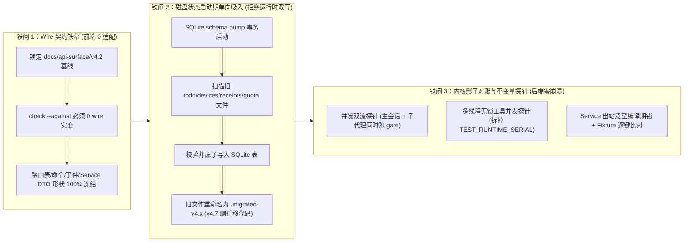
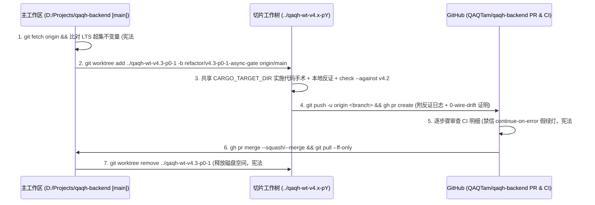

> **宿主机资源基线（项目宪法 #7）**：Intel Xeon E3-1230 V2（4C/8T）· 内存可用 **4.64 GB** / 7.95 GB · 磁盘 `C:` 剩余 105.54 GB / `D:` 剩余 **85.16 GB**。以下为补充了 **`../` 平级 Git Worktree 物理隔离规程**与 **GitHub PR 强制对外展示/审计流程**的完整整改令 Markdown。

---

# QAQ-Harness 后端架构治理与纯血 Rust Native 演进总纲（`v4.3` – `v4.12` → `v5.0`）

> **2026-11-26 路线升格校准（依新版《项目宪法 v2 · 高质量发展修宪版》与 `ADR-0042 r2`）**：
> - 原 `v4.7`/`v4.8` 封板死线已正式扩展为 **`v4.5` – `v4.12` 高质量演进跑道（`v4.12` 终极稳定封板 → `v5.0` 内核大重写）**，目录名 `docs/v4.3-4.8/` 保持不动以免破坏既有文档与在途 worktree 锚点；
> - `v4.3`–`v4.5` 继续遵循“铁闸 1（V2 契约 0 漂移）+ 铁闸 2（启动期吸入）+ 铁闸 3（并发反证）”；
> - **自 `v4.6` 起切换为「RingingV3 反腐铁闸」**（宪法第 5–7 条、`ADR-0042 r2`）：依赖级封杀 `serde_json`、物理隔离目录、`v4.6` 冻协议与 6 条跨代不变量（含前端渲染预算初心守卫）、`v4.7` 切 GPUI 本地 IPC（腰斩 `bridge.rs`）、`v4.8` 切移动端纯 QUIC 多端联动、**`v4.9` 首 PR 整目录物理立斩 V2**、`v4.11` 切 `rust-nightly` 烧机与 PTC 独立沙箱选型、`v4.12` 功能冻结封板。

- **当前版本基线**：`v4.2.0`（[Cargo.toml](file:///home/qaqtam/项目/qaqh-backend/Cargo.toml#L64)；`v4.3` P0、`v4.4` P1 与 `v4.5` `P2-0` #39 已合入 `main`）
- **最终完工死线**：**核心架构清债（P0–P2）在 `v4.5` 100% 清零；旧 RingingV2 协议栈在 `v4.9` 首张 PR 物理清零；`v4.12` 全平台稳定封板，随后进入 `v5.0` 内核重写。**
- **适用最高准则**：《项目宪法（v2 · 高质量发展修宪版）》第 1–17 条
- **核心约束**：
  1. **`v4.3`–`v4.5` 阶段旧前端 0 适配**；**`v4.6`–`v4.9` 阶段全面转向纯血 Rust Native（`../qaqh-gpui` + 移动 `qaqh-client` FFI）并立斩旧 V2 栈**；
  2. **后端必须建立在绝对正确的设计之上**，严禁靠防御性补丁或永久兼容转换层苟延残喘，且重构全程**核心语义不变量零退化**；
  3. **全流程 Worktree 隔离 + GitHub PR 对外留痕**：所有切片一律在 `../` 下通过 `git worktree` 创建独立分支施工（严禁使用 `git checkout`，宪法 #15），并通过 GitHub PR（`https://github.com/QAQTam/qaqh-backend`）完整公开反证、隔离闸与 CI 步骤明细。

---

## 一、现状定性：不可容忍的架构腐化与工程懒政

经过对全仓 **43 个 workspace crates（超 13.8 万行 Rust 代码）** 的逐层剥离审计，当前后端在表面「RingingV2 契约化」之下，掩盖着大量**违背项目宪法、自欺欺人的拧巴设计**。在此逐条点名批判：

### 1. 荒谬绝伦的「异步 → 同步 → 异步」三明治与单进程 5 套 Tokio Runtime
这是全仓最丑陋的并发灾难：
- `qaqh-daemon` 本身就是多线程 Tokio Runtime，`SessionLoop::run_turn` 本身也是 `async` 任务；
- 结果调 LLM 时，[crates/qaqh-agent-runtime/src/provider_job.rs](file:///d:/Projects/qaqh-backend/crates/qaqh-agent-runtime/src/provider_job.rs#L172-L175) 居然用 `tokio::task::spawn_blocking` 把异步强行拍扁成同步阻塞线程，再去调同步签名的 `qaqh_gate::chat_stream`；
- 而 `qaqh-gate` 底层的 `mutil-ai` / `reqwest` **本来就是原生 `async` 的**！为了给同步函数圆场，[crates/qaqh-gate/src/transport.rs](file:///d:/Projects/qaqh-backend/crates/qaqh-gate/src/transport.rs#L25-L37) 竟然声明了一个进程级全局的 **`new_current_thread()` 单线程 Tokio Runtime (`FALLBACK_RT`)**，用 `FALLBACK_RT.block_on(...)` 跑流式 HTTP（见 [crates/qaqh-gate/src/chat_sdk.rs](file:///d:/Projects/qaqh-backend/crates/qaqh-gate/src/chat_sdk.rs#L793)）！
- **恶果**：`current_thread` Runtime 的 `block_on` 持有独占调度锁。当主会话与子代理（`spawn_subagent`）或多会话并发流式请求 LLM 时，后进入的线程在 `FALLBACK_RT.block_on` 门口**被彻底卡死串行化**！所谓「多代理并发协作（AgentTeam 2.0，`ADR-0033 [状态：已采纳并实施]`）」在网关 I/O 层被一把单线程大锁直接废掉！
- 同样的懒政还出现在 [crates/qaqh-mcp/src/bridge.rs](file:///d:/Projects/qaqh-backend/crates/qaqh-mcp/src/bridge.rs#L126-L225) 与 [crates/qaqh-lsp/src/bridge.rs](file:///d:/Projects/qaqh-backend/crates/qaqh-lsp/src/bridge.rs#L22-L31)：在各自私建的 Tokio Runtime 上 spawn 任务，然后用 `std::sync::mpsc::Receiver::recv_timeout(250ms)` 轮询取消位。**一个进程里塞进 5 个 Tokio Runtime，这是对 Rust 异步模型的彻底羞辱。**

### 2. 「伪模块化」拆分：43 个 Crate 靠 `thread_local!` 与 `OnceLock<fn()>` 反向钩子苟合
P2 阶段把 `qaqh-workspace` 拆成 `qaqh-file-tools`、`qaqh-process-tools`、`qaqh-permission`、`qaqh-tool-core`，表面上解了编译环，实际上干的是**掩耳盗铃的伪解耦**：
- **测试层依旧成环**：[crates/qaqh-file-tools/Cargo.toml](file:///d:/Projects/qaqh-backend/crates/qaqh-file-tools/Cargo.toml#L33-L35) 和 [crates/qaqh-process-tools/Cargo.toml](file:///d:/Projects/qaqh-backend/crates/qaqh-process-tools/Cargo.toml#L33-L35) 在 `[dev-dependencies]` 里反向依赖 `qaqh-workspace`；
- **运行期靠全局静态函数指针偷状态**：[crates/qaqh-file-tools/src/hooks.rs](file:///d:/Projects/qaqh-backend/crates/qaqh-file-tools/src/hooks.rs#L31-L41) 和 [crates/qaqh-workspace/src/registration.rs](file:///d:/Projects/qaqh-backend/crates/qaqh-workspace/src/registration.rs#L35-L45) 用 `OnceLock<fn() -> AmbientRuntime>` 把门面的 `thread_local!` 状态反向喂给子 crate；
- **执行一次工具要改 5 个 `thread_local!`/全局槽位**：[crates/qaqh-workspace/src/runtime.rs](file:///d:/Projects/qaqh-backend/crates/qaqh-workspace/src/runtime.rs#L104-L163) 的 `ToolExecutionScope::install()` 在明明已经有 `ToolCallContext` 的情况下，依然在线程局部存储里来回倒腾 `ACTOR_TOOL_MANAGER`、`EXECUTION_CONTEXT`、`RUNTIME_CTX`、`SUBAGENT_SANDBOX`；
- **进程级 `file_state::LEDGER` 跨会话污染**：[crates/qaqh-file-tools/src/file_state.rs](file:///d:/Projects/qaqh-backend/crates/qaqh-file-tools/src/file_state.rs#L93-L132) 的文件读写基线账本居然还是**全进程唯一单例**（里面甚至留着已死架构 `serve` 子进程的 `take_pending` / `apply_pending` 尸体），任何会话调一次 `init_tools`（[crates/qaqh-workspace/src/runtime.rs](file:///d:/Projects/qaqh-backend/crates/qaqh-workspace/src/runtime.rs#L235-L236)）就 `file_state::clear()` 把全进程所有会话的 `STALE_FILE` 校验基线全部洗白！
- **幽灵依赖无人清理**：拆完之后，[crates/qaqh-workspace/Cargo.toml](file:///d:/Projects/qaqh-backend/crates/qaqh-workspace/Cargo.toml#L15-L48) 里的 `globset`、`ignore`、`grep-regex`、`grep-searcher`、`similar`、`unicode-normalization`、`sbx-win` 在该 crate 内 **0 引用**，却一直挂在 `Cargo.toml` 里陪葬编译！

### 3. 口头「SQLite 单权威」，身体却在数据目录到处拉撒 JSON/JSONL 私房文件
[crates/qaqh-runtime/src/service.rs](file:///d:/Projects/qaqh-backend/crates/qaqh-runtime/src/service.rs#L86-L89) 注释写得义正词严：*「业务库：SQLite WAL 单权威」*。然而翻开代码，数据根下居然还有 **5 套脱离 SQLite 事务保护的野生文件账本**：
1. **`sessions/{seed}/todo.json`**（[crates/qaqh-workspace/src/todo/store.rs](file:///d:/Projects/qaqh-backend/crates/qaqh-workspace/src/todo/store.rs#L26-L31)）：会话早已落进 SQLite，Todo 却还在往 `sessions/{seed}/todo.json` 写文件，逼得 44 行的空壳 `SessionManager`（[crates/qaqh-session/src/manager.rs](file:///d:/Projects/qaqh-backend/crates/qaqh-session/src/manager.rs#L25-L49)）专门保留下来删目录。
2. **`quota/{root_session_id}/ledger.jsonl`**（[crates/qaqh-agent-runtime/src/quota_ledger.rs](file:///d:/Projects/qaqh-backend/crates/qaqh-agent-runtime/src/quota_ledger.rs#L135-L295)）：每次操作配额都要加 `.lock` 文件锁、把整个 JSONL 从头到尾重读解析一遍（`self.refresh()`）。
3. **`ringing-command-receipts.json`**（[crates/qaqh-ringing-runtime/src/pending_store.rs](file:///d:/Projects/qaqh-backend/crates/qaqh-ringing-runtime/src/pending_store.rs#L175-L260)）：每次命令回执更新，把最多 4096 条 `HashMap` 全量序列化写盘覆盖一次 JSON。
4. **`ringing-devices.json`**（[crates/qaqh-ringing-runtime/src/device_registry.rs](file:///d:/Projects/qaqh-backend/crates/qaqh-ringing-runtime/src/device_registry.rs#L86-L132)）：配对设备表不进 SQLite，单开 JSON 文件。
5. **`.qaqh/journal.jsonl` & `audit/v2.rs`**：工具侧维护两套 JSONL 审计日志，与 SQLite `tool_calls.code_delta` 形成三头记账。

### 4. 劣质手写轮子泛滥，甚至公然违宪写「伪随机数降级补丁」
明明 workspace 已经引入了工业级标准 crate，部分模块却偏要手搓劣质实现，甚至复制粘贴 3~5 份：
- **违宪防御性代码（宪法 #5 零容忍）**：[crates/qaqh-dsaccount/src/util.rs](file:///d:/Projects/qaqh-backend/crates/qaqh-dsaccount/src/util.rs#L13-L26) 与 [crates/qaqh-siwc/src/util.rs](file:///d:/Projects/qaqh-backend/crates/qaqh-siwc/src/util.rs#L11-L24) 在操作系统 CSPRNG (`SystemRandom::fill`) 失败时，不仅不报错终止，反而**用「当前时间戳 + 栈内存指针地址」拼字符串当 OAuth PKCE `code_verifier` / `state` 密钥**！同文件 `random_uuid_v4` 在熵源失败时用「时间戳 + PID」伪造 UUID！这是典型的**用安全漏洞掩盖系统故障的防御性补丁**，必须立即铲除！
- **手写 Base64 重复 3 套**（`secrets.rs`、`qaqh-siwc/src/util.rs`、`qaqh-dsaccount/src/util.rs`），而 workspace 早已引入 `base64 = "0.23"`。
- **手写 32 次堆分配的 `sha256_hex` 重复 4 套**（`hash.iter().map(|b| format!("{b:02x}")).collect()`），而 workspace 早已引入 `hex = "0.4"`。
- **手写无 `black_box` 的 `constant_time_eq` 重复 2 套**（在 LTO 下随时被 LLVM 优化掉常数时间特性），而 workspace 早已引入 `subtle = "2"`。
- **手写 `atomic_write` / `replace_file` 重复 5 套**（两处复制粘贴 `unsafe { MoveFileExW }`，三处直接用固定 `.json.tmp` 既不 `sync_all` 也不防并发踩踏），而 workspace 早已引入 `tempfile = "3"`。
- **手写 `tasklist.exe` 子进程派生判活**（[crates/qaqh-types/src/platform.rs](file:///d:/Projects/qaqh-backend/crates/qaqh-types/src/platform.rs#L413-L439)）：查一个 PID 是否存活居然去 spawn 一个耗时上百毫秒的 `tasklist.exe`！

---

## 二、破例设计的严格迁移机制：「前端 0 适配 + 后端正确设计零崩溃」三道铁闸

> **核心纪律**：本次允许为大整改设计严格的**工程迁移保障机制**，但**绝不允许在业务内核里保留丑陋的运行时兼容转换层**（宪法 #4、#5、#9）。我们的策略是：**把用户空间（Wire 协议面）焊死，把磁盘旧状态在启动瞬间一次性单向吸入 SQLite，把内核空间一步到位切成正确架构，并用自动化对账闸门锁死行为等价性。**



### 铁闸 1：用户空间 Wire 契约铁幕（确保前端 100% 零适配）
1. **内核手术与契约演进物理隔离**：
   - 本次大整改的所有架构手术（Runtime 异步化、工具去 `thread_local!`、状态入 SQLite、Crate 合并、手写轮子替换）**一律定义为纯粹的内核空间（Kernel-Space）改造**。
   - **硬性机器判据**：每一个架构整改 PR 提交前，必须执行官方命令（宪法 #20）：
     ```powershell
     cargo run -p qaqh-contract-export -- check --against docs/api-surface/v4.2
     ```
     **必须返回 `EXIT = 0` 且 wire 实变列表为空**（或仅在 `v4.6` 合入 `ADR-0035 [状态：已采纳（未实施）]` 时做唯一一次受控 `[contract-refreeze]`）。
2. **四大前端接触面绝对不变**：
   - 路由表 `RINGING_V2_HTTP_ROUTES` 与 `CONTROL_PLANE_ROUTES` 零增删（宪法 #16）；
   - `RingingCommand` / `RingingV2CommandAck` / `SessionEventFrame` 的序列化 JSON 形状与 `seq` 单调递增语义零变化；
   - `/ringing/v2/service/{method}` 的 40+ 个方法名、入参 `*Params` 与出参 `*Result` DTO 零变化；
   - `DaemonDiscovery` (`daemon.json`) 字段与握手机制零变化。
   - **结论**：WinUI、Ratatui、Web、Android (`qaqh-ffi`)、OHOS (`qaqh-harmony-napi`) **不需要改一行代码，不需要重编前端 SDK**。

### 铁闸 2：磁盘持久化「启动期一次性单向吸入（Boot-Time One-Shot Ingression）」
针对 `todo.json`、`ringing-devices.json`、`ringing-command-receipts.json`、`quota/*/ledger.jsonl` 并入 `qaqh.db`：
- **严禁做运行时 fallback（如「先查 SQLite，查不到再读 `todo.json`」）**——那正是宪法 #4 严令砍掉的兼容性垃圾代码！
- **破例执行一次性启动吸入机制**：
  1. 在 [crates/qaqh-session/src/db/schema.rs](file:///d:/Projects/qaqh-backend/crates/qaqh-session/src/db/schema.rs) 提升 `SCHEMA_VERSION` 时，在**同一个 `EXCLUSIVE` SQLite 事务**内运行 `ingest_legacy_sidecar_files(conn, data_dir)`：
     - 扫描 `sessions/*/todo.json` → 写入 SQLite `session_todos` 表；
     - 扫描 `ringing-devices.json` → 写入 SQLite `paired_devices` 表；
     - 扫描 `ringing-command-receipts.json` → 写入 SQLite `command_receipts` 表；
     - 扫描 `quota/*/ledger.jsonl` → 聚合写入 SQLite `quota_reservations` 表。
  2. **强校验与墓碑封存**：事务内核对吸入行数与原文件记录数 100% 相等后 `COMMIT`；提交成功后立即将旧文件重命名为 `*.migrated-v4.4`（既防重复吸入，又留现场备查）。
  3. **运行期纯粹单一真源**：迁移函数跑完后，`QaqhService`、`ToolManager`、`RingingHub` 的运行期代码**只存在读写 SQLite 的唯一路径**，旧文件读写代码在同一次提交中彻底删除！
  4. **生命周期自毁**：该启动期吸入函数仅在 `v4.4`–`v4.6` 存续，**在 `v4.7.0` 封板前随旧版本 schema 升级分支一并清理**，不留永久历史包袱。

### 铁闸 3：内核替换「同提交立斩 + 并发反证闸」（确保后端零崩溃）
遵循宪法 #18（新闸门落地必须反证它真会红），每一刀内核手术必须绑定对应的**反证与不变量测试**：
1. **砍 `FALLBACK_RT` 与 `qaqh-gate` 原生异步化的防崩闸**：
   - 必须新增一条**双流并发反证测试** `concurrent_sessions_stream_in_parallel`：启动两个 Mock Upstream SSE 流（流 A 挂起 5 秒不发完，流 B 立即发完），主会话连流 A、子代理连流 B。
   - **反证**：在旧代码（`FALLBACK_RT` `current_thread` `block_on`）上，流 B 会被流 A 阻塞满 5 秒（测试必红）；在 `qaqh-gate` 改为原生 `async fn chat_stream` 后，流 B 必须在 50ms 内独立完成（测试变绿）。
2. **砍 `thread_local!` 与进程级 `file_state` 的防崩闸**：
   - 删掉 `qaqh-workspace`、`qaqh-file-tools`、`qaqh-permission` 中的 `static TEST_RUNTIME_SERIAL: LazyLock<Mutex<()>>`！
   - 新增多线程压力测试：8 个线程同时持有不同 `session_id` 和 `workspace_root` 的 `WorkspaceToolPort` 并发执行 `read` / `edit` / `apply_patch` / `todo_write`，断言**零 `STALE_FILE` 误判、零跨会话工作区串台**。
3. **砍每会话 `SessionOwner` OS 线程（改 Tokio Actor）的防崩闸**：
   - 跑通全套 [crates/qaqh-session/src/owner_tests.rs](file:///d:/Projects/qaqh-backend/crates/qaqh-session/src/owner_tests.rs) 与 [crates/qaqh-daemon/src/axum_server/v2_storm_tests.rs](file:///d:/Projects/qaqh-backend/crates/qaqh-daemon/src/axum_server/v2_storm_tests.rs)，确保 `ADR-0030 [状态：已采纳并实施]` 的 20ms/256KiB 泵侧合帧、`seq` 严格递增、`flush()` 屏障语义 100% 不变，且 `unload_idle_sessions` 后任务句柄立即 drop 回收。
4. **砍 `service_methods::dispatch` 运行期二次 JSON 反序列化的防崩闸**：
   - 将所有 handler 签名改为强类型 `fn(&QaqhService, ReqDto) -> QaqhResult<RespDto>`，在编译期锁死返回类型；保留 `qaqh-contract-export` 对所有 `TYPED_METHODS` 的 fixture round-trip 校验，任何字段偏差在编译期直接拒绝。

---

## 三、`../` Worktree 物理隔离与 GitHub PR 对外展示强制规程（新增铁律）

> **强制背景**：主工作区 `D:/Projects/qaqh-backend` 保持在干净的 `main` 基线，**严禁在主工作区直接手改业务代码或使用已被宪法 #22 禁用的 `git checkout`**。本次 `v4.3`–`v4.7` 全部切片必须通过 `../` 平级 Worktree 创建独立分支，并通过 **GitHub PR (`origin = https://github.com/QAQTam/qaqh-backend.git`)** 对外完整呈现每一次架构手术的提案、反证记录、契约检查与合并轨迹。



### 1. `../` 平级 Worktree 目录与命名硬性规范
1. **为什么必须直接建在 `../`（即 `D:/Projects/qaqh-wt-*`）而非二级子目录**：
   - 根 [Cargo.toml](file:///d:/Projects/qaqh-backend/Cargo.toml#L53) 声明了路径依赖 `mutil-ai = { version = "0.7.0", path = "../mutil-ai" }`（位于 `D:/Projects/mutil-ai`）。
   - 只有将 worktree 建在 `../qaqh-wt-<version>-<slice>`（与 `D:/Projects/qaqh-backend` 和 `D:/Projects/mutil-ai` 同级），Cargo 解析 `../mutil-ai` 才能 **100% 零修改无缝命中**！严禁建在 `../worktrees/...` 等多级子目录下破坏相对路径。
2. **禁止 `git checkout`（宪法 #22）与并发比对（宪法 #19）**：
   - 开设任何切片 worktree 前，必须先执行：
     ```powershell
     git fetch origin
     git worktree add ../qaqh-wt-v4.3-p0-1 -b refactor/v4.3-p0-1-async-gate origin/main
     ```
   - 在 worktree 内切换或恢复文件只准用 `git switch` / `git restore`，出现一次 `git checkout` 立即判定违规。
3. **磁盘与内存防爆规程（宪法 #7、#10）**：
   - 本机 `D:` 盘可用空间为 **85.16 GB**，内存仅 **7.95 GB**。若每个 worktree 独立生成一份 `target/`（动辄 15~25 GB），3 个 worktree 就会撑爆磁盘！
   - **强制规定**：
     - 同一时刻最多驻留 **1~2 个**活跃切片 worktree；
     - 在 worktree 内执行 `cargo test -p <crate>` 时，统一注入环境变量 `$env:CARGO_TARGET_DIR = "D:/Projects/qaqh-backend/target"` 复用编译缓存；
     - 切片 PR 合并进 `main` 后，**必须当场执行 `git worktree remove ../qaqh-wt-<version>-<slice>` 并 `git branch -d <branch>`**，严禁留置僵尸工作树。

### 2. GitHub PR 对外展示与审计四步法（每个切片 1 个独立 PR）
严禁把 `v4.3`–`v4.7` 攒成一个几万行的黑盒巨型提交直接推 `main`。**每一条优先级切片（P0-1 ~ P3-2）必须对应 GitHub 上一个独立、高信噪比的 Pull Request**：

1. **PR 标题与契约分类标签（宪法 #15）**：
   - 内核空间零 wire 变动切片：`[kernel-refactor][v4.x][P0-1] <简明扼要的架构手术名>`（若涉及快照收紧或注释刷新，严格标 `[guard-tightening]` 或 `[doc-only-refresh]`；仅 `v4.6` 的 ADR-0035 标 `[contract-refreeze]`）。
2. **PR 正文必填「四联单」（对外展示核心）**：
   - **① 架构病灶与宪法依据**：点名被砍掉的旧设计（附 `file:line`）及依据的《项目宪法》/ ADR 条款；
   - **② 旧代码物理歼灭清单**：列出本 PR 彻底删除的旧模块、旧 `thread_local!`、旧手写轮子或空壳 crate（证明绝非新旧并存打补丁）；
   - **③ 反证记录（Counter-Proof，宪法 #18）**：贴出新测试在旧实现上变红（或复现阻塞/串台）、在新实现上变绿的真实终端输出；
   - **④ 前端 0 适配契约铁闸输出**：贴出 `cargo run -p qaqh-contract-export -- check --against docs/api-surface/v4.2` 的 `EXIT=0` 实测证明。
3. **CI 步骤级严苛核验（宪法 #18、#20）**：
   - 推送分支并执行 `gh pr create` 后，通过 `gh pr checks` 与 `gh run view --log` **逐步骤（Step-by-Step）核查 CI**，严禁只看 Job 顶层绿灯（防止 `continue-on-error` 掩盖 lint 或契约闸门失败）。
4. **主工作区同步与超集不变量复核（宪法 #19）**：
   - PR 经 `gh pr merge` 合入 `origin/main` 后，回到主工作区 `D:/Projects/qaqh-backend` 执行 `git pull --ff-only origin main`，核验 `main ⊇ LTS-v3.0 / LTS-v3.1 / LTS-v4.1` 超集不变量，随即销毁该切片的 `../qaqh-wt-*` 目录。

---

## 四、`v4.3` – `v4.12` → `v5.0` 高质量演进路线图与优先级总表

> **硬性排期校准（2026-11-26）**：`v4.3`（P0-1~P0-4）、`v4.4`（P1-0a~P1-4）及 `v4.5` `P2-0`（PR #39 `fe091bde`）均已合入 `main`。以下路线图按新版《项目宪法 v2》与 [ADR-0042 r2](../adr/0042-ringing-v3-rust-native-ipc-and-quic.md) 拆分为四个清晰战役，任何切片未通过反证与隔离闸验收，严禁进入下一阶段。
>
> **2026-11-23 `LOCK_AUDIT_REPORT.md` 补充校准（已于 v4.4/v4.5-P2-0 收口）**：
> 1. `P1-0a ~ P1-0c` 已在 `v4.4` 清零；`P1-0d` 顺延锁微修（`L-21/L-15/L-16/L-13/L-29`）已于 `v4.5 P2-0`（#39）清零，`L-23` 随移除 `qaqh-lsp` 自然消亡，`L-27` 归入 `P2-2b`。
> 2. 剩余与传输耦合的高价值结构刺（`L-11` Shell stdin 持 `registry` 锁、`L-12` Blob 同步写盘）锁定在 `v4.7` 切 RingingV3 异步门面时根除。

### 优先级与阶段分级定义
- **P0（`v4.3`，已清零）**：架构毒瘤 / 单线程 `FALLBACK_RT` / 工具 `thread_local!` / 违宪伪随机补丁。
- **P1（`v4.4`，已清零）**：Tokio Runtime 合一、`SessionOwner` 去 OS 线程化、野生 JSON/JSONL 吸入 SQLite WAL、`service_methods` 强类型收口。
- **P2（`v4.5`，进行中：`P2-0` 已合入）**：伪模块化空壳 Crate 合并（同步清理 `../qaqh-gpui/Cargo.toml` 的 `qaqh-config-api` 依赖）、消除 5 个 `OnceLock<Arc<dyn *Host>>` 反向槽、清剿全部劣质手写轮子。
- **P3（`v4.6`–`v4.9`：RingingV3 建新厂 → 切全端 → 物理立斩 V2）**：`v4.6` 落地 `ADR-0035` 泄洪闸 + `ToolCatalog` + 冻结零 `serde_json` 的 `qaqh-ringing-v3` 强类型协议与 6 条跨代不变量守卫（剥离重型 PTC 沙箱）；`v4.7` 落本地 IPC（Linux UDS / Win Pipe）+ `../qaqh-gpui` 原子切 V3（`bridge.rs` 腰斩）+ 拔 `sidecar.rs` 与统一依赖；`v4.8` 落远端纯 QUIC（`quinn`）与原生多端联动 + 移动端原子切 V3；**`v4.9` 首张 PR 整目录物理立斩旧 V2 栈**。
- **P4（`v4.10`–`v4.12`：纯血 Rust Native 精雕 + `rust-nightly` 烧机 + 稳定封板）**：`v4.10` 无 WebView 原生可视化 + `ADR-0024` 硬件 MCP 接线 + 跨会话检索；`v4.11` 切 `rust-nightly` 烧机 + 8 GiB RAM 全链路压测 + PTC 独立沙箱选型（不碰 `session_loop.rs`）+ 冻结 `v5.0` 内核 ADR；`v4.12` 功能冻结稳定封板，确立 `v5.0` 内核大重写前的可靠逃生舱。
- **P5（`v5.0`：内核一次性革命）**：按宪法 #8 一次性完成 `SessionLoop` Effect 状态机 + 全异步工具 + Per-Root Actor + PTC 正式接入。

### 全局整改优先级、Worktree/PR 映射与版本切片表

| 优先级 | 目标版本 | 独立 Worktree 目录 (`../`) & GitHub PR 分支名 | 整改项内容与核心路径 (`file:line`) | 契约面 / 闸门要求 | 硬性验收判据（必须贴入 GitHub PR 正文） |
|---|---|---|---|---|---|
| **P0-1 ~ P0-4** | **`v4.3`（已清零）** | PR #23–#28（已合 `main`） | 砍 `FALLBACK_RT`、砍工具 `thread_local!`/`file_state` 单例、清剿伪随机降级、删幽灵依赖并移出未接线 `qaqh-ptc-*` | 0 Wire 变化（已完成） | 已全部合入 `main` 并完成验收。 |
| **P1-0a ~ P1-4** | **`v4.4`（已清零）** | PR #29–#38（已合 `main`） | 控制面 `spawn_blocking`、`list_sessions` 缩锁、Tokio Runtime 合一、`SessionOwner` Tokio Actor、四账本吸入 SQLite WAL、`service_methods` 强类型收口 | 0 Wire 变化（已完成） | 结项回写见 [V4_4_EXECUTION_PLAN.md](./V4_4_EXECUTION_PLAN.md#六结项状态回写v44-p12026-11-24mainff532ac0)。 |
| **P2-0** | **`v4.5`（已合 #39）** | `fix/v4.5-p2-0-v44-closeout-and-p1-0d` | `unload_idle_sessions` 子代 `SessionOwner` 回收补漏 + `P1-0d` 5 项锁微修收口 | `66bcb896` 补切 v4.2 金标准 | 已合入 `fe091bde`，结项回写见 [V4_5_EXECUTION_PLAN.md](./V4_5_EXECUTION_PLAN.md#五结项状态回写待每合入一张-pr-滚动更新)。 |
| **P2-1a ~ P2-2b** | **`v4.5`（进行中）** | `../qaqh-wt-v4.5-p2-{1a,1b,2a,2b}` | 4 空壳 Crate 合并（`qaqh-policy→qaqh-types`，同步更新 `../qaqh-gpui/Cargo.toml` 删 `qaqh-config-api`）+ 拆 `[dev-dependencies]` 环 + 消 5 个 `OnceLock` Host 槽 + `siwc`/`dsaccount` 公共层 + 全仓手写轮子清剿（Base64×5/`hex`/`tempfile`/`dunce`/`chrono`/`ulid`/`OpenProcess`/`jsonc-parser`） | 铁闸 1：`LF_NORMALIZED_DIFFS=0` | 详见 [V4_5_EXECUTION_PLAN.md](./V4_5_EXECUTION_PLAN.md)；累计净删 ≥ 2,000 行手写代码。 |
| **P3-1** | **`v4.6`** | `../qaqh-wt-v4.6-p3-1`<br>`feat/v4.6-p3-1-adr0035-spill-gate` | **落地 `ADR-0035`（exec 洪峰模型消费面泄洪闸）+ `ADR-0034` daemon 级真实洪峰冒烟**：严守宪法 #8，独立为 `crates/qaqh-agent-runtime/src/spill_gate.rs`，`session_loop.rs` 内 ≤ 10 行薄接线 | 纯 Rust 强类型契约演进（不再走 V2 跨语言重切仪式） | 1. 单 exec 超硬编码阈值后停灌 delta、投合成通告帧（异常流量 + 权威日志路径 + tail 预览）且不恢复；<br>2. `write_stdin` 轮询可用、客户端流不设闸；<br>3. 更新 `ADR-0035` 状态为已实施。 |
| **P3-2** | **`v4.6`** | `../qaqh-wt-v4.6-p3-2`<br>`feat/v4.6-p3-2-tool-modes-and-catalog` | **工具模式三档重塑 + 强类型只读 `ToolCatalog`**（[tool_mode.rs](file:///home/qaqtam/项目/qaqh-backend/crates/qaqh-types/src/tool_mode.rs) 收口、`minimal:b/c` 收回测试夹具，暴露工具分组/风险标签/模型能力联动；**剥离重型 PTC 沙箱运行时至 `v4.11` 选型 / `v5.0` 接入**） | 纯 Rust 强类型 DTO（直供 `qaqh-gpui` / V3） | 1. 后端单一真源驱动工具目录，0 硬编码数量；<br>2. 模型视觉/工具能力与风险标签联动生效；<br>3. 精准 crate 测试全绿。 |
| **P3-3** | **`v4.6`** | `../qaqh-wt-v4.6-p3-3`<br>`feat/v4.6-p3-3-ringing-v3-contract` | **冻结 `crates/qaqh-ringing-v3` 强类型二进制协议 crate（`ADR-0042 r2` 七铁律）**：`postcard` 长度前缀帧 + ALPN/指纹 Fail-Closed 握手 + 覆盖 `System/Session(含尾窗分页)/Command/Shell/Blob/Marketplace/Config/Account/Pairing/Gitx/Fs/ToolCatalog` 全能力 + `DeliveryClass` 与 `server_ts_ms`（**0 个 `/v1` 孤岛、0 `serde_json` 依赖、0 `#[serde(alias)]`**） | **V3 反腐隔离闸**：`qaqh-ringing-v3` 内 `serde_json` / `RINGING_V2` / `serde(alias` **0 命中** | 1. `cargo tree -p qaqh-ringing-v3` 不含 `serde_json`；<br>2. 全量 `ControlRequest/Response` 与四流帧（含尾窗分页与 `DeliveryClass`）往返编码测试全绿；<br>3. 失配版本/非法帧 Fail-Closed 反证绿。 |
| **P3-4** | **`v4.6`** | `../qaqh-wt-v4.6-p3-4`<br>`feat/v4.6-p3-4-v3-duplex-and-invariants` | **建立 `v3_server/` + `client/v3/` 隔离骨架 + `tokio::io::duplex` 内存闭环 + 6 条跨代不变量守卫**（原子订阅回放尾防活锁、四流零队头阻塞、断联不杀进程+幂等回执、身份单权威、多端联动原语、前端渲染预算保护）+ 补写无 WebView 可视化与 `audit/JOURNAL_IO` 归属 ADR | **V3 反腐隔离闸**：`v3_server/` 与 `client/v3/` 零引用 `axum_server` / `v2_stream` | 1. `ringing_v3_invariants` 6 大守卫在 `duplex` 上毫秒级全绿（含 11/10 P0 洪峰 `resync_cycles == 0` 复现守卫与渲染预算守卫）；<br>2. 反腐隔离 `rg` 闸 0 命中。 |
| **P3-5** | **`v4.7`** | `../qaqh-wt-v4.7-p3-5`<br>`feat/v4.7-p3-5-v3-local-ipc-and-gpui` | **RingingV3 本地传输层 + `../qaqh-gpui` 原子切换 + 依赖收口**：<br>① Linux UDS (`0600`) + Windows Named Pipe + `yamux` + 本地发现升级；<br>② 删 `v4.4` 临时 [sidecar.rs](file:///home/qaqtam/项目/qaqh-backend/crates/qaqh-session/src/db/sidecar.rs)，统一 `ureq → reqwest` 与 SHA-256；<br>③ `../qaqh-gpui` 单 PR 原子切 V3（删旧 HTTP/SSE 逻辑，瘦身 `bridge.rs`，解决 `L-11`/`L-12`） | V2 只读冰封；GPUI 零回退开关 | 1. Linux UDS 与 Windows Named Pipe 本地直连全绿；<br>2. `qaqh-gpui` 在 V3 上跑通会话、审批、Shell PTY、二进制附件；<br>3. `sidecar.rs` 与 `ureq` 物理删除。 |
| **P3-6** | **`v4.8`** | `../qaqh-wt-v4.8-p3-6`<br>`feat/v4.8-p3-6-v3-quic-multidevice` | **RingingV3 远端纯 QUIC（`quinn`）+ 原生多端联动 + 移动端原子切 V3**：<br>① `quinn` 纯 QUIC（ALPN `qaqh-ringing/3` + 指纹 pin + Device Token + 0-RTT + Wi-Fi↔5G 迁移，遵守 `ADR-0039` OHOS `ring` 分治）；<br>② 协议级多端联动（多端同看会话/Shell、Driver 交接广播、吊销即时踢流）；<br>③ `qaqh-ffi`（Android）与 `qaqh-harmony-napi`（OHOS）同 PR 原子切 V3 | V2 维持只读冰封；移动端零回退开关 | 1. 弱网切网连接迁移不断流；<br>2. 桌面 GPUI + 移动端双端同看同一会话/Shell 与 Driver 交接验收全绿；<br>3. OHOS `ring` / host `aws-lc-rs` 交叉编译分治通过。 |
| **P3-7** | **`v4.9`** | `../qaqh-wt-v4.9-p3-7`<br>`refactor/v4.9-p3-7-demolish-ringing-v2` | **物理立斩 RingingV2 旧世界（纯血 Rust Native 里程碑，宪法 #2/#5/#7）**：<br>① 首张 PR 整目录 `git rm -rf` 删除 `qaqh-daemon/src/axum_server/`、`qaqh-ringing/src/v2/`、`qaqh-client/src/{v2.rs,v2_stream.rs,sse_decoder.rs,shell_stream.rs}`、`tools/qaqh-contract-export/`；<br>② 补齐 `../qaqh-gpui` Linux + Windows 双桌面端一等交付 | **RingingV3 唯一控制面** | 1. `rg 'axum_server\|RINGING_V2\|/ringing/v2\|/control/v1\|/marketplace/v1\|v2_stream' crates/` **0 命中**；<br>2. `ringing_v3_invariants` 全绿证明零误伤；<br>3. Linux + Windows GPUI 双端打包可运行。 |
| **P4-1** | **`v4.10`** | `../qaqh-wt-v4.10-p4-1`<br>`feat/v4.10-p4-1-native-genui-and-tail-adrs` | **纯原生富体验 & 历史 ADR 收账**：<br>① 无 WebView 原生可视化（取代 HTML iframe `widget-directive`）；<br>② 接线 `ADR-0024` 硬件控制 MCP 到 daemon/`qaqh-mcp`；<br>③ 落定 `audit v1/v2` 与 `JOURNAL_IO` 归属；突破 GPUI 256 条会话检索上限 | 纯 V3 强类型演进 | 1. 后端 0 处 Electron/WebView 专属协议残留；<br>2. 硬件 MCP 过真 daemon 闭环验收；<br>3. ADR 台账 4.x `部分实施` 项清零。 |
| **P4-2** | **`v4.11`** | `../qaqh-wt-v4.11-p4-2`<br>`chore/v4.11-p4-2-nightly-stress-and-v5-prep` | **`rust-nightly` 切轨烧机 + 8 GiB 级压测 + `v5.0` 边界预演**：<br>① `rust-toolchain.toml` 与 CI 全面切 `rust-nightly`；<br>② 8 GiB RAM 宿主机级全压测（10k+ 时间线、多端 QUIC、200MB 洪峰泄洪、真 `spawn_new` 空闲回收）；<br>③ 独立实验验证 PTC 沙箱选型（`rquickjs`/`Starlark`/`Monty`，**不碰 `session_loop.rs`**）并定稿 `v5.0` 内核 ADR | `rust-nightly` 全绿 + 压测指标落盘 | 1. nightly 全平台编译测试绿；<br>2. 8 GiB 压测无 OOM/无泄漏；<br>3. `v5.0` 架构 ADR 与 PTC 选型定稿。 |
| **P4-3** | **`v4.12.0` 稳定版封板** | `../qaqh-wt-v4.12-p4-3`<br>`release/v4.12.0-native-seal` | **4.x 终极稳定封板（Feature Freeze，准逃生舱）**：只修稳定性与边界缺陷；Linux GPUI / Windows GPUI / Android / OHOS 全矩阵端到端验收；冻结 `qaqh.db` 迁移基线与 `v5.0` 切换清单 | 全平台封板基线 | 签发可长期自用的纯血 Rust Native `v4.12.0`（是否切 LTS 由所有者显式决定），随后 `main` 进入 `v5.0` 内核革命。 |
| **P5** | **`v5.0`** | 独立 `v5.0` 执行计划 | **上帝文件一次性内核革命（宪法 #8）**：`SessionLoop` Effect 状态机 + 全异步工具 + Per-Root Actor（根除 `L-01` 中央 `registry` 锁）+ PTC 正式接入 | 纯血 V3 + 新内核 | 独立 `v5.0` ADR 验收。 |

---

## 五、执行铁律（任何人、任何 Agent 不得违抗）

1. **严禁「新旧并存等以后再删」**：每一个切片 PR 替换手写轮子或旧架构时，**必须在同一个 PR 内物理删除旧代码**；V2/V3 双栈期被死刑锁定在 `v4.7`–`v4.8` 两版并在 `v4.9` 首张 PR 整目录处决，谁敢留下 `legacy_*` / `V2-over-V3` 转换层或 `QAQH_USE_V2` 回退开关，直接按违反《项目宪法 v2》第 2、3、5、7 条打回。
2. **严禁绕过 `../` Worktree 与 GitHub PR 直推 `main`**：每一个切片必须走完「`git worktree add ../qaqh-wt-*` → 编码与红→绿反证 → `gh pr create` 对外展示四联单 → CI 步骤明细全绿 → `gh pr merge` → `git worktree remove`」完整闭环（严禁 `git checkout`）。
3. **契约与隔离双闸分阶段执行**：`v4.5` 剩余切片维持铁闸 1（`docs/api-surface/v4.2` `LF_NORMALIZED_DIFFS=0`）；自 `v4.6` 起全面启用 **V3 反腐隔离闸（`rg == 0` + 零 `serde_json` + 6 条跨代不变量守卫）**。
4. **资源受限下的验证纪律（宪法 #12、#14）**：本机（8 逻辑核 / 8 GiB RAM）验证一律共享 `CARGO_TARGET_DIR` 并按改动涉及的 crate 跑精准测试（`cargo test -p <crate>`），禁止在本地每改一行跑全仓 `--release` 编译，全量构建矩阵交 CI 或受控 `-j1` 验收。
