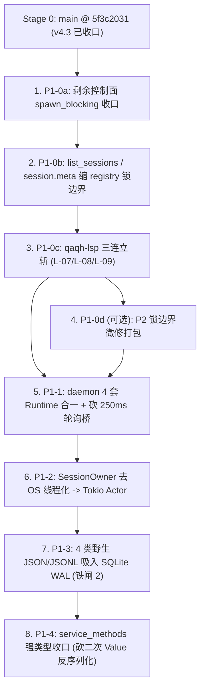

# QAQ-Harness `v4.4` 开工总计划与接手派工清单

> **基线时间**：2026-11-23 15:20 +08:00
> **当前 `main` HEAD**：`5f3c2031`（已含 `v4.3` 全部 4 个切片 PR #23/#24/#25/#26 + 桌面稳定性修复 PR #27/#28）
> **Companion 文档**：[MUST.md](./MUST.md)（总宪章与整改总表）、[LOCK_AUDIT_REPORT.md](./LOCK_AUDIT_REPORT.md)（全局锁与 Tokio 阻塞审计报告）

---

## 一、`v4.3` 收口现状与进 `v4.4` 前检查

1. **`v4.3` 业务切片已清零，桌面端待你最终验收**：
   - `P0-1`（PR #23）、`P0-2`（PR #25）、`P0-3`（PR #24）、`P0-4`（PR #26）全部合入 `main`；
   - PR #27（`PREFLIGHT_STATE` 自死锁修复）+ PR #28（`sbx-win` `DETACHED_PROCESS` 修 `0xC0000142`、`qaqh-gitx` 加 `CREATE_NO_WINDOW` 消仪表盘 4 黑框、`service_api.rs` 迁 `spawn_blocking`）已合入 `5f3c2031`；
   - 注：`Cargo.toml` 仍为 `4.2.0`，尚未推进 `4.3.0` 版本位或打 `v4.3.0` tag；如要保留“已测通的桌面发版点”，建议**先在当前 `5f3c2031` 重编 `qaqh-daemon --release` 覆盖安装目录实测一轮**，确认无误再决定是否顺手固化 `v4.3.0`（注意 `AGENTS.md` #21：tag ≠ LTS）。
2. **未入库文档状态**：
   - `docs/v4.3-4.8/`（`MUST.md`、`LOCK_AUDIT_PROMPT.md`、`LOCK_AUDIT_REPORT.md`、本文件 `V4_4_EXECUTION_PLAN.md`）目前在主工作区为未追踪文档，可单开一个 `[doc]` PR 入库，或在首张 `v4.4` PR 之外独立保存，避免切换/清理 worktree 时误删或混提交。

---

## 二、`v4.4` 全量切片执行顺序（Strict Sequential DAG）

`LOCK_AUDIT_REPORT.md` 将“锁边界/控制面停摆/LSP 缺陷”与 `MUST.md` 的 `P1-1 ~ P1-4` 做了严格解耦：
- **原则 1：先治“会直接假死控制面 / 误杀子进程”的 `P1-0` 小刀，再动 `P1-1 ~ P1-4` 运行时/存储大手术。**
- **原则 2：同一时刻只开 1 个活跃切片 worktree（`../qaqh-wt-v4.4-*`）**，防止本机 8GB RAM / 4C8T CPU 编译抖动与 `CARGO_TARGET_DIR` 并发指纹冲突。
- **原则 3：全程 0 Wire 变化**，所有 PR 提交前必须跑通 LF 归一化 `docs/api-surface/v4.2` 契约对账（`LF_NORMALIZED_DIFFS=0`）。



---

## 三、各切片精确施工卡（直接分发给执行 Agent）

### 1. `P1-0a` — 剩余控制面 `spawn_blocking` 收口（防 worker 饿死）
- **Worktree & 分支**：`../qaqh-wt-v4.4-p1-0a` · `fix/v4.4-p1-0a-dispatch-spawn-blocking`
- **前置注意（必读，防做重）**：`LOCK_AUDIT_REPORT.md` 审计基线为 `a1e5a9b4`，而 **PR #28（`5f3c2031`）已经把 `service_api.rs` 的 `shell.*` 与 `service_methods::dispatch` 迁入 `spawn_blocking`**！本切片**只补剩余缺口**：
  1. `crates/qaqh-daemon/src/axum_server/axum_impl/commands.rs`：同步命令匹配臂（约 L490-543：`upsert_provider` / `set_default_model_selection` / `execute_ringing_command` 等，含 `secrets.toml.lock` / `config_io_lock` / `TODO_LOCK` 写盘）及之后的 `state.pending.lock()...mark_terminal_sync(...)` 持久化边界，迁入 `spawn_blocking`；
  2. `crates/qaqh-daemon/src/axum_server/axum_impl/command.rs`：L135-148 `Route::Rename`（`rename_session` 同步等 `rx.recv()`）以及 L278 `Route::Engine` 中同步取 `registry` 锁 + `spawn_session_inprocess` / `session_effective_config` / `truncate_from_turn` 路径迁入 `spawn_blocking`；
  3. `crates/qaqh-daemon/src/axum_server/axum_impl/control.rs`：L18-30 `activity`（`state.service.activity_snapshot()` 同步取 `registry` 锁）迁入 `spawn_blocking`；
  4. `crates/qaqh-runtime/src/service.rs`：L1029-1098 `config` 文件轮询器与 `exec env` 热重载器在 `tokio::spawn` 中执行的同步读取/解密放入 `spawn_blocking`。
- **不准动**：不改任何锁本身结构、不改 HTTP DTO/路由。
- **反证与验证**：构造慢 IO/阻塞 hook 并发 8 路慢命令/查询，同时探测 `/health` 延迟 < 50ms；跑通 `cargo test -p qaqh-daemon -p qaqh-runtime` + `qaqh-contract-export`。

### 2. `P1-0b` — `list_sessions` / `session.meta` 缩 `registry` 锁边界（解 P0 复合停摆 `L-01.2`）
- **Worktree & 分支**：`../qaqh-wt-v4.4-p1-0b` · `fix/v4.4-p1-0b-list-sessions-lock-boundary`
- **改动目标**：
  - `crates/qaqh-runtime/src/service.rs:825-901`（`list_sessions`）：`registry()` 锁内**只 `clone` 内存中 `is_running` / 活动状态快照并立刻放锁**；将两次 `read_blocking`、逐行 `session_run_status`、以及 `write_blocking` 工作区自动绑定全部挪到锁外执行；
  - `crates/qaqh-runtime/src/service/handlers/session.rs:29-44`（`session.meta`）：同样缩小 `registry` 持锁范围，禁止拿着 `MutexGuard` 跨越 `read_blocking`。
- **反证与验证**：慢 DB 读注入（模拟 `read_blocking` 延迟 1s+）下并发调用 `session.list` 与快速读路径（`session.activity` / 其它 `registry()` 操作），旧实现后者被 `registry` 锁堵死必红，新实现后者毫秒级返回绿；跑 `cargo test -p qaqh-runtime`。

### 3. `P1-0c` — `qaqh-lsp` 三项独立 P1 缺陷立斩（`L-07 / L-08 / L-09`）
- **Worktree & 分支**：`../qaqh-wt-v4.4-p1-0c` · `fix/v4.4-p1-0c-lsp-pgid-shutdown-timeout`
- **为什么不能等 `P1-1`**：这三条是语义与资源回收缺陷，与 Tokio Runtime 个数无关，先修干净再做 `P1-1` 更安全。
- **改动目标**：
  1. **`L-07` 删 `SPAWN_PIDS` 防误杀**：删除 `crates/qaqh-lsp/src/adapter.rs:35` `SPAWN_PIDS` 全局表及 `record`/`take`；`spawn_server` 已返回 pid，改为在 `connect_once` 经 `store_connected` 参数直接把本连接 `pgid` 存进当前连接实例；
  2. **`L-08` 退出收尾全路径接线**：在 `crates/qaqh-daemon/src/main.rs` 的 `server`（L105）、`run`（L150）和 `acp`（L111-119）三条退出路径补齐 `qaqh_lsp::shutdown_global()`，同时 **`acp` 分支补上 `qaqh_mcp::shutdown_global()`**；处理死代码 `prime_all_async`（接线或按宪法 #4 删除）；
  3. **`L-09` `Shutdown` 请求加超时硬顶**：`crates/qaqh-lsp/src/connection.rs:531-551` 对 `socket.request::<Shutdown>().await` 套上 `tokio::time::timeout(close_timeout, ...)`（消费已有但未接线的 `settings.close_timeout`），超时后 abort driver 并放 guard 走 `sweep_group`；同步补上 watchdog 回收后 `return` 与 `begin_call` 状态闸门（对齐 `qaqh-mcp` 已有实现）。
- **反证与验证**：
  - 双工作区并发连同名 mock LSP，关闭 A 后断言 B 进程组仍存活、关闭 B 后各自收割；
  - mock LSP 拒绝响应 `Shutdown` 请求时，在 `close_timeout` 内完成回收不挂死；
  - `cargo test -p qaqh-lsp -p qaqh-daemon`。

### 4. `P1-0d`（可选但推荐）— `P2` 锁边界与自死锁引信微修打包
- **Worktree & 分支**：`../qaqh-wt-v4.4-p1-0d` · `fix/v4.4-p1-0d-lock-boundary-microfixes`
- **聚焦最值得先收的零风险小刀**（参考 `LOCK_AUDIT_REPORT.md` §五 `P1-0d`）：
  - `L-21` `crates/qaqh-gate/src/sdk_common.rs:639-648`：`RetryHub.drain` 改为锁内 `std::mem::take` 到本地 `Vec`，放锁后再调 `on_event` 回调，彻底拆掉 edition 2024 `while-let` 临时 guard 持锁回调引信；
  - `L-22` `crates/qaqh-mcp/src/bridge.rs:47/:72`：统一模块级 Runtime cell（修复 `try_runtime_handle` 恒返回 `None` 导致 Drop 清理兜底失灵）；
  - `L-23` `crates/qaqh-lsp/src/manager.rs:340-345`：`evict_recycled_conns` 先锁内收集候选再锁外查状态，拆掉唯一 `conns → state` 嵌套边；
  - `L-15`/`L-16`/`L-13` 锁外预备（`FileRuntime::ledger_key`、`process_registry` 先取 `Arc` 锁外 `clone`、`audit/v2` `recover_state` 文件读移出双锁）；
  - `L-27` `crates/qaqh-types/src/platform.rs:413-438`：`process_is_running` 在 Windows 上从派生 `tasklist.exe`（无超时风险 + 150ms）改为 `OpenProcess` 直查（与 `P2-2⑥` 重合，可在此提前收或留给 `P2-2`，不强求）；
  - `L-29` `crates/qaqh-agent-runtime/src/session_loop.rs:1540`：`trust_folder` 写盘套 `spawn_blocking`（或移至 `P1-2`）。

---

### 5. `P1-1` — `daemon` 4 套 Tokio Runtime 合一 + 砍 `mcp`/`lsp` 250ms 轮询桥
- **Worktree & 分支**：`../qaqh-wt-v4.4-p1-1` · `refactor/v4.4-p1-1-unify-tokio-rt`
- **核准口径**：`daemon` 进程内最多 4 套 Runtime（`main` + `mcp` 专属 + `lsp` 专属 + 惰性 `shared_runtime`），`client` 的 `RUNTIME` 在前端/桥进程不在 daemon。
- **核心改动**：
  - `crates/qaqh-mcp/src/bridge.rs`、`crates/qaqh-mcp/src/resources.rs`、`crates/qaqh-lsp/src/bridge.rs`、`crates/qaqh-lsp/src/tool.rs`、`crates/qaqh-agent-runtime/src/session_loop.rs:117-150`；
  - 优先复用宿主 `tokio::runtime::Handle::try_current()`（仅非 async 单测/CLI fallback 共享单 runtime，可加 `debug_assert` 防止 daemon 内误落入 fallback）；
  - 将 `mpsc::Receiver::recv_timeout(250ms)` 轮询 + `sleep` 取消等待替换为原生 `async` + `tokio::select!` 监听取消令牌（取消延迟 < 1ms）。
- **验证**：`cargo test -p qaqh-mcp -p qaqh-lsp -p qaqh-agent-runtime` + 取消响应延迟反证测试（< 50ms，远低于原 250ms 轮询步长）+ `qaqh-contract-export`。

### 6. `P1-2` — `SessionOwner` 去 OS 线程化 → Tokio Actor
- **Worktree & 分支**：`../qaqh-wt-v4.4-p1-2` · `refactor/v4.4-p1-2-async-session-owner`
- **核心改动**：
  - `crates/qaqh-session/src/owner.rs`、`crates/qaqh-session/src/db/mod.rs`；
  - 把每会话 `std::thread::spawn("qaqh-owner-...")` 改为由宿主 Tokio Runtime 驱动的异步 Actor（自然消化 `L-03` 同步 `rx.recv()` 与 `L-31` 锁内派生 OS 线程）；
  - 保持 `ADR-0030` 20ms/256KiB 泵侧合帧、`seq` 单调递增、`flush()` 屏障语义 100% 不变；
  - `unload_idle_sessions` 确保持有任务句柄可即时 drop 回收；如本阶段顺手把 `TODO_LOCK`（或留到 `P1-3`）、`ShellRegistry`/`GLOBAL_TRUSTED` 实例边界收紧一并评估。
- **验证**：创建 100 个会话线程数增量基线对照（0 个每会话 OS 线程）+ `owner_tests` + `qaqh-daemon` `v2_storm_tests` 全绿 + `qaqh-contract-export`。

### 7. `P1-3` — 4 类野生 JSON/JSONL 并入 SQLite WAL 单权威（启用铁闸 2）
- **Worktree & 分支**：`../qaqh-wt-v4.4-p1-3` · `refactor/v4.4-p1-3-sqlite-single-truth`
- **核心改动**：
  - 按 `MUST.md` §二铁闸 2：提升 `crates/qaqh-session/src/db/schema.rs` `SCHEMA_VERSION`，在单个 `EXCLUSIVE` 事务内执行一次性启动吸入 `ingest_legacy_sidecar_files`：
    - `sessions/*/todo.json` → `session_todos` 表（消除 `L-04` `TODO_LOCK`）
    - `ringing-devices.json` → `paired_devices` 表（消除 `L-20`）
    - `ringing-command-receipts.json` → `command_receipts` 表（消除 `L-06` 全量覆写）
    - `quota/*/ledger.jsonl` → `quota_reservations` 表（消除 `L-02` `quota.lock` + 全量 replay + `fsync`）
  - 核对吸入行数后重命名为 `*.migrated-v4.4`，**同次提交物理删除运行期旧 JSON/JSONL 读写路径（严禁写 fallback）**，同时删除 44 行空壳 `SessionManager`（职责归 `OwnerDirectory`）；
  - `audit` v1/v2 锁族（`L-13`）与 `JOURNAL_IO` 视 `MUST.md` 边界决定是否在同切片/后续收编进 `qaqh.db` 或保留显式单写者。
- **验证**：启动吸入事务完整性（行数核对 + `.migrated-v4.4` 墓碑 + 二次启动幂等 + 故障回滚）+ 相关 crate 测试全绿 + `qaqh-contract-export`。

### 8. `P1-4` — `service_methods` 强类型收口（砍 `Value` 出站二次反序列化）
- **Worktree & 分支**：`../qaqh-wt-v4.4-p1-4` · `refactor/v4.4-p1-4-typed-service-dispatch`
- **核心改动**：
  - `crates/qaqh-runtime/src/ringing/service_methods.rs` 与 `crates/qaqh-runtime/src/service.rs`；
  - 将 handler 签名收敛为编译期强类型 `fn(&QaqhService, ReqDto) -> QaqhResult<RespDto>`，彻底移除出站 `validate_typed_result` 二次 JSON 往返；保持 `qaqh-contract-export` 对全部 `TYPED_METHODS` 的 fixture round-trip 零偏差。
- **验证**：`cargo test -p qaqh-runtime --lib service` + `qaqh-contract-export` 零 wire 变更 + 版本评估（是否于本阶段推进 `Cargo.toml` 至 `4.4.0` / 打 `v4.4.0` tag）。

---

## 四、给后续执行 Agent 的标准派工 Prompt 模板

每次只派 1 个模型执行 1 个切片（按上文序号顺序），将 `<SLICE_ID>` 替换为对应切片名即可：

```markdown
请你在 `D:\Projects\qaqh-backend` 推进 `v4.4` 路线图的 **`<SLICE_ID>`** 切片。

### 开工前必读与现场核查
1. 阅读 `AGENTS.md`、`docs/v4.3-4.8/MUST.md`、`docs/v4.3-4.8/LOCK_AUDIT_REPORT.md` 与 `docs/v4.3-4.8/V4_4_EXECUTION_PLAN.md` 中 `<SLICE_ID>` 对应小节。
2. 先运行只读检查确认现场基线（禁止凭记忆）：
   - `git -C D:\Projects\qaqh-backend fetch origin`
   - `git -C D:\Projects\qaqh-backend status -sb` 与 `git -C D:\Projects\qaqh-backend worktree list`
   - `gh pr list --repo QAQTam/qaqh-backend --state all --limit 10`
   - 检查本机空闲内存与 D: 磁盘空间（宿主机 4C8T / 8GB RAM，严禁在本地随意跑全仓 `--release`）。

### 强制施工纪律
1. **Worktree 隔离 & 禁用 `git checkout`**：直接在平级目录 `../qaqh-wt-v4.4-<slice>` 开独立分支（`git -C D:\Projects\qaqh-backend worktree add ... origin/main`），共享编译缓存 `$env:CARGO_TARGET_DIR = "D:/Projects/qaqh-backend/target"`。切文件/恢复只准用 `git switch` / `git restore`。
2. **严禁兼容层 / 严禁盲目删锁**：旧代码/旧路由/旧分支在同一 PR 物理删除；禁止未迁移所有权前直接移除生产锁；禁止写出 `legacy_*` / fallback 分支。
3. **反证 + 契约闸门缺一不可**：
   - 先在未改或对照条件下写/验证反证测试会红，再落地修复令其变绿；
   - 运行受影响 crate 的精准 `cargo test -p <crate>` 与 `cargo clippy --no-deps -p <crate>`；
   - 若根目录 `.gitattributes` 在 Windows 下检出 CRLF 导致 `qaqh-contract-export check --against docs/api-surface/v4.2` 报 670 处换行假差异，**绝不要改动 `docs/api-surface/` 换行符**，改用 `qaqh-contract-export export --out <tmp>` 后按 `\r\n -> \n` 归一化比对 `docs/api-surface/v4.2`，确认 `LF_NORMALIZED_DIFFS=0`。
4. **已知无关基线红测防误判**（非本切片引入时如实注明作用域，不得顺手改无关业务代码掩盖）：
   - `qaqh-workspace --lib`（`schema_spot_check` 等 5 项）及 `audit_fail_closed` / `audit_ledger`；
   - `qaqh-process-tools --lib`（宿主机受限子进程 `-1073741502`）；
   - `sbx-win --test registry`（`reg.exe` `0xC0000142`）与 `hardening::sddl_snapshot_roundtrip_restores_dacl`（`D:AI` 继承标志）。
5. **PR 四联单收口**：按 `MUST.md` §三创建 PR（若 `gh pr create` 遇 GitHub GraphQL `unexpected EOF` 可改用 `gh api` REST 或重试），贴齐反证输出与 `0 wire drift` 证明；合并后同步 `D:\Projects\qaqh-backend`（`git pull --ff-only origin main`）并 `git worktree remove` 清理临时工作树。
```
