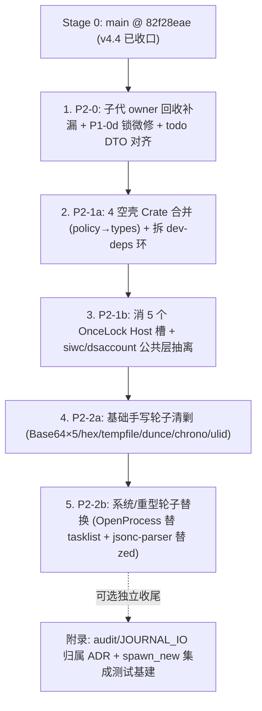

# QAQ-Harness `v4.5`（P2）开工总计划与子代理派工清单

> **基线时间**：2026-11-24 22:38 +08:00
> **当前 `main` HEAD**：`82f28eae`（已含 `v4.4` 全部 P1 切片 PR #29–#38 及结项回写）
> **Companion 文档**：[MUST.md](./MUST.md)（总宪章与整改总表）、[LOCK_AUDIT_REPORT.md](./LOCK_AUDIT_REPORT.md)（全局锁与 Tokio 阻塞审计报告）、[V4_4_EXECUTION_PLAN.md](./V4_4_EXECUTION_PLAN.md)（`v4.4` 结项与顺延登记）
> **版本位说明**：按所有者裁定「版本号/tag 一律不管，直接以 `v4.8` 发稳定版」，`Cargo.toml` 保持 `4.2.0` 不回写。

---

## 一、`v4.4` Review 结论与进 `v4.5` 前置校准

1. **`v4.4` P1 主体已清零，但有 1 处中危补漏 + 6 项 `P1-0d` 顺延项须在 `v4.5` 最前端收口**：
   - **Review 新发现（须入 `P2-0`）**：`crates/qaqh-runtime/src/registry/lifecycle.rs:92-107` 中，`unload_idle_sessions` 调用 `self.close(&session_id)` 会把 `supervisor.descendants_postorder(&session_id)` 的所有子代实例一起卸载并 `unlink`，但紧接着只对根 `session_id` 调用了 `self.owners.take_session(&session_id)`，**漏掉了被顺带卸载的子代 `SessionOwner`**，导致子代泵任务与 `ReplayRing` 滞留 `OwnerDirectory` 直到 daemon 退出。
   - **`P1-0d` 顺延项（6 项锁边界微修）**：`L-21`（`RetryHub::drain` 持锁回调引信）、`L-23`（LSP `conns→state` 嵌套边）、`L-15`/`L-16`/`L-13`（锁外预备）、`L-29`（`trust_folder` 进 `spawn_blocking`）；另 `L-27`（`tasklist.exe → OpenProcess`）归入 `P2-2b`。
2. **`P2-1` 架构硬校准（防子代理踩编译环坑）**：
   - **`qaqh-policy` 不能直接并入 `qaqh-permission`！** 实测 `crates/qaqh-permission/Cargo.toml:9-10` 依赖 `qaqh-sandbox`，而 `crates/qaqh-sandbox/Cargo.toml:10` 依赖 `qaqh-policy`；直合并会造成 `qaqh-permission ↔ qaqh-sandbox` 循环依赖。**`P2-1a` 改走无环方案：将 `qaqh-policy` 并入叶子 crate `qaqh-types`**（7 个消费方均已依赖 `qaqh-types`）。
   - **`qaqh-config-api → qaqh-profile` 波及契约导出器**：`tools/qaqh-contract-export/Cargo.toml:9` 直接依赖 `qaqh-config-api`（`features = ["ts"]`），合并时必须同步切到 `qaqh-profile` 并跑 `docs/api-surface/v4.2` 0 差异对账。
   - **`OnceLock<Arc<dyn Host>>` 清单实测为 5 槽**：`GoalHost`、`GitxHost`、`TodoHost`（v4.4 P1-3 新增）、`TaskBoardHost`、`SubagentHost`。
3. **`P2-2` 扫描校准**：
   - 手写 Base64 实测 **5 处**（除 `secrets.rs`、`qaqh-siwc`、`qaqh-dsaccount` 外，还有 `qaqh-file-tools/src/read_image/image_utils.rs` 与 `qaqh-process-tools/src/exec/shell.rs`）。
   - 根 `Cargo.toml` 的 `[workspace.dependencies]` 尚未统一声明 `base64` / `hex` / `tempfile` / `dunce` / `path-clean` / `jsonc-parser` / `chrono` / `ulid`，统一在 `P2-2a` / `P2-2b` 提升至 `[workspace.dependencies]`。

---

## 二、`v4.5` 全量切片执行顺序（Strict Sequential DAG）

- **原则 1（适配免费子代理）**：把原 `P2-1`、`P2-2` 拆成 **5 张边界正交、上下文紧凑的独立切片（`P2-0` → `P2-1a` → `P2-1b` → `P2-2a` → `P2-2b`）**，每张切片单次派发给 1 个子代理，避免单个子代理吃下万行级大 diff 导致失焦或撞车。
- **原则 2（资源防爆，宪法 #7/#10）**：宿主机 4C8T / 7.9GB RAM（可用约 3.3GB），**同一时刻只开 1 个活跃 worktree（`../qaqh-wt-v4.5-*`）**，共享 `$env:CARGO_TARGET_DIR = "D:/Projects/qaqh-backend/target"`，合入后立刻 `git worktree remove`。
- **原则 3（铁闸 1）**：`v4.5` 全程 **0 Wire 变化**，每张 PR 提交前必须通过 LF 归一化 `docs/api-surface/v4.2` 对账（`LF_NORMALIZED_DIFFS=0`）。



---

## 三、各切片精确施工卡（直接分发给子代理）

### 1. `P2-0` — `v4.4` 补漏 + `P1-0d` 锁微修打包 + `todo` DTO 对齐
- **Worktree & 分支**：`../qaqh-wt-v4.5-p2-0` · `fix/v4.5-p2-0-v44-closeout-and-p1-0d`
- **改动目标**：
  1. **补漏 `unload_idle_sessions` 子代 `SessionOwner` 回收**：
     - `crates/qaqh-runtime/src/registry/lifecycle.rs:32-49,92-107`：在 `unload_idle_sessions` / `finish_for_unload` 中对所有被卸载的 `descendants` 一并调用 `self.owners.take_session(...)`，并在 `registry` 锁外 drop 摘出的 `Vec<Arc<SessionOwner>>`；补充父子会话树闲置卸载后父+子 `Arc::strong_count` 归零的回归测试。
  2. **清零 `P1-0d` 6 项顺延锁微修（对照 `LOCK_AUDIT_REPORT.md` §五）**：
     - `L-21` `crates/qaqh-gate/src/sdk_common.rs:639-648`：`RetryHub::drain` 改为锁内 `std::mem::take` 到本地 `Vec`，放锁后再调 `on_event`（反证：回调内重入 `record` 在超时线程下不死锁）；
     - `L-23` `crates/qaqh-lsp/src/manager.rs:340-345`：`evict_recycled_conns` 先锁内收集候选再锁外查状态，拆掉 `conns → state` 嵌套边；
     - `L-15` `crates/qaqh-file-tools/src/file_state.rs:80,231,309-326`：`FileRuntime::ledger_key`（含 `canonicalize`）移到会话锁外计算；
     - `L-16` `crates/qaqh-process-tools/src/process_registry.rs:727-743`：锁内只取 `Arc`，大文本 `clone` 挪锁外；
     - `L-13` `crates/qaqh-workspace/src/audit/v2.rs:312,414-470`：`recover_state` 文件读取挪到 `APPEND_LOCK`/`CHAIN` 双锁外预备；
     - `L-29` `crates/qaqh-agent-runtime/src/session_loop.rs:1540`：`trust_folder` 写盘套 `tokio::task::spawn_blocking`。
  3. **`todo.status` / `todo.list` 契约 DTO 对齐（0 wire 漂移前提）**：
     - `crates/qaqh-runtime/src/ringing/service_methods.rs:491`（`TodoStatusSnapshot`）与 `crates/qaqh-runtime/src/service/handlers/task.rs:15-25`：核对 `TodoStatusSnapshot` 的 `skip_serializing_if` 与现有手拼 `json!` 在缺失值时的 `null` 键差异；**若不改 wire 即可对齐（调整 DTO serde 注解使其与既有 wire 形状 100% 一致）则完成绑定，否则保留现状并在 PR 说明中登记推迟至 `v4.6` 同窗处理**（严禁破坏铁闸 1）。
- **不准动**：不改任何 Crate 目录结构、不改路由表、不触碰 `tasklist.exe`（留给 `P2-2b`）。
- **反证与验证**：
  - `RetryHub::drain` 重入 `record` 限时测试（旧实现死锁超时红，新实现绿）；
  - 父子会话 `unload_idle_sessions` 子代 `SessionOwner` 回收测试（旧实现子代滞留红，新实现绿）；
  - `cargo test -p qaqh-gate -p qaqh-lsp -p qaqh-file-tools -p qaqh-process-tools -p qaqh-agent-runtime -p qaqh-runtime` + `qaqh-contract-export` LF 归一 0 差异。

---

### 2. `P2-1a` — 4 个空壳 Crate 物理合并 + `[dev-dependencies]` 环拆除
- **Worktree & 分支**：`../qaqh-wt-v4.5-p2-1a` · `refactor/v4.5-p2-1a-crate-consolidation`
- **改动目标（按宪法 #4 物理删除旧 crate 目录与根 `Cargo.toml` 成员，严禁保留 re-export 空壳 crate）**：
  1. **`qaqh-goal`（292 行）→ `qaqh-subagent`（或 `qaqh-agent-runtime`）**：
     - 迁移 `crates/qaqh-goal/src/lib.rs` 为子模块 `goal`，更新 `crates/qaqh-daemon/Cargo.toml`、`crates/qaqh-runtime/Cargo.toml` 及所有 `use qaqh_goal::*`；删除 `crates/qaqh-goal/`。
  2. **`qaqh-config-api`（378 行）→ `qaqh-profile`**：
     - 迁移 `crates/qaqh-config-api/src/lib.rs` 到 `qaqh-profile`（沿用 `qaqh-profile` 已有的 `ts = ["dep:ts-rs", "qaqh-types/ts"]` 特性门控）；
     - 同步更新 `crates/qaqh-config/Cargo.toml`、`crates/qaqh-runtime/Cargo.toml` 及 **`tools/qaqh-contract-export/Cargo.toml:9`** 与其源码引用；删除 `crates/qaqh-config-api/`。
  3. **`sbx-nt`（159 行）→ `sbx-win`**：
     - 迁移 `crates/sbx-nt/src/lib.rs` 为 `sbx-win::nt`（保留对 `\??\`、`\??\UNC\`、`\\?\` 的完整 NT 路径归一单测）；更新 `crates/sbx-win/Cargo.toml`、`crates/sbx-cli/Cargo.toml`；删除 `crates/sbx-nt/`。
  4. **`qaqh-policy`（530 行）→ `qaqh-types`（⚠️ 避环定案，严禁并入 `qaqh-permission`）**：
     - 因 `qaqh-permission → qaqh-sandbox → qaqh-policy`，合并到 `qaqh-types::policy` 可彻底避开循环依赖；
     - 更新全部 7 个消费方（`qaqh-config`、`qaqh-permission`、`qaqh-sandbox`、`qaqh-tool-core`、`qaqh-workspace`、`qaqh-process-tools`、`qaqh-ptc-tools`）的 `Cargo.toml` 与 import；删除 `crates/qaqh-policy/`。
  5. **拆除 `[dev-dependencies]` 跨 crate 环**：
     - 移除 `crates/qaqh-file-tools/Cargo.toml:38` 与 `crates/qaqh-process-tools/Cargo.toml:36` 对 `qaqh-workspace` 的反向开发依赖；将依赖具体 `ToolManager` 的集成测试迁入 `crates/qaqh-workspace/tests/`，子 crate 单元测试只依赖 `qaqh-tool-core` / `ToolCallContext`。
- **不准动**：本切片不改 `OnceLock<Arc<dyn Host>>` 注入机制（留给 `P2-1b`），不顺手替换手写轮子（留给 `P2-2`）。
- **反证与验证**：
  - `rg 'qaqh-goal|qaqh-config-api|sbx-nt|qaqh-policy' Cargo.toml crates/ tools/` 返回 0 命中；
  - `rg 'qaqh-workspace' crates/qaqh-file-tools/Cargo.toml crates/qaqh-process-tools/Cargo.toml` 返回 0 命中；
  - `cargo check --workspace --tests`（或分批精准 `-p` 编译校验）通过；
  - `qaqh-contract-export` LF 归一比对 `docs/api-surface/v4.2` 确认 `LF_NORMALIZED_DIFFS=0`（重点验证 `qaqh-config-api → qaqh-profile` 迁移后导出物零变化）。

---

### 3. `P2-1b` — 消除 5 个 `OnceLock<Arc<dyn Host>>` 反向槽 + `siwc`/`dsaccount` 公共层抽离
- **Worktree & 分支**：`../qaqh-wt-v4.5-p2-1b` · `refactor/v4.5-p2-1b-kill-host-slots-and-oauth-core`
- **改动目标**：
  1. **物理删除全仓 5 个 `OnceLock<Arc<dyn *Host>>` 静态反向槽**：
     - `GoalHost`（`P2-1a` 迁入位置，原 `qaqh-goal/src/lib.rs:39`）
     - `GitxHost`（`crates/qaqh-gitx/src/tools.rs:58`）
     - `TodoHost`（`crates/qaqh-workspace/src/todo/host.rs:39`）
     - `TaskBoardHost`（`crates/qaqh-subagent/src/host.rs:380`）
     - `SubagentHost`（`crates/qaqh-subagent/src/host.rs:440`）
     - 改由工具实例构造器或 `ToolCallContext` / 注册期显式持有 `Arc<dyn *Host>`；同步清理 `crates/qaqh-runtime/src/host_impl.rs`、`crates/qaqh-runtime/src/goal_host.rs`、`crates/qaqh-runtime/src/todo_host.rs` 中的全局 `register_*_host` 副作用调用。
  2. **抽离 `qaqh-siwc` 与 `qaqh-dsaccount` 公共基础设施层**：
     - 对比 `crates/qaqh-siwc/src/{loopback.rs,util.rs,store.rs,http.rs}` 与 `crates/qaqh-dsaccount/src/{loopback.rs,util.rs,store.rs,http.rs}`；
     - 抽离公共 OAuth loopback 回调服务、PKCE/随机数/URL 编解码工具、原子凭据存储与 ureq 超时封装到共享模块/紧凑内部 crate（如 `qaqh-oauth-core`，**注意**：需保证合并后总 crate 数相较 `v4.4` 净减少 ≥ 3~4 个，满足 `MUST.md` 验收）；
     - 物理删除两 crate 中重复的 `loopback.rs` / `util.rs` 拷贝，确保 `siwc.*` / `dsaccount.*` 全部方法名与 wire DTO 形状 0 变化。
- **不准动**：不改 `siwc` / `dsaccount` 对外 RPC 方法表与 admin-only 权限矩阵；不改 `P2-2` 的其余轮子。
- **反证与验证**：
  - `rg 'OnceLock<Arc<dyn' crates/ --glob '!*test*'` 返回 0 命中；
  - 新增「同一测试进程内并发构造两套不同 `Host` 实例（无需进程级 `OnceLock` 串行锁）互不串台」的反证测试（旧全局槽无法注册两套，新实现变绿）；
  - `cargo test -p qaqh-siwc -p qaqh-dsaccount -p qaqh-subagent -p qaqh-gitx -p qaqh-workspace -p qaqh-runtime` + `qaqh-contract-export` LF 归一 0 差异。

---

### 4. `P2-2a` — 基础设施手写轮子清剿（Base64×5 / hex / tempfile / dunce / chrono / ulid）
- **Worktree & 分支**：`../qaqh-wt-v4.5-p2-2a` · `refactor/v4.5-p2-2a-replace-core-handrolled`
- **改动目标（先在根 `Cargo.toml` `[workspace.dependencies]` 统一声明所需成熟库版本，再逐项物理删旧实现）**：
  1. **5 处手写 Base64 → `base64`**：
     - `crates/qaqh-config/src/secrets.rs:659-682`
     - `crates/qaqh-siwc/src/util.rs:51-70` & `crates/qaqh-dsaccount/src/util.rs:54`（若已在 `P2-1b` 抽入公共层则单点替换）
     - `crates/qaqh-file-tools/src/read_image/image_utils.rs:153-180`
     - `crates/qaqh-process-tools/src/exec/shell.rs:514-539`
  2. **手写 `sha256_hex` / 逐字节 `format!("{b:02x}")` → `hex::encode`**：
     - `crates/qaqh-types/src/image_store.rs:59`、`crates/qaqh-agent-runtime/src/tool_job.rs:284`（统一复用 `qaqh_types::sha256_hex`）及全仓同类循环。
  3. **手写 `atomic_write` / `MoveFileExW` unsafe FFI → `tempfile::NamedTempFile::new_in(parent)` + `persist(target)`**：
     - `crates/qaqh-config/src/secrets.rs:524-555` 与 `crates/qaqh-file-tools/src/file_shared.rs:23-80`（同提交移除两 crate `Cargo.toml` 中仅为此保留的 `Win32_Storage_FileSystem` 特性）；
     - 同步清扫其余固定 `.tmp` 手写原子落盘点（如 `qaqh-siwc` / `qaqh-dsaccount` / `qaqh-config`）。
     - **硬性注意**：必须使用 `NamedTempFile::new_in(parent)` 保证同卷原子替换，写完后 `as_file().sync_all()` 再 `persist`。
  4. **Windows `\\?\` 剥离与路径归一 → `dunce` + `path-clean`**：
     - 替换 5 处残缺手写 `strip_prefix(r"\\?\")`：`crates/qaqh-file-tools/src/grep_tool.rs:363`、`crates/qaqh-file-tools/src/apply_patch_engine/mod.rs:229`、`crates/qaqh-file-tools/src/file_state.rs:292`、`crates/qaqh-session/src/grouping.rs:12`、`crates/qaqh-runtime/src/service.rs:1213-1216`；
     - **严禁误删**：`crates/qaqh-file-tools/src/file_shared.rs:341` 是 Windows 设备路径安全拦截（`\\.\` / `\\?\GLOBALROOT`），必须保留！
  5. **2 处 `civil_from_days` → `chrono`**：
     - `crates/qaqh-types/src/platform.rs:457-485`（及其调用方 `qaqh-workspace`、`qaqh-agent-runtime`）与 `crates/qaqh-hooks/src/event.rs:266-295`。
  6. **伪 ULID → `ulid` crate**：
     - `crates/qaqh-ringing-contract/src/ulid.rs:11-54`：`generate_ulid()` 改用 `ulid::Ulid::new().to_string()`，`ulid_from_text` 改用 `ulid::Ulid::from_bytes(bytes).to_string()`，物理删除手写 `encode_ulid_bytes`；保持 26 字符 Crockford Base32 与 `is_ulid_text` 100% 兼容。
- **反证与验证**：
  - `\\?\UNC\server\share\dir\file.rs` 路径归一反证测试（旧 `strip_prefix(r"\\?\")` 会吐出坏路径 `UNC\server\share\...` 必红，换 `dunce` 后输出 `\\server\share\...` 变绿）；
  - `rg 'MoveFileExW|civil_from_days|encode_ulid_bytes' crates/` 返回 0 命中；
  - `cargo test -p qaqh-types -p qaqh-config -p qaqh-file-tools -p qaqh-process-tools -p qaqh-ringing-contract -p qaqh-hooks -p qaqh-session` + `qaqh-contract-export` LF 归一 0 差异。

---

### 5. `P2-2b` — 系统级与重型手写轮子替换（`OpenProcess` 替 `tasklist.exe` + `jsonc-parser` 替 `zed_integration`）
- **Worktree & 分支**：`../qaqh-wt-v4.5-p2-2b` · `refactor/v4.5-p2-2b-openprocess-and-jsonc`
- **改动目标**：
  1. **`platform::process_is_running` 砍掉 `tasklist.exe` 子进程派生（同时清零 `L-27`）**：
     - 位置：`crates/qaqh-types/src/platform.rs:413-438`；
     - Windows 分支改用 `OpenProcess(PROCESS_QUERY_LIMITED_INFORMATION, false, pid)` + `GetExitCodeProcess`（等于 `STILL_ACTIVE` 返回 `true`；`OpenProcess` 返回 `ERROR_ACCESS_DENIED` 视为进程存活；句柄用 RAII guard 保证 `CloseHandle`，unsafe 块须带完整 `// SAFETY:` 注释满足 `undocumented_unsafe_blocks = "deny"`）；
     - Unix 分支使用 `libc::kill(pid as i32, 0)`（返回 `0` 或 `EPERM` 视为存活）。
  2. **`zed_integration.rs` 480 行手写 JSONC 状态机 → `jsonc-parser`**：
     - 位置：`crates/qaqh-daemon/src/zed_integration.rs:127-530`；
     - 物理删除手写词法/注释剥离/增量编辑状态机，改用 `jsonc-parser` 的 AST/CST 解析与编辑能力；确保既有 `zed_integration` 单测 100% 绿灯。
- **反证与验证**：
  - 性能反证测试：`process_is_running(std::process::id())` 连续探测 100 次均值 < 50μs（旧 `tasklist.exe` 单次 ~150ms），且对当前进程返回 `true`、对已退出子进程返回 `false`；
  - `rg 'tasklist\.exe' crates/ --glob '!*test*'` 返回 0 命中；
  - 核计 `P2-2a + P2-2b` 累计净删行数（验收目标：净删 ≥ 2,000 行手写代码与重复 `unsafe` FFI）；
  - `cargo test -p qaqh-types -p qaqh-daemon` + `qaqh-contract-export` LF 归一 0 差异。

---

### 附录：不阻塞 `v4.5` 主线的两项独立登记任务
1. **`audit v1/v2` 与 `JOURNAL_IO` 最终归属决策（ADR）**：
   - `v4.4` P1-3 按所有者裁定暂未将 `audit v1/v2` 与 `JOURNAL_IO` 收编 `qaqh.db`；需在 `docs/adr/` 补写简短 ADR 明确「保留显式单写者文件」还是「择期入 SQLite」（宪法 #17），避免 `v4.7` 封板口径模糊。
2. **`unload_idle_sessions` 真 `spawn_new` 全链路集成测试基建**：
   - 补建 `spawn_new` 成功路径测试 fixture，把 `v4.4` #37 的单元测试升级为真 `SessionLoop` 端到端回收验证（纯测试 PR，可随时插队）。

---

## 四、给免费子代理的标准派工 Prompt 模板

每次只派 **1 个子代理**执行 **1 张切片**（严格按 `P2-0 → P2-1a → P2-1b → P2-2a → P2-2b` 顺序），将 `<SLICE_ID>` 替换为对应切片名即可：

```markdown
请你在 `D:\Projects\qaqh-backend` 推进 `v4.5`（P2）路线图的 **`<SLICE_ID>`** 切片。

### 开工前必读与现场核查
1. 阅读 `AGENTS.md`、`docs/v4.3-4.8/MUST.md`、`docs/v4.3-4.8/LOCK_AUDIT_REPORT.md` 与 `docs/v4.3-4.8/V4_5_EXECUTION_PLAN.md` 中 `<SLICE_ID>` 对应小节。
2. 先运行只读检查确认现场基线（禁止凭记忆）：
   - `git -C D:\Projects\qaqh-backend fetch origin`
   - `git -C D:\Projects\qaqh-backend status -sb` 与 `git -C D:\Projects\qaqh-backend worktree list`
   - `gh pr list --repo QAQTam/qaqh-backend --state all --limit 10`
   - 检查本机空闲内存与 D: 磁盘空间（宿主机 4C8T / 8GB RAM，严禁在本地跑全仓 `--release`）。

### 强制施工纪律
1. **Worktree 隔离 & 禁用 `git checkout`（宪法 #22）**：直接在平级目录 `../qaqh-wt-v4.5-<slice>` 开独立分支（`git -C D:\Projects\qaqh-backend worktree add ... origin/main`），共享编译缓存 `$env:CARGO_TARGET_DIR = "D:/Projects/qaqh-backend/target"`。切文件/恢复只准用 `git switch` / `git restore`。
2. **严禁兼容层与空壳 re-export（宪法 #4、#5）**：被合并的 crate、被替换的手写轮子、被消除的 `OnceLock` 槽必须在**同一 PR 内物理删除**；严禁留下 `legacy_*` / fallback 分支；每个新增 `unsafe` 块必须写 `// SAFETY:`（workspace clippy 为 `deny`）。
3. **反证 + 契约铁闸缺一不可（宪法 #18、#20）**：
   - 先证明反证测试在旧实现上变红（或给出对照基准），再落地修改令其变绿；
   - 运行受影响 crate 的精准 `cargo test -p <crate>` 与 `cargo clippy --no-deps -p <crate>`；
   - **铁闸 1（0 Wire 变化）**：执行 `qaqh-contract-export export --out <tmp>` 并按 `\r\n -> \n` 归一化比对 `docs/api-surface/v4.2`，确认 `LF_NORMALIZED_DIFFS=0`（绝不要修改 `docs/api-surface/` 换行符）。
4. **已知无关基线红测防误判**（非本切片引入时如实注明作用域，不得顺手改无关业务代码掩盖）：
   - `qaqh-workspace --lib`（`schema_spot_check` 等 5 项）及 `audit_fail_closed` / `audit_ledger`；
   - `qaqh-process-tools --lib`（宿主机受限子进程 `-1073741502`）；
   - `sbx-win --test registry`（`reg.exe` `0xC0000142`）与 `hardening::sddl_snapshot_roundtrip_restores_dacl`（`D:AI` 继承标志）。
5. **PR 四联单收口**：按 `MUST.md` §三创建 PR（标题 `[kernel-refactor][v4.5][<SLICE_ID>] ...`），贴齐 ①病灶与宪法依据 ②物理歼灭清单 ③反证输出 ④`LF_NORMALIZED_DIFFS=0` 证明；合并后同步主工作区 `git pull --ff-only origin main` 并 `git worktree remove` 清理临时工作树。
```

---

## 五、结项状态回写（待每合入一张 PR 滚动更新）

| 切片 | PR | 状态 | 备注 |
|---|---|---|---|
| `P2-0` | — | 待开工 | `unload_idle_sessions` 子代回收补漏 + `P1-0d` 6 项锁微修 + `todo` DTO 对齐 |
| `P2-1a` | — | 待开工 | 4 空壳 crate 合并（`qaqh-policy → qaqh-types` 避环）+ 拆 `[dev-dependencies]` 环 |
| `P2-1b` | — | 待开工 | 消 5 个 `OnceLock<Arc<dyn *Host>>` 槽 + `siwc`/`dsaccount` 公共层抽离 |
| `P2-2a` | — | 待开工 | Base64×5 / `hex` / `tempfile` / `dunce`+`path-clean` / `chrono` / `ulid` |
| `P2-2b` | — | 待开工 | `OpenProcess` 替 `tasklist.exe`（L-27）+ `jsonc-parser` 替 `zed_integration` |
