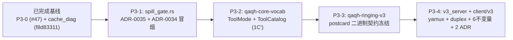

# QAQ-Harness `v4.6`（`P3-1` ~ `P3-4`）深度源码考察与详细设计 Plan

> **生成时间**：2026-11-26 · **代码基线**：`main @ d35e4430`（含 PR #47 `P3-0` `bea000a2`、`cache_diag` 修复 `f8d83311` 与 `V4_6_EXECUTION_PLAN` 台账刷新 `d35e4430`）
> **宿主机资源实测（宪法 #14）**：8 逻辑核 / 7.7 GiB RAM（可用 4.7 GiB）+ 3.8 GiB Swap · `/home` 可用 92 GiB。全程严格执行单活跃平级 worktree（`../qaqh-wt-v4.6-*`）、共享 `CARGO_TARGET_DIR`、`/home/qaqtam/.cargo/bin/cargo -j2` 精准 `-p` 验证，严禁本机全仓 `--release`。
> **上位依据**：[AGENTS.md](../../AGENTS.md) · [ADR-0035](../adr/0035-exec-flood-model-spill-gate.md)（`已采纳 · 未实施`）· [ADR-0042 r4](../adr/0042-ringing-v3-rust-native-ipc-and-quic.md)（`已采纳 · 未实施`）· [V4_6_DECISION_PACK.md](./V4_6_DECISION_PACK.md) · [V4_6_EXECUTION_PLAN.md](./V4_6_EXECUTION_PLAN.md)

---

## 一、源码实查的 7 项关键技术发现与设计修正

在逐模块核查 `session_loop.rs`（现 2,775 行）、`tool_job.rs`、`exec_session/`、`owner.rs`、`view.rs`、`store.rs`、`service_methods.rs`、`axum_server/`、`shell/mod.rs`、`hub.rs` 与 `qaqh-types`/`qaqh-ringing-contract` 后，发现以下 **7 处文档未明说、开工前必须拍板的技术事实与隐蔽竞态**：

### 1. [`P3-1`] 模型消费面真正需要截流的是 `ToolExecOutput`，而非 `OwnerMsg::ExecSessionOutput`
- **源码实证**：
  - `Capture -> ExecSessionPublisher::output -> ToolLifecycle::exec_session_output -> OwnerPump::flush_exec_output`（`crates/qaqh-session/src/owner.rs:1273, 1338`）只写 append-only 日志、更新 DB 水位和广播前端 SSE，`owner.rs:1458` 已明示「这不影响模型环——模型回放读 messages 表的 ToolResult 块」。
  - 真正进入模型上下文的是 `WorkspaceToolPort::execute`（`tool_job.rs:708`）调 `SessionExecHost::exec_command` / `write_stdin` 返回的 `ExecSessionResult` → `ExecSessionToolOutput` JSON（`exec_session/tool.rs:112`），经 `session_loop.rs:1229-1306` 拼装 `ToolResult` 后入库并进 `messages`。
- **设计裁定**：`spill_gate.rs` 的挂接点完全收口在 **`crates/qaqh-agent-runtime/src/spill_gate.rs` + `tool_job.rs`（`SessionExecHost`）**，`session_loop.rs` **无需新增任何行（净行数 +0）**。

### 2. [`P3-1`] `ToolLifecycle` 缺少权威日志路径，且存在「20ms 合帧写盘滞后于模型读」竞态
- **源码实证**：
  - 权威日志路径由 `exec_output_log_path(&db, &session_id, &exec_session_id)`（`owner.rs:1831`，即 `<data_dir>/sessions/<session_id>/exec/<exec_session_id>.log`）派生；但 `ToolLifecycle`（`owner.rs:1132`）当前只有 `session_id` 和 `tx: UnboundedSender<OwnerMsg>`，而 `SessionExecHost`（`tool_job.rs:96`）只有 `ExecSessionManager` + `OwnerExecPublisher`，均拿不到 `data_dir`！
  - 更隐蔽的竞态：`OwnerPump` 的 `EXEC_OUTPUT_COALESCE_WINDOW` 为 **20ms**（`owner.rs:64`）。当 `SessionExecHost` 返回泄洪通告时，最后一批输出可能仍停在 `OwnerPump` 信箱中尚未落盘；模型紧接着下一回合调用 `read`/`grep` 读取该 `.log` 路径时会读到不完整末尾。
- **设计裁定**：
  1. 在 `ToolLifecycle` 中新增由 `SessionOwner` 构造期一次算好的 `exec_logs_dir: Option<PathBuf>`，并提供 `pub fn exec_log_path(&self, exec_session_id: &str) -> Option<PathBuf>`（零锁、零 DB 依赖）；
  2. 提供异步/阻塞池安全冲刷口（或由 `ToolLifecycle::flush_exec_output_barrier()` 经 `async_rt::block_on_host` 等 `OwnerPump` 处理完当前已入队批次），在**首次触发泄洪并组装通告帧之前**冲刷已捕获输出到权威 `.log` 文件（注意 `WorkspaceToolPort::execute` 本就在 `spawn_blocking` 内执行，符合 `block_on_host` 约束，参见 `owner.rs:19-22`）。

### 3. [`P3-1`] 泄洪通告必须保留结构化控制字段，且后续 `write_stdin` 应免除无谓 Reflower 开销
- **设计裁定**：
  - 开闸后，`ExecSessionToolOutput` **必须继续保留** `outcome`（`yielded` / `completed` / `failed` / `cancelled` / `interrupted`）、`exec_session_id`、`exit_code`、`timed_out`、`cancelled`、`input_bytes_written`、`error_code`、`error_message`，并将 `output_truncated = true`、`omitted_bytes` 诚实记账；只将 `output` 替换为合成通告帧（异常流量说明 + 权威日志路径 + 轻量 tail 预览 + `next_offset` 水位提示）。
  - 一旦某 `exec_session_id` 进入 `spilled = true`，后续 `write_stdin` 轮询继续保留完整进程交互与等待退出语义（可发 `chars`、可长轮询等退出），但不再让模型消费积累输出：在 `ExecSessionManager::poll` 返回或 `SessionExecHost::write_stdin` 拦截后，只返回轻量水位与权威日志引用（不重放全量、不重复吐大段文本），并可通过在 `ExecSessionManager` 侧支持轻量 `skip_model_output` / 仅取 `watermark` 避免高产进程在已被泄洪后继续白跑 `ConptyReflower` + `strip_ansi`。

### 4. [`P3-2`] `ToolMode` 词表对齐与 `ToolMeta` 缺少 `ModelCapabilities` 绑定字段
- **源码实证**：
  - 冰封中的 `crates/qaqh-types/src/tool_mode.rs` 现用字符串常量 `standard` / `minimal` / `minimal:b` / `minimal:c` / `custom`，而文档写的是 `Core / Standard / Custom`。
  - `crates/qaqh-tool-core/src/tool_api/descriptor.rs:236` 的 `ToolMeta` 仅有 `category: ToolCategory`、`risk: ToolRisk`、`capabilities: ToolCapabilities`（工具编排特性如只读/并发安全），**没有声明“依赖哪些 `ModelCapabilities`（如 `image_input`）”的字段**。
  - `qaqh-workspace/src/runtime.rs:83` 的 `all_tools()` 只查全局静态 `TOOL_MANAGER`，而会话动态 MCP 工具在会话私有的 `ToolManager` 上。
- **设计裁定**：
  1. `crates/qaqh-core-vocab` 定义 `pub enum ToolMode { Core, Standard, Custom { tools: Vec<String> } }`，并明确记录映射约定：`Core` 语义对应 V2 `minimal`（8 件套），`minimal:b`/`minimal:c` 彻底隔绝在 V3 `ToolMode` 之外（留在测试夹具与冰封旧路径）；
  2. 不修改冰封中的 `qaqh-types` 与 `qaqh-ringing-contract`；`qaqh-core-vocab` 独立提供纯值版 `UsageInfo`（去除 `qaqh-types/api_types.rs:36,41` 的 2 处 `skip_serializing_if`）、强类型 ID newtype、`ActivityState`、`TurnTerminal`、`ContentRef`、`ToolRisk`、`ToolMode` 与 `ToolCatalog`；
  3. 在 `qaqh-workspace`（或 `qaqh-runtime`）实现 `build_tool_catalog(manager: &ToolManager, caps: ModelCapabilities, mode: &ToolMode) -> ToolCatalog`，以集中静态表声明工具与模型能力约束（如 `read_image` 需 `caps.image_input`，否则标记 `ToolAvailability::Disabled { reason: ToolDisableReason::UnsupportedByModelCapability }`），同时支持传入会话私有 `ToolManager` 以纳入动态 MCP 工具。

### 5. [`P3-3`] `timeline_epoch` 在「禁止改 `SCHEMA_VERSION == 13`」约束下的无 Schema 落地方案
- **源码实证**：`sessions` 表及 `SessionOwner` 当前均无 `timeline_epoch` 字段；`V4_6_DECISION_PACK.md` §一.4 严禁在 `v4.6`–`v4.9` 改动 SQLite schema。
- **设计裁定**：在 `SessionOwner` 内新增 `timeline_epoch: Arc<AtomicU64>`：
  - 构造 `SessionOwner` 时初始化为 `(store::now_ms().max(1) as u64) << 16`（保证每次 owner 重新加载或 daemon 重启后的 epoch 严格大于此前任何历史值）；
  - 每次 `OwnerPump` 成功执行 `store::truncate_from_turn` 并广播 `TimelineTruncated` 时，对 `timeline_epoch` 执行 `fetch_add(1, Ordering::AcqRel)` 并在新快照 `GetSessionSnapshot` 与 `TimelineTruncated` 事件中回传；
  - `GetTranscriptPage { session_id, before_ord, limit, timeline_epoch }` 校验当前 owner 的 `timeline_epoch`（若 session 未加载则返回当前启动代际或先走 `GetSessionSnapshot`），失配时 Fail-Closed 返回 `ControlError::StaleCursor`。

### 6. [`P3-3`] 全量能力一网打尽盘点：防止遗漏 `Goal` / `Todo` / `Skills` / `SandboxPreflight` / `ExecSession` / `Admin` 权限位
- **源码实证**：核对 `CONTROL_PLANE_ROUTES`（11 条）+ `RINGING_V2_HTTP_ROUTES`（17 条）+ `service_methods::METHODS`（40+ 条）后发现，除计划书主列表外，还存在：
  - `goal.*`（`service/handlers/goal.rs`）
  - `todo.status` / `todo.list` / `plan.read`
  - `skills.catalog` / `skills.list_tools`
  - `sandbox.preflight.start` / `sandbox.preflight.status`（`ADR-0040`）
  - `exec_session.list` / `exec_session.output`
  - `diagnostics.memory.snapshot` / `diagnostics.memory.start` / `diagnostics.memory.stop`
  - `clients.list` / `profile.list`
  - **Admin 分级红线**：`siwc.*`、`dsaccount.*`、`clients.list`、`diagnostics.memory.*`、`pairing.*`、`devices.revoke` 属于 `AdminOnly`（仅限本地受信任主端，配对远端设备一律拒绝），需要在 `ControlRequest` 上提供编译期/表驱动 `required_scope() -> AuthScope`（服务不变量④）。

### 7. [`P3-4`] `ShellFacade`（`L-11`）、`BlobFacade`（`L-12`）与 `widget-directive` 现状校准
- **源码实证**：
  - `crates/qaqh-runtime/src/shell/mod.rs` 的 `ShellRegistry` 已拆 `LiveShell` 细粒度锁，但直接对 `stdin: Mutex<Box<dyn Write + Send>>` 做同步写入。`ShellFacade` 应将 `open`/`write`/`resize`/`close` 中的阻塞系统调用封装至 `tokio::task::spawn_blocking`，仅在内存中通过 `watch` + `broadcast` 无锁分发输出与终止事实，绕开中央 `AgentRegistry` 锁（消除 `L-11`）。
  - `crates/qaqh-ringing-runtime/src/hub.rs` 仍使用 `db.write_blocking`/`read_blocking`（`L-12`）。`BlobFacade` 应直接调用 `qaqh_session::db::Db::write` / `Db::read` 异步接口，并以 `BlobTransfer` 分片流收发原始 `Bytes`。
  - `crates/qaqh-workspace/src/registration.rs:80` 显示：`visualize` 工具已采用结构化 C2 形态（无 PUA），故 `P3-4` 补写的「无 WebView 可视化策略 ADR」应正式记录 [widget-directive-protocol-2026-11-12.md](../widget-directive-protocol-2026-11-12.md)（HTML iframe + PUA marker）退役并由纯原生结构化组件承载。

### 8. [`P3-3`/`P3-4`] 协议复核增补定案（`ADR-0042 r4`：对外 `iroh`、对内 `MuxTransport+yamux`、严格同版与因果分流纪律）
- **传输同构定案**：
  - 对外/移动端在 `v4.8` 采用 **`iroh`（纯 QUIC，`EndpointId` 公钥寻址 + 自动 NAT 打洞 + 端到端加密 Relay 兜底，默认 n0 公共 Relay 且支持自托管配置）**，不再使用裸 `quinn` 手配 IP/指纹；`v4.8` 开工前须核验 `iroh` 在 OHOS 交叉目标下与 `ADR-0039`（`aws-lc-rs`/`ring`）的兼容性。
  - 对内维持 **`UDS / Named Pipe + yamux`**（正式否决 `remoc`），在 `P3-4` 定义极薄 **`MuxTransport` trait**（`open_bi` / `accept_bi` / `open_uni` / `accept_uni`，其中 `yamux` 单向流以半关闭双向流同构），确保 `duplex + yamux`（测试）、`UDS/Pipe + yamux`（`v4.7` 本地）与 `iroh::Connection`（`v4.8` 远端）共享 100% 同一套上层协议与流控代码。
- **移动端与桌面端统一严格同版 Fail-Closed（方案 A）**：
  - 维持裸 `postcard` + `build.rs` 机器生成 `PROTOCOL_FINGERPRINT: [u8; 32]` 强校验，拒绝任何指纹/版本失配客户端（不为移动端引入跨小版本宽松解码），防遗忘同步更新客户端并杜绝隐性兼容债。
- **四流因果分流与跨流时序纪律**：
  - **同会话严格单流单 `seq`**：同一 `session_id` 的全部事件（含 `Reliable` 与 `Replaceable`）严守同一条 `SessionEvents` FIFO 流及 `OwnerPump` 单点 `seq`，**严禁将 `Reliable` 与 `Replaceable` 拆成两条流**；发送端仅在同流缓冲内对连续 `Replaceable` 做合帧，遇到任何 `Reliable` 帧前必须先 flush 已合并的 `Replaceable` 增量再按序发送。
  - **三大跨流边界闭环**：
    1. `Control` ↔ `SessionEvents`：`SessionEvents` 为前端唯一状态真相源，前端不得假设 `CommandAck` 与 `TurnStarted` 的跨流到达顺序；首屏与断联恢复统一靠 `watermark + ReplayRing` 原子 attach（`iroh` 切网由 QUIC 迁移透明保活，彻底断联后按 `since_seq` 追环，超环再拉尾窗快照）；
    2. `GetTranscriptPage` ↔ `TimelineTruncated`：靠 `timeline_epoch` Fail-Closed 返回 `StaleCursor`；
    3. 多端并发 `SwitchDriver`：由 `OwnerPump` 单点裁决并写入单调 `seq` 广播 `DriverChanged`，非 Driver 端发 `SendPrompt` 当场 Fail-Closed 拒绝。

---

## 二、逐切片详细设计蓝图（Strict Sequential DAG：`P3-1` → `P3-4`）



---

### 切片 1：`P3-1` — `ADR-0035` 泄洪闸 + `ADR-0034` 真实洪峰冒烟

- **Worktree & 分支**：`../qaqh-wt-v4.6-p3-1` · `feat/v4.6-p3-1-adr0035-spill-gate`
- **涉及文件**：
  - **新增**：`crates/qaqh-agent-runtime/src/spill_gate.rs`
  - **修改**：
    - `crates/qaqh-agent-runtime/src/lib.rs`（导出 `pub(crate) mod spill_gate;`）
    - `crates/qaqh-session/src/owner.rs`（`ToolLifecycle` 增 `exec_logs_dir: Option<PathBuf>`、`exec_log_path(&self, exec_session_id)` 与 `flush_exec_output_barrier(&self)`；`OwnerPump` 处理屏障空消息以确保排在前面的 `ExecSessionOutput` 批落盘）
    - `crates/qaqh-agent-runtime/src/tool_job.rs`（`SessionExecHost` 持有 `SpillGate` 与 `ToolLifecycle`，拦截 `exec_command`/`write_stdin` 返回的 `ExecSessionResult`；`≤ 10` 行薄接线）
    - `crates/qaqh-process-tools/src/exec_session/manager.rs`（可选轻量接口：标记/查询或跳过多余 Reflower，保持 `write_stdin` 轮询可用）
    - `crates/qaqh-daemon/` 冒烟测试（补完 `ADR-0034` 遗留 daemon 级真实洪峰端到端验证）
    - `docs/adr/0035-exec-flood-model-spill-gate.md` & `docs/adr/README.md`（状态更新为 `已采纳并实施`）
  - **不动约束**：`crates/qaqh-agent-runtime/src/session_loop.rs` 净行数变更必须 `≤ 0`（尽量 **0 改动**）。

#### 核心模块与数据结构（`spill_gate.rs`）
```rust
/// 模型消费面单 exec 会话累计字节硬编码阈值（不经 SessionSettingsPatch 暴露，ADR-0035 决策 3）。
/// 示例定值（可在设计评审确认后冻结）：单 exec 会话累计直灌模型字符/字节上限 96 KiB（98_304 B），
/// 通告帧附带尾窗预览上限 4 KiB（4_096 B）。
pub const EXEC_MODEL_SPILL_THRESHOLD_BYTES: usize = 96 * 1024;
pub const EXEC_SPILL_TAIL_PREVIEW_BYTES: usize = 4 * 1024;

#[derive(Debug, Default)]
struct ExecSpillState {
    accumulated_bytes: usize,
    spilled: bool,
    last_known_offset: u64,
}

#[derive(Debug, Default)]
pub struct ExecSpillGate {
    sessions: Mutex<HashMap<String, ExecSpillState>>,
}

impl ExecSpillGate {
    /// 对单次 `exec_command` / `write_stdin` 的 `ExecSessionResult` 应用泄洪闸判定：
    /// 1. 若尚未开闸且累计 `result.output.len() <= THRESHOLD`：放行原文本，更新累计字节；
    /// 2. 若本次跨过阈值（首次开闸）：置 `spilled = true`，触发日志落盘屏障，截取安全 UTF-8 tail 预览，
    ///    将 `result.output` 替换为合成通告帧（异常流量说明 + `log_path` + tail 预览 + `write_stdin`/read 指引），
    ///    设 `result.output_truncated = true`；
    /// 3. 若此前已开闸（`spilled == true`）：永不恢复直灌，返回轻量水位与权威日志引用（保留退出码/状态字段）。
    pub fn gate_result(
        &self,
        exec_session_id: &str,
        result: &mut ExecSessionResult,
        log_path: Option<&Path>,
        on_first_spill: impl FnOnce(),
    ) -> SpillDecision;
}
```

#### 红→绿反证设计
1. **单 exec 累计洪峰必触发且永不恢复**：构造循环打印 `>128 KiB` 的测试命令（分批输出：`exec_command` + 多次 `write_stdin`）；旧路径向模型累计注入超限全量输出（红）；新路径在跨过 `96 KiB` 时精确投递 1 条合成通告帧（含权威日志路径与 tail），后续 `write_stdin` 即使进程又输出 `200 KiB` 仍只返回轻量水位（不恢复直灌），同时客户端 SSE 通道完整收到全部输出。
2. **日志立即可读反证**：开闸瞬间立刻读取通告中的 `log_path`，验证 `flush_exec_output_barrier` 已确保先导日志落盘。
3. **Daemon 级 `ADR-0034` + `ADR-0035` 真实洪峰冒烟**：启动真实 `qaqh-daemon`（或 `OwnerDirectory` + `ExecSessionManager` + HTTP/SSE 端到端链路），持续写入 `20 MiB+` 高产输出，验证 daemon RSS 有界、SSE 无卡死、模型侧触发泄洪且日志完整。

---

### 切片 2：`P3-2` — `crates/qaqh-core-vocab` 纯原语 + `ToolMode` + 只读 `ToolCatalog`

- **Worktree & 分支**：`../qaqh-wt-v4.6-p3-2` · `feat/v4.6-p3-2-core-vocab-and-tool-catalog`
- **绝对红线**：**零修改** `crates/qaqh-types/` 与 `crates/qaqh-ringing-contract/`（`1C′` 铁律）；`qaqh-core-vocab` 的 `cargo tree -e normal,build -i serde_json` 必须为空；零 `skip_serializing_if`、`serde(tag/flatten/untagged/alias)`。

#### 新建 `crates/qaqh-core-vocab`（仅依赖 `serde`、`thiserror` 等纯基础库）
- **`ids.rs`**：`macro_rules! pure_string_id!` 生成 `SessionId`、`TurnId`、`BlockId`、`ToolCallId`、`InputId`、`InteractionId`、`ExecutionId`、`ExecSessionId`、`ShellId`、`ContentHash`、`DeviceId`、`CommandId`、`WorkspaceId`（均为透明新类型 `struct X(String)`，禁用 `serde(transparent)` 或保持标准元组结构体 `Serialize`/`Deserialize`——注意在 `postcard` 中 tuple struct `struct X(String)` 编码与 `String` 等价且无属性冲突）。
- **`domain.rs`**：
  - `ActivityState`（`Idle | Running | WaitingUser | Cancelling`）
  - `TurnPhase`（`Running | WaitingUser | Cancelling`）
  - `TurnTerminal`（`Completed | Failed | Cancelled`）
  - `ContentRef`（`content_id: ContentHash`, `media_type: String`, `bytes_len: u64`, `truncated: bool`）
  - `UsageInfo`（纯标量字段 + `extras: BTreeMap<String, i64>`，**不含任何 `skip_serializing_if`**；`cache_usage_reported: Option<bool>` 用 `postcard` 原生 `Option` 编码）
  - `JsonText(pub String)`（仅用于少数必须透传工具参数/Schema 文本的场景，不依赖 `serde_json`）
  - `ExecOutputSource`（`Stdout | Stderr | Terminal`）
- **`tool_catalog.rs`**：
  ```rust
  #[derive(Debug, Clone, PartialEq, Eq, Serialize, Deserialize)]
  pub enum ToolMode {
      Core,                      // 对应核心 8 件套（exec_command/write_stdin/write/edit/read/glob/grep/confirm_apply）
      Standard,                  // 全量正式工具集
      Custom { tools: Vec<String> },
  }

  #[derive(Debug, Clone, Copy, PartialEq, Eq, Serialize, Deserialize)]
  pub enum ToolRiskLevel { Safe, SideEffect, Destructive }

  #[derive(Debug, Clone, Copy, PartialEq, Eq, Serialize, Deserialize)]
  pub enum ToolGroup { File, Exec, Search, Workspace, Git, Web, Memory, Skill, Interaction, Mcp, Other }

  #[derive(Debug, Clone, Copy, PartialEq, Eq, Serialize, Deserialize)]
  pub enum ToolDisableReason {
      ExcludedByMode,
      RequiresImageInput,
      RequiresNativeWebSearch,
      DisabledByPolicy,
      McpServerUnavailable,
  }

  #[derive(Debug, Clone, PartialEq, Eq, Serialize, Deserialize)]
  pub enum ToolAvailability {
      Enabled,
      Disabled { reason: ToolDisableReason },
  }

  #[derive(Debug, Clone, PartialEq, Eq, Serialize, Deserialize)]
  pub struct ToolCatalogEntry {
      pub name: String,
      pub display_name: Option<String>,
      pub group: ToolGroup,
      pub summary: String,
      pub risk: ToolRiskLevel,
      pub is_dynamic_mcp: bool,
      pub mcp_server: Option<String>,
      pub availability: ToolAvailability,
      pub input_schema_json: Option<JsonText>, // 按需投影，非 serde_json::Value
  }

  #[derive(Debug, Clone, PartialEq, Eq, Serialize, Deserialize)]
  pub struct ToolCatalog {
      pub active_mode: ToolMode,
      pub entries: Vec<ToolCatalogEntry>,
  }
  ```
- **投影构造器（落 `crates/qaqh-workspace/src/tool_catalog_proj.rs` 或 `qaqh-runtime`）**：
  - `project_tool_catalog(manager: &ToolManager, mode: &ToolMode, caps: ModelCapabilities) -> ToolCatalog`：遍历 `ToolManager` 全量静态+动态注册描述符，结合 `ModelCapabilities`（如 `read_image` 需 `caps.image_input`）与 `ToolMode` 白名单，单向投影为 `ToolCatalog`，并过滤测试夹具 `minimal:b/c`。

---

### 切片 3：`P3-3` — 冻结 `crates/qaqh-ringing-v3` 纯 Rust 二进制协议 crate

- **Worktree & 分支**：`../qaqh-wt-v4.6-p3-3` · `feat/v4.6-p3-3-ringing-v3-contract`
- **根 `Cargo.toml` 改动**：仅引入 `postcard = { version = "1", features = ["alloc"] }`、`bytes = "1"`、`yamux`（或在 P3-4 引入 `yamux` 与 `tokio-util`）；新增 member `crates/qaqh-ringing-v3`。
- **`crates/qaqh-ringing-v3` 依赖**：`qaqh-core-vocab`、`serde`、`postcard`、`bytes`、`thiserror`（零 `serde_json`、`axum`、`qaqh-types`、`qaqh-ringing-contract`、`qaqh-ringing`）。

#### 协议核心骨架与机器指纹
1. **线缆常量与帧头（`framing.rs`）**：
   - `pub const RINGING_V3_ALPN: &[u8] = b"qaqh-ringing/3";`
   - `pub const PROTOCOL_REV: u32 = 1;`
   - `pub const MAX_FRAME_BYTES: usize = 16 * 1024 * 1024;`（防畸形长度前缀 OOM；Blob 分片单块 ≤ 256 KiB）
   - **机器协议指纹 `PROTOCOL_FINGERPRINT: [u8; 32]`**：由 `crates/qaqh-ringing-v3/build.rs` 扫描 `src/` 下全部 `.rs` 契约源码（归一化 CRLF 后做 SHA-256，不依赖 `serde_json`），生成编译期常量 `PROTOCOL_FINGERPRINT`！任何 DTO 字段/变体变动自动刷新指纹，**绝不靠手改字符串**。
   - **长度前缀编解码**：`4-byte big-endian u32` 长度 + `postcard::to_allocvec` / `from_bytes`，超 `MAX_FRAME_BYTES` 即 Fail-Closed 返回 `FrameError::FrameTooLarge`。
2. **握手与服务发现（`handshake.rs`、`discovery.rs`）**：
   - `ClientKind`：`DesktopGpui | MobileAndroid | MobileOhos | Cli | TestHarness`
   - `ClientHello { client_instance_id: String, client_kind: ClientKind, protocol_rev: u32, fingerprint: [u8; 32], build_id: String, channel: String, auth: AuthCredential }`（桌面与移动端均采用严格同版 Fail-Closed 校验，失配即拒）
   - `AuthCredential`：`LocalOsPeer | IrohPeer { pairing_token: Option<String> } | DeviceToken { token: String }`（服务端按本地 OS Socket/Owner-Only Pipe 凭据或 `iroh` 底层已认证的 Ed25519 `EndpointId` 权威判定 `AuthScope::{LocalAdmin, PairedInteract, PairedView}`；首次配对消耗一次性 `pairing_token` 并登记对端 `EndpointId`，业务体零自报身份）
   - `ServerHello`：`Accepted { server_epoch: String, protocol_rev: u32, fingerprint: [u8; 32], daemon_version: String, granted_scope: AuthScope }` | `Rejected { code: HandshakeRejectReason, message: String }`
   - `DaemonEndpoint`（落磁盘 `daemon.endpoint`，固定 magic header + version + `postcard` payload，零 `serde_json`）：含 `ipc_path`、`iroh_endpoint_id: Option<[u8; 32]>`、`iroh_relay_url: Option<String>`、`pid`、`server_epoch`、`protocol_rev`、`fingerprint`、`daemon_version`、`build_id`、`channel`、`token`（仅本地 Owner-Only 读取）。
3. **四流与帧分级（`streams.rs`，严守因果独立域分流）**：
   - `StreamKind`：`Control | SessionEvents { session_id: SessionId, since_seq: u64 } | ShellPty { shell_id: ShellId, from_offset: u64 } | BlobTransfer`
   - `DeliveryClass`：`Reliable | Replaceable`（同一会话共享单条 `SessionEvents` FIFO 流与单点 `seq`，严禁按 `DeliveryClass` 拆流；发送端合帧遇 `Reliable` 前必须先 flush 已合并增量）
   - `SessionEventFrame { seq: u64, server_ts_ms: u64, delivery: DeliveryClass, event: SessionEvent }`（`SessionEvent` 含 `DriverChanged { new_driver_client_id, ... }` 等单点定序事件）
   - `ShellPtyFrame`（客户端→服务端：`Input(Bytes) | Resize { cols: u16, rows: u16 }`；服务端→客户端：`Data { offset: u64, bytes: Bytes } | Closed { reason: ShellStopReason }`）
   - `BlobChunkFrame { transfer_id: u64, offset: u64, total_len: u64, sha256: [u8; 32], data: Bytes, eof: bool }`
4. **全覆盖 `ControlRequest` / `ControlResponse`（`rpc.rs`，零 `/v1` 孤岛）**：
   按域划分强类型枚举，确保覆盖全部 11 + 17 + 40+ 现有能力：
   - `System(SystemRpc)`：`Health`、`Activity`、`Version`、`Stop`、`StopIfIdle`、`ClientList`、`DiagnosticsMemorySnapshot`、`DiagnosticsMemoryStart`、`DiagnosticsMemoryStop`、`SandboxPreflightStart`、`SandboxPreflightStatus`
   - `Session(SessionRpc)`：`List`、`Create`、`Delete`、`Meta`、`Activity`、`Dashboard`、`GetSnapshot { session_id, tail_blocks, turns_limit }`、`GetTranscriptPage { session_id, before_ord, limit, timeline_epoch }`、`GetTurn`、`SetTitle`、`TruncateFromTurn`、`SettingsPatch`、`SetToolMode`、`SetProfile`、`UpdateGoal` / `GoalStatus`、`TodoList`、`TodoStatus`、`PlanRead`、`ExecSessionList`、`ExecSessionOutput`
   - `Command(CommandRpc)`：`OpenClient`、`RenewLease`、`SendPrompt`、`Interrupt`、`RespondApproval`、`GetCommandStatus { command_id }`（幂等回执）、`Handoff`、`SwitchDriver { session_id, target_client_id }`（多端联动原语）
   - `Shell(ShellRpc)`：`Open`、`Close`、`List`
   - `ToolCatalog(ToolCatalogRpc)`：`Get { session_id: Option<SessionId> }`、`SkillsCatalog`
   - `Marketplace(MarketplaceRpc)`：`List`、`Installed`、`Add`、`Install`、`Uninstall`、`Remove`、`Update`
   - `Config(ConfigRpc)`：`Load`、`Save`、`SetPermissionLevel`、`ProfileList`
   - `Account(AccountRpc)`：`SiwcStatus` / `Profiles` / `Models` / `SignInStart` / `SignInStatus` / `SignInCancel` / `ProfileSelect` / `SignOut`；`DsAccountStatus` / `Balance` / `Bonuses` / `BonusAck` / `Models` / `Verify` / `SignInStart` / `SignInStatus` / `SignInCancel` / `SignOut`
   - `Pairing(PairingRpc)`：`CreateToken`、`Pair`、`ListDevices`、`RevokeDevice`
   - `Gitx(GitxRpc)`：`Snapshot`、`Status`、`WorktreeList`、`WorktreeCreate`、`WorktreeRemove`、`WorktreeBind`、`WorktreeUnbind`
   - `Fs(FsRpc)`：`List`、`Read`
   - `Workspace(WorkspaceRpc)`：`List`、`Get`
   - **显式排除（记于 `ADR-0042 r4` §四）**：无 `InspectModelContext`、无 `local_readonly_path`、无内部 `opaque` 锚点、无 `remoc` 绑定、无移动端跨小版本宽松解码。
   - **视图关键字段**：`SessionSnapshot` 含 `timeline_epoch: u64`、`pinned_compaction: Option<CompactionSummary>`、`timeline_from_ord: Option<i64>`、`turns_truncated: bool`、`turns: Vec<TurnView>`、`timeline: Vec<TimelineEntry>`、`tools: Vec<ToolCallView>`、`interactions: Vec<InteractionView>`、`exec_sessions: Vec<ExecSessionView>`、`goal: Option<GoalView>`、`subagents: Vec<SubagentView>`。`TranscriptPage` 含 `timeline_epoch: u64`、`entries: Vec<TimelineEntry>`、`tools: Vec<ToolCallView>`（明确归属本页涉及的 `call_id`）、`has_more: bool`。

---

### 切片 4：`P3-4` — `v3_server` + `client/v3` + `duplex` 闭环 + 6 不变量 + 2 份前置 ADR

- **Worktree & 分支**：`../qaqh-wt-v4.6-p3-4` · `feat/v4.6-p3-4-v3-duplex-and-invariants`
- **物理隔离目录**：
  - `crates/qaqh-daemon/src/v3_server/`（`mod.rs`, `facade.rs`, `transport.rs`, `router.rs`, `ipc_security.rs`, `projection.rs`）
  - `crates/qaqh-client/src/v3/`（`mod.rs`, `conn.rs`, `endpoint.rs`, `session.rs`, `shell.rs`, `blob.rs`）
  - `crates/qaqh-daemon/tests/ringing_v3_invariants.rs`（6 大守卫在 `tokio::io::duplex` 上跑通）
- **核心设计要点**：
  1. **多路复用传输引擎（薄 `MuxTransport` 抽象 + `yamux` / `tokio-util::compat`）**：
     - 定义极薄 **`MuxTransport` trait**（`open_bi` / `accept_bi` / `open_uni` / `accept_uni`），语义直接对齐 `iroh::Connection`，使 `v4.6` 的 `duplex + yamux`、`v4.7` 的 `UnixStream`/`NamedPipeServer + yamux`（单向流以半关闭双向流同构）与 `v4.8` 的 `iroh::Connection` 共享 100% 同一套上层协议与四流路由。
     - 开工前按宪法 #16 查阅 `yamux` 最新稳定版 API（驱动模式：`futures::stream::poll_fn(|cx| conn.poll_next_inbound(cx))` 须持续由独立 `tokio::spawn` driver task 轮询，绝不阻塞在单个 RPC 处理上）。
     - `ipc_security.rs` 提前封装 Windows Named Pipe 显式当前用户 SID Owner-Only `SECURITY_ATTRIBUTES` + `reject_remote_clients(true)`（`#[cfg(windows)]` 编译校验）及 Unix `0600` Socket 权限约定。
  2. **细粒度异步门面 + 泛型静态分发 `V3Server<B>`**：
     - 拆分 8 个纯粹 `async` Facade Trait：`SystemFacade`、`ConfigAccountFacade`、`MarketplaceFacade`、`GitxFacade`、`FsFacade`、`SessionFacade`、`ShellFacade`（独立并发句柄表 + `spawn_blocking` 封装阻塞 PTY I/O，消 `L-11`）、`BlobFacade`（直连 `Db::write`/`Db::read` 异步端口，消 `L-12`），由 `pub trait V3Backend: SystemFacade + ... + Send + Sync + 'static` 聚合。
     - `V3Server<B: V3Backend>` 采用泛型静态分发（避免 `async fn in trait` `dyn` 装箱），测试可注入纯内存/轻量 mock 或真实 `QaqhService` 适配器（单向后端 → V3 DTO 投影）。
  3. **`daemon.endpoint` 读取与 Fail-Closed 校验**：
     - `client/v3/endpoint.rs` 解析二进制 `daemon.endpoint`（0 `serde_json`），强制比对 `build_id` / `channel` / `protocol_rev` / `fingerprint`，过期或不匹配当场拒绝（绝不静默连向旧代进程）。
  4. **`ringing_v3_invariants` 六大跨代守卫（`duplex` 闭环）**：
     - ① **原子订阅 + 有界回放尾**：事件洪峰中 attach，验证 `resync_cycles == 0` 零丢帧（附反证测试：故意先读环再订阅必触发丢帧红灯）；
     - ② **多流背压隔离与量化延迟上界**：`BlobTransfer` 满载分片 + `ShellPty` 高频刷屏 + 会话 A 事件洪峰并发期间，连续发送 `Control` RPC 验证 **P99 < 50ms** 且会话 B 事件不被饿死；
     - ③ **断联不杀进程 + 幂等回执**：关闭 `duplex` 连接后后台 exec/shell 仍存活，重连后以同 `command_id` 重放返回原回执；
     - ④ **身份单权威不可伪造**：`PairedView` / `PairedInteract` 尝试调用 `AdminOnly` RPC（如 `Account`/`DiagnosticsMemory`/`Pairing`）或越权访问其他作用域时当场返回 `Unauthorized`；
     - ⑤ **多端联动原语**：双内存客户端同时附着同一会话与 Shell、`SwitchDriver` 由 `OwnerPump` 单点定序广播 `DriverChanged` 且非 Driver 端发 `SendPrompt` 当场 Fail-Closed 拒绝、设备吊销即时切断对应连接流；
     - ⑥ **前端渲染预算保护（初心守卫）**：高密度 `Replaceable` 增量流经服务端同流合帧后不阻塞同流 `Reliable`（审批/终态）交付且**严格保持因果序（`Reliable` 前先 flush 已合并 `Replaceable`，绝不出现终态早于尾增量乱序）**；大输出转 `BlobRef`；验证 `GetSessionSnapshot` 返回独立 `pinned_compaction` 且 `truncate_from_turn` 后 `GetTranscriptPage` 返回 `StaleCursor`。
  5. **两份轻量定案 ADR（状态均设为 `已采纳 · 未实施`）**：
     - `docs/adr/0045-native-structured-visualization-no-webview.md`：记录 [widget-directive-protocol-2026-11-12.md](../widget-directive-protocol-2026-11-12.md)（HTML iframe + PUA）正式退役，确认纯原生结构化组件路线（接续现有 `visualize` C2 工具）；
     - `docs/adr/0046-audit-and-journal-consolidation.md`：定案 `audit v1 CSV`、`audit v2 JSONL` 与 `JOURNAL_IO`（`qaqh-file-tools/src/journal.rs`）的去留与收敛归属（排入 `v4.10` 实施）。

---

## 三、全阶段机器验收闸总表

| 阶段 | 强制执行的机器校验闸 |
|---|---|
| **`P3-1`** | `git diff --numstat origin/main -- crates/qaqh-agent-runtime/src/session_loop.rs` 净行数 `<= 0`；`cargo test -j2 -p qaqh-session -p qaqh-process-tools -p qaqh-agent-runtime -p qaqh-daemon` |
| **`P3-2`** | `cargo tree -p qaqh-core-vocab -e normal,build -i serde_json` 为空；`rg 'serde_json\|skip_serializing_if\|serde\([^)]*(tag\|flatten\|untagged)\|serde\(alias\|legacy_\|compat_' crates/qaqh-core-vocab/` 0 命中；`git diff origin/main -- crates/qaqh-types crates/qaqh-ringing-contract` 为空 |
| **`P3-3`** | `cargo tree -p qaqh-ringing-v3 -e normal,build -i serde_json` 为空；`rg ... crates/qaqh-ringing-v3/` 0 命中；全量 DTO（含 `None`/空 `Vec`）`postcard` 往返属性测试 + 失配握手/超限帧/`StaleCursor` Fail-Closed 全绿 |
| **`P3-4`** | `rg 'axum_server\|RINGING_V2\|v2_stream\|serde_json\|skip_serializing_if\|serde\([^)]*(tag\|flatten\|untagged)\|serde\(alias\|legacy_\|compat_' crates/qaqh-daemon/src/v3_server crates/qaqh-client/src/v3` 0 命中；`ringing_v3_invariants` 6 大守卫（含 P99 < 50ms 与反证）在 `duplex` 全绿 |
