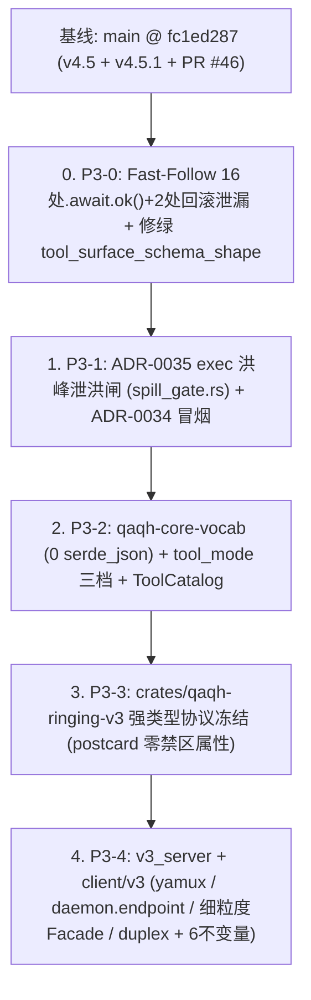

# QAQ-Harness `v4.6`（`P3-0` ~ `P3-4`）开工总计划与施工卡

> **基线时间**：2026-11-26 · **代码基线**：`main @ bea000a2`（已合入 `v4.5` PR #39–#44、`v4.5.1` PR #45、`wip/prompt-cache` PR #46、`v4.6 P3-0` PR #47）
> **适用宪章**：[AGENTS.md](../../AGENTS.md)（《项目宪法 v2 · 高质量发展修宪版》）· [ADR-0042 r4](../adr/0042-ringing-v3-rust-native-ipc-and-quic.md)（状态：`已采纳 · 未实施`）· [ADR-0035](../adr/0035-exec-flood-model-spill-gate.md)（状态：`已采纳 · 未实施`）· [V4_6_DECISION_PACK.md](./V4_6_DECISION_PACK.md)（已二审定案 + r4 协议复核增补）· [MUST.md](./MUST.md)
> **前置状态**：`v4.5`、`v4.5.1` 与 **`v4.6 P3-0`（PR #47 · `bea000a2`）** 均已合入 `main`，`session_loop.rs` 已降至 2,775 行，`../qaqh-gpui/Cargo.toml` 已摘除 `qaqh-config-api`。当前下一张开工切片为 **`P3-1`**，随后按序推进 `P3-2` ~ `P3-4`。

---

## 一、`v4.6` 战略定位（高质量发展转折版）

`v4.6` 是本仓正式告别“V2 跨语言妥协与修修补补”、迈向纯血 Rust Native 的决定性版本，严格按序执行 **5 张正交零返工切片（`P3-0` ~ `P3-4`）**：
1. **`P3-0`（前置清债 & 绿灯基线）**：按 `fc1ed287` 精确行号清剿 `session_loop.rs` 剩余 16 处 `.await.ok()` 与 2 处错误回滚内存泄漏（见 [V4_5_1_PR45_REMEDIATION_GUIDE.md](./V4_5_1_PR45_REMEDIATION_GUIDE.md) §二），同时修绿基线存量失败 [tool_surface_schema_shape.rs](../../crates/qaqh-runtime/tests/tool_surface_schema_shape.rs)（`exec_command` `oneOf` 泄漏），让主线在 100% 全绿基线上进军 `P3-1`；
2. **`P3-1`（后端洪峰安全阀）**：落地 `ADR-0035` 模型消费面泄洪闸（严守宪法 #8，独立为 `spill_gate.rs`）+ `ADR-0034` daemon 级真实洪峰冒烟；
3. **`P3-2`（纯原语底座 `qaqh-core-vocab` + 工具模式 + 只读 `ToolCatalog`）**：落实 `1C′` 方案，新建零 `serde_json`、零 `skip_serializing_if`/`tag`/`flatten` 的 `crates/qaqh-core-vocab`，收敛 [tool_mode.rs](../../crates/qaqh-types/src/tool_mode.rs) 三档预设并提供强类型只读 `ToolCatalog`（**冰封中的 `qaqh-types`/`qaqh-ringing-contract` 一行不动，剥离 PTC 沙箱运行时至 `v4.11`/`v5.0`**）；
4. **`P3-3`（RingingV3 纯 Rust 协议冻结）**：建立 `crates/qaqh-ringing-v3`（仅依赖 `qaqh-core-vocab` + `postcard` + `bytes`），一网打尽全部 daemon 能力，固化 `pinned_compaction`、`turns` 窗口、`GetTranscriptPage(before_ord, limit, timeline_epoch)` 与机器生成协议指纹；
5. **`P3-4`（V3 隔离骨架 + 细粒度异步门面 + `duplex` 闭环 + 6 条跨代不变量 + 前置 ADR）**：落地物理隔离 `v3_server/` + `client/v3/`、`yamux` + `daemon.endpoint` 无版本发现契约、泛型静态分发多域 Facade（含 `ShellFacade` 独立并发句柄表）与 `ringing_v3_invariants` 六大守卫（含量化 P99 延迟红线），补齐 2 份前置 ADR。

**明确不做的事（已定案与被否方案）**：
- 不再维护 `ADR-0008` 第 3 步（C# 解析机重写）或旧 V2 跨语言重切仪式；
- 不在 `v4.6` 中途重写 `session_loop.rs` / `store.rs` / `owner.rs`（锁定 `v5.0`）；
- 不在 `v4.6` 动 SQLite 存储引擎或新增任何磁盘 `migrate-on-read`（宪法 #6）；
- 不在 `v4.6` 把 V3 任何新能力倒灌回旧 V2 `axum_server` 或改动冰封中的 `qaqh-types`/`qaqh-ringing-contract`（`1C′`）；
- **不引入**跨进程共享内存直读消息上下文、`InspectModelContext`（推迟至 `v5.0` 后）、`local_readonly_path` 后门、对内 **`remoc`（`chmux` 全家桶）** 以及**移动端跨小版本宽松解码**（桌面与移动端统一坚持裸 `postcard` + 机器指纹严格同版 Fail-Closed，均记入 `ADR-0042 r4` §四）。

---

## 二、`v4.6` 全量切片执行顺序（Strict Sequential DAG）

- **宿主机资源红线（宪法 #14）**：8 逻辑核 / 7.7 GiB RAM，同一时刻只开 **1 个** 活跃平级 worktree（`../qaqh-wt-v4.6-*`），共享 `CARGO_TARGET_DIR="/home/qaqtam/项目/qaqh-backend/target"`，使用 `/home/qaqtam/.cargo/bin/cargo -j2` 跑受影响 crate 精准测试，严禁本地频繁全仓 `--release`。



---

## 三、各切片精确施工卡

### 0. `P3-0` — 前置清债（Fast-Follow 16 处 `.await.ok()` / 2 处回滚泄漏 + `tool_surface_schema_shape`）
- **Worktree & 分支**：`../qaqh-wt-v4.6-p3-0` · `fix/v4.6-p3-0-fail-closed-and-schema`
- **宪法与指南依据**：宪法 #3（Fail-Closed）、#8（上帝文件止血令）、#12（全绿基线）· [V4_5_1_PR45_REMEDIATION_GUIDE.md](./V4_5_1_PR45_REMEDIATION_GUIDE.md) §二（已按 `fc1ed287` 刷新行号）。
- **改动目标**：
  1. 按 §二 优先级 1–3 清零 `session_loop.rs`（现 2,887 行）中 16 处 `.await.ok()`：
     - `L2396` (`interrupt()`) 失败经 `owner.emit_turn_persist_failed` 解锁 UI 并单次报 `Failed`；
     - `L1331`/`1361`/`1400` (`inject_failed_tool_results`/`declare`) 写库失败立即上抛 `DbError`，绝不先污染内存 `messages`；
     - 5 处 `interaction_resolved`（`L1794`/`1815`/`1904`/`1926`/`2382`）与 7 处阶段变更（`L1609`/`1726`/`1775`/`1820`/`1871`/`1909`/`1931`）消除静默 `.ok()`，按路径记错并传播/回滚；
  2. 修复 2 处错误回滚内存泄漏：`request_permission`（`L1767`）补清 `active.pending_interactions`、`run_ask`（`L1867`）补清 `inner.asks` 与 `active.pending_interactions`；
  3. 同步将交互落库 / 截断注入辅助逻辑拆出至独立子模块，**确保 `session_loop.rs` 净行数 `≤ 0`**；
  4. 修复 `crates/qaqh-runtime/tests/tool_surface_schema_shape.rs`（消除 `exec_command` schema 的 `oneOf` 泄漏）。
- **反证与验证**：
  - 覆盖 `interrupt()` / `declare()` 失败及权限/Ask 失败回滚清理内存槽的红→绿反证；
  - `cargo test -j2 -p qaqh-session -p qaqh-agent-runtime -p qaqh-runtime`（含 `tool_surface_schema_shape`）全绿，clippy 零新增错误，铁闸 1 `EXIT=0`。

---

### 1. `P3-1` — `ADR-0035` exec 洪峰模型消费面泄洪闸 + `ADR-0034` 真实洪峰冒烟
- **Worktree & 分支**：`../qaqh-wt-v4.6-p3-1` · `feat/v4.6-p3-1-adr0035-spill-gate`
- **宪法与 ADR 依据**：[ADR-0035](../adr/0035-exec-flood-model-spill-gate.md)（状态：`已采纳 · 未实施`）· 宪法 #8（上帝文件止血令：`session_loop.rs` 净行数 `≤ 0`）。
- **改动目标**：
  1. 在 `crates/qaqh-agent-runtime/src/spill_gate.rs` 独立实现单 exec 会话模型消费面泄洪闸（硬编码累计字符/字节阈值常量，**不经 `SessionSettingsPatch` 暴露**）；
  2. 超限后立即停止向模型上下文直灌 delta，改为投递一条合成通告帧（异常流量说明 + 权威日志路径 + tail 预览），且**本会话余下输出永不恢复直灌**；
  3. 在 `crates/qaqh-agent-runtime/src/session_loop.rs` 与 `tool_job.rs` 中仅保留 **≤ 10 行薄调用接线**（确保 `session_loop.rs` 净行数 `≤ 0`）；
  4. 保持 `write_stdin` 轮询可用（泄洪后返回轻量水位与权威日志引用，不重放全量）且客户端事件流不设闸；
  5. 完成 `ADR-0034` 遗留的 daemon 级真实洪峰冒烟，并在同 PR 更新 `ADR-0035` 与 `docs/adr/README.md` 状态为 `已采纳并实施`。
- **反证与验证**：
  - 构造高产循环输出 exec 进程：旧代码持续向模型上下文灌入数百帧必红；新代码精确切换为 1 条合成通告帧、后续不再直灌、`write_stdin` 可轮询、客户端侧完整收到实时输出；
  - `git diff --numstat origin/main -- crates/qaqh-agent-runtime/src/session_loop.rs` 确认净行数 `≤ 0`；
  - `cargo test -j2 -p qaqh-agent-runtime -p qaqh-process-tools -p qaqh-daemon` 精准回归。

---

### 2. `P3-2` — `crates/qaqh-core-vocab` 纯原语底座 + 工具模式三档收口 + 只读 `ToolCatalog`
- **Worktree & 分支**：`../qaqh-wt-v4.6-p3-2` · `feat/v4.6-p3-2-core-vocab-and-tool-catalog`
- **宪法与决策依据**：`V4_6_DECISION_PACK.md` D1 (`1C′`) · 宪法 #6、#7 · [ADR-0042 r4](../adr/0042-ringing-v3-rust-native-ipc-and-quic.md)（状态：`已采纳 · 未实施`）铁律 1。
- **改动目标**：
  1. 新增 workspace member **`crates/qaqh-core-vocab`**（零 `serde_json`、`skip_serializing_if`、`#[serde(tag)]`、`flatten`、`untagged`）：
     - 承载强类型 ID newtype（`SessionId`/`TurnId`/`BlockId`/`ToolCallId`/`InputId`/`InteractionId`/`ExecSessionId`/`ContentHash`）、纯净域枚举（`ActivityState`/`TurnTerminal`/`UsageInfo`/`ContentRef`）及 **`ToolCatalog` / `ToolCatalogEntry` / `ToolAvailability`**；
     - `ToolCatalogEntry` 只带名称、分组、简述、风险级别、能力约束与动态 MCP 标识（**不带 `serde_json::Value` Schema**，如需原始 schema 文本仅用 `JsonText(String)`）；
  2. **严格执行 `1C′` V2 冰封纪律**：**绝对不修改** `crates/qaqh-types/` 与 `crates/qaqh-ringing-contract/`（`tool_mode.rs` 亦维持冰封不动，只在 `crates/qaqh-core-vocab` 定义三档强类型 `ToolMode`（`Core` / `Standard` / `Custom`）与 `ToolCatalog`，不留任何空壳 re-export；`qaqh-workspace`/`qaqh-runtime` 侧将运行期能力单向投影为 `qaqh-core-vocab::ToolCatalog` 且将压测档 `minimal:b/c` 隔绝在 V3 `ToolMode` 之外；**不恢复** `qaqh-ptc-*` crate）；
  3. 在 `qaqh-workspace` / `qaqh-runtime` 侧实现 `ToolCatalog` 投影构造函数（与 `ModelCapabilities` 联动计算禁用原因，后端单向投影至 `core-vocab`）。
- **反证与验证（V3 隔离前哨闸）**：
  - `cargo tree -p qaqh-core-vocab -e normal,build -i serde_json` **输出为空**；
  - `rg 'serde_json|skip_serializing_if|serde\([^)]*(tag|flatten|untagged)|serde\(alias|legacy_|compat_' crates/qaqh-core-vocab/` **0 命中**；
  - 构造无视觉能力模型 / `minimal` 模式 / 含动态 MCP 工具三种快照，断言 `ToolCatalog` 精确标记禁用原因与分组；
  - `cargo test -j2 -p qaqh-core-vocab -p qaqh-workspace -p qaqh-runtime` 与 clippy 全绿。

---

### 3. `P3-3` — 冻结 `crates/qaqh-ringing-v3` 强类型二进制协议 crate
- **Worktree & 分支**：`../qaqh-wt-v4.6-p3-3` · `feat/v4.6-p3-3-ringing-v3-contract`
- **宪法与决策依据**：宪法 #5、#6、#7 · `V4_6_DECISION_PACK.md` D1–D3/增补 · [ADR-0042 r4](../adr/0042-ringing-v3-rust-native-ipc-and-quic.md)（状态：`已采纳 · 未实施`）铁律 1–4、7。
- **改动目标**：
  1. 在根 `Cargo.toml` 引入 `postcard` 与 `bytes`，新增 workspace member **`crates/qaqh-ringing-v3`**，仅依赖 `qaqh-core-vocab`、`serde`、`postcard`、`bytes`、`thiserror`（**严禁依赖 `serde_json`、`axum`、`qaqh-ringing`、`qaqh-types`、`qaqh-ringing-contract`**）；
  2. 定义统一线缆帧与握手契约：
     - `RINGING_V3_ALPN = b"qaqh-ringing/3"`、`PROTOCOL_REV: u32` 及**由机器从 `qaqh-ringing-v3` 类型定义自动计算（`build.rs`）的协议指纹 `PROTOCOL_FINGERPRINT: [u8; 32]`**（严禁手改字符串版本）；
     - `ClientHello` / `ServerHello`（`client_instance_id`、`ClientKind`、本地 OS 凭据 / `iroh` `EndpointId` 鉴权凭据；**桌面与移动端统一执行严格同版 `PROTOCOL_REV` + `PROTOCOL_FINGERPRINT` Fail-Closed 校验**，失配即 `HandshakeReject`）；
     - 长度前缀 + `postcard` 编解码与单帧字节上限守卫（防恶意/异常超大帧 OOM）；
     - 无版本最终名服务发现结构 **`DaemonEndpoint`**（对应磁盘 `daemon.endpoint`，固定单一非 JSON 格式，含 `build_id` / `channel` / 本地 IPC 路径 / `iroh_endpoint_id` 与 `iroh_relay_url` 预留字段，0 `serde_json`）；
  3. **一网打尽全量强类型 RPC 与四流帧（按因果独立域分流）**：
     - `ControlRequest` / `ControlResponse` 完整覆盖：`System`（Health/Activity/Version/Stop/StopIfIdle）、`Session`（首屏 `GetSessionSnapshot` 支持 `tail_blocks`、独立 `pinned_compaction: Option<CompactionSummary>`、`turns` 窗口上限；向上翻页 `GetTranscriptPage { session_id, before_ord, limit, timeline_epoch }` 一次带齐关联 `ToolCallView` 与跨页工具归属规则，epoch 失配返回 `StaleCursor`）、`Command`、`Shell`、`Marketplace`、`Config`、`Account`、`Pairing`、`Gitx`、`Fs`、`ToolCatalog`；
     - **显式排除**：不纳入 `InspectModelContext`，不加入 `local_readonly_path: Option<PathBuf>`，不把后端 `opaque` 锚点带上客户端 wire；所有动态参数仅用强类型 `JsonText(String)` / `Bytes`；
     - 四类逻辑流（`StreamKind::Control | SessionEvents { session_id, since_seq } | ShellPty { shell_id, from_offset } | BlobTransfer`）、`DeliveryClass`（`Reliable | Replaceable`，同会话死守单流单 `seq`，绝不按分级拆流）、`server_ts_ms: u64` 与原生多端联动帧（含单点定序 `DriverChanged`）。
  4. **全部 DTO 采用 externally-tagged `enum` / 无 `skip_serializing_if` `struct`**，命名永久无 `V3` 业务前缀、0 `#[serde(alias)]`、0 自报 `owner_id`/`client_id`。
- **反证与验证（V3 双重反腐闸）**：
  - `cargo tree -p qaqh-ringing-v3 -e normal,build -i serde_json` **输出为空**；
  - `rg 'serde_json|skip_serializing_if|serde\([^)]*(tag|flatten|untagged)|RINGING_V2|axum_server|serde\(alias|legacy_|compat_' crates/qaqh-ringing-v3/` **0 命中**；
  - **全量 DTO `postcard` round-trip 属性测试**（刻意构造 `Option::None`、`Option::Some`、空/多元素 `Vec` 混合序列，证明无位置错位与编解码全通）、超限帧/失配版本/陈旧 `timeline_epoch` Fail-Closed 测试、`DaemonEndpoint` 往返测试全绿；
  - `cargo test -j2 -p qaqh-ringing-v3` + `cargo clippy --no-deps -p qaqh-ringing-v3` 零警告。

---

### 4. `P3-4` — `v3_server` + `client/v3` 隔离骨架 + `duplex` 闭环 + 6 条跨代不变量守卫 + 前置 ADR
- **Worktree & 分支**：`../qaqh-wt-v4.6-p3-4` · `feat/v4.6-p3-4-v3-duplex-and-invariants`
- **宪法与决策依据**：宪法 #5、#6、#7、#10 · `V4_6_DECISION_PACK.md` D3/D4/增补 · [ADR-0042 r4](../adr/0042-ringing-v3-rust-native-ipc-and-quic.md)（状态：`已采纳 · 未实施`）铁律 3–7。
- **改动目标**：
  1. 在 `crates/qaqh-daemon/src/v3_server/` 与 `crates/qaqh-client/src/v3/` 建立物理隔离的 V3 服务端与客户端骨架：
     - 定义极薄 **`MuxTransport` trait**（`open_bi`/`accept_bi`/`open_uni`/`accept_uni`，直接对齐 `v4.8` `iroh::Connection`），引入 `yamux` + `tokio-util::compat`（**按宪法 #16 开工前查最新官方 crate API**，配独立 `Connection` driver task），实现 `tokio::io::duplex` 内存多路复用闭环；
     - `client/v3` 对消费端仅暴露极简原生 async Stream/Handle，固化 `SessionEvents` 为前端唯一状态真相源，并在 `daemon.endpoint` 读取校验层落地 `build_id` / `channel` / `fingerprint` Fail-Closed 拒绝过期守护进程逻辑；
     - **同步记录 Windows Named Pipe 显式 Owner-Only DACL + `reject_remote_clients(true)` 与严格同版协议演进规则**，确保 `v4.7` 本地 IPC 与 `v4.8` `iroh` 传输零返工；
  2. **按域细分 `v3_server` 纯 `async` 门面 + 泛型静态分发**：
     - 拆出 `SystemFacade` / `ConfigAccountFacade` / `MarketplaceFacade` / `GitxFacade` / `FsFacade` / `SessionFacade` / `ShellFacade`（配独立并发句柄表，不碰中央 `registry` 锁）/ `BlobFacade`，统一通过 **`V3Server<B>` 泛型静态分发**接入（无 `dyn` 装箱妥协），明确 `v3_server` 内的后端→DTO 单向投影边界；
  3. **优先落地 `ringing_v3_invariants` 六大跨代不变量守卫测试集**（全部跑在 `duplex` 真多路流上）：
     - ① **原子订阅 + 有界回放尾**：事件洪峰期间 attach，`resync_cycles == 0` 且零丢帧（含破坏顺序必红反证）；
     - ② **多流背压隔离与量化延迟上界**：大 Blob 满载分片 + PTY 刷屏 + 会话 A 洪峰并发时，Control RPC 往返 **P99 < 50ms** 且会话 B 不饿死；
     - ③ **断联不杀进程 + 幂等回执**：断开连接不终止 exec/shell，同 `command_id` 重放返回原回执；
     - ④ **身份单权威不可伪造**：越权访问他人会话/Shell 或低 scope 调 Admin RPC 当场拒绝；
     - ⑤ **多端联动原语**：双内存客户端同时附着同一会话与 Shell、`SwitchDriver` 由 `OwnerPump` 单点定序广播 `DriverChanged` 且非 Driver 端发 `SendPrompt` 当场拒绝、设备吊销即时踢流；
     - ⑥ **前端渲染预算保护（初心守卫）**：高频 `Replaceable` 洪峰经同流合帧后不拖慢同流 `Reliable` 审批/终态且**严格保序（`Reliable` 前先 flush 已合并增量，绝不终态早于尾增量乱序）**，大输出走 `BlobRef`/泄洪引用，支持 `pinned_compaction` 分离与 `GetTranscriptPage` `StaleCursor` 校验。
  4. **补齐两份轻量定案 ADR**（状态：`已采纳 · 未实施`）：
     - 无 WebView（`qaqh-gpui`）下的原生结构化可视化策略 ADR（处置 [widget-directive-protocol-2026-11-12.md](../widget-directive-protocol-2026-11-12.md)）；
     - `audit v1/v2` 与 `JOURNAL_IO` 最终归属 ADR。
- **反证与验证（V3 反腐闸）**：
  - `rg 'axum_server|RINGING_V2|v2_stream|serde_json|skip_serializing_if|serde\([^)]*(tag|flatten|untagged)|serde\(alias|legacy_|compat_' crates/qaqh-daemon/src/v3_server crates/qaqh-client/src/v3` **必须 0 命中**；
  - `ringing_v3_invariants` 6 大守卫在 `duplex` 上全绿（且演示破坏守卫①先 grab 后读环顺序时必红）；
  - `cargo test -j2 -p qaqh-core-vocab -p qaqh-ringing-v3 -p qaqh-client -p qaqh-daemon -- v3` 与 clippy 全绿。

---

## 四、给执行 Agent 的 `v4.6` 标准派工 Prompt 模板

每次只派 **1 个 Agent** 按序执行 **1 张切片（`P3-0` → `P3-1` → `P3-2` → `P3-3` → `P3-4`）**：

```markdown
请在 `/home/qaqtam/项目/qaqh-backend` 推进 `v4.6` 路线图的 **`<SLICE_ID>`** 切片。

### 开工前必读与现场核查（宪法 #14、#15、#16）
1. 阅读 `AGENTS.md`（宪法 v2）、`docs/adr/0042-ringing-v3-rust-native-ipc-and-quic.md`（r4）、`docs/v4.3-4.8/V4_6_DECISION_PACK.md` 与 `docs/v4.3-4.8/V4_6_EXECUTION_PLAN.md` 中 `<SLICE_ID>` 小节（若做 `P3-0` 必读 `V4_5_1_PR45_REMEDIATION_GUIDE.md` §二）。
2. 先运行只读检查：
   - 核查磁盘可用空间、可用内存、CPU 核数（8 逻辑核 / 7.7 GiB RAM，禁止本地全仓 `--release`）；
   - `git fetch origin && git status -sb && git worktree list`；
   - 确认前序切片已合入 `origin/main`。
3. 使用任务列表工具同步你的执行步骤后再开始改代码。

### 强制施工纪律
1. **Worktree 隔离 & 禁用 `git checkout`（宪法 #15）**：在平级目录 `../qaqh-wt-v4.6-<slice>` 开独立分支，共享 `CARGO_TARGET_DIR="/home/qaqtam/项目/qaqh-backend/target"`，统一使用 `/home/qaqtam/.cargo/bin/cargo -j2`；严禁使用 `git checkout`。
2. **上帝文件止血 & V2 冰封（宪法 #7、#8）**：`session_loop.rs`、`store.rs`、`owner.rs` 严禁净增行数（`≤ 0`），新能力独立成子模块；严禁改动冰封中的 `qaqh-types`/`qaqh-ringing-contract`（`1C′` 纪律），严禁写 V2/V3 转换层或向 V2 倒灌能力。
3. **RingingV3 反腐与 `postcard` 禁区红线（宪法 #5、#6、#7）**：
   - `qaqh-core-vocab` 与 `qaqh-ringing-v3` 的 `cargo tree -e normal,build -i serde_json` 必须为空；
   - `qaqh-core-vocab/`、`qaqh-ringing-v3/`、`v3_server/`、`client/v3/` 对 `axum_server`、`RINGING_V2`、`v2_stream`、`serde_json`、`skip_serializing_if`、`serde(tag/flatten/untagged/alias)`、`legacy_`、`compat_` 必须 **0 命中**。
4. **反证 + 精准验证 + 停等验收（宪法 #12、#17）**：
   - 给出红→绿反证输出，跑受影响 crate 的 `cargo test -j2 -p <crate>` 与 `cargo clippy -j2 --no-deps --lib -p <crate>`；
   - 提交（附 `Co-Authored-By:`）并 `gh pr create`，贴齐病灶/依据、隔离闸证明、反证日志与未验范围；**不要自行 merge，停下等待验收**。
```

---

## 五、结项状态回写（每合入一张 PR 滚动更新）

| 切片 | PR | 状态 | 备注 |
|---|---|---|---|
| `P3-0` | #47 (`bea000a2`) | **已合入 `main`** | Fast-Follow：`session_loop.rs` 16 处 `.await.ok()` + 2 处回滚泄漏清零（拆出 `session_interaction.rs`，降至 2,775 行）+ 修绿 `tool_surface_schema_shape` |
| `P3-1` | — | **待开工（下一张）** | `ADR-0035` 泄洪闸（独立 `spill_gate.rs`）+ `ADR-0034` 真实洪峰冒烟 |
| `P3-2` | — | 待开工（依赖 `P3-1`） | `crates/qaqh-core-vocab`（0 `serde_json`）+ `tool_mode.rs` 三档 + 只读 `ToolCatalog`（`1C′` 不碰 V2 crate，剥离 PTC） |
| `P3-3` | — | 待开工（依赖 `P3-2`） | `crates/qaqh-ringing-v3` 强类型协议冻结（`postcard` 零禁区属性 / `daemon.endpoint` / `pinned_compaction` / 机器指纹） |
| `P3-4` | — | 待开工（依赖 `P3-3`） | `v3_server` + `client/v3`（`yamux` + 细粒度泛型静态分发 Facade + `duplex` 闭环 + 6 条不变量（含量化延迟）+ 2 份前置 ADR） |