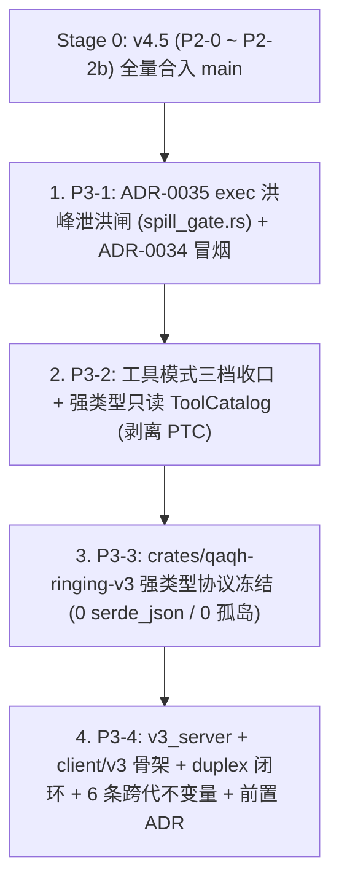

# QAQ-Harness `v4.6`（P3-1 ~ P3-4）开工总计划与施工卡

> **基线时间**：2026-11-26
> **适用宪章**：[AGENTS.md](../../AGENTS.md)（《项目宪法 v2 · 高质量发展修宪版》）· [ADR-0042 r2](../adr/0042-ringing-v3-rust-native-ipc-and-quic.md)（状态：`已采纳 · 未实施`）· [ADR-0035](../adr/0035-exec-flood-model-spill-gate.md)（状态：`已采纳 · 未实施`）· [MUST.md](./MUST.md)
> **开工硬前置**：`v4.5`（[V4_5_EXECUTION_PLAN.md](./V4_5_EXECUTION_PLAN.md)）的 `P2-1a` ~ `P2-2b` 全部合入 `main`，且 `../qaqh-gpui/Cargo.toml` 已同步摘除 `qaqh-config-api` 路径依赖。

---

## 一、`v4.6` 战略定位（高质量发展转折版）

`v4.6` 是本仓正式告别“V2 跨语言妥协与修修补补”、迈向纯血 Rust Native 的决定性版本，只干 **4 件边界正交、零返工的高价值硬事**：
1. **后端洪峰安全阀收口（`P3-1`）**：落地 `ADR-0035` 模型消费面泄洪闸（严格执行宪法 #8 上帝文件止血令，独立成 `spill_gate.rs`）+ 收口 `ADR-0034` daemon 级真实洪峰冒烟；
2. **强类型工具模式与能力目录（`P3-2`）**：为 `../qaqh-gpui` 与 RingingV3 提供单一真源 `ToolCatalog`（**显式剥离重型 PTC 沙箱运行时**，移至 `v4.11` 独立选型、`v5.0` 全异步底座落地后一步接入）；
3. **RingingV3 纯 Rust 协议冻结（`P3-3`）**：建立零 `serde_json` 依赖的 `crates/qaqh-ringing-v3`，一网打尽全部 daemon 能力（零 `/control/v1`、`/marketplace/v1` 孤岛，零 `ClientV3*` 别名墙，零 `#[serde(alias)]`）；
4. **V3 隔离骨架 + `duplex` 内存闭环 + 6 条跨代不变量守卫（`P3-4`）**：先立不变量红线（含 11/10 P0 洪峰不活锁守卫与前端渲染预算初心守卫），为 `v4.7` 切 `../qaqh-gpui` 本地 IPC（并腰斩 `bridge.rs`）与 `v4.8` 切移动端纯 QUIC 铺平零返工跑道。

**明确不做的事（防范围蔓延与返工）**：
- 不再维护 `ADR-0008` 第 3 步（C# 解析机重写）或旧 V2 跨语言金标准重切仪式；
- 不在 `v4.6` 中途重写 `session_loop.rs` / `store.rs` / `owner.rs`（锁定在 `v5.0` 一次性完成）；
- 不在 `v4.6` 动 SQLite 存储引擎或新增任何磁盘 `migrate-on-read`（宪法 #6 协议与存储隔离）；
- 不把 V3 任何新能力倒灌回旧 V2 `axum_server`（V2 自 `v4.6` 起只读冰封）。

---

## 二、`v4.6` 全量切片执行顺序（Strict Sequential DAG）

- **宿主机资源红线（宪法 #14）**：8 逻辑核 / 7.7 GiB RAM，同一时刻只开 **1 个** 活跃平级 worktree（`../qaqh-wt-v4.6-*`），共享 `CARGO_TARGET_DIR`，精准 `cargo test -p <crate>`，严禁本地频繁全仓 `--release`。



---

## 三、各切片精确施工卡

### 1. `P3-1` — `ADR-0035` exec 洪峰模型消费面泄洪闸 + `ADR-0034` 真实洪峰冒烟
- **Worktree & 分支**：`../qaqh-wt-v4.6-p3-1` · `feat/v4.6-p3-1-adr0035-spill-gate`
- **宪法与 ADR 依据**：[ADR-0035](../adr/0035-exec-flood-model-spill-gate.md)（状态：`已采纳 · 未实施`）· 宪法 #8（上帝文件止血令：`session_loop.rs` 净行数只减不增）。
- **改动目标**：
  1. 在 `crates/qaqh-agent-runtime/src/spill_gate.rs` 独立实现单 exec 会话模型消费面泄洪闸（硬编码累计字符/字节阈值常量，**不经 `SessionSettingsPatch` 暴露**）；
  2. 超限后立即停止向模型上下文直灌 delta，改为投递一条合成通告帧（异常流量说明 + 权威日志路径 + tail 预览），且**本会话余下输出永不恢复直灌**；
  3. 在 `crates/qaqh-agent-runtime/src/session_loop.rs` 与 `tool_job.rs` 中仅保留 **≤ 10 行薄调用接线**（如能顺手抽离相关逻辑使 `session_loop.rs` 净行数下降更佳）；
  4. 保持 `write_stdin` 轮询可用（泄洪后返回轻量水位与权威日志引用，不重放全量）且客户端事件流不设闸；
  5. 完成 `ADR-0034` 遗留的 daemon 级真实洪峰冒烟，并在同 PR 更新 `ADR-0035` 与 `docs/adr/README.md` 状态为 `已采纳并实施`。
- **反证与验证**：
  - 构造高产循环输出 exec 进程：旧代码将持续向模型上下文灌入数百帧必红；新代码触发硬编码阈值后精确切换为 1 条合成通告帧、后续不再直灌、`write_stdin` 可轮询、客户端侧仍完整收到实时输出；
  - 核查 `git diff --numstat crates/qaqh-agent-runtime/src/session_loop.rs` 确认净增量遵守宪法 #8；
  - `cargo test -p qaqh-agent-runtime -p qaqh-process-tools -p qaqh-daemon` 精准回归。

---

### 2. `P3-2` — 工具模式三档收口 + 强类型只读 `ToolCatalog`
- **Worktree & 分支**：`../qaqh-wt-v4.6-p3-2` · `feat/v4.6-p3-2-tool-modes-and-catalog`
- **改动目标**：
  1. 清理 [crates/qaqh-types/src/tool_mode.rs](../../crates/qaqh-types/src/tool_mode.rs)：收敛面向用户的预设档位（如 `core`/`minimal` 原生核心集、`standard` 拓展工具集、`custom` 结构化白名单；将内部压测档 `minimal:b` / `minimal:c` 收回测试夹具，不暴露在生产预设列表）；
  2. 定义强类型只读 **`ToolCatalog` / `ToolCatalogEntry` / `ToolAvailability`**（落于无 `serde_json` 依赖的纯粹领域位置，直供 `qaqh-ringing-v3` 与 `../qaqh-gpui` 零转换消费）：
     - 覆盖工具名、分组、简述、风险级别、`ToolCapabilities` 约束、动态 MCP 工具项；
     - 与当前选中模型的 `ModelCapabilities`（`tool_calls`、`image_input`、`native_web_search`、`reasoning`）联动计算可用状态与不可用原因；
  3. **显式排除**：本切片**不恢复** `Cargo.toml` `exclude` 中的 4 个 `qaqh-ptc-*` crate，不引入任何外置/内嵌脚本沙箱引擎。
- **反证与验证**：
  - 构造无视觉能力模型 / `minimal` 模式 / 含动态 MCP 工具三种快照，断言 `ToolCatalog` 精确标记禁用原因与分组（旧实现无单源目录或依赖前端硬编码）；
  - `cargo test -p qaqh-types -p qaqh-workspace -p qaqh-runtime` 精准绿。

---

### 3. `P3-3` — 冻结 `crates/qaqh-ringing-v3` 强类型二进制协议 crate
- **Worktree & 分支**：`../qaqh-wt-v4.6-p3-3` · `feat/v4.6-p3-3-ringing-v3-contract`
- **宪法与 ADR 依据**：宪法 #5、#6、#7 · [ADR-0042 r2](../adr/0042-ringing-v3-rust-native-ipc-and-quic.md) 铁律 1–4 & 铁律 7（前端第一与用户体验初心）。
- **改动目标**：
  1. 新增 workspace member **`crates/qaqh-ringing-v3`**，**其 `Cargo.toml` 严禁依赖 `serde_json`、`axum`、`qaqh-ringing`**；
  2. 定义统一线缆帧与握手契约：
     - `RINGING_V3_ALPN = b"qaqh-ringing/3"`、`PROTOCOL_REV: u32`；
     - `ClientHello` / `ServerHello`（客户端逻辑身份 `client_instance_id`、`ClientKind`、能力位、鉴权凭据/本地 OS 免密标识；失配直接 `HandshakeReject` Fail-Closed）；
     - 长度前缀 + `postcard` 编解码与单帧字节上限守卫（防恶意/异常超大帧 OOM）；
  3. **一网打尽全量强类型 RPC 与四流帧（消灭所有 `/v1` 孤岛与字符串方法表，落实铁律 7 前端友好初心）**：
     - `ControlRequest` / `ControlResponse` 完整覆盖：`System`（Health/Activity/Version/Stop/StopIfIdle）、`Session`（**`SessionSnapshot` 原生内置尾部窗口 + 向上翻页参数，确保长会话首屏秒开**）、`Command`、`Shell`、`Marketplace`、`Config`、`Account`、`Pairing`、`Gitx`、`Fs`、`ToolCatalog`；
     - **零裸 `Value`、开箱即渲染**：连历史遗留的 `pending_approvals` 与全部 `service_methods` 均在此处强类型化，前端无需拼接口或猜字段；
     - 四类逻辑流标识（`StreamKind::Control | SessionEvents { session_id, since_seq } | ShellPty { shell_id, from_offset } | BlobTransfer`）；
     - 事件帧头显式携带 **`DeliveryClass`（`Reliable | Replaceable`）** 与轻量 **`server_ts_ms: u64`**（保护前端渲染预算 + 端到端延迟观测）；
     - 多端联动原生帧（Driver 席位变更广播、设备列表/吊销通知、Shell 多观看者控制帧）。
  4. **命名洁癖**：所有业务域 DTO 无 `V3` 前缀；严禁 `#[serde(alias = ...)]`；严禁在任何业务请求体中放入可伪造的“自报 `owner_id`/`client_id`”字段。
- **反证与验证（V3 反腐闸）**：
  - `cargo tree -p qaqh-ringing-v3` 断言 `serde_json` **0 出现**；
  - `rg 'serde_json|RINGING_V2|axum_server|serde\(alias|legacy_|compat_' crates/qaqh-ringing-v3/` **0 命中**；
  - 全量 `ControlRequest` / `ControlResponse` / 四流帧 `postcard` round-trip、超限帧拒绝、协议版本失配 Fail-Closed 拒绝、以及 `SessionSnapshot` 尾窗分页与 `DeliveryClass` 编码单测全绿；
  - `cargo test -p qaqh-ringing-v3` + `cargo clippy --no-deps -p qaqh-ringing-v3` 零警告。

---

### 4. `P3-4` — `v3_server` + `client/v3` 隔离骨架 + `duplex` 内存闭环 + 跨代不变量守卫 + 前置 ADR
- **Worktree & 分支**：`../qaqh-wt-v4.6-p3-4` · `feat/v4.6-p3-4-v3-duplex-and-invariants`
- **宪法与 ADR 依据**：宪法 #5、#6、#7、#10 · [ADR-0042 r2](../adr/0042-ringing-v3-rust-native-ipc-and-quic.md) 铁律 5–7。
- **改动目标**：
  1. 在 `crates/qaqh-daemon/src/v3_server/` 与 `crates/qaqh-client/src/v3/` 建立完全物理隔离的 V3 服务端与客户端骨架，通过统一 `V3Transport` 抽象支持 **`tokio::io::duplex` + `yamux`** 内存多路复用直连；`client/v3` 对消费端只暴露极简原生 async `Stream`/Handle API（把连接/重连/回放尾追帧/命令幂等全部封装在 SDK 内，为 `v4.7` 腰斩 `../qaqh-gpui` 56 KB `bridge.rs` 奠基）；
  2. 为 `v3_server` 接入纯 **`async` 业务门面 trait**（解耦 `QaqhService.registry` 中央同步锁，Shell 流直接持有独立 `Arc<ShellHandle>`，为 `v5.0` Per-Root Actor 铺路）；
  3. **优先落地 `ringing_v3_invariants` 六大跨代不变量守卫测试集**（全部跑在 `duplex` 真多路流上，零 mock 业务逻辑）：
     - ① **原子订阅 + 有界回放尾**：事件洪峰期间 attach，`resync_cycles == 0` 且零丢帧（直接继承 11/10 P0 守卫）；
     - ② **四流物理隔离零队头阻塞**：大 Blob 分片 + PTY 狂刷 + 会话 A 洪峰并发时，Control RPC 与会话 B 事件延迟 < 50ms；
     - ③ **断联不杀进程 + 幂等回执**：断开连接不终止 exec/shell，同 `command_id` 重放返回原回执；
     - ④ **身份单权威不可伪造**：越权访问他人会话/Shell 或低 scope 调 Admin RPC 当场拒绝；
     - ⑤ **多端联动原语**：双内存客户端同时附着同一会话与 Shell、Driver 席位交接广播、设备吊销即时踢流；
     - ⑥ **前端渲染预算保护（初心守卫）**：高频 `Replaceable` 增量洪峰经后端合帧/节流后不得拖慢同流 `Reliable` 审批/终态交付，且大输出自动转 `BlobRef`/泄洪引用、快照尾窗分页可无全量加载拉取历史。
  4. **补齐两份轻量定案 ADR**（防止 `v4.10` 口径悬空）：
     - 无 WebView（`qaqh-gpui`）下的原生结构化可视化策略 ADR（明确处置 [widget-directive-protocol-2026-11-12.md](../widget-directive-protocol-2026-11-12.md)）；
     - `audit v1/v2` 与 `JOURNAL_IO` 最终归属 ADR（收口 `V4_5_EXECUTION_PLAN.md` 附录登记项）。
- **反证与验证（V3 反腐闸）**：
  - `rg 'axum_server|RINGING_V2|v2_stream|serde_json|serde\(alias|legacy_|compat_' crates/qaqh-daemon/src/v3_server crates/qaqh-client/src/v3` **必须 0 命中**；
  - `ringing_v3_invariants` 6 大守卫测试在 `duplex` 上全绿（且演示若人为破坏先 grab 后读环顺序，守卫①必红）；
  - `cargo test -p qaqh-ringing-v3 -p qaqh-client -p qaqh-daemon -- v3` 全绿。

---

## 四、给执行 Agent 的 `v4.6` 标准派工 Prompt 模板

每次只派 **1 个 Agent** 按序执行 **1 张切片（`P3-1` → `P3-2` → `P3-3` → `P3-4`）**：

```markdown
请在 `qaqh-backend` 推进 `v4.6` 路线图的 **`<SLICE_ID>`** 切片。

### 开工前必读与现场核查（宪法 #14、#15、#16）
1. 阅读 `AGENTS.md`（宪法 v2）、`docs/adr/0042-ringing-v3-rust-native-ipc-and-quic.md`、`docs/v4.3-4.8/MUST.md` 与 `docs/v4.3-4.8/V4_6_EXECUTION_PLAN.md` 中 `<SLICE_ID>` 小节。
2. 先运行只读检查：
   - 核查磁盘可用空间、可用内存、CPU 核数（8 GiB RAM 宿主机严禁本地全仓 `--release`）；
   - `git fetch origin && git status -sb && git worktree list`；
   - 确认 `v4.5` 前置切片已合入 `main`。
3. 使用任务列表工具同步你的执行步骤后再开始改代码。

### 强制施工纪律
1. **Worktree 隔离 & 禁用 `git checkout`（宪法 #15）**：在平级目录 `../qaqh-wt-v4.6-<slice>` 开独立分支，共享 `CARGO_TARGET_DIR`，严禁使用 `git checkout`。
2. **上帝文件止血（宪法 #8）**：`session_loop.rs`、`store.rs`、`owner.rs` 等 >1,000 行生产文件严禁净增业务分支，新能力独立成子模块，既有文件内仅允许 ≤ 10 行薄接线。
3. **RingingV3 反腐铁律（宪法 #5、#6、#7）**：
   - `qaqh-ringing-v3` 严禁依赖 `serde_json`；
   - `qaqh-ringing-v3/`、`v3_server/`、`client/v3/` 对 `axum_server` / `RINGING_V2` / `v2_stream` / `serde_json` / `serde(alias` / `legacy_` / `compat_` 必须 **0 命中**；
   - 严禁编写 V2/V3 转换层，严禁把新能力倒灌回旧 V2 路由。
4. **反证 + 精准验证（宪法 #12）**：给出红→绿反证输出；跑受影响 crate 的 `cargo test -p <crate>` 与 `cargo clippy --no-deps -p <crate>`；PR 正文按四联单贴齐病灶/依据、反腐隔离 `rg == 0` 证明、反证日志与测试输出，合并后立即 `git worktree remove`。
```

---

## 五、结项状态回写（待每合入一张 PR 滚动更新）

| 切片 | PR | 状态 | 备注 |
|---|---|---|---|
| `P3-1` | — | 待开工（待 `v4.5` 结项） | `ADR-0035` 泄洪闸（独立 `spill_gate.rs`）+ `ADR-0034` 真实洪峰冒烟 |
| `P3-2` | — | 待开工 | 工具模式三档收口 + 强类型只读 `ToolCatalog`（剥离 PTC 运行时） |
| `P3-3` | — | 待开工 | `crates/qaqh-ringing-v3` 强类型二进制协议冻结（0 `serde_json` / 0 `/v1` 孤岛） |
| `P3-4` | — | 待开工 | `v3_server` + `client/v3` 骨架 + `duplex` 闭环 + 6 条跨代不变量守卫 + 2 份前置 ADR |
