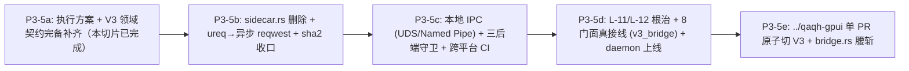

# QAQHarness `v4.7`（`P3-5`）执行方案：RingingV3 本地 IPC 上线 + 真门面接线 + 历史债清场 + `../qaqh-gpui` 原子切换

> **基线**：`qaqh-backend` `main` @ `f751a2c7`（`v4.6` `P3-0`～`P3-4` 全部已合入）· `../qaqh-gpui` `main` @ `617427f`  
> **最高约束**：《项目宪法 v2》第 1–17 条 · [ADR-0042 r5](../adr/0042-ringing-v3-rust-native-ipc-and-quic.md) · [MUST.md](./MUST.md)  
> **使用说明**：本文档拆分为 5 张职责单一、互不纠缠的顺序切片 PR（`P3-5a`～`P3-5e`）。`P3-5a` 已率先完成契约补齐，**后续每个切片均设计为可由轻量/快速模型独立承接并一次性验收通过的精确工单**。

---

## 一、总体架构、前沿对标与四条红线

### 1. 同类项目对标与开源选型定案
- **Zed / WezTerm / Codex 本地 IPC 对标**：统一采用 OS 原生字节流（Unix Domain Socket / Windows Named Pipe）+ 多路复用器；绑定前核验路径类型，连接后以 OS 内核凭据（`SO_PEERCRED` / DACL）强校验，退场时清理端点。
- **否决引入 `interprocess` Crate**：`interprocess::local_socket` 屏蔽了 Windows 底层 `SECURITY_ATTRIBUTES` 注入，无法满足 `ADR-0042` 铁律 4 要求的 Owner-Only DACL 硬红线（Named Pipe 默认 DACL 会授予 `Everyone` 读权限）。定案**零新增 IPC 框架依赖**，直接使用 `tokio::net::{UnixListener, UnixStream}`（`#[cfg(unix)]`）与 `tokio::net::windows::named_pipe::{ServerOptions, ClientOptions}` + `windows-sys`（`#[cfg(windows)]`）。
- **根除 `reqwest::blocking` 运行时崩溃陷阱**：实查 `qaqh-workspace/src/web.rs`（`WebFetchTool::run`）与 `qaqh-runtime` 账号 RPC 均在 `tokio::task::spawn_blocking` 池中执行（TLS 已进入 Tokio runtime 上下文）。使用 `reqwest::blocking::Client` 会在构造/Drop 时直接 panic。定案 `qaqh-oauth-core` 与 `qaqh-workspace` 统一使用**异步 `reqwest::Client`**（不启用 `blocking` 特性，复用 `rustls` / `aws-lc-rs`）。

### 2. 全程死守的四条工程红线
1. **单活跃平级 Worktree + 宿主机资源保护（宪法 #14/#15）**：
   - 8 核 / 8 GiB RAM Linux 宿主机统一坚持：单一平级 `../qaqh-wt-v4.7-p3-5`、共享 `CARGO_TARGET_DIR`、`-j2` 精准 `-p` 验证、禁止本机频繁 `--release` 全仓编译、**全仓禁用 `git checkout`**；
   - **禁止改动**主工作区 `/home/qaqtam/项目/qaqh-backend`（其本地尚有 `store.rs`/`accounts.rs`/`providers.rs` 未提交改动）；若由所有者合入主工作区改动，在开 `P3-5d` 前先 `git fetch && git rebase/merge origin/main`。
2. **`v3_server/` 反腐隔离墙 & `v3_bridge/` 单向投影分层**：
   - `crates/qaqh-core-vocab/`、`crates/qaqh-ringing-v3/`、`crates/qaqh-v3-transport/src/`、`crates/qaqh-daemon/src/v3_server/`、`crates/qaqh-client/src/v3/` 对 `axum_server|RINGING_V2|v2_stream|serde_json|skip_serializing_if|serde\((tag|flatten|untagged|alias)|legacy_|compat_` 必须**字面 0 命中**。
   - **单向投影层位置定死在 `crates/qaqh-daemon/src/v3_bridge/`（位于 `v3_server/` 外侧）**：将 `QaqhService`/`SessionOwner`/`qaqh-config` 的内部状态**单向**投影为纯 V3 DTO，`v3_server/` 本身不碰任何 JSON/V2 类型；`PairingTable` 从 `axum_server` 抽离到 `qaqh-ringing-runtime::pairing`，禁止 `v3_server` 或 `v3_bridge` 引用 `axum_server`。
3. **代码规模与文件上限（宪法 #8）**：
   - `session_loop.rs`、`owner.rs`、`store.rs` 等 >1,000 行文件净行数只减不增；
   - 新增/拆分模块（含 `qaqh-ringing-v3/src/*.rs`、`v3_server/`、`v3_bridge/`）单文件严格控制 **< 1,000 行**；
   - 严禁创建 `V2-over-V3` 转换层或 `QAQH_USE_V2` 回退开关（宪法 #2/#5/#7）。
4. **反证优先与诚实交付（宪法 #12/#13/#17）**：
   - 所有并发修复（`L-11`/`L-12`）、安全守卫（Unix `0600`/同 UID 校验、Windows Named Pipe DACL）必须提供**红→绿反证测试**；
   - 本机为 Linux，Windows Named Pipe 真机实测由 GitHub Actions `.github/workflows/v3-ci.yml` 的 `windows-latest` Runner 执行；PR 正文必须如实标明未在本机实测的 Windows GUI 范围；
   - 提交统一附 AI 实名 trailer（如 `Co-Authored-By:`）。

---

## 二、切片明细（可直接按序派发快速模型执行）

### 切片 1：`P3-5a` — V3 契约完备补齐 + 执行方案冻结（高阶模型完成）
- **目标**：一次性补齐 `../qaqh-gpui` 现网在用的全部 V3 领域原语（消除后续切端返工），并调整与真实后端对齐的两个核心边界（`ShellRequest::{Open, List}` 的 `session_id: Option<SessionId>`、`BlobTransferRole::ClientUpload` 携带 `session_id: SessionId` 匹配 SQLite `(session_id, content_id)` 复合主键）。
- **新增模块**：
  - `crates/qaqh-core-vocab`：新增 `WorkspaceId`、`PermissionGrantScope`、`GoalStatus`、`TurnPhase`、`ModelSelection` / `ModelSelectionOptions`、`SettingOverride<T>`（全外部标签 enum，零 `serde_json`）；
  - `crates/qaqh-ringing-v3/src/{session,workspace,team,config,account}.rs`：按域拆出，严守 `< 1,000` 行与 `#![deny(missing_docs)]`；补齐 `Workspace` 域、`Archive`/`Unarchive`/`PatchSettings`/`Truncate`/`SetGoal`/`ClearGoal`/`GetTodos`/`GetTeam`/`GetSkillsCatalog`、`Config` + Provider CRUD、强类型 `siwc`/`dsaccount` 状态与登录流、`AskAnswer`/`AskQuestionView`、11 种细粒度 `SessionEvent` 及完整 `postcard` round-trip 测试；
  - 对齐 `qaqh-client/src/v3/`（补 `fetch_blob` + 更新 `upload_blob(&session_id, bytes)`）与 `qaqh-daemon/src/v3_server/`（维持 37/37 测试与 `yamux` + `iroh` 双后端守卫全绿）。

---

### 切片 2：`P3-5b` — 删除 `sidecar.rs` + 全仓 `ureq → reqwest` + `sha2` 单一收口
> **目标分支**：`feat/v4.7-p3-5b-sidecar-and-reqwest`（base = `P3-5a` 分支）

1. **物理删除 `sidecar.rs`**：
   - 删除 `crates/qaqh-session/src/db/sidecar.rs`（651 行）与 `crates/qaqh-session/tests/sidecar_ingestion.rs`（269 行）；
   - 修改 `crates/qaqh-session/src/db/mod.rs`：删除 `pub mod sidecar;`，将 `schema::initialize(&mut write_conn, data_dir)` 简化为 `schema::initialize(&mut write_conn)`；
   - 修改 `crates/qaqh-session/src/db/schema.rs`：删除 `empty_data_dir()`、`IngestionReport` 及 `sidecar::ingest_legacy_sidecar_files` 调用；**务必保留** `11 =>` 分支的 `repair_skipped_v11(tx)?; upgrade_11_to_12(tx)?;`（旧库升级仍需建 v12 SQLite 表！）；同步更新 `schema.rs`（9 处）、`store.rs`（4 处）、`team.rs`（1 处）测试调用点，并保留 `qaqh-workspace/src/audit/v2.rs` 的 `.torn` 崩溃标记逻辑不动。
2. **全仓 `ureq → reqwest`（严禁用 `blocking` 特性）**：
   - 修改 `crates/qaqh-oauth-core/Cargo.toml` 与 `crates/qaqh-workspace/Cargo.toml`：移除 `ureq`，改用 `reqwest = { version = "0.13", default-features = false, features = ["json", "rustls"] }`（确认根工作区 `ring` 不被新增）；
   - 重写 `crates/qaqh-oauth-core/src/http.rs`：`HttpAgent` 内部持有 `reqwest::Client`，提供辅助 `run_async(...)`（若 `tokio::runtime::Handle::try_current()` 返回当前句柄，用 `tokio::task::block_in_place` + `handle.block_on` 驱动，否则为 OAuth 纯 OS 线程临时建 `current_thread` runtime）。保留全部不变量：请求级 `timeout`、`deny_redirects`（`reqwest::redirect::Policy::none()`）、非 2xx 不报错、提取 `x-request-id` / `openai-request-id`、`post_empty` 不带 `content-type`；
   - 重写 `crates/qaqh-workspace/src/web.rs`（`http_agent` / `fetch_content`）：使用流式 `resp.chunk().await` 累加读取并严格限制 `MAX_WEB_BODY_BYTES`（512 KiB），超限 Fail-Closed 报错而非调用无界 `.text()`。
3. **统一 `sha2 = "0.11"`**：
   - 在根 `Cargo.toml` 的 `[workspace.dependencies]` 增加 `sha2 = "0.11"`；
   - 修改 `crates/qaqh-oauth-core/src/util.rs`：`pkce_challenge` 改用 `sha2::Sha256::digest` 替换 `aws_lc_rs::digest::SHA256`（仍保留 `aws_lc_rs::rand::SystemRandom`）。
4. **反证 & 验收命令**：
   - 在 `qaqh-oauth-core` 与 `qaqh-workspace` 增加回归单测：在 `tokio::task::spawn_blocking` 内调用 `HttpAgent` 与 `fetch_content` 绝不 panic；增加 `v11→v12` 升级后空表测试；
   - 门禁：`cargo tree --workspace -i ureq` 必须为空；`cargo test -j2 -p qaqh-session -p qaqh-oauth-core -p qaqh-workspace` 全绿；`cargo clippy -j2 --no-deps --lib -p qaqh-session -p qaqh-oauth-core -p qaqh-workspace` 零新告警。

---

### 切片 3：`P3-5c` — 本地 IPC（Unix UDS / Windows Named Pipe）+ 三后端守卫 + 跨平台 CI
> **目标分支**：`feat/v4.7-p3-5c-local-ipc-and-ci`（base = `P3-5b` 分支）

1. **`crates/qaqh-v3-transport/src/local_ipc.rs`（按平台拆 `unix_ipc.rs` / `windows_ipc.rs`）**：
   - **Unix (`#[cfg(unix)]`)**：
     - 目录权限创建为 `0o700`；绑定前若路径存在，先检查 `std::fs::symlink_metadata(&path)`，仅当 `file_type().is_socket()` 时才 unlink 残留，否则返回 `AlreadyExists` 错误；
     - `UnixListener::bind(&path)` 后立即设文件权限 `0o600`；
     - `accept()` 后立即调用 `stream.peer_cred()`：检查 `cred.uid() == current_uid()`，不匹配当场拒接丢弃（Fail-Closed）；
     - `LocalIpcListener` 实现 `Drop` 自动 unlink socket 文件。
   - **Windows (`#[cfg(windows)]`)**：
     - 仅在 `crates/qaqh-v3-transport/Cargo.toml` 为 `[target.'cfg(windows)'.dependencies]` 声明 `windows-sys`（`Win32_Foundation`, `Win32_Security`, `Win32_Security_Authorization`, `Win32_System_Memory`）；
     - 将 SDDL 字符串 `"D:P(A;;GA;;;OW)"` 经 `ConvertStringSecurityDescriptorToSecurityDescriptorW` 转为 `SECURITY_DESCRIPTOR`，配 RAII 守卫在作用域结束时调用 `LocalFree`；
     - 首实例必须调用 `ServerOptions::new().first_pipe_instance(true).reject_remote_clients(true).create_with_security_attributes_raw(...)`；每接受一条连接后立即以 `first_pipe_instance(false)` 预建下一监听实例；
     - 客户端 `connect_local_ipc` 遇到 `ERROR_PIPE_BUSY` 时短退避重试至超时。
   - 两平台接受/连接后的字节流一律包装为既有 `YamuxTransport::new(stream, role, MuxConfig::default())`（`qaqh-v3-transport` 继续保持 0 `serde_json`、`#![deny(missing_docs)]`）。
2. **`crates/qaqh-client/src/v3/mod.rs`**：
   - 新增 `V3Client::connect_local(data_root, expected_build_id, expected_channel, client_instance_id, launch_if_missing)`：读取 `daemon.endpoint`（`resolve_daemon_endpoint` 四重 Fail-Closed）→ 缺失或不可达且允许自启时拉起 `qaqh-daemon` 并轮询就绪 → 连接 `local_ipc` → 完成 `V3Client::connect` 握手。
3. **`crates/qaqh-daemon/src/v3_server/` 三后端矩阵升级**：
   - 在 `harness.rs` 新增 `LocalIpcFactory`（Unix 临时目录 UDS / Windows 唯一 Pipe 名）；
   - 将 `invariants/mod.rs` 六大守卫实例化为 **`yamux`（duplex）+ `local_ipc` + `iroh`** 共 **18 条守卫测试**，全部量化指标（Control RTT P99 < 50ms、PTY RTT P99 ≤ 16.6ms、会话 B 间隔 P99 < 50ms）必须全绿；补一条 Unix `0600` 权限检查与伪造/非 socket 路径拒绑反证测试。
4. **跨平台 PR CI `.github/workflows/v3-ci.yml`**：
   - 触发于 `push`（`main` / `feat/*`）与 `pull_request`；跑 `ubuntu-latest` + `windows-latest` 矩阵：
     - 字面反腐 `rg` 扫描 + `cargo tree` 闸；
     - `cargo test -p qaqh-core-vocab -p qaqh-ringing-v3 -p qaqh-v3-transport`、`cargo test -p qaqh-client --lib v3`、`cargo test -p qaqh-daemon --bin qaqh-daemon v3_server`（确保 Windows Named Pipe Owner-Only DACL 在 CI `windows-latest` 上真实运行）。

---

### 切片 4：`P3-5d` — `L-11`/`L-12` 根治 + `v3_bridge/` 真门面接线 + `qaqh-daemon` 生产上线
> **目标分支**：`feat/v4.7-p3-5d-real-backend-wiring`（base = `P3-5c` 分支；注意开本切片前先确保主工作区未提交改动已落盘或不影响 `qaqh-profile`/`accounts`/`providers`）

1. **根治 `L-11`（`crates/qaqh-runtime/src/service.rs` & `registry/mod.rs`）**：
   - 将 `shells: Arc<crate::shell::ShellRegistry>` 提升为 `QaqhService` 独立顶层字段（新增 `pub fn shells(&self) -> &Arc<ShellRegistry>`），`QaqhService` 上全部 9 个 `shell_*` / `shutdown_shells*` / `sweep_idle_shells` 方法**彻底移除 `self.registry()?`**，不再在阻塞 PTY `open`/`write`/`resize` 上持中央 `Mutex<AgentRegistry>`；同步导出 `siwc()`、`dsaccount()`、`list_sessions()`、`set_tool_mode()` 等必要访问器。
2. **根治 `L-12` + 抽离 `PairingTable`（`crates/qaqh-ringing-runtime/`）**：
   - `hub.rs` 新增全异步 `put_content_async` / `get_content_async` / `content_sessions_async`（直接走 `Db::write`/`Db::read`，零 `*_blocking`），并同步切走 `axum_impl/content.rs` 与 `v2.rs` 的异步阻塞点；
   - 将 `PairingTable` 从 `axum_server/axum_impl/pairing.rs` 迁出至 `qaqh-ringing-runtime::pairing`（支持自定义 `ttl_ms`），V2 与 V3 共用。
3. **补齐 `qaqh-gitx`（`diff` / `commit`）**：
   - 在 `crates/qaqh-gitx/src/{git.rs,lib.rs}` 新增带路径安全检查的 `WorktreeManager::diff` 与 `WorktreeManager::commit`。
4. **收口 `v3_server/connection.rs` + 新建 `crates/qaqh-daemon/src/v3_bridge/`**：
   - 调整 `v3_server/facade/mod.rs` 与 `connection.rs`：将 `serve_session_events`、`serve_shell_pty`、`serve_client_blob`/`receive_upload`、`execute`（幂等回执）与 `teardown` 收口进 `V3Backend` Trait，`SkeletonBackend` 保持内存表（18 条守卫继续全绿），真实接线不再被 `server.state` 内存表绑死；
   - 在 `crates/qaqh-daemon/src/v3_bridge/`（`v3_server/` 外侧，按域拆分每个文件 `< 600` 行）实现 `RealBackend`：
     - **Session + Events Projector**：接 `QaqhService`、`SessionOwner::snapshot_tailed`、`store::read_transcript_page`、每会话 `timeline_epoch` 跟踪、`qaqh_workspace::project_tool_catalog`；为活跃附着会话运行单向活事件投影任务（`SessionOwner::subscribe()` → V3 `SessionEventBus` + 大输出走 `Db::write` + `BlobPush`）；`RespondInteraction` 按 `interaction_id` 查 `store::pending_interactions` 分发至权限/Ask 处理；
     - **Shell**：直接走 `QaqhService::shells()`（`spawn_blocking` 写/调窗/开闭 + `ShellRegistry::attach` 零锁流播）；
     - **Blob & Receipts**：全异步 `Db::read`/`Db::write`（带 `session_contents` 权限归属）+ SQLite `PendingCommandStore`；
     - **Config / Account / Pairing**：对接 `qaqh-config` + `ProfilesStore`（脱敏密钥，JSON 序列化收口在 `v3_bridge` 内转 `JsonText`）、`SiwcManager` / `DsAccountManager`（`spawn_blocking`）、`PairingTable` + `DeviceRegistry`（启动及变更实时同步 `IdentityTable`，吊销同步踢流 + `shutdown_shells_of`）；
     - **Workspace / Marketplace / Gitx / Fs / System**：全量接通真实后端，`Fs` 严格校验 `ensure_session_workspace` + `qaqh_workspace::permission`（禁用绝对路径/`..`/越界符号链接与自管路径写入，原子替换）；`System` 接通共享 `shutdown: watch::Sender<bool>`。
5. **接入 `crates/qaqh-daemon/src/{main.rs,server.rs}` + 端到端测试**：
   - 移除 `main.rs` 的 `#[allow(dead_code)]`；`server::run_with` 启动绑定 `LocalIpcListener`、发布 `daemon.endpoint`、优雅退出清理端点与 `.sock`；
   - 新增真 `QaqhService` + 真 SQLite + 真 UDS + `V3Client::connect_local` 集成测试，以及 `L-11`（持有 `registry.lock()` 时并发 Shell 写入延迟 `< 10ms`）与 `L-12`（异步大 Blob 读写不阻塞控制面心跳）红→绿反证测试。
   - `v3-ci.yml` 追加 `v3_bridge` 真后端本地 IPC 测试，以及 `L-11`/`L-12`/`PairingTable`/`Gitx` 定向门禁；生产连接与逻辑流任务在停机时统一取消并等待收摊。

---

### 切片 5：`P3-5e` — `../qaqh-gpui` 跨仓单 PR 原子切 V3 + `bridge.rs` 腰斩
> **目标仓库**：`/home/qaqtam/项目/qaqh-gpui`（前置要求：现有 21 个修改文件 + 4 个未追踪文件先行提交，且 `../qaqh-backend` `main` 已合入 `P3-5a`～`P3-5d`）

1. **清理 `../qaqh-gpui/Cargo.toml`**：物理移除 `qaqh-ringing-contract` 与 `qaqh-types`（硬门禁 **0 引用**），切到 `qaqh-client`、`qaqh-ringing-v3`、`qaqh-core-vocab`、`qaqh-profile`；按需移除图片 Base64 专用 `base64` 依赖。
2. **重写 `crates/qaqh-gpui-wire/src/bridge.rs`**：从 **1,316 行** 压缩至 **≤ 650 行**（硬标尺腰斩），彻底删除 `Client` (V2)、`V2StreamStatus`、`ShellStream`、`read_discovery`（`daemon.json`）、`serde_json::json!` 拼装；改为直调 `V3Client::connect_local`、`SessionEventsStream`、`ShellOutputStream`、`BlobInbox`、`upload_blob` / `fetch_blob`，**严禁出现 `QAQH_USE_V2` 回退开关**。
3. **迁移其余 24 个引用文件（`qaqh-gpui-session` / `qaqh-gpui-shell`）**：
   - 全量替换为 `qaqh_ringing_v3::*` 与 `qaqh_core_vocab::*`；
   - 启用尾部窗口快照（独立 `pinned_compaction` 不混入 `timeline`）与 `TranscriptPage` 向上翻页（`StaleCursor` 重灌）；
   - 接入 `ToolCatalog` 后端单一真相源，清理前端硬编码工具表；
   - 图片附件直接经 `upload_blob` 传原始 `Bytes` + `ContentRef::Blob`。
4. **跨仓验收**：`rg 'qaqh-ringing-contract|qaqh-types|QAQH_USE_V2' ../qaqh-gpui` 为 0；`wc -l bridge.rs <= 650`；`cargo check/test -j2 --workspace` 全绿；`qaqh-gpui --probe` 与 GUI 真窗口人工端到端实测通过。

---

## 三、结项状态回写（滚动更新）

| 切片 | PR | 状态 | 备注 |
|---|---|---|---|
| `P3-5a` | #52 `5d8f2f49` | **已合入 main** | 本文档落盘 + `V4_6_EXECUTION_PLAN.md` §五回写 + `qaqh-core-vocab`/`qaqh-ringing-v3` 契约补齐 + `v3_server`/`client/v3` 对齐 |
| `P3-5b` | 待合并 PR | **已完成 / 门禁通过** | `sidecar` 已删除、`ureq` 依赖图清零、异步 `reqwest` 未启用 `blocking`（含 `CurrentThread` 运行时安全桥接）、`sha2 0.11` 收口；新增 `spawn_blocking` / `current_thread` / `v11→v12` 回归通过，Clippy 零新告警 |
| `P3-5c` | 待合并 PR | **已完成 / 跨平台 CI 验收中** | `local_ipc`（Unix `0600`/`peer_cred` + Win 当前用户 SID Owner-Only DACL）+ `V3Client::connect_local` + 三后端 18 条守卫 + Ubuntu/Windows CI；已加 `iroh` 流优先级与 Blob 512 KiB 喘息节流，`v3_server` 45/45 与 `iroh guard_02` 连续三次全绿 |
| `P3-5d` | 待合并 PR | **已完成 / Review 修复收口** | `L-11`/`L-12` 根治 + `PairingTable` 抽离 + Gitx `diff`/`commit` + `v3_bridge/` 真门面 + daemon 本地 IPC 生产上线；已修复 Account 强类型投影、`ask_user` 字段对齐、运行期动态会话注册、二进制/截断 Blob 投影、直连 `attach_session`、Compaction 与 Timeline 隔离及 `Fs`/`Gitx` 健壮性 |
| `P3-5e` | 待定（`qaqh-gpui`） | **前置已达标 / 契约缺口工单已出 / 前端代码待工单落地** | 前置：`P3-5a`～`P3-5d` 已合入 `main`（`3e4a8b35`）；`../qaqh-gpui` 在途改动已落盘（`e875e4a`）。**发现契约缺口**：V3 `ToolCallView`/`BlockView`/`ExecSessionSnapshot`/`InteractionView` 不足以承载前端现网渲染，工单见 [P3_5E_V3_CONTRACT_GAPS.md](./P3_5E_V3_CONTRACT_GAPS.md)；前端迁移计划（类型映射 + 文件工单 + 验收）见 `../qaqh-gpui/docs/P3-5E-FRONTEND-V3-MIGRATION.md`。已落地：`qaqh-gpui` 接入 `qaqh-ringing-v3` 依赖、诊断面切 V3 协议自证字段 |
