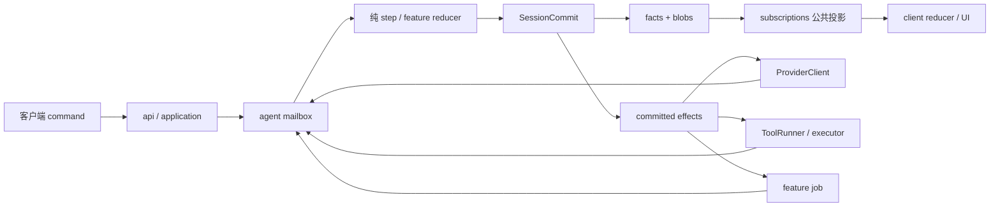

# 薄 loop、功能插件与执行路径

状态：目标设计。again 工作树未迁移；当前产品 runtime::agent 持续更新，不能当成冻结实现。
施工遵循 [rollout](rollout.md) 与 [能力保留矩阵](preservation.md)，provider/账号契约见 [providers](providers.md)。
plugins/ 依赖 AgentState/RingContext，turn_actor 镜像旧 lap，不是这里的边界。

## 1. loop 六件事

1. 单会话真实邮箱排序 typed command 与带 request/execution generation 的 completion。
2. 纯 step(state,input) 计算 state delta、facts、effects、live。
3. SessionCommit 原子提交 batch，失败不执行后续副作用。
4. 更新 committed state/context，发布有界通知和 live。
5. 显式端口派发 effects，结果回邮箱，等待期间仍响应 cancel/交互。
6. 取消树、预算、supervisor join、恢复。

不处理 HTTP/provider JSON/具体工具/PTY/诊断文件/secret/UI/标题/存储格式。
不能 await 等用户或长工具直到堵住邮箱；运行 supervised task，回投 completion。
邮箱有界，取消用独立受限优先入口，携准确 turn/execution，不读 global current session。



## 2. 模块与接口

| 包/模块 | 责任 |
|---|---|
| agent-api/input | Command/ProviderCompleted/ToolCompleted/FeatureCompleted，稳定 ID/generation |
| agent-api/feature | FeatureId/Version/Descriptor/AgentFeature、恢复类别、事件 schema |
| agent-api/effect | EffectPlan/Id、ProviderRequest/RunTool/FeatureJob/OpenInteraction、typed completion |
| agent-api/view | 只读 FeatureView：水位、turn config、context、本 feature state |
| agent-api/observation | 元数据 ObservationSink/no-op，无正文或业务控制 |
| agent/state | active turn、操作结论、effect 跟踪，无 managers/IO |
| agent/mailbox | 容量、generation 校验、优先取消 |
| agent/reducer | validate/step、feature phases、delta 校验 |
| agent/commit | 提交屏障/发布，无磁盘知识 |
| agent/scheduler | provider/tool/feature 有界派发/completion |
| agent/supervisor | cancel/shutdown/join/panic 终态 |
| agent/recovery | facts 恢复 pending effects、分类对账 |
| agent-features/compact | budget、摘要 request、ContextCompacted |
| agent-features/skills | 选择、资源引用、激活集 delta |
| agent-features/subagent | 子任务目标/结果/team 状态，无文本标签注入 |
| agent-features/plan | plan/todo、纯 delta |

title 是 application 后台用例；diagnostics 是 collector；PTY 是 terminal；adapter 是 providers。
只对参与回合决策/恢复的功能提供 AgentFeature，不把所有模块塞入任意 callback。

## 3. 插件拿限权 view，不拿万能状态

首期 Rust 编译期插件，daemon 显式注册实例，无动态库 ABI/WASM/自动扫描。
此处插件指 AgentFeature。市场安装的 ExtensionPackage 由 extensions 管，
不能注入 Rust reducer 或获得 AgentState；公共包与运行协议见 [ecosystem](ecosystem.md)。
功能可独立关/替换；已有 session 含 required feature facts 而缺该插件时 UnsupportedFeature，不能跳过后 resume。
feature 集合/版本随会话/turn 固定；更换需要离线 migration 或新 session。
市场服务热插拔不改变这一边界；其资源作用域、代际准入与停止证据见 [composition](composition.md)。
ResourceScope 的注册/清理不叫 EffectPlan，后者专指 commit 后派发的业务效果。

语义接口（尚非落地 Rust ABI）：

```rust
trait AgentFeature {
    fn descriptor(&self) -> FeatureDescriptor;
    fn reduce(&self, view: FeatureView, input: FeatureInput)
        -> Result<FeatureDelta, FeatureError>;
    fn restore(&self, facts: FeatureFacts) -> Result<FeatureState, FeatureError>;
}
```

reduce/restore 纯函数不 IO，Delta 含 typed state/context/fact proposals 和 effect requests。
长摘要/检索/子任务由 FeatureJobRunner/ProviderClient 执行，不在 reducer 请求模型。
runner 拿限权 JobContext/CancelToken，返回 FeatureCompleted，不持 SessionCommit/Emitter。
核心验证 feature/version、revision、ContentRef、scope、允许效果和预算才接纳 delta。
feature state 以 namespaced facts 持久，正文用 blob；不让任意 JSON 获跨功能写权。
context 只接受稳定 ContextChange；插件不能改任意模型数组/其他 feature state。

明确 phase/order 固定顺序，不依赖注册 HashMap：before_request/provider_completed/tool_completed/turn_finishing。
权限、取消、提交屏障属于核心，不准插件覆盖。互斥 ContextChange 返回 FeatureConflict，不 last-write-wins。
所有模型任务有独立 request_id/预算/purpose（main/compact/title/subagent）。
required feature 失败先提交明确失败/降级结论，再按策略停止或恢复；optional 明确 skip 并观测，不能吞必要状态。
panic 转 failed completion，取消子树、收割，不能 reset 全部共享状态假装继续。

## 4. 消息：agent → 存储 → UI

模型消息不是 UI timeline。context 定义 role/parts/tool refs/签名/多模态；session-api facts 定义业务变化；protocol 定义展示 DTO。
[消息与历史操作](messages.md) 定义独立 transcript item/response bundle、ID/顺序以及撤回/fork。
thinking/text/每个调用/结果分别有 message_id，actor 提交 opened 元数据后发 live；不能只靠类型猜 part identity。
subscriptions 唯一映射公共投影，API 不新建 timeline writer。

1. application 鉴权/资源/大小准入，投递 typed Command。
2. actor 校验 revision/turn，put_blob + 提交 CommandAccepted/UserMessageAdded/TurnStarted。
3. context fold committed 消息、固定 TurnConfigSnapshot，调度 ProviderClient。
4. opened 元数据先提交，增量只 live；item 终稿可独立提交，完整 response bundle 的提交屏障决定是否可进模型上下文。
   usage/完整 tool intent completion 进提交 batch；不从一个 finalized UI item 推断 response 或工具依赖已经完整。
5. commit 成功发布 batch，SDK 原子更新 reducer/applied cursor。
6. 下一 request 只读 committed context；UI 断线/diagnostics off 不改执行。

流中途失败标明正文 incomplete/failed，已有 usage 为 partial；不能把未提交 live 当完整 assistant message 续用。
恢复 request/attempt 改变，能否续请求由 provider 能力与 facts 决定，不能读 UI 字符串猜。

## 5. 工具：agent → executor → agent → UI

loop 只持意图和提交终态；tool-api 定义 descriptor/call/outcome/host ports，executor 管准入/限额/授权/执行。
保留已接入产品的参数容错、完整有效参数、进度和调用身份；原始输入与 effective args 分开，执行以校验后的值为准。
provider 已报告但无法形成合法 ToolIntent 的调用也要有独立可见失败，不能静默消失、伪造执行或把失败误当成功结果。
WorkspaceAccess/ProcessHost/InteractionHost/ContentHost/ObservationSink 为受限接口，不是 service locator。

ToolIntentCommitted → admission → NeedInteraction/Run → ToolOutcome → ToolFinishedCommitted。
InteractionHost 请求投递 actor，返回已持久 handle；executor 持等待 future，不维护另一份 pending 权威。
actor 保持处理取消/答案，CAS 提交后完成 future。
文件写仍走 workspace journal；OS 成功与会话提交失败之间按恢复类别对账，不能声称原子覆盖 OS。
迁移 workspace 时保留 LF/hash/行尾、stale guard、dry-run/confirm、模型回执与 UI diff 分离以及 exec 外部变更证据。
扫描报告是有界、注明来源的可选观测，不是全部归因于当前调用的证明；失败可降级，但必要 journal/blob/fact 写入不能照搬 best-effort。

process-tools 实现 typed exec/check/wait/kill；创建 PTY/进程/write fence/resize/exit 经 terminal/ProcessHost。
接管由 executor 提出交互，actor 提交事实后启用 writer；用户接管不新建 tool call。
human 输入/输出不入 context，归还后的结构化 exit/获许可结果才进 ToolOutcome。
diagnostics 旁路观测，不能以诊断 done 给工具写成功。

cancel 精确 Token 树，停 provider/feature/tool、禁 PTY 输入、OS kill+wait 后唯一终态。
不能断 SSE/置 AtomicBool 就报 Cancelled；衍生进程/管道继承需平台验收。
迟到 completion 按 execution/generation 拒绝，不污染下一 turn。

## 6. 恢复与生命周期

effect intent 随 canonical commit 才派发，effect_id/input digest/purpose/recovery_class 稳定，不建 runtime WAL。
重启未终态 effect：PureReplay 安全再算；Reconcile 查 journal/receipt；NonReplayable 等人工或 Indeterminate。
provider 请求可能已计费，重试记录新 attempt，不当无成本恢复。
审批从 facts 恢复；原 PTY 通常丢失，handoff 关闭 Lost，不能自动重跑 sudo。

daemon 拥有 Tokio runtime，async actor，有界 blocking pool 保留阻塞算法。
禁止会话 TLS、全局 managers、fallback runtime、无人 join 的自建线程。
装配：store/config/access → workspace/execution → providers/features → actor → subscriptions/API。
退出反向，停新命令、取消/收割 effect、关 writer；诊断 flush 有截止，不阻塞业务提交。

## 7. 精简验收

agent-api 不导出旧 AgentState；features 不依赖 agent；terminal 不复制 global registry；protocol 不 re-export 存储类型。
第一刀同时搬实际消费者和删除反向依赖；manifest DAG 不替代 TLS/写入链/行为检查。
新文件不超 1000 行，不通过巨大 helper 伪装薄 loop。
optional feature 去掉装配无需改核心；同 facts 确定重放；错误/取消/权限/PTY/交互/终态各有唯一所有者。
