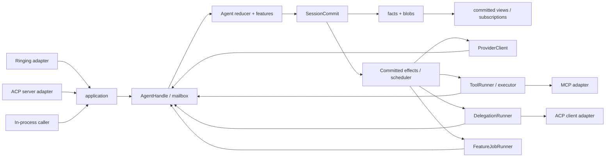

# Agent loop 重塑施工规范

状态：待实施的规范；本文件写入不表示任何 Rust、协议、数据迁移或平台验收已经完成。
制定日期：2026-10-23。实施可跨 v2.1、后续 v2.x，终态最迟在 v3.0 验收。

## 1. 目标、范围与完成口径

把当前 `qaqh-runtime::agent` 重塑为单会话、真实邮箱驱动的薄 agent，功能通过受限 AgentFeature 组合，
模型、工具、外部 agent 和持久化通过显式端口接入。减少共享可变状态、隐式依赖和故障补偿，
同时提高取消与恢复的可信度、执行过程的可观测性和新增适配器的可维护性。

**终态是替换旧执行模型，不是保留旧模型后再加一层兼容 facade。**
不要求保留 `Loop`、`AgentState`、`RingContext`、`TurnEngine`、`Outcome` 等内部 API、线程模型或存储布局。
保留的是现行产品能力、成熟算法和可证明的业务性质；用户数据经明确迁移保留。
可以分版本发布，但不能把“端口已建、旧主路径继续运行”称为本规范完成。

本规范细化 [agent](agent.md) 的施工、迁移出口和验收；不另建一套架构。
发布规则遵循 [rollout](rollout.md)，消息保真遵循 [messages](messages.md)，
外部服务与生命周期遵循 [ecosystem](ecosystem.md)、[composition](composition.md)、[ACP](acp.md)。
接口名称在本文中表达内部语义，不是已实现的 Rust ABI，也不替代这些专题的公共协议。

### 1.1 最终必须交付

1. typed command、completion 和必要控制输入经过同一会话所有者排序；模型/工具等待不占住邮箱处理栈。
2. 纯决策、唯一提交、提交后派发、结果回投形成真实运行主路径。
3. 持久状态可由 facts/blobs 恢复；会话消息与上下文不再由另一套 MessageStore/WAL 权威维护。
4. compact、skills activation、plan/todo 编排、子代理决策退出核心，共享核心提交与执行规则。
5. 外部工具走 ToolRunner，外部 agent 走 DelegationRunner，外部调用者走 application/AgentHandle。
6. MCP 及 ACP 两个方向有真实消费者证明边界；新适配器不通过修改 loop 接入。
7. 任务有唯一 owner、取消、收割和 typed outcome；诊断可以关闭或丢弃，不参与业务裁决。
8. 本规范涉及的旧执行链、状态镜像、事件回转副作用及过期迁移桥全部删除。

### 1.2 不作为本规范的前置工程

完整市场安装、全部 MCP/LSP 扩展能力、客户端工具宿主、多语言 SDK、任意终端接管、动态 Rust ABI/WASM，
不要求随本规范一次交付。支持范围必须诚实声明；需要接入时复用本规范端口。
Ringing major 3、细粒度消息 UI、rewind/fork 各自验收，不以产品版本号自动宣告完成。
但唯一上下文、消息保真和提交屏障是本规范终态的必要条件，不能无限期留给“未来存储重构”。

客户端等级、抢占权和优先级不在本规范范围。控制入口的容量保留只服务取消、吊销、停止等生命周期操作，
不赋予某个客户端通用独占写权。lease/driver 的退出属于 access + SDK 切片；新 core 不引入这些概念。

## 2. 当前代码基线与需要退出的前提

本次只读核对的提交：

| 仓库 | HEAD |
|---|---|
| backend | `c9ba36928336b3666fd870a0241345e9455a8e04` |
| desktop | `06f9d59b3c7aed91bf0087a12a82419a35e8285b` |
| TUI | `46b23045d875928c1d49aaafc1be2194c237750d` |
| WinUI | `18429868fdc30633f88b704186d918f877ca5c12` |

这些提交用于定位，不冻结业务线。每项施工从最新可用版本刷新相关差异和脏文件范围。
本次 backend 已有 `crates/qaqh-config/src/config.rs` 未提交修改，以及多客户端审查文档；不得覆盖。
目录中旧文档的 beta4/again/RC2 版本说明不代表上述当前代码。
当前树缺少旧文档引用的 `preservation.md` 和 `tools/v2-architecture/audit.py`，不能宣称对应闸门已通过；AL-00 负责补齐实施依据。

| 当前事实与源码 | 需要退出的前提 | 可以保留的资产 |
|---|---|---|
| [Loop](../../../crates/qaqh-runtime/src/agent/loop_core.rs) 持有会话 bundle、功能引擎、通道和输出器 | loop 既决定业务又拥有执行环境 | 有界准入、现行输入语义的有效部分 |
| [RingContext](../../../crates/qaqh-runtime/src/agent/types.rs) 暴露 `&mut AgentState`、phase、pending、Emitter | 功能可跨域改状态和发布成功 | typed 参数与结果、已有上下文规则 |
| [TurnEngine](../../../crates/qaqh-runtime/src/agent/engine_turn.rs) 同步 run_lap；[TurnActor](../../../crates/qaqh-runtime/src/agent/turn_actor.rs) 镜像 outcome | 长调用驱动主循环，另一个状态机追认 | TurnCore 的纯状态转换、已有效的冲突反例 |
| [ToolRuntime](../../../crates/qaqh-runtime/src/agent/tool_runtime.rs) 启线程、收割、写账本、回填消息 | 执行、提交、上下文和子代理副作用合在一起 | intent、授权、工具顺序、文件 journal 和结果算法 |
| [CompactionPort](../../../crates/qaqh-runtime/src/agent/compaction_port.rs) 仅持结果 receiver；loop 轮询 | receiver 不等于任务监督或停止证据 | compact 的准备/计算/应用分段和 revision 校验 |
| [actor reader](../../../crates/qaqh-runtime/src/actor.rs) 匹配域事件触发交互等副作用 | 输出桥同时承担业务执行 | 必要的临时协议映射 |
| [AgentState](../../../crates/qaqh-runtime/src/agent/state/agent.rs) 聚合消息、配置、skills、存储、遥测 | 一个状态对象承载全部能力 | 前缀保真、usage、模型消息与工具关联算法 |
| [workspace runtime](../../../crates/qaqh-workspace/src/runtime.rs) 及 MCP/LSP 全局槽 | task/线程隐式绑定工作区和 manager | 已验证的沙箱、参数容错、协议和进程算法 |

不能先删除保护这些旧前提的 guard。先迁移所有者与真实消费者，再删除补偿及其专属测试。

## 3. 终态结构与所有权



### 3.1 唯一所有者

| 状态/资源 | 所有者 | 其他组件的权限 |
|---|---|---|
| 会话 committed facts、blob 引用和命令回执 | session-store，actor 经 SessionCommit 提交 | runner/插件不能写会话事实 |
| turn 状态、待决 effect、交互结论、context head | agent；持久部分由 facts fold | executor 只持等待句柄，不复制 pending 决策表 |
| 模型上下文 | context 对 committed facts/bundles 的纯投影 | UI、live、插件不得直接修改模型数组 |
| provider 请求与工具/委派任务句柄 | supervisor，按执行 owner 分区 | scheduler 只派发、回收许可，不丢弃句柄 |
| 工具准入、当前 grant 复核 | executor/policy | feature 不能批准自己或覆盖 deny |
| 工作区 journal、文件版本和写入 | workspace | actor 记录结果引用，不承诺与 OS 原子提交 |
| 进程/PTY、输入 fence、kill/wait | terminal/执行宿主 supervisor | 取消请求不是停止证明 |
| feature 私有持久状态 | actor fold 的 namespaced feature facts | 插件只读自身状态并提交 proposal |
| 配置/能力选择 | 配置与 catalog 提供不可变版本，actor 固定 turn 引用 | 运行中不按名字查“最新实现” |
| 连接、协议 pending RPC、服务进程 | integration supervisor | core 不持 MCP/ACP socket 或 server map |
| diagnostics 队列、窗口及保留 | diagnostics | 采集关闭不改变事实、usage 终稿或执行结论 |

agent 的运行态只保留必要句柄和有界索引。可重建视图可以缓存，但不能成为第二份权威。
父子 actor、executor 和 integration supervisor 通过具名 owner 关联；同一进程/任务只能有一个 join/kill 清理所有者。

### 3.2 包与依赖边界

采用 [dependencies.json](dependencies.json) 中的目标边，不以一次建立全部目标 crate 为前提。
模块切片可以先落在现有包内；一旦独立发布契约，必须连真实消费者一起迁移，禁止空包、全量 re-export 或反向依赖。

| 模块/包 | 必须拥有 | 禁止拥有 |
|---|---|---|
| agent-api | input、feature、effect、受限 view、观测契约 | AgentState、wire DTO、具体 manager |
| agent | state/mailbox/reducer/commit/scheduler/supervisor/recovery | HTTP、MCP/ACP 实现、具体工具、磁盘格式、诊断文件 |
| agent-features | compact/skills/subagent/plan 的纯决策和 job 定义 | agent 实现依赖、SessionCommit、任意 IO 或 Emitter |
| session-api / session-store | 中立会话契约 / 唯一 writer、blob、commit 和恢复 | UI 协议、模型 HTTP SDK、工具执行 |
| provider-api / providers | 模型请求/parts/bundle 契约 / provider 与账号适配 | loop 分支、跨会话共享 active profile |
| tool-api / tool-executor | 工具及委派端口、执行身份 / 准入执行和交互桥 | 会话终态 writer、文本解析式子代理回传 |
| application / adapters | typed 用例 / Ringing、ACP server 等入口映射 | 第二套 loop、消息 writer 或权限权威 |
| daemon | 实例构造、runtime/线程池、插件注册和退出顺序 | 以通用 service locator 代替依赖设计 |

`DelegationRunner` 契约放在 tool-api 的受限端口中，ACP client 不依赖 application 或 agent 实现。
agent 通过注入的 AgentFeature 集合工作，不反向依赖 agent-features。
`qaqh-runtime` 可暂时承载尚未迁移的 application/subscriptions；完成时不得再拥有本规范的 agent 业务或任务生命周期。
删除整个 runtime 包属于整体架构收敛；把它改名为 agent 并保留全部职责不满足本规范。

## 4. 核心输入、纯决策和提交屏障

### 4.1 内部输入

核心输入是闭合语义 union，至少覆盖：

- Command：SubmitInput、AnswerInteraction、CancelTurn/Execution、ChangeFeature、明确的选择/上下文操作。
- ProviderInput：有 request/attempt/part 身份的 opened、delta、closed 和最终 completion。
- ToolInput / DelegationInput / FeatureInput：进度、交互请求、typed completion。
- LifecycleInput：恢复、deadline 到达、授权收紧和 shutdown。

协议未知方法、JSON-RPC id、HTTP header、provider 私有 JSON 在 adapter 边界处理。
跨边界值须校验；内部已经证明的静态前提不逐层重验。吊销、资源版本、代际等变化条件在派发边界仍复核。
时间、ID 分配、预算和策略版本作为显式输入；纯 reducer 不自行读时钟、生成随机 ID 或查询环境。

### 4.2 核心处理步骤

以下是语义伪代码，不要求照此创建泛型框架：

```text
proposal = step(committed_view, validated_input, decision_context)
validate(proposal, pinned_feature_set, resource_revisions, budgets)
prepared = prepare_blobs_and_batch(proposal)
commit_result = SessionCommit.commit(batch_id, expected_head, prepared)
on Committed:
    state = fold_committed_batch(state, committed_batch)
    publish_committed_notification_and_eligible_live()
    schedule(committed_effect_handles)
on NotCommitted:
    discard_proposal_and_release_prepared_resources()
on Unknown:
    fence_new_dispatch_for_session()
    reconcile_batch_id_before_any_retry_or_publish()
```

proposal 可以含 StateDelta、FactProposal、ContextChange、BlobDraft、EffectRequest 和 live proposal。
持久状态以 committed facts fold 为准；若保留 StateDelta 优化，必须验证与同批 fold 等价。
核心不得先改 committed state，再依靠异常路径恢复。失败 proposal 的 ID、游标和成功结果不得向客户端发布。

SessionCommit 返回 `Committed / NotCommitted / Unknown` 的 typed 结果。
`Unknown` 包含可以对账的 batch 身份；提交响应丢失不等于没有提交，禁止换 batch/effect id 盲目重试。
同 batch id 同 digest 幂等；同 id 异内容冲突。blob 持久后才允许事实引用，commit marker 界定完整 batch。
持久化串行屏障可以等待存储，但必须有超时、状态可查询和独立停止通道；不得无限阻塞整个 daemon。
提交后的通知是可重建投影的唤醒信号；发送失败由 subscriptions 从日志补读，不回滚事实、重做 effect 或阻止已提交工作调度。
live/观察端背压不能成为执行准入条件；业务副作用不得由通知消费者匹配事件后触发。

只包装旧 messages/WAL/canonical 写调用的 trait 不具备上述原子性质。
AL-03 前明确称为现有写链端口，不能让它签发虚假的 CommittedBatch/CommittedEffect 证明。
新 effect 模型进入生产前，迁移域必须具有实际满足屏障的 writer 和恢复读取。

### 4.3 接纳、幂等和失败

CommandAccepted 与相应输入/执行意图在实际持久 batch 中成立后才 ACK accepted。
去重域是稳定 principal、session、command id，并校验 body digest；连接身份变化不创建新操作。
accepted 后必须最终成为 succeeded/failed/cancelled/indeterminate，或保持可查询的 recovering/blocked 状态。
容量满、scope 不足、版本冲突等在接纳前明确拒绝；不能用 receipt TTL 或被淘汰替代终态。
公开状态由 adapter 映射，内部迁移不暗改 Ringing v2 accepted/终态语义；不能无损映射时显式升级消费契约。

## 5. 邮箱、背压与执行调度

### 5.1 邮箱分流

| 输入类别 | 策略 | 不允许的退化 |
|---|---|---|
| 普通 commands | 按会话接纳顺序、有界数量与字节；每主体有限额 | 一个客户端填满全局队列或让其他端长期无法受理 |
| completion / durable interaction request | 派发前预留回投容量；可靠消费后释放 | 被 progress/live 挤掉，或任务结束但 actor 永远不知道 |
| cancel/revoke/shutdown | 独立有界控制入口、重复合并、准确 target | 依赖普通满队列，或按“当前 turn”取消 |
| provider/progress/live | 合并 replace、限速、有界丢弃或明确 stream reset | 每 token 永久落盘、阻塞可靠终态 |

容量同时限定 item 数、总字节、单帧、in-flight 数和持久已接纳待执行量，配置值可观测。
公平受理是容量隔离，不设计客户端等级。普通输入默认排队；steer/interject/替换必须显式绑定目标。
某端提交新文字不能隐式 abort 另一端正在审批的挂起 turn。

可靠回投采用 executor 许可与 mailbox slot/byte budget 的联合预留；取消通知仍能到达 task。
大结果通过受限 ContentHost 准备持久 blob/ref，不把完整结果无限堆进内存 mailbox。
runner 可以准备 scope-bound 正文，不能提交会话事实；actor 验引用、归属和摘要后提交，孤儿正文由 store 回收。
进程退出、receiver 关闭或 actor 崩溃时，supervisor 保留任务结果/执行证据供恢复，不静默丢 completion。
provider runner 必须独立保真归集完整 response bundle、签名、工具参数和 usage；可丢弃的是展示 live/progress，
不是决定模型上下文或执行意图的原始片段。actor 消费最终校验的 bundle/ref；无法在预算内完整归集时明确失败或 incomplete，
不能静默截断后生成成功 completion。最终正文与元数据引用在提交前一并校验。

### 5.2 scheduler 和 runner

scheduler 只接受不可伪造的 committed effect handle；其构造由提交端口控制，不能以字符串冒充已提交证明。
派发前复核取消、当前权限、确切 route generation 和资源 precondition；失败回投明确 not_started/denied 结论。
不在 registry 锁、会话状态锁或存储事务内执行网络、阻塞 send、插件回调或 `block_on`。

daemon 注入 async runtime 与有界 blocking executor。现有同步 parser、文件算法、SDK 可在受监督 runner 内复用。
过渡期需要会话 TLS 的算法必须在受控 blocking scope 内安装/清理环境；不能跨 await 使用线程绑定状态。
该适配在 AL-08 前退出，终态 workspace、授权、进程、模型账号都由实例句柄显式传递。

## 6. Effect、身份与恢复

### 6.1 执行身份

| 身份 | 作用 |
|---|---|
| command_id / input_id | 同一次命令和输入，不因重连变化 |
| session_id / turn_id / context_revision | 业务所属及上下文代际 |
| effect_id / input_digest / purpose | 一个已提交执行意图及其参数/用途 |
| request_id / attempt_id | 模型或远端的一次实际请求，重试新建 attempt |
| execution_id / execution_generation | 具体工具、委派或 job 的执行与 fence |
| binding_generation / runtime_incarnation | 固定服务配置代际与本次连接/进程实例 |
| actor_incarnation | 本次 actor 实例，不能恢复旧 task 句柄或旧回投地址 |

completion 由 supervisor 绑定原执行身份，不采信外部服务自报任意 session/turn。
先核对来源、digest、generation、尚未结算状态，再进入 reducer。
重复同结论幂等；冲突结论具名失败并对账。旧代结果不能改变新 turn/context，仍可作为原 execution 的恢复证据。

### 6.2 状态与保证

```text
Proposed -> IntentCommitted -> Scheduled -> Running/AwaitingInteraction
                                     -> NotStarted/Denied
Running/AwaitingInteraction -> CancelRequested -> 收割或对账
任一已接纳执行 -> OutcomeObserved -> TerminalCommitted
证据不足 -> Reconciling -> TerminalCommitted(Indeterminate) 或明确恢复结论
```

Scheduled/Running 等易失执行态不要求逐状态 fsync；意图、必要派发证据、交互结论和业务终态必须持久。
必要证据集合由 recovery class 和实际副作用边界决定，不以诊断日志替代，也不建第二套 runtime WAL。
结果到达但终态提交失败时，保留原 outcome，重试同一结算；不得重新执行工具或提前报告成功。
终态不可改写；迟到证据追加 reconciliation 记录，通过显式决议决定后续，不再发第二次 ToolFinished。

| RecoveryClass | 恢复动作 | 必要限制 |
|---|---|---|
| PureReplay | 同输入重新计算 | 必须证明旧执行已结束或从未开始；不以 readOnlyHint 直接认定 |
| Reconcile | 查询 workspace journal、宿主 receipt 或远端执行状态 | 没有证据不能补造“未执行”或成功 |
| NonReplayable | 等人工决议或提交 Indeterminate | 不自动重发有副作用请求 |

provider 请求可能已经计费；断流/崩溃不代表无成本重试。保留实际 attempt、partial usage 和失败分类。
`SideEffectClass` 描述安全/副作用类别，不等于 RecoveryClass；只读、网络或进程类别均不能单独证明可安全重放。
不承诺 OS/网络 exactly-once。会话幂等提交与外部执行去重/对账分别验收。

## 7. 取消、故障与真实停止

取消树为 host → session → turn/effect → execution；背景任务和委派子树的归属显式记录。
取消 token 单向触发，不清除旧 token 来代表新 turn；新 turn 创建新节点。
控制入口必须先验证调用方权限及精确 target/generation，才允许触发对应 token 或封闭准入。
旧 turn 的取消不得先设置会话全局 flag 再校验目标。

顺序：封闭目标新派发 → 请求取消 → 等待 completion/kill+wait/远端证据 → 提交结论 → 释放执行许可。
存储不可用时允许已授权的安全停止继续，但不能声称取消终态已持久化。
supervisor 独立于单次 reducer 和 commit future，能在存储慢或 actor 故障时继续停止和收割。

| 故障 | 必须行为 |
|---|---|
| optional 纯 feature reducer 失败 | 不应用其 proposal；按已声明策略记录 skip/degraded，不影响既成状态 |
| required feature 或核心一致性未知 | 封闭相关准入、取消/收割依赖执行，转 recovering/blocked；不 reset 为 Idle 假装恢复 |
| task panic | supervisor 捕获为 typed failure；外部副作用不明时为 Indeterminate |
| 不响应取消的 Rust blocking 工作 | 保留句柄、配额和残留所有者；隔离关联资源，不宣称已停止 |
| 自有进程无法正常停 | 平台进程树 kill + wait，失败保留 StopIncomplete |
| 远端只 ACK 收到取消或连接断开 | CancelPending/Reconcile/Indeterminate，不伪造 Cancelled |
| actor 崩溃但 runner 尚存 | supervisor 停止准入并保留证据；恢复前不向新 actor 复用旧执行路由 |

必须硬停止的不可信/不可取消运行代码放受监督进程，Rust 线程不能安全强杀。
业务 Indeterminate 可以成为持久结论，但不表示运行资源已被收割；残留任务仍占配额并阻止冲突资源复用。
可证明独立的其他 session/resource 可以继续，不把单任务故障扩大为全进程冻结。
正常 shutdown 停新命令、封闭新派发、取消并收割、提交结算、关 writer；诊断 flush 有截止。

## 8. AgentFeature 与功能迁移

### 8.1 插件接口

首期是编译期 Rust 实例，由 daemon 注册；与市场 ExtensionPackage、MCP 服务实例分开。
插件不获得动态 service map、HTTP client、存储 writer、任意工具句柄或全量可变状态。

```rust
// 语义接口；关联类型和具体错误在实际消费者迁移时锁定。
trait AgentFeature {
    fn descriptor(&self) -> FeatureDescriptor;
    fn reduce(&self, view: FeatureView<'_>, input: FeatureInput<'_>)
        -> Result<FeatureDelta, FeatureError>;
    fn restore(&self, facts: FeatureFacts<'_>)
        -> Result<FeatureState, FeatureError>;
}
```

Descriptor 固定 feature id/version、fact schema、required/optional、适用 phase、允许效果、写集合和预算。
View 只包含固定水位、turn config/capability 引用、受限 context view 和本 feature 状态。
Delta 含本命名空间状态/事实 proposal、稳定 ContextChange 和 typed effect request，不能直接 emit 成功或调用模型。
runner 接收只读 JobContext、执行身份和取消节点；返回 completion，不持 SessionCommit/Emitter。

phase 顺序固定：before_request → provider_completed → tool_completed → turn_finishing；同 phase 明确排序键与依赖。
插件 id 唯一、依赖无环；互斥 ContextChange 返回 FeatureConflict，不由注册顺序或 HashMap 决定覆盖。
插件失败隔离不依赖“约定不修改共享状态”，纯 view/proposal 是实际边界。
reduce/restore 禁 IO，且工作量受限；超预算纯计算不能抢占 Rust 线程，昂贵计算转受监督 FeatureJob。

feature manifest 在会话创建时固定 id/version/schema/required 属性，turn 记录参与集。
required 状态或 schema 无法恢复时返回 UnsupportedFeature，不跳过后 resume。
运行中不热换 reducer；版本升级需明确离线 migration 或新 session。旧 facts 和正文仍须保真读取。
不为所有插件创建任意 JSON 执行通道；扩展状态编码可 namespaced，但 schema 注册、大小和写权必须校验。
S1 只迁移现有事实可表达的手动 compact，不新增插件私有持久状态；manifest、通用 feature facts 和确定恢复在 AL-03 实现。
此前只宣称插件边界与当前能力迁移，不能宣称通用可恢复 feature runtime 已完成。

### 8.2 功能去向与删除条件

| 当前功能 | 新所有者 | 实际迁移出口 |
|---|---|---|
| 手动 compact | CompactFeature + ProviderClient/job | 原切分、摘要和保留区算法保留；completion 按 context revision 接纳；删除 loop 轮询和共享状态访问 |
| skills 选择/激活/上下文注入 | SkillsFeature；内容读取归 skills/catalog | 固定 digest、激活事实与 context fold；核心不再直接操作 SkillContextManager |
| plan/todo/goal 自动推进决策 | PlanFeature + typed ContextChange/effect | 保留现有可见交互和推进能力；退出 core 中专用 prompt/工具名特判 |
| 子代理创建、消息、结果、预算 | SubagentFeature + 受限 ChildAgent/Delegation 端口 | 结构化关联和终态；删除文本标签解析式结果注入和父子多份 pending |
| title | application 后台任务，结果命令回会话提交 | 手动改名与迟到自动标题按 revision 防覆盖；后台线程不直接写 meta |
| dashboard、统计、缓存诊断、memory marker | read projections / ObservationSink | 不要求 agent 持诊断文件、全量历史 hash 或 UI 面板状态 |

当前自动 compact 已禁用，迁移不得顺便重新启用；新增行为需独立产品切片和验收。
可选 feature 从装配移除后核心可编译运行；required feature 恢复失败仍诚实拒绝。

## 9. 模型、工具和消息上下文

ProviderClient 接受固定 request/config/capability snapshot，返回中立 parts/关联和 response bundle。
账号登录、refresh/verify、origin 绑定和 SDK 差异归 providers/config；core 不查询 siwc/dsaccount 全局 manager。
main/compact/title/subagent 请求分别有 purpose、request/attempt、预算和超时。

模型输入只来自 committed context；UI timeline、live overlay 和外部 agent 展示更新不能直接成为模型历史。
保留正文与 tool calls 同时出现、签名/私有 bundle、多模态、reasoning 类别、effort、usage/缓存和调用顺序。
保留工具参数归一化与 typed lenient 的已接受边界；无效调用有独立可见失败，不伪造已执行 intent。

opened 身份/依赖元数据先提交，delta 只经有界 live 通道发布；没有锚点就缓冲有界或丢弃，不能先公开未提交身份。
item finalized 不代表整个 response 已可进入下次请求；ResponseCommitted 屏障验证完整 bundle 和工具依赖闭合。
流失败保留 incomplete/partial 证据，不把缺 finish reason 一律当成功，也不自动拼接不同 attempt。
live 关闭、重放和 renderer 重建不能再次触发工具或提交输入。

工具路径固定为 committed intent → executor admission → interaction/run → outcome → actor terminal commit。
InteractionOpened/Resolved/Expired 的事实由 actor 唯一提交；executor 只等待相应 durable handle。
答案 revision CAS、取消与答案竞态只有一个结论；等待用户时不占住邮箱或模型/工具执行配额。
文件版本、LF/CRLF、stale guard、dry-run/confirm、文件 journal、同文件写顺序和取消后的真实结果回填继续保留。
后台进程启动确认与最终 exit 分开；终态不能由“没有进度”或诊断 done 推断。

## 10. MCP、ACP 与未来适配器接入合同

### 10.1 三种接入不能混成一个插件回调

| 接入方向 | 端口与路径 | core 不需要知道 |
|---|---|---|
| MCP/LSP/本地或客户端工具 | catalog descriptor → executor → ToolRunner | server 名、JSON-RPC、stdio/HTTP、MCP continuation 具体格式 |
| QAQH 委派给外部 ACP agent | SubagentFeature → committed DelegateAgent → DelegationRunner | ACP session/prompt wire、远端工具内部实现 |
| editor/其他客户端通过 ACP 调 QAQH | ACP server → application → AgentHandle；读取同一 committed views | ACP 请求 ID、协议更新格式或 editor UI |
| 新模型 provider | ProviderClient 实现 | URL、HTTP SDK、认证刷新及私有 JSON |
| 新回合功能 | AgentFeature + 既有 typed effects/jobs | 外部协议或任意服务查找 |

ToolRunner 和 DelegationRunner 共享执行身份、取消、观测及对账规则，但保留独立语义。
外部 agent 是有会话、权限回调及自身工具执行的委派者，不伪装成一次普通模型 completion。
需要新业务语义时可以评审中立契约；不得添加 `if protocol == mcp/acp` 或任意 `execute(method, json)` 绕开边界。

### 10.2 固定能力与路由

turn 固定 capability snapshot，其中包含 source/component、schema digest、binding generation 和执行 host/route。
服务连接另有 runtime incarnation。list_changed 只产生新图；旧调用不按名字重定向到最新或同名另一设备。
派发仍复核当前授权；旧 snapshot 不免除吊销。失去所需 schema/代际时返回 CapabilityChanged/Unavailable。
候选启动、发布、旧代退休与 shutdown 由 integration supervisor 负责，遵循 composition 契约。

### 10.3 外部回调

MCP elicitation/continuation、ACP permission 等经 InteractionHost 投递持久交互，等待 CAS 后的结论。
敏感 continuation 通过受保护内容端口保存；不写公共正文或建 adapter 自有会话 WAL。
sampling 是独立预算的 ProviderRequest，只在实现并授权时宣告；资源/提示词是外部输入，不升级为 system 权限。
ACP 的文件/终端回调经过受限 Workspace/ProcessHost 与 executor，必要副作用先持久子意图再执行。
外部 agent 报告工具成功只标 client_reported/remote_reported，不能冒充本机验证的文件或进程结果。
未知 callback 能力具名 unsupported，不回 true、空结果或 shell 文本模拟成功。

RPC correlation map 可以属于 adapter，但有界、按 incarnation 隔离，不能成为业务交互权威。
断线、旧回调、取消 ACK、无 response 都按原 execution 对账；不自动重发有副作用请求或 prompt。
ACP v1 不具备 Ringing applied cursor；load/replay 只恢复展示，不重新执行历史。

### 10.4 扩展性完成证明

在核心契约冻结后，以下接入各自只修改 adapter、装配、能力声明及对应测试，agent 核心不增加协议分支：

1. 现有 MCP 实现迁入 ToolRunner，真实 server 完成调用、交互、取消、断线和旧代结果验收。
2. ACP client 连接固定版本的真实外部 agent，完成委派、权限、取消及断线不重放。
3. ACP server 被一个真实 editor/client 调用，完成 create/prompt/cancel 及所有已宣告能力。
4. 无网络的 in-process caller 运行同一 AgentHandle，证明核心不依赖某个 transport。

fake peer 用于注入竞态和坏帧，不能代替真实协议互通；真实接缝也不能代替故障测试。
验收记录实际实现/SDK 版本和 schema digest，不依据本文日期猜测当时最新协议。

## 11. 可观测性与资源约束

ObservationSink 为有界非阻塞端口，支持 no-op；提供方定义中立观测契约，diagnostics 实现，daemon 注入。
字段至少能关联 session、turn、command、effect、request/attempt、execution/generation、feature/version 和 host。
默认只采元数据、耗时、容量、错误码和证据引用，不携 secret、原始 PTY、完整提示词或工具正文。

| 需要回答的问题 | 最小观测 |
|---|---|
| 当前卡在哪里 | accepted/queued、awaiting_provider/tool/user/commit、recovering/blocked 及原因 |
| 为什么没有开始执行 | 准入结果、queue wait、预算、固定 route 和已提交 intent 引用 |
| 是否真的停止 | cancel_requested、stop_ack、join/process wait、StopIncomplete、残留数 |
| 为何拒绝结果 | expected/received generation、duplicate/conflict/stale 分类 |
| 插件做了什么 | phase、feature id/version、proposal 接纳/冲突/失败/skip |
| 数据是否持久 | batch id、commit latency/outcome、对账结果；不拿日志当 commit 证据 |
| 为什么观测不完整 | enabled level、dropped/gap、retention 和 sink health |

业务终态、必要 usage 和安全审计不由观测开关控制。诊断 full/慢/崩溃不得阻塞 command、commit 或取消。
队列满、runner 配额、超大结果、pending 交互、feature state、重放和日志保留都须有明确预算。
完成态历史移入持久存储并分页读；内存不保留全部 receipt、全部 message clone 或全部 event trace。

AL-00 记录受控基线；各切片测 idle 每会话内存、固定并发峰值、线程/任务数、queue/commit 延迟、取消停止延迟及重放成本。
使用相同 fixture/配置/平台比较，报告差异原因；不设置脱离环境的统一毫秒承诺或删行配额。
长任务期间必须在任务结束前处理合法控制命令；诊断背压下结果与禁用诊断时保持同一业务结论。

## 12. 能力保留与验证归属

下表是本规范的施工输入，列出已有源码/测试不等于已运行通过。AL-00 补齐最新跨仓基线。

| 必须保留的性质 | 当前验证素材 | 迁移后所有者 |
|---|---|---|
| 重启后请求上下文、前缀、Responses 私有 bundle 保真 | [restart_request_body](../../../crates/qaqh-runtime/tests/restart_request_body.rs)、[Responses](../../../crates/qaqh-runtime/tests/restart_request_body_responses.rs)、[prefix](../../../crates/qaqh-runtime/tests/restart_prefix_cache.rs) | context/store + provider 接缝 |
| canonical 提交、blob 存在、intent/终态恢复 | [canonical store](../../../crates/qaqh-session/tests/canonical_session_store.rs)、[tool ledger](../../../crates/qaqh-session/tests/tool_ledger.rs)、[finish failure](../../../crates/qaqh-runtime/tests/tool_ledger_finish_failure.rs) | store + scheduler/executor |
| 取消保留已发生结果、工具顺序与回填等价 | [cancel results](../../../crates/qaqh-runtime/tests/cancel_keeps_tool_results.rs)、[ordering](../../../crates/qaqh-runtime/tests/tool_ordering_contract.rs)、[projection equivalence](../../../crates/qaqh-runtime/tests/tool_output_projection_equivalence.rs) | agent/executor/context |
| ask、permission、plan 交互与结果投影 | [ask](../../../crates/qaqh-runtime/tests/ask_user_lifecycle.rs)、[permission](../../../crates/qaqh-runtime/tests/permission_lifecycle.rs)、[plan](../../../crates/qaqh-runtime/tests/plan_review_hook.rs) | actor interaction + features |
| 共享 daemon 的会话隔离、子代理结果与生命周期 | [session](../../../crates/qaqh-runtime/tests/session_inprocess.rs)、[subagent](../../../crates/qaqh-runtime/tests/subagent_inprocess.rs)、[scope](../../../crates/qaqh-workspace/tests/tool_thread_workspace.rs) | agent host + SubagentFeature |
| 工作区变更证据、参数容错和安全写入 | [workspace injection](../../../crates/qaqh-runtime/tests/workspace_change_injection.rs)、[audit](../../../crates/qaqh-workspace/tests/audit_fail_closed.rs)、[patch scenarios](../../../crates/qaqh-workspace/tests/apply_patch_engine_scenarios.rs) | workspace/executor |
| MCP 资源与能力在正确上下文中可见 | [MCP env](../../../crates/qaqh-runtime/tests/mcp_env_block.rs) | catalog/SkillsFeature/context |
| 历史、实时输出、模型与账号设置不退化 | 当前 desktop/TUI/WinUI 消费路径、[providers](providers.md) | application/projections/adapters + 各端 |

测试随性质迁往真实所有者，不维持“旧桥必须存在”的断言。旧机制退出时删除专属测试；仍有效的反例必须保留。
现行模型工具容错、账号路由、usage、GenUI 和工作区审计增量不能从早期 beta 源码重新搬回旧行为。

## 13. 分版本施工与旧路径退出

### 13.1 里程碑

| 阶段 | 建议发布范围 | 必须可交付 | 允许尚未完成 |
|---|---|---|---|
| S1 | v2.1，AL-00～AL-02 | 当前产品中统一任务监督的首个真实消费者、手动 compact 受限插件、关联观测 | 主 provider/tool 仍可在未迁移域走旧路径；不得称“薄 loop 已完成” |
| S2 | 后续 v2.x，AL-03～AL-05 | 唯一提交/context、真实邮箱、provider/tool/交互主链替换 | 其他功能仍按明确 owner 迁移，公开 wire 可按合同过渡 |
| S3 | 后续 v2.x，AL-06～AL-07 | 所有回合功能退出 core；MCP 和 ACP 双向实际消费端口 | 与本规范无关的市场、终端接管等可以未实现 |
| S4 | 最迟 v3.0，AL-08 | 数据/消费者切换、旧执行链和迁移桥退出、全部终态闸门通过 | 不能保留生产旧 loop 开关或同会话双 writer |

这是依赖和发布边界，不是固定工期；容量不足可以增加 minor，不降低终态。
同一任务可拆多个 PR，但每个 PR 有实际消费者/可验证性质，不能只发布空抽象。
AL-03～AL-05 可交错施工，但新存储会话公开可写前，其实际模型/工具/恢复消费者必须完整可用；
不能先切数据根，再让旧引擎用已经退出的写链补齐缺失能力。不满足屏障的分支仅可用于隔离开发验证，不能作为 S2 交付。

### 13.2 施工任务

**AL-00：刷新能力与接缝基线。依赖：无。**

- 核对最新四仓提交、实际依赖路径、脏文件范围及本规范 §12；补齐缺失的能力保留材料，供现行入口引用。
- 记录 provider 四协议、账号来源、模型/工具/审批/compact/skills/子代理/历史及各客户端路径。
- 建立必要的上下文请求金标、故障注入点和 §11 度量基线；复用现有 fixture，不新建万能测试 runtime。
- 退出：每项拟迁移能力有当前 owner、目标 owner、输入/失败/取消/恢复及现有回归证据；缺项明确写未验证。

**AL-01：建立有所有者的任务执行与观测。依赖：AL-00。**

- 明确 SessionScope/ExecutionRef、daemon runtime/有界 blocking runner、任务句柄与停止报告。
- 先迁移 compact job 和标题任务的实际创建/取消/结果路径；标题结果回 application 命令，避免直接写 meta。
- 观测采用显式 sink；保留必要审计，不新建业务 event bus。已有取消树可复用并改为按执行代际拥有。
- 删除已迁移任务的 detached spawn/只持 receiver/后台直接持 SessionManager 等路径。
- 退出：panic、超时、取消、会话卸载都有具名 owner 和可查询残留；当前尚未迁移的主模型/工具路径明确列出。

**AL-02：用手动 compact 验证真实 AgentFeature。依赖：AL-01。**

- 按 §8 提取只读 view、纯决策和结果 proposal；复用切分/摘要/保留区算法，不重新启用自动 compact。
- S1 由当前会话 owner 在原安全点消费结果并执行现有写链；不能签发 §4 的原子提交证明。
- 插件不拿 RingContext/AgentState/Emitter；scope 和任务执行归 AL-01；stale revision 明确拒绝。
- 删除 `CompactionPort` 的轮询和 core 中对应专用准备/结果逻辑，保留现行协议所需的边缘映射。
- 退出：移除插件装配核心仍可运行；失败/取消/旧结果不改新上下文；进度及终态现行客户端可见。

**AL-03：实现唯一会话提交与 committed context。依赖：AL-00；可与 AL-01～02 的独立部分交错。**

- 实现 session-api/store/context 的真实契约、batch 幂等、Unknown 对账、完整 bundle/工具依赖及必要 effect/feature schema。
- 迁移域停止 MessageStore/WAL/PersistOp/SaveFull 权威写入；消息、终态、回执、交互和 feature state 同源恢复。
- 按 §14 用隔离数据根/离线导入切换，不在线双写验证新 store。提取成熟 fold，不从 UI 数组或 meta 猜上下文。
- 将 AL-02 的结果应用移入真实提交屏障，删除其现有写链入口；feature 的事实不由插件私有文件持久化。
- 退出：commit 故障/响应丢失/重启恢复及请求上下文金标通过；未终态执行按 recovery class 处理。

**AL-04：替换模型主循环。依赖：AL-02、AL-03。**

- 将 provider 账号/协议构造迁出 agent；注入 ProviderClient，固定 config/capability snapshot。
- 实现 typed mailbox、纯 step、提交、committed effect 派发和 provider input 回投，覆盖重试/partial/usage/parts/bundle。
- 切换实际普通消息主路径；旧 `run_lap`/`apply_outcome` 的模型递归驱动和 TurnActor 的对应镜像职责删除。
- 新 core 不接收 Ringing 信封；现行 wire 留在入口/出口 adapter。长调用期间合法控制输入可处理。
- 退出：真实请求与假 provider 故障场景均覆盖；正文+工具、签名、多模态及账号路由无已知回退。

**AL-05：替换工具、审批和取消主链。依赖：AL-04。**

- ToolRuntime 拆为 executor/runner、actor 提交、context fold、scope/supervisor；迁移所有实际工具调用入口。
- 交互由 actor 唯一持有；可靠回投容量、文件写顺序、结果回填、OS/远端不确定状态和旧 generation 按 §5～7 验收。
- 删除阻塞 collect 驱动主循环、先设会话 cancel 后校验 target、孤儿线程报 Cancelled、ToolEngine 私有决策 pending。
- 删除 worker 域事件 reader 中已迁移的业务副作用；输出桥只作投影/传输，不触发执行。
- 退出：正常回合、并行工具、ask/plan/permission、取消与结果竞态、commit 失败均通过实际接缝。

**AL-06：迁移其余回合功能和子代理。依赖：AL-05。**

- skills activation、plan/todo/goal 编排和子代理依次变为 §8 的独立 feature；每次同时迁真实调用者和删除 core 特判。
- 子代理创建/通信/terminal 保持结构化 intent、预算和父子生命周期；内建 child 与外部委派共享监督规则。
- title/dashboard/诊断退出 core；清理共享 AgentState、重复 phase/pending/actor 状态及遗留消息注入来源注册。
- 退出：§12 能力都具有明确唯一 owner；feature version 恢复和 optional/required 失败规则经过验证。

**AL-07：验证工具来源、委派与外部调用端口。依赖：AL-05、AL-06。**

- MCP/LSP 实例和 catalog 显式注入；固定 turn schema/route，移除 core 对 take_projection_batch/global manager 的依赖。
- ACP client 实现 DelegationRunner；ACP server 实现 application 前门；不创建第二 loop、writer 或 pending 业务表。
- 按 §10.4 完成真实接缝、坏帧/断线/旧代/权限/取消测试；只宣告实际实现的能力。
- 退出：同一 core 通过 Ringing、ACP server、in-process 调用；MCP 与 ACP client 接入只需端口实现和装配。

**AL-08：切换、删除与终态验收。依赖：AL-03～AL-07。**

- 完成支持的数据/前后端组合切换，删除 §15 中旧执行责任和全部过期桥、旧 loop 生产开关。
- 提取或收敛目标包依赖；恢复业务缺陷的必要反例，删除只断言已退出机制的测试和 fixture。
- 跑 §16，补齐实际架构/存储/线程/端口和部署说明；尚未迁移的无关业务不能再反向借用旧 agent。
- 退出：§17 每条都有实现与验证证据；任何一条未完成，整体状态仍为未完成。

### 13.3 临时适配的期限

| 临时机制 | 唯一 owner / 调用方向 | 终止点 |
|---|---|---|
| S1 功能结果接入当前写链 | 当前会话 actor → 现有持久端；feature 不反调 | AL-03，最迟 S2 结束 |
| 同步算法使用旧线程执行 scope | daemon 注入的 blocking runner → 现有算法 | AL-07/AL-08 前消除会话 TLS，最迟 v3.0 |
| 现行 Ringing v2 的输入/投影映射 | 边缘 adapter → 单一 application/core | 按支持组合合同退出，最迟 v3.0；不能承载旧业务执行模型 |
| 未迁移功能调用单向窄端口 | 明确当前 owner → 已迁移 owner | 对应 AL-06/AL-07；不得复制状态或让新 core 回调旧 Loop |

代码可在仓库内分阶段迁移，但同一 session 不能同时运行新旧决策器或新旧权威 writer。
过渡发布若同时服务不同格式，必须按显式格式/数据根隔离，且每个域只有一个 owner；禁止会话内 shadow 双执行。
这些机制只用于施工，不构成终态兼容承诺。不能延期后继续把 AL-08 标为完成。

## 14. 数据、wire 和跨仓切换

产品版本、内部事实 schema、公开 Ringing major 和 GenUI 分别版本化。
内部职责重构尽量不改变已支持产品契约；无法保真映射时明确升级/拒绝，不给旧 DTO 填字段假装语义相同。
本规范不为新代码强留旧内部 API，也不要求新 store 原位读取所有旧格式。

存储切换：封闭写入/派发 → 收割或记录不确定执行 → 保留备份 → staging 离线导入 → 完整性/引用/上下文金标 →
原子选择新根/格式身份 → 新 writer 启动 → 恢复及真实请求验证。
旧数据缺少 provider bundle、工具结果、交互或 required feature 证据时，只读导入 transcript 并具名说明，不能猜测 resume。
导入不复制活 task、审批授权、PTY writer、连接票据或 provider 凭据；凭据另按其 owner 迁移。
历史 execution 不进入 scheduler；fork/恢复展示不重放副作用。

新根有写入后，旧二进制不能直接打开。回退只用已验证的反向导出，或显式停写保留新根并说明备份之后的数据边界。
文件/远端已经发生的效果不因回退数据而撤销或自动重跑。

新 actor 的 AgentHandle 不检查在线 lease、attach 或 driver；所有已授权调用者采用相同受理规则。
对外多客户端验收依赖 access + SDK 切片完成相应入口迁移：仍被旧 driver 门控的入口不能标为 G16 通过。
这项接缝必须随支持组合关闭，不能在 AL-08 后借边缘 adapter 永久恢复全会话独占。

每次涉及公开投影变化，列出 backend、Rust client/SDK、Tauri IPC、TS 类型、renderer、TUI、WinUI 的支持组合。
生成 DTO、实际 reducer、重连快照和历史加载一起验证；类型导出通过不代表消费语义通过。
不通过一个永久 v2 facade 把当前双 timeline/临时租约语义塞回新 core。

## 15. 必须删除或迁出的责任

按符号/职责核对，允许成熟算法迁往新 owner；不能只改文件名或隐藏在巨大 helper 中。

| 当前责任 | 终态处理 |
|---|---|
| `Loop` 驱动 `TurnEngine::run_lap`、递归 `apply_outcome` | 删除，由 mailbox/reducer/scheduler 驱动 |
| `TurnActor::observe_outcome*` 镜像旧引擎 | 删除镜像路径；纯 TurnCore 迁入实际唯一决策器 |
| `RingContext`、共享 `AgentState`、`SessionBundle` 作为功能 API | 删除；state/view/ports 各自受限 |
| `ToolRuntime` 聚合准入、spawn、collect、账本、回填、子代理 | 迁往 executor、store/context、features 和 supervisor，无同等巨型替身 |
| compact receiver 轮询、后台任务私有直写、title 回调写 meta | 删除，统一 job/completion/命令提交 |
| `WriterEvent`/DomainEvent 回转触发业务 | 删除；保留所需公开协议映射直至边缘切换 |
| 消息 MessageStore/WAL/PersistOp/SaveFull 及独立 timeline 权威写入 | 从新会话运行域删除；旧格式只归离线 importer |
| 多套 interaction pending、技能/子代理业务状态副本 | actor/feature facts 唯一恢复，外部只持等待/执行句柄 |
| 会话 TLS、全局 current workspace/取消表/manager 查询、fallback runtime | 显式实例、scope 和 CancelToken 树 |
| panic 后全量 reset 并清 token 继续、丢 JoinHandle 后报 Cancelled | 明确隔离、停止/对账、残留跟踪和可信结论 |
| receipt 过期代替命令终态、UI/meta 猜成功 | 持久回执/事实恢复，不可确定则明确 Indeterminate |

## 16. 验收矩阵

| ID | 场景/注入点 | 必须成立的结果 |
|---|---|---|
| G01 | 主 provider/工具不完成，提交合法取消/答案/查询 | 邮箱和读路径可响应；不等待长任务返回才处理控制 |
| G02 | 普通队列、progress、diagnostics 同时满 | 新请求明确容量结果，已接纳 completion/停止有保留通道；其他会话不被全局锁堵住 |
| G03 | blob、fact、commit marker 写入各点失败或 kill | 未提交不发布、不派发；引用完整，恢复只看已提交 batch |
| G04 | commit 成功但响应丢失 | 同 batch 幂等应用；原 attempt 不盲目重发，按执行证据恢复；Unknown 先对账 |
| G05 | OS 效果已发生、ToolFinished 提交失败/进程崩溃 | 保存证据并对账，不自动重复效果；缺证据为 Indeterminate |
| G06 | 旧 turn 取消/旧 generation completion/重复与冲突 receipt | 不影响新上下文；原执行证据可查，终态不改写 |
| G07 | 取消与权限回答/工具完成/进程退出并发 | 一个持久业务结论，结果及停止证据不丢；审批不恢复已取消路径 |
| G08 | 不响应取消的线程或远端、自有进程停止失败 | 保留 owner/配额/残留，StopIncomplete 或 Indeterminate，不伪造 Cancelled |
| G09 | optional/required feature 失败、冲突、超预算或缺版本 | 按 descriptor 处理，不跨域改状态；required 不可恢复不得 resume |
| G10 | compact job 迟到、context revision 已变化、取消后再返回 | stale 结果不覆盖新上下文；当前手动 compact 产品表现保留 |
| G11 | 关闭诊断、sink 抛错/满队列、慢观察端断线 | 业务 facts、usage 终稿、执行和取消结果不变，观测缺口可说明 |
| G12 | 重启后重新构造下一 provider 请求 | 消息、签名、私有 bundle、工具关联/顺序、配置选择与金标一致 |
| G13 | 正文+工具、交错 parts、多模态、无效参数、partial response | 稳定身份与可见失败保留，未闭合 response 不进入下一模型请求 |
| G14 | MCP list_changed、同名工具、断线重连、旧实例回调 | turn route/schema 不漂移，未知效果不重放，真实 server 可调用 |
| G15 | ACP client 委派及 callback，ACP server 被真实客户端调用 | 复用同一 actor/执行/授权；协议能力诚实，无新 loop/writer |
| G16 | 两会话/多客户端同时提交、某端处理审批时另一端发文字 | 正确排队或目标化操作，不抢全会话写权、不隐式替换挂起工作 |
| G17 | 父取消/子完成、预算耗尽、子重启/外部委派断线 | 子树按 owner 收割和结算，不解析正文猜终态，不重复回传 |
| G18 | 离线导入、部分证据缺失、切换/回退 | 无双 writer、无历史效果重发，不能保真则只读并说明 |
| G19 | 移除 optional feature、新增端口 adapter | 核心无需修改协议分支；缺 required feature 明确拒绝 |
| G20 | 跨仓历史、实时、重连/快照、账号和 GenUI | 不丢已支持能力，replay 不自动触发 followUp 或工具 |

可重放决定/事件使用确定性 unit/接缝测试；commit、OS、网络、真实协议和跨语言消费使用实际边界测试。
并发测试用独立数据根和任务信号，不能靠全局 HOME/cwd/OnceLock 及全体串行化掩盖状态共享。
不为私有实现暴露万能公共 TestContext。只有存在独立错误捕获能力的测试才保留。

Rust 实现验证按触及包执行相关测试，并在发布阶段执行：

```bash
cargo fmt --all -- --check
cargo clippy --workspace --all-targets -- -D warnings
cargo test --workspace -- --test-threads=1
```

上述 workspace 历史串行命令不允许成为新并发接缝只能串行通过的理由。
另跑实际客户端类型/构建/消费测试、模型请求金标、故障注入、MCP/ACP 及支持平台的进程/沙箱验证。
架构工具缺失时 AL-00 建立可执行检查；slice 检查新增/删除依赖和 forbidden imports，终态核对全部本规范允许边。
全量 new-tech DAG 是整体架构终态检查；无关域缺口如实报告，不能用它代替本规范的运行接缝。
所有结果区分已运行、未运行和平台不可用；本次 spec 写入不声称这些命令已通过。

## 17. 整体完成的硬性出口

AL-08 仅在以下条件全部有证据时完成：

- [ ] 普通用户消息、模型、工具、交互、compact、skills、plan/goal 和子代理实际走新的所有者及执行链。
- [ ] 新 core 的纯决策、提交屏障、committed effect、可靠回投和有界调度均为生产路径，不是镜像或参考模型。
- [ ] 会话 facts/blobs 是持久权威，完整上下文和 feature 状态可恢复；旧消息/运行日志只存在于 importer 输入中。
- [ ] 核心与插件无 Ringing/MCP/ACP/HTTP/具体 manager 依赖；没有 AgentState 等万能共享上下文的替身。
- [ ] 所有执行均有 owner、预算、停止及收割证据；不靠 detach、清 map、关闭 SSE 声称 Cancelled。
- [ ] 取消、旧结果、commit 不确定、恢复和背压通过 G01～G13、G16～G18 的真实接缝。
- [ ] MCP、ACP client/server 和 in-process consumer 通过 G14～G15、G19；接入未增加 core 协议分支。
- [ ] 现有能力保留与跨仓消费通过 G20；未支持平台/能力明确拒绝而非伪造成功。
- [ ] §15 的旧责任与 §13.3 的临时桥全部退出，无生产旧 loop 开关、shadow 决策器或同会话双 writer。
- [ ] 架构、存储、线程/任务、支持组合及实际验证结果同步到现行文档；没有“以后删除”仍未到期的本规范必需工作。

代码行数、crate 数、接口数量和测试数量只作结果度量，不能替代上述出口。
完成后维护新的唯一运行模型；功能增加通过端口或 AgentFeature 扩展，不再恢复 heavy runtime 的共享状态与隐式回调路径。
