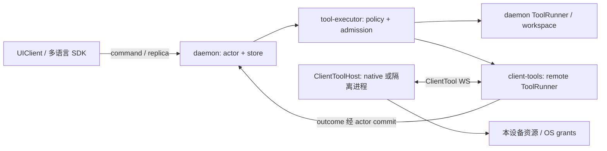

# 客户端工具宿主与多语言 SDK

状态：2026-10-20 校准的 v2.1 → v3.0 目标契约，尚无本契约的远端 ToolRunner、工具宿主或 major 3 SDK 实现。
当前已有 Rust client/TUI、桌面 TS、Android Kotlin 与 Harmony ArkTS 的 v2 消费路径；它们是迁移输入，不等于目标 SDK 已交付。
交付与兼容退出遵循 [rollout](rollout.md)；现有桌面/账号/GenUI 能力以 [preservation](preservation.md) 为准，不能因暂不实现远端工具而回退。
本契约将原先 daemon-only 扩为受控的多执行宿主；会话、loop、事实提交仍有唯一服务器所有者。
遵循 [protocol](protocol.md) 的持久化和恢复规则、[composition](composition.md) 的代际准入。

## 1. 三种角色

UIClient 负责展示、commands、SessionReplica 和本地偏好。
ClientToolHost 负责本设备的工具注册、系统权限、执行、取消、回执和生命周期。
daemon 负责模型、薄 loop、配置、会话 facts、服务端授权、路由、准入和结果收口。
同一 app 可以同时实现前两种角色；WebView/页面组件不能因此获得任意 native 执行权。
工具宿主可以是桌面 companion 进程、原生 app 的平台模块或用户明确安装的服务。



按资源位置、权限边界和无人值守寿命决定执行位置，不按“核心/非核心”机械分配。

| 能力 | 默认位置 | 理由 |
|---|---|---|
| 会话、模型、compact、子代理、审批结论、配置版本 | daemon | 离线继续运行；一个事实权威 |
| daemon workspace 的文件/Git/build/test/sandbox | daemon | 与真实文件版本、路径、进程和 journal 同主机 |
| 剪贴板、屏幕选择、摄像头、用户分享文件、原生应用集成 | ClientToolHost | 资源和系统授权在用户设备 |
| 无 IO 的解析/转换 | 明确选择的宿主 | 可复用算法；执行身份仍须固定 |
| 本机仓库操作、长期桌面任务 | 持久桌面宿主或本机 daemon | 必须声明实际 workspace；UI 关闭不应带走作业 |
| 移动端设备能力 | 原生工具宿主，默认 foreground_only | 不承诺系统挂起后仍可执行 |

模型只看到当前 session 获准的能力集和清楚的设备/资源描述；日常操作无需用户选择协议。
跨设备首次绑定或扩大资源授权时展示实际设备。不能把手机提交消息隐式解释为可读所有设备。

## 2. 身份、能力与路由

daemon 配对产生 device_id，认证身份映射到 tool_host_id；不能信任客户端自行声称的设备身份。
每个连接产生 connection_incarnation；每个工具 binding 使用持久 binding_generation。
capability_id 是服务端确定的稳定 ID，包含宿主与组件身份；同名工具不能覆盖另一设备。
catalog_revision、schema_digest、package_digest 和 binding_generation 沿用不可变快照规则。
catalog 在 turn 开始前固定 route；派发时重新检查在线状态、权限和对应代际。
旧 snapshot 不得按名字改派另一台设备、重连后的新实例或 daemon 同名实现。

`qaqh.capability/2` 增加 execution_target，与 execution_host_id 同时使用：

```typescript
type ExecutionTarget =
  | { kind: "daemon" }
  | { kind: "client"; device_id: string; tool_host_id: string;
      connection_incarnation: string;
      lifetime: "foreground_only" | "persistent_host";
      runtime_kind: "native" | "isolated_process" }
  | { kind: "none" }; // skill 内容，无执行路由
```

这些声明不是权限证明；persistent_host 也不是“网络断开永不失败”的承诺。
native 工具来源标为 client_native；客户端 MCP 保留 mcp 来源并标 client execution_target。
native builtin 可以没有市场 package，但必须有组件、binding 和 generation；市场内容仍固定 package digest。
上报 input/output JSON Schema 需 meta-schema 验证、尺寸/深度限制，拒绝外部 `$ref` 网络解析。
schema_digest 基于规范化描述；宿主不能原地换 schema 或借参数请求超出本地授予的资源。
可用性变化更新目录，不修改已提交 turn snapshot。UI 可展示离线缓存；模型新 turn 默认隐藏离线工具。

## 3. ClientTool 控制通道

`GET /api/v3/tool-hosts/connect` 升级 WSS，subprotocol `qaqh.client-tools.1`。
宿主主动连接 daemon，不要求手机/桌面暴露入站端口。
凭据交换为一次性、绑定 tool_host 的 connect ticket；凭据不放 URL 日志、工具参数或子进程 env。
独立于会话 committed/live、诊断 SSE、PTY WS；控制通道不承载 sudo 输入。
心跳只提供可用性信号；缺心跳不删除身份、不吊销 session、不伪造作业已停止。

所有 frame 有 protocol、type、message_id、connection_incarnation；JSON 帧最多 256 KiB。
超限正文走 session/执行身份限定的 content upload，server 完成校验和 blob commit 后才引用 ContentRef。
所有计数按 Ringing 使用 canonical u64 十进制字符串；frame 顺序不是业务提交 seq。
pending offer、并发 calls、progress、未 ACK receipts 均有有界配额；容量不足返回 HostBusy。
协议字段闭集，版本在握手协商；未知影响执行的类型/字段拒绝，不能忽略后继续副作用。

| 帧 | 方向 | 语义 |
|---|---|---|
| Register / Registered | host → daemon / 回应 | 验证宿主、能力描述，返回 binding/catalog；注册不授权调用 |
| HostState / Drain / Drained | 双向 | foreground/suspended、封闭新准入、等待已有作业；Drained 必须有停止证据 |
| OfferCall / Prepared / OfferRejected | daemon → host / 回应 | 固定调用，客户端持久 prepared 回执；此时禁止执行；拒绝明确 not_started |
| StartCall / Started / StartRejected | daemon → host / 回应 | 服务端已提交派发授权；宿主持久 started 后才允许副作用；过期/授权变化可拒绝 |
| Progress | host → daemon | 有界可丢过程数据；不代表完成、不推进 session seq |
| Result / ResultCommitted | host → daemon / 回应 | 结果校验、blob/fact 提交之后才确认；丢 ACK 仅重传回执 |
| CancelCall / CancelReceived | daemon → host / 回应 | 收到取消请求；不能解释为进程已停止 |
| QueryCall / CallStatus | 双向 | 重连查询本地回执，对账确切 execution，不重跑 |

OfferCall 的必须字段为：execution_id、attempt_id、session_id、turn_id、tool_call_id、
capability_id、catalog_revision、binding_generation、schema_digest、package_digest（builtin 可 null）、
target（确切 device/tool_host/incarnation）、input、input_digest、resource_grant_refs、
recovery_class、deadline、max_runtime_ms、policy_revision。执行 key 为 `(execution_id, attempt_id)`。
StartCall 额外含一次性 start_nonce 和签名的短时 start permit，绑定前述身份、摘要、当前连接及授权。
短时 permit 是一次调用的执行授权；不是定期续租的 UI/session 租约。
deadline 为 UTC 过期时间，max_runtime_ms 为 canonical u64 毫秒；都有服务器硬上限，宿主只可缩短。
host 使用配对时固定的 daemon 验证身份检查 permit；时钟不能验证过期时拒绝，不能默认允许。
启动后以单调时钟限制执行寿命，不能靠调整墙上时钟延长作业。
宿主断连后不能首次启动 prepared call；重连废止旧连接未消费 permit，需对账并重新授权。
已经 started 的调用按事先授予的 deadline/断连策略执行，不能通过重连生成第二次启动。

每个响应带 execution_id、attempt_id、input_digest 和确切 host/generation；服务端检查与原派发匹配。
Result 的结果是闭合 union：Succeeded（结构化结果/ContentRef）、Failed（typed code/detail）、
Cancelled（停止证据）、Indeterminate（缺失证据原因）；另带 effect_state = not_started/started/unknown。
只有未发过 Start 或经可信对账证明未启动时，服务端才能确认 not_started。
OfferRejected/StartRejected 属于结果收口输入，不让客户端直接建立 ToolFinished。
本机权限、排队、系统能力等失败以 code 区分；UI 不匹配错误字符串来决定是否重试。

这是 QAQH 的路由/执行控制协议，不能称作标准 MCP transport。
MCP 工具作者继续编写标准 MCP server；宿主作为 MCP host/client，在本地运行或连接 server，
桥接后的调用仍经过本协议和本地权限。LSP/ACP 也保留各自的文档/终端/角色语义。
native 工具可直接实现 SDK 的 ToolHost port，无需为一个相机回调再启动 MCP 进程。

## 4. 提交、去重与故障

1. agent 持久 ToolIntent，executor 做服务端准入并固定 route，再 OfferCall。
2. host 校验本地授权，持久 Prepared（摘要、目标、资源），再回应；不产生副作用。
3. daemon 持久 DispatchAuthorized 后发送 StartCall；恢复只能查询，不能盲目重新派发。
4. host 在副作用前持久 Started，原子消费 start_nonce。重复相同 key/摘要返回已有状态；
   相同 key 不同摘要拒绝。crash 留下 Started 不能证明没执行，禁止自动再次运行。
5. host 持久完整 outcome 或 session-bound upload receipt，再 Result。
6. daemon 校验来源、目标、schema、大小和内容引用，经 actor 提交 ToolFinished/模型结果后 ResultCommitted。
   前端从 committed feed 消费；工具宿主不能直接向会话写消息或替 loop 决定下一步。

客户端 execution journal 只拥有本机作业证据，不是第二份 session log。
未确认结果有保留策略；删除 receipt 前必须取得 ResultCommitted 或明确的管理处置。
日志不可写、空间满或无法保证 receipt 持久化时，host 在开始前拒绝调用；不能降级成纯内存执行。
服务器按执行 key 幂等提交；异常不能产生两个 ToolFinished 或两份模型工具结果。
client_reported 与 server_verified provenance 区分；schema 校验不能证明远端真实完成了副作用。

| 情况 | 结论与行为 |
|---|---|
| 派发前指定宿主未连接 | ClientToolNotConnected，not_started；默认不排队、不换设备 |
| 本地系统权限拒绝、挂起、容量满且未启动 | ClientPermissionDenied / ClientHostSuspended / HostBusy，明确 not_started |
| 已 Prepared，服务器可证明从未授权 Start | not_started，可通过新的显式调用再试 |
| Start 可能已送达、缺 Started 或 Result | Reconciling，之后有证据才结算；不是“未连接所以没执行” |
| 已 Started 后断网/崩溃 | 按 recovery_class 查询；无法确定则 Indeterminate，写操作不自动重试 |
| ResultCommitted ACK 丢失 | host 重传同一 receipt；server 返回原结论，不再次执行 |
| 收到 CancelReceived 但无法确认停止 | CancelPending / Indeterminate，保留 supervisor/残留证据 |

默认不为设备离线创建长期待执行队列；将来支持须有显式排队授权、过期、撤销、唤醒和启动前再确认。
断线后允许完成的工具须预先声明并取得本地授权；敏感交互工具默认断线取消。
远端取消/吊销无法保证离线设备立即停机；daemon 立即封闭新准入，host 恢复连接先处理撤销。
deadline 限制开始与最大执行寿命；可取消作业 kill+wait，不能中断的 OS 操作诚实报告不确定。
回执无法在结算期限内获得证据时，actor 提交 Indeterminate，并停止依赖该副作用的自动动作。
迟到证据新增 ReconciliationEvidence，显式 resolution 命令决定后续；不回写历史成功或重复 ToolFinished。
只声明 PureReplay 仍不够自动重试：除非旧 execution 已证明结束，否则新 attempt 可能重复并发。

## 5. 本设备安全

执行许可 = daemon 的 session/subject/resource grant ∩ host 本地用户许可 ∩ OS 权限。
daemon 管理对话授权，不能替客户端授予相机、屏幕、文件选择、管理员权限。
ClientResourceRef 包含 tool_host_id、resource_id、version/precondition 和 grant_ref；
它是本机 broker 的不透明句柄，不是可供 daemon 随意解析的绝对路径或 URI。
不同设备的 workspace/root/document 明确区分；edit 必须验证对应资源版本，不能混用远端路径。
屏幕/剪贴板等读取与发送给远端模型的授权分别明确；不把整个会话、provider key 给工具宿主。
参数、回执、进度均是不可信输入；正文仍按工具结果来源呈现，不能提升为 system 指令。

第三方进程不持有 host 的控制 token；native broker 分发受限资源句柄/调用接口。
WebView XSS 不能获得所有本地工具；UI 与 native broker 的每次 IPC 校验身份、工具、资源和 call。
客户端工具包的实际下载、校验、安装与 artifact journal 归该 host。
extensions registry 记录 desired binding、digest 和 host 报告的 installation 状态；
服务端安装 operation 的成功不能冒充客户端已安装成功，不承诺跨设备原子安装。
客户端安装请求同样经过本机确认；未配置强制隔离的平台拒绝执行要求隔离的不可信脚本。

## 6. Cowork、Bun 与终端

桌面 Cowork 定义为 UI 与持久 daemon/ClientToolHost 分离：TUI、WinUI、Tauri 可以连接同一 daemon。
切换 UI 只改变观察/交互端；已启动作业继续属于原宿主，不在 UI 之间迁移内存、进程或 pending call。
工具宿主进程重启后只能对账原 execution；接管 UI 与迁移 execution 是不同能力。
如果桌面 app 本身承载 host，关闭 app 会使它离线；界面必须清楚标明，不能承诺后台继续。
手机作为控制端可以批准使用已绑定的桌面 host，但不能靠 push/心跳保证手机执行后台任务。

Bun 是可选桌面/daemon TypeScript 工具运行时，不是协议、沙箱或所有客户端的必装依赖。
固定 runtime/package/依赖 digest；安装时完成解析/静态检查，运行入口和调用数据均做运行时校验。
禁用运行时自动安装，生产依赖锁定并预装；子进程使用独立工作目录、最小 env、限时/限量和 OS 隔离。
JS worker、TypeScript 类型、代理 fs API 都不能取代 OS 强制；宽权限进程可以绕过代理直接 IO。
未经有效隔离的第三方工具不按“受限工具”宣传。可信原生插件也要明确权限与来源。
手机首期使用原生适配器；不能从桌面可执行目标推断 Android/iOS/Harmony 可嵌入 Bun。

现有 Ringing terminal 协议首期仍由 daemon PTY/ConPTY 所有。
客户端普通工具不隐式获得 exec/sudo/PTY；遇到交互终端需求返回 RequiresInteractiveTerminal。
client-owned PTY 将来必须有独立 host/resource namespace、supervisor、输入 fence、privacy、对账和真实平台验收。
不能把 daemon terminal_id 转成客户端 shell 路径，或在断线后自动重跑提权调用。

## 7. SDK 与 crate 边界

qaqh-sdk 是 SDK 产品族和 Rust crate 名，不要求非 Rust UI 经 FFI 才能接入。
schema/语义/测试向量是契约；Rust serde 不能成为跨端协议唯一规范。
生成 DTO/校验绑定，手写少量有状态消费核心，让各端运行相同向量；生成代码不包含业务执行逻辑。
配置管理与会话 effective view 也必须跨端一致：各 composer 绑定 session 的 revision/model/额度/分母，
不能继续用模块级 config.load/save 表示当前标签页配置；命名 CRUD、pending/applied 与冲突见 [configuration](configuration.md)。
SDK 发布附 protocol major、schema digest、能力表和兼容测试版本。
ClientTool 帧的完整 JSON Schema、OpenAPI 以及生成器尚待实现；capability/2 目前只有本文描述，
其原配套机器 schema 未随本仓入库；不能当已运行的 schema 校验或整套 SDK 生成链。
新增及迁移客户端必须跑同一协议消费/恢复向量，不能只生成 DTO 就算适配完成。

现有 Rust 账号出口、Kotlin/ArkTS 连接/配对/审批与桌面 reducer 都应通过受限 adapter 渐进迁移。
不要求原生端先转 Rust FFI；Harmony 的 NAPI smoke 仅是实验，不代替当前 ArkTS client。
共享向量须覆盖完整批次、部分 usage、compact replace/原因、重复/断线和权限；向量尚待 major 3 切片提供。
客户端 API 可聚合纯公共契约，但不能借 re-export 旧 types/session 实现永久保留反向依赖。

| 目标 | 模块/端口 | 禁止责任 |
|---|---|---|
| qaqh-sdk，替代旧 qaqh-client | endpoint, auth, commands, queries, SessionReplica, live, content, diagnostics, terminal, tool_host, lifecycle | daemon spawn、安装器、loop、具体 session-store |
| @qaqh/sdk | 同一公开语义；Transport/Storage/Clock 平台端口；浏览器与 Node/Bun 适配 | 强依赖 Bun/Tauri；业务类型中的 native 路径 |
| Kotlin / C# / ArkTS SDK | 类型、验证、transport、replica、错误与取消；按实际原生端交付 | 每端自创 seq、重连、回执语义 |
| qaqh-client-tools，新 daemon adapter | registry, dispatch, receipts, reconcile, cancellation；实现 ToolRunner | 新 loop、会话 writer、客户端安装器 |
| qaqh-tool-host，可选 Rust 宿主实现 | native registry, permission broker, execution journal, jobs, shutdown | 控制会话、provider credentials、UI toolkit |
| qaqh-client-local | 本地发现和进程启动；按需装配 sdk/tool-host | 被所有远端/移动 SDK 强制依赖 |

qaqh-protocol 定义 wire 的 client_tools DTO；qaqh-tool-api 定义 ExecutionTarget/ToolRunner 与结果语义。
daemon 向 executor/catalog 注入 remote runner；api 只映射 WS 和 application ports。
agent 不依赖 client-tools/tool-host/SDK/WS；仍只收到 effect/outcome。
扩展安装的实际 artifact owner 按 execution host 区分，registry 的 scope/generation 所有权不变。
当前目标增加两包、将 client 改名 sdk，共 46 包；允许边以 dependencies.json 为准。并行 import 等独立业务按所有权更新图，包数不是上限。

首期交付顺序是共享 schema/SDK 消费核心 → 一个真实 native client tool → 断线/取消/回执故障验收
→ 第二种语言真实客户端复用契约 → 客户端扩展安装及受限 Bun runner。
第一个工具选用户显式分享文件等有清楚授权与输入边界的能力，避免以任意 shell 验证架构。
本契约首期承诺明确宿主路由、离线失败、执行去重/对账和 native callbacks；
不把无缝执行迁移、客户端提权终端或全市场脚本跨平台运行列为已经完成的能力。

## 8. 必须经过真实接缝的验收

两个同名设备工具不串路由；旧 catalog 不派新代；配对撤销不能继续注册/启动；
Prepared/Start/副作用/Result/ACK 各边界 kill 或断网，不能重复写，不能伪造 not_started；
结果 blob 未提交不发布 fact；重复 receipt 不增加模型结果；取消请求不冒充停止；
手机挂起不续假在线；UI 切换不接走执行；host token 不进入插件/renderer；
客户端资源版本冲突与 OS 权限拒绝保持 typed outcome；超限结果/progress/backpressure 有界；
Rust/TS/实际原生 SDK 以相同输入产生同一 applied cursor、工具状态和错误分类。
schema 离线检查只验证形状与身份规则，不代替这些 IO、安全、恢复与原生平台验收。

依据（核查于 2026-10-10）：
[MCP 架构](https://modelcontextprotocol.io/docs/2026-07-28/learn/architecture) 的 host/client/server 角色；
[Bun runtime](https://bun.com/docs/runtime) 的 TypeScript 执行与显式检查；
[Bun auto-install](https://bun.com/docs/runtime/auto-install) 的自动依赖获取；
[Bun executables](https://bun.com/docs/bundler/executables) 的公布目标平台。
