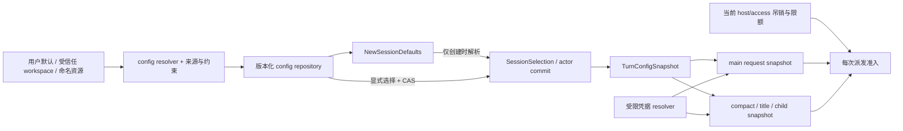

# 多配置、会话选择与配置契约

校准：2026-10-20。当前源码基线为后端 `37167d74b96fdef0700f5ca886475fb59e76d238`，客户端提交见 [preservation](preservation.md)。
本文补全 config/config-api 的重构边界；是源码审查与目标设计，不表示 Rust 重构、网络复现或跨端验收已经完成。
沿用 [rollout](rollout.md) 的功能切片、[providers](providers.md) 的凭据隔离和 [agent](agent.md) 的提交屏障。

## 1. 结论：已有多 profile，运行与管理仍以全局单份配置为中心

当前不能称为“完全单配置”：磁盘有 profiles map、命名 secret 槽、会话 meta.profile，
`session.set_profile` 会定向重载，spawn/resume 也共用会话配置解析。这些能力必须保留。
但它还不是完整的多配置资源模型：所有 profile 先被摊成一份 Config，配置写入主要作用于全局活跃项，
会话只记名字或持续跟随全局；API 不提供目标资源 revision、实际生效版本和完整的会话有效配置。

“配置”“默认选择”“会话已选择的配置”“某次请求的配置”必须分开。多个有效 Config 实例本身是正常的，
问题是从哪个资源、哪个版本、哪个主体解析，以及后续变化能否越过已有执行边界。

## 2. 当前链路与源码证据

| 链路 | 当前行为/证据 | 迁移要求 |
|---|---|---|
| 磁盘 → 运行态 | [Config](../../../crates/qaqh-config/src/config.rs) 同时含 profiles/active_profile、扁平模型字段、明文运行密钥、权限、UI、MCP/LSP、subagent | 分资源存储与解析，不把整个仓库配置对象交给 agent/工具 |
| 写入 | Config::update 在进程锁内 load→mutate→save→publish；save_with 用扁平字段重建 profiles[active]，同时写 Main/Subagent secret | 保留一个明确 writer；命名资源 CAS，保存某 profile 不切默认、不重建无关 profile |
| 配置 API | [ConfigDto/ConfigPatch](../../../crates/qaqh-config-api/src/lib.rs) 是活跃项扁平读写；profiles 只有名称；没有 profile_id/expected_revision | 分管理、默认、会话有效视图；读改指定资源，不能靠先 apply 再 save 间接编辑 |
| 全局动作 | [service](../../../crates/qaqh-runtime/src/service.rs) 的 config.save/profile.apply/save_current/delete 写后广播所有 worker reload | 默认更新与资源更新分别发布；只通知需要重新解析的消费者，不替换已固定请求 |
| 会话选择 | service 的 session.set_profile 写 meta 后发定向 reload；[manager](../../../crates/qaqh-session/src/manager.rs) 只持久名字，无 revision，persist_profile 不返回写盘结果 | actor 接纳带 CAS 的选择命令；持久成功再确认，公开 pending/applied 与生效边界 |
| spawn/resume | [session_effective_config](../../../crates/qaqh-runtime/src/agent/engine_session.rs) 读 global，再按 meta 名称调用 for_session；无配置时 spawn 可 default | 按持久的确切 profile revision 恢复；缺失返回 NeedsConfiguration，读取不自动换端点 |
| profile 解析 | Config::for_session 未指定时跟随 active；指定名字被删时回退 active；无 own key 时继承 Main | 已绑定会话不静默跟随新默认；缺凭据/资源明确不可执行，不借其他 endpoint 的 key |
| 热更新 | SessionEngine::apply_config 手工复制热字段；[loop](../../../crates/qaqh-runtime/src/agent/loop_injection.rs) 会把非注入命令延后处理 | 保留当前延后处理的性质；用完整快照与显式应用边界替代逐字段复制，不据此断言当前流中请求必然被改写 |
| main/compact/title | [provider_for](../../../crates/qaqh-runtime/src/agent/turn_lap/gate.rs) 从 agent.config 构造；[compact](../../../crates/qaqh-runtime/src/agent/plugins/engine_compact.rs)、[title](../../../crates/qaqh-runtime/src/agent/engine_title.rs) 已复用此构造器 | 保留统一构造入口；每个用途绑定来源快照和预算，不能为后台请求重读全局 |
| 模型网站账号 | gate 的 ChatGPT access_token(None)/account_headers(None)、DeepSeek manager.token() 使用账号 manager 当前状态 | 配置明确绑定 account identity；token refresh 可更新代际，账号切换不能悄悄改变既有绑定 |
| 子代理 | [工具入口](../../../crates/qaqh-subagent/src/lib.rs) 重读 Config::load；[SubagentSpawnSpec/apply_subagent_config](../../../crates/qaqh-runtime/src/agent/spawn.rs) 仅携部分模型/URL/预算和父权限 | 完整继承父请求的配置绑定，或显式选择独立 profile revision；不拼接父 endpoint、全局 key 与不同 wire |
| 工具、MCP/LSP/tokenizer | [official_web](../../../crates/qaqh-runtime/src/agent/official_web.rs) 按 cfg 开关与全局账号取后端；[watch](../../../crates/qaqh-config/src/watch.rs) 发布整份 Config；tokenizer 仍有进程级初始化 | 工具只拿执行政策/限权端口，服务资源按 scope/generation 管理；不同模型的 TokenCounter 可并存 |
| 客户端 | desktop 的 composer/model-config.ts 是模块级全局 config.load/save；session/store.ts 另读 meta.profile，非 active profile 的 model 不公开，contextLength 仍来自全局 | 每个 composer 从 session 的 effective view 显示模型/额度/分母；全局设置页单独管理资源与新会话默认 |

TUI、Kotlin/ArkTS 的 config.load/save/profile.apply 也仍消费现行扁平契约。
桌面已有会话 profile 选择，不能删掉后以“新增多配置”名义回退；跨端变更按实际支持组合验收。

### 2.1 已确认的字段缺口与尚待复现的影响

- Config::load_from_paths_with 从 active profile 复制 credential，但 Config::apply_profile 没有复制 credential；
  SessionEngine::apply_config 也没有同步它。静态代码可确认字段遗漏；跨凭据类型切换可能保留旧路由，
  profile.apply 随后的 save_with 还会用旧扁平 credential 重建新活跃项。需要分别覆盖解析、保存和 reload 的真实接缝。
- session_effective_config 仅在 meta.profile 为 Some 时解析命名 profile key。None 跟随全局的路径不会解析活跃项的独立 key；
  apply_profile 又有意不改 Main key。由此不能把“存在命名 secret 槽”当成所有选择路径都正确使用了它。
- profile.save_current 在 Config::update 外先读取当前 key、再写目标 secret，随后 update 再加载配置。
  存在并发选择/密钥更新窗口；先落 secret 的顺序不能独自证明 endpoint、profile 和 key 来自同一快照。
- 同一字段的旧 UI 草稿没有 expected_revision；进程内串行写能防止部分丢更新，但不能识别用户基于过期版本的覆盖。
  ConfigPatch 的 Option 字段也不等于完整 RFC 7386：null 和缺失会收敛为 None，某些空串/掩码表示保持，清除操作另有语义。

以上不是远端调用/数据泄漏的已复现结论；本轮未调用账号或修改生产配置。新实现以本节反例定义验收，
不保留遗漏字段、主密钥继承和读取时回退这些机制作为产品承诺。

## 3. 外部实现研究：固定提交，不以品牌替代证据

只读取公开源码与文档，未执行第三方仓库脚本、测试、插件或安装依赖；其提示词/AGENTS 均不是本任务指令。
公开源码行为不代表闭源客户端或商业服务的全部内部设计。

| 参考 | 本次固定源码 | 核对入口 |
|---|---|---|
| Zcode | `0a1fc56d279fd1001f78387bd81aec1c26767411`，2026-10-19 | provider/config-service、model-selection-config、effective-model-selection、provider-node repository、CLI turn-model/runtime-model |
| Codex | `8dd6099e265f14b80cb1b3fcf10c29a12bb6b23d`，2026-10-19 | codex-config loader/state、app-server config manager、core session/config_refresh、turn_context/runtime_refresh |

### 3.1 Zcode：配置目录、默认推荐、会话意图和执行句柄分开

[ProviderConfigService](https://github.com/zai-org/ZCode/blob/0a1fc56d279fd1001f78387bd81aec1c26767411/packages/provider/src/config-service.ts)
组合 built-in/personal 两个版本化来源，按 provider/model 身份管理 overlay，创建、更新和删除是明确操作。
不能借迟到 save 复活已删除的 provider；这是 QAQH 命名配置 CRUD 与来源归属可借鉴的部分。

[默认选择解析](https://github.com/zai-org/ZCode/blob/0a1fc56d279fd1001f78387bd81aec1c26767411/packages/provider/src/model-selection-config.ts)
把新草稿推荐与历史选择恢复分开；[effective selection](https://github.com/zai-org/ZCode/blob/0a1fc56d279fd1001f78387bd81aec1c26767411/packages/provider/src/effective-model-selection.ts)
保留用户意图并返回 selectionIssue。已有会话缺模型/档位时，不拿新草稿的默认推荐冒充原选择。
该源码对 account-plan 有显式“当前账号”重映射政策，不能据此宣称它对所有账号都永久 pin；QAQH 选用下文的明确账号绑定。

[Personal repository](https://github.com/zai-org/ZCode/blob/0a1fc56d279fd1001f78387bd81aec1c26767411/packages/provider-node/src/personal-provider-config-repository.ts)
拥有文件锁、校验、私有原子写和内容 revision；默认选择仍由同一 repository 保存。
它的读取恢复/空 overlay 降级不是 QAQH 的照搬目标：QAQH 必须显示配置错误并阻止受影响执行。

[turn-model](https://github.com/zai-org/ZCode/blob/0a1fc56d279fd1001f78387bd81aec1c26767411/apps/zcode-cli/packages/core/src/runtime/methods/turn-model.ts)
区分串行接纳的 session selection 与某次执行创建的 Model，排队输入执行自己的选择快照。
[runtime-model](https://github.com/zai-org/ZCode/blob/0a1fc56d279fd1001f78387bd81aec1c26767411/apps/zcode-cli/packages/core/src/runtime/methods/runtime-model.ts)
在句柄工厂绑定请求准入/重试策略；缺选择允许恢复历史，但执行入口拒绝。适合复用到 QAQH 的 main/compact/title/subagent。
其 execution-only 加速卡、账号重映射和运行中换模型属于特定产品策略，不移植进 QAQH 核心。

### 3.2 Codex：配置层、来源、并发版本与执行快照

[官方配置说明](https://developers.openai.com/codex/config-basic/)当前区分用户、受信任项目、profile 文件和会话/CLI 覆盖，
并把强制 requirements 与默认值分开。当前 profile 文件是 `<name>.config.toml`；不能以旧 `[profiles.*]` 示例代替当前契约。

[loader](https://github.com/openai/codex/blob/8dd6099e265f14b80cb1b3fcf10c29a12bb6b23d/codex-rs/config/src/loader/README.md)
和 [ConfigLayerStack](https://github.com/openai/codex/blob/8dd6099e265f14b80cb1b3fcf10c29a12bb6b23d/codex-rs/config/src/state.rs)
保留层版本、逐键来源与禁用原因，再求 effective 值。QAQH 应能回答“会话为何用此模型、哪些值被覆盖、何时生效”，
而不是只给设置页一份无法解释来源的扁平 ConfigDto。

[ConfigManager 写入口](https://github.com/openai/codex/blob/8dd6099e265f14b80cb1b3fcf10c29a12bb6b23d/codex-rs/app-server/src/config_manager_service.rs)
区分可写层、managed 字段和 expected_version 冲突；其通用 key-path 编辑用于自己的产品，不作为 QAQH 任意配置写权限的理由。
QAQH 采用封闭资源命令与具名 Patch，不对客户端开放任意文件路径/key-path 写入。

[config_refresh](https://github.com/openai/codex/blob/8dd6099e265f14b80cb1b3fcf10c29a12bb6b23d/codex-rs/core/src/session/config_refresh.rs)
发布前检查捕获的 owner 仍是当前版本，拒绝 stale；refresh 按范围保留 session-static 设置。
[TurnContext](https://github.com/openai/codex/blob/8dd6099e265f14b80cb1b3fcf10c29a12bb6b23d/codex-rs/core/src/session/turn_context.rs)
有 turn config，同时把可变化的后续 step settings 交给 StepContext 快照；不是“一份 Config 永远冻结所有东西”。
QAQH 首期选择更简单的“模型选择下一 turn 生效、在飞 request 不变”，不引入多环境/step 热切换。

## 4. QAQH 的资源与所有权

沿用四个主模型 ClientPreferences / HostConfig / ProfileVersion / SessionSelection，补齐它们引用的模型与凭据资源；
不新建万能 config context，也不为这次设计增加 crate。

| 资源 | 持久所有者 | 语义 |
|---|---|---|
| ClientPreferences | 每端 | theme/lang/font/notification/草稿；不从 daemon 推导每端偏好 |
| HostConfigVersion | config repository | 数据根、服务/资源限制、执行政策、daemon 生命周期；安全约束不是低优先级默认值 |
| ModelBindingVersion | config repository，provider-api 定义能力端口 | endpoint/wire/compat、model、能力/预算与 CredentialBindingRef 的完整组合；不暴露 secret |
| ProfileVersion | config repository | 可命名、不可变的用户配置版本；引用 main binding，声明 compact/title/subagent 用途规则；显示名不作身份 |
| NewSessionDefaults | config repository | 新会话推荐的 profile revision；修改它不更新已绑定 session |
| SessionSelection | session facts，actor 提交 | selection_revision、确切 profile revision、允许的覆盖和生效边界；不是可移动 active_profile 名 |
| CredentialBinding/secret versions | config 受限存储；账号协议归 providers | API key 版本或确切 account identity/origin 的受限引用；刷新 token 不换账号主体 |
| TurnConfigSnapshot/RequestConfigSnapshot | actor/请求 owner；会话记录可重放的非秘密引用 | 固定配置、输入政策、能力来源、用途与预算；运行明文由专用 resolver 限时获取 |
| WorkspaceConfigLayer | config resolver 的受信任输入 | 只覆盖允许字段，携 source/trust/revision；不自带执行授权、账号切换或任意 secret 引用 |

模型绑定的完整性必须在所有入口成立，不靠 apply_profile/reload/child 复制字段。
API key 没有绑定就 NeedsCredential；不得以“无独立 key”隐式继承另一 endpoint 的 Main。
选择“当前登录账号”只允许新建/显式改选时解析成确切 binding；后续网站账号切换不改已有选择。
access 的设备/会话 grant 与 provider account 仍分离，权限收紧即时复核。

### 4.1 解析与生效规则

1. Host 安全约束与 access grant 独立求交集，不能被 profile、项目或请求层覆盖。
2. 新建时：内置非秘密默认 → 用户默认 → 受信任 workspace 允许字段 → 显式 profile/binding → 会话允许覆盖。
   不做任意 JSON 深合并；各字段族声明 replace/merge/clear，集合顺序确定，路径相对各自来源解析。
3. 固定 profile revision 保存其完整非秘密依赖/来源摘要；恢复按历史选择，不重新执行“新建时找默认”。
   可选 UI 推荐与已绑定执行选择分开；目录暂时不可用不改写原选择。
4. 更新 profile 发布新 revision；改新会话默认只影响后续新建。已有 session 要显式 UpdateSelection + CAS，
   运行中先接纳为 pending，在下一 turn 提交 applied。客户端不能拿磁盘保存成功当会话已生效。
   CAS 对最新已接纳的 selection_revision 判定，包括 pending，不能只比较较旧的 applied revision。
5. 同一 turn 的模型 binding 不变；下一次 TurnStarted 前先应用最新合法 pending 选择，再固定该 turn 的快照。
   HTTP 输入入队 accepted 不等于 turn admission，排队输入不携带入队时读到的全局 Config；首期不提供逐输入隐式改选。
   后台 completion 不倒写较新的选择。请求创建时固定 purpose/attempt/预算；网络重试可 refresh 同主体 token，不能换 endpoint/account/profile。
6. host/access 安全收紧对下一次副作用/请求准入立即生效；放宽不自动扩大已接纳意图。
   MCP/LSP/工具变化按独立 binding generation 与 turn capability pin，不靠广播整份 Config 重装。
7. 删除 profile 隐藏可发现入口并保留被历史引用的版本；删除/吊销 credential 明确阻止未来请求。
   强制停用影响执行时是受控取消/对账操作，不伪装成缺配置后切到默认。

### 4.2 多种模型用途

| 用途 | 默认绑定 | 显式独立配置 | 必须固定的边界 |
|---|---|---|---|
| main | SessionSelection 的 main binding | 改会话选择 | turn admission，覆盖范围受限 |
| compact | 父 turn 的相同 binding | profile 的 compact binding revision | job 开始固定输入/revision/预算；结果按 context_revision 提交 |
| title | 首次输入所属 turn 的 binding | profile 的 title binding revision | 后台任务创建时固定，后续全局保存不改变它 |
| subagent | 父请求的完整 binding 与政策上限 | 显式 child profile revision | spawn intent 固定；继承 wire/compat/credential/account，不只 model/base_url |
| MCP sampling 等辅助请求 | 未实现/未授权则拒绝 | 单独声明用途规则 | 同一 resolver、预算/递归上限、准入与请求身份；不新增绕过路径 |
| 官方 Search/Fetch | 已选择能力的限权 provider binding | 按 providers 的独立工具契约 | 固定 origin/account/路由，执行当前权限复核；不从全局账号另猜 |

用户无需为继承场景复制四份配置；独立选择是可选项。客户端展示请求真实采用的模型和额度来源，
usage、contextLength、effort allowlist 来自对应 snapshot。TokenCounter 句柄可按 provider/model/tokenizer digest 并存，
不再由第一次加载的进程全局 tokenizer 决定所有会话。

## 5. config-api 与 config 的落地契约

### 5.1 config-api：封闭 DTO、值类型和错误

不包含磁盘、环境变量、解密或 provider manager。资源 ID/revision 使用 kernel 的不透明 ID 与规范十进制字符串；
单资源 revision、目录 revision、selection revision、secret/account 代际不是同一个计数器。

| 面 | 目标契约 |
|---|---|
| Host | HostConfigView/Patch + expected_revision；实际采用值/不可改字段/应用时机 |
| 命名配置 | ListProfiles、GetProfileVersion、CreateProfile、PublishProfileVersion、DeleteProfile；ID+revision，不必先激活才能编辑 |
| 默认 | Get/SetNewSessionDefaults，独立 CAS；与选择器打开/选中某行无关 |
| 绑定 | ModelBindingView/Patch、CredentialStateView；明确 source/account/origin 与缺失状态，永不返回 token |
| 会话 | GetSessionSelection/GetEffectiveConfig、UpdateSelection(expected_selection_revision, profile_version_ref, allowed_overrides) |
| effective view | requested/applied/pending、profile/binding revision、model/wire/credential source、context window、能力、字段来源与 blocked reason |
| 错误 | ConfigRevisionConflict、SelectionRevisionConflict、ProfileUnavailable、CredentialUnavailable、InvalidBinding、UnsupportedOverride、PersistenceUnavailable、RestartRequired |

requested/pending 的 revision 与当前 applied revision 可以不同。选择请求持久化的回执必须明确“已保存、待下回合应用”；
只有 applied 投影证明运行采用新选择。生效前被吊销/不可用时显示 blocked，不伪报 applied 或重写既有命令回执。

Patch 明确 Unchanged/Set/Clear；省略为 Unchanged，只有允许字段接受 Clear。secret 使用受限 set/clear 操作，
不把掩码 `****` 写回或作为新 API 的命令值，不把缺失 secret 状态变成空字符串有效配置。
规范 wire 与既有别名只在外部边界归一；内部使用统一值类型，不让客户端再维护另一套解析真相。
effective view 只披露当前主体有权看的来源和账号投影，不暴露本机 secret 路径或其他用户配置。

### 5.2 config：注入 repository、resolver 与有范围通知

- daemon 构造 ConfigRepository/SecretResolver/ConfigResolver 实例，显式数据根和生命周期；线上写入经其单一 writer queue。
  进程内 Mutex 不跨 IO；同数据根由 host ownership 约束唯一服务者，不能把 static LOCK 当跨进程事务。
- 沿用可移植文件存储即可起步，无需为了多配置引入新数据库。不可变版本先落盘，再原子发布 manifest/current 指针；
  profile 的“当前版本”与 NewSessionDefaults 是不同引用。清理只回收未引用版本，保留会话/fork 所需引用。
- secret 新版本先持久化、完整 profile/binding 验证后才发布配置引用；失败保留原激活版本。
  跨文件不是一个 rename 原子事务：未引用 secret/版本可回收，已发布引用必须可解析；不能先覆写旧 secret 槽再假定回退安全。
- CAS 在 owner 的提交队列内针对实际持久 revision 判定，过期编辑返回冲突及最新脱敏视图；patch 互不覆盖不等于不需要 CAS。
  手工文件编辑需校验/导入为新版本，失败保留原文件并展示具名错误；不读失败后静默 default/换账号。
- 通知是 HostConfigChanged/ProfileVersionPublished/DefaultSelectionChanged/CredentialRevoked 等有资源和 revision 的 invalidation。
  watch 可用于有界通知，但不是第二个权威配置槽；慢订阅者重取确切资源，不靠漏一帧就漏一次安全吊销。
- 安装、MCP/LSP scope binding、访问授权与凭据分别由既有所有者管理；config 只持引用，不接管全部服务状态。
  provider 能力/凭据验证经中立限权端口注入；不新增 config-api → provider-api/providers 的反向边，避免与 provider-api → config-api 成环。

### 5.3 现有字段的归属

| 当前字段族 | 目标归属 |
|---|---|
| profiles、active_profile | 命名 ProfileVersion 资源；active 仅迁为新会话默认，不再是运行时全局模型开关 |
| model/base_url/wire/compat/credential、max_tokens/context_length/effort | ModelBindingVersion + 允许的 session overrides；能力与硬上限另校验 |
| Main/Subagent/profile api_key | 明确 CredentialBindingRef，迁移保持原加密与权限；缺失/跨 origin 不继承 |
| auto_compact_threshold 与用途预算 | profile 的 context/compact 政策，可在授权范围内会话覆盖；硬资源限制归 host |
| subagent 模型/URL/key/default_tools/max_depth/timeout | 模型选择归 child binding，编排预算与工具选择归 profile；实际权限是父/host/grant 的交集 |
| permission_level、compliance、exec.default_shell | 执行政策/会话选择与 host 上限分开；scope、执行宿主及收紧时机明确 |
| MCP/LSP enabled/server/cwd/env/header | integration binding/config 引用与受限 credentials；资源生命周期归各 supervisor |
| lang/theme/font/notifications | 每端 Preferences；旧读模型只在有期限 adapter 中保留 |
| session_idle_unload_secs、数据根/监听参数 | HostConfig，注明 hot/next-request/restart；不复制进所有 profile |
| tokenizer_path | 版本化 provider TokenCounter 资源；不可更改事实/消息恢复语义 |

## 6. 施工顺序与旧路径退出

| 切片 | 实际交付 | 旧路径退出条件 |
|---|---|---|
| 配置契约与读取 | 命名资源、完整 resolver、effective view；现有读取可经单向 adapter | 非 active profile 的模型/分母/credential 可解释；不新增 Config 全量 re-export |
| 资源写入与凭据 | 指定 profile/binding CRUD、revision CAS、secret 发布恢复、默认单独更新 | 不再通过 global apply→save 编辑目标；关闭同域旧 writer |
| 会话选择与恢复 | 选择 facts、pending/applied、下一 turn 快照；跨 profile 两会话并行 | meta 名字完成离线迁移；None 在切换时显式绑定默认，无法确定则 NeedsConfiguration |
| 全用途和资源 | main/compact/title/child/官方 web 共享解析端口，tokenizer 多实例，当前吊销检查 | 辅助任务不重读 global；手工热字段复制、全局账号隐式选择退出 |
| 多端与协议 | Rust client、桌面、Kotlin、ArkTS 分开验收 CRUD/默认/会话 UI 和错误 | 旧 config.load/save/profile.* 的 adapter 明确兼容范围，最迟 v3.0 退出 |

同切片完成必要原子不变量；旧 Ringing v2 资源化/破坏性 wire 变化须先按仓库规则补 ADR 和客户端契约。
本轮不修改当前 wire。迁移只把旧类型作为边缘输入，不让正常读取永久兼容猜测。
删除名字、缺 revision 或历史账号来源不明时不猜原配置；保留只读历史，让用户显式重新绑定。

## 7. 必须通过的真实接缝

1. 会话 A/B 分别用不同 wire/model/key/account 并发执行；修改默认/profile C 不改变 A/B 已绑定请求。
2. 从 API key 切 ChatGPT/DeepSeek，以及反向切换，覆盖 load、apply、save、reload、resume；credential 与 wire 不拆开。
3. None 的旧会话、显式 profile、独立 key、缺 key、被删 profile 分别迁移；不发送 Main key 到另一个 endpoint。
4. 两端从同一 revision 编辑同一字段，第二次明确冲突；编辑不同资源互不切默认；删除后迟到 save 不复活。
5. secret 持久失败、profile 版本落盘后崩溃、manifest 发布失败、外部文件编辑冲突；原配置仍可解释，无悬空引用。
6. 切 profile 请求在 active turn 中接纳，公开 pending；旧请求完成后下一 turn 才 applied；重复命令不双提交。
7. compact/title 后台执行期间改默认/账号，任务保持创建时 binding；compact 的旧 context_revision 仍不能提交。
8. child 完整继承父 profile revision 或用显式独立 profile；父权限收紧仍阻止后续执行，子任务不重读 global model。
9. token refresh 只换同主体 token generation；退出/吊销阻止新请求，迟到 refresh 不恢复授权，切账号不漂移旧绑定。
10. 不同 tokenizer/上下文窗口并存；各端 HUD、模型、effort、额度、usage 与对应会话 effective view 一致。
11. 项目配置试图改 secret/account/未授权 endpoint/执行上限，明确拒绝；路径按配置来源解析，不按进程 cwd。
12. 重启/fork 保留配置来源及版本，不继承运行许可；MCP/官方工具的变更不改旧 turn capability pin。
13. 当前 Chat/Responses 请求体恢复反例、账号白名单、schema/参数容错继续有效；结构检查不代替这些行为测试。

本轮验证仅含来源/引用/目标图检查；未执行第三方测试、Rust 产品回归或真实账号请求。
配置格式/schema 和多端消费向量由上述切片随实际实现交付，不以本文中的语义类型宣称已经生成。
